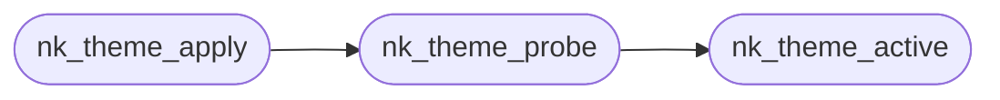

# `progs/nuklear/nuklear_theme.c`

> Source: [progs/nuklear/nuklear_theme.c:1](../../progs/nuklear/nuklear_theme.c#L1) | language `c` | coverage 66.7% | [API index](../index.md)

Docstring: shared Nuklear theme loader, linked by every NK app.

## Contents

- **Structs:** [`nk_theme_slot`](#nk_theme_slot)
- **Functions:** [`nk_theme_active`](#nk_theme_active), [`nk_theme_probe`](#nk_theme_probe), [`nk_theme_apply`](#nk_theme_apply)
- **Macros:** [`X`](#x)

## Call Graph

Solid arrows stay in this module, dashed arrows leave it.



## Structs

<a id="nk_theme_slot"></a>

### `nk_theme_slot`

`struct` | [progs/nuklear/nuklear_theme.c:15](../../progs/nuklear/nuklear_theme.c#L15)

```c
struct nk_theme_slot
```

---

## Functions

<a id="nk_theme_active"></a>

### `nk_theme_active`

`function` | [progs/nuklear/nuklear_theme.c:49](../../progs/nuklear/nuklear_theme.c#L49)

```c
int nk_theme_active(char *dst, int cap)
```

Resolve the active theme name (current file, else the default).

**Parameters**

| Name | Type | Default | Description |
|---|---|---|---|
| `dst` | `char *` |  |  |
| `cap` | `int` |  |  |

**Returns:** `int`

> **Inherited:** Documentation from [`nk_theme_active`](#nk_theme_active) (progs/nuklear/nuklear_theme.h:62).

*Called by:* [`nk_theme_probe`](#nk_theme_probe)

---

<a id="nk_theme_probe"></a>

### `nk_theme_probe`

`function` | [progs/nuklear/nuklear_theme.c:105](../../progs/nuklear/nuklear_theme.c#L105)

```c
int nk_theme_probe(const char *name, unsigned char rgb[NK_THEME_KEY_COUNT][3])
```

Load name (or active when 0) into rgb[32][3]; 0 ok, <0 fallback used.

**Parameters**

| Name | Type | Default | Description |
|---|---|---|---|
| `name` | `char *` |  |  |
| `NK_THEME_KEY_COUNT` | `unsigned char rgb[ ][3]` |  |  |

**Returns:** `int`

> **Inherited:** Documentation from [`nk_theme_probe`](#nk_theme_probe) (progs/nuklear/nuklear_theme.h:65).

*Calls:* [`nk_theme_active`](#nk_theme_active)

*Called by:* [`nk_theme_apply`](#nk_theme_apply)

---

<a id="nk_theme_apply"></a>

### `nk_theme_apply`

`function` | [progs/nuklear/nuklear_theme.c:141](../../progs/nuklear/nuklear_theme.c#L141)

```c
int nk_theme_apply(struct nk_context *ctx, const char *name)
```

Apply name (or active when 0) to ctx; 0 ok, <0 fallback applied.

**Parameters**

| Name | Type | Default | Description |
|---|---|---|---|
| `ctx` | `struct nk_context *` |  |  |
| `name` | `char *` |  |  |

**Returns:** `int`

> **Inherited:** Documentation from [`nk_theme_apply`](#nk_theme_apply) (progs/nuklear/nuklear_theme.h:68).

*Calls:* [`nk_theme_probe`](#nk_theme_probe)

---

## Macros

<a id="x"></a>

### `X`

`macro` | [progs/nuklear/nuklear_theme.c:21](../../progs/nuklear/nuklear_theme.c#L21)

```c
#define X(k, i)
```

---
