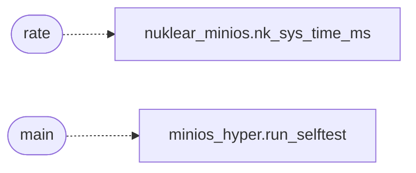

# `progs/piano/piano.c`

> Source: [progs/piano/piano.c:1](../../progs/piano/piano.c#L1) | language `c` | coverage 30.0% | [API index](../index.md)

piano.c — a Nuklear piano that plays FM sound through the SB16 driver.

## Contents

- **Functions:** [`rate`](#rate), [`main`](#main)
- **Macros:** [`UI_MEMORY`](#ui_memory), [`SYS_PCM2_OPEN`](#sys_pcm2_open), [`SYS_PCM2_WRITE`](#sys_pcm2_write), [`SYS_PCM2_CLOSE`](#sys_pcm2_close), [`RATE`](#rate), [`PCM_FRAG`](#pcm_frag), [`PCM_BUF`](#pcm_buf), [`MAX_AUDIO_MS`](#max_audio_ms), [`PIANO_FRAME_MS`](#piano_frame_ms), [`PIANO_FRAME_PERIOD`](#piano_frame_period), [`KEY_W`](#key_w), [`BK_W`](#bk_w), [`KEY_Y`](#key_y), [`PIANO_BASE_MIDI`](#piano_base_midi), [`PIANO_OCTAVES`](#piano_octaves), [`NKEYS`](#nkeys), [`MAX_VOICES`](#max_voices), [`KBD_NO_NOTE`](#kbd_no_note), [`FX_DELAY_CAP`](#fx_delay_cap), [`FX_DELAY_MAX_MS`](#fx_delay_max_ms), [`FX_FEEDBACK`](#fx_feedback), [`FX_WET`](#fx_wet), [`FX_TREM_FREQ`](#fx_trem_freq), [`CTRL_Y`](#ctrl_y), [`BTN_W`](#btn_w), [`BTN_GAP`](#btn_gap), [`NCTRLS`](#nctrls)

## Call Graph

Solid arrows stay in this module, dashed arrows leave it.



## Functions

<a id="rate"></a>

### `rate`

`function` | [progs/piano/piano.c:818](../../progs/piano/piano.c#L818)

```c
* wait below caps the frame rate (bench mode skips it so the * benchmark still measures raw throughput). */ if (bench_ms <= 0)
```

**Parameters**

| Name | Type | Default | Description |
|---|---|---|---|
| `throughput` | `bench mode skips it so the * benchmark still measures raw` |  |  |

**Returns:** `* wait below caps the frame`

*Calls:* [`nk_sys_time_ms`](progs.nuklear.nuklear_minios.h.md#nk_sys_time_ms)

---

<a id="main"></a>

### `main`

`function` | [progs/piano/piano.c:1042](../../progs/piano/piano.c#L1042)

```c
int main(int argc, char **argv)
```

**Parameters**

| Name | Type | Default | Description |
|---|---|---|---|
| `argc` | `int` |  |  |
| `argv` | `char **` |  |  |

**Returns:** `int`

*Calls:* [`run_selftest`](tools.minios_hyper.py.md#run_selftest)

---

## Macros

<a id="ui_memory"></a>

### `UI_MEMORY`

`macro` | [progs/piano/piano.c:54](../../progs/piano/piano.c#L54)

```c
#define UI_MEMORY
```

---

<a id="sys_pcm2_open"></a>

### `SYS_PCM2_OPEN`

`macro` | [progs/piano/piano.c:57](../../progs/piano/piano.c#L57)

```c
#define SYS_PCM2_OPEN
```

---

<a id="sys_pcm2_write"></a>

### `SYS_PCM2_WRITE`

`macro` | [progs/piano/piano.c:58](../../progs/piano/piano.c#L58)

```c
#define SYS_PCM2_WRITE
```

---

<a id="sys_pcm2_close"></a>

### `SYS_PCM2_CLOSE`

`macro` | [progs/piano/piano.c:59](../../progs/piano/piano.c#L59)

```c
#define SYS_PCM2_CLOSE
```

---

<a id="rate"></a>

### `RATE`

`macro` | [progs/piano/piano.c:61](../../progs/piano/piano.c#L61)

```c
#define RATE
```

---

<a id="pcm_frag"></a>

### `PCM_FRAG`

`macro` | [progs/piano/piano.c:62](../../progs/piano/piano.c#L62)

```c
#define PCM_FRAG
```

---

<a id="pcm_buf"></a>

### `PCM_BUF`

`macro` | [progs/piano/piano.c:63](../../progs/piano/piano.c#L63)

```c
#define PCM_BUF
```

---

<a id="max_audio_ms"></a>

### `MAX_AUDIO_MS`

`macro` | [progs/piano/piano.c:76](../../progs/piano/piano.c#L76)

```c
#define MAX_AUDIO_MS
```

Upper bound on audio rendered per frame, in milliseconds.

The kernel-side audio ring absorbs up to ~3 seconds of buffered PCM, so a slow frame can render more without starving the speaker.  The clamp is kept conservative to avoid unbounded per-frame work.

---

<a id="piano_frame_ms"></a>

### `PIANO_FRAME_MS`

`macro` | [progs/piano/piano.c:84](../../progs/piano/piano.c#L84)

```c
#define PIANO_FRAME_MS
```

Per-frame render bite: after a stall the backlog is paced over several frames instead of one giant catch-up render, bounding the worst-case CPU spike while the debt below is preserved, so not a single millisecond of audio is lost.

Must cover a typical frame time (nk rasterize 800x360 + nk_frame composite costs 30-50 ms in QEMU): a 15 ms bite renders at 15/40 = 0.37x wall-clock and sounds slow/low even with a trivial synth, which is why the bite stays just under one DMA buffer (~93 ms).

---

<a id="piano_frame_period"></a>

### `PIANO_FRAME_PERIOD`

`macro` | [progs/piano/piano.c:91](../../progs/piano/piano.c#L91)

```c
#define PIANO_FRAME_PERIOD
```

Frame period: the old yield-only loop spun uncapped (hundreds of fps), rasterizing 800x360 + presenting + rendering OPL3 every iteration and pinning the host CPU.

Other NK apps cap with a pause loop; piano caps at ~60 fps so input stays snappy while rasterize+present+OPL3 run at most 60x/s.  Audio still tracks wall-clock: the pacing delay counts toward the next frame's elapsed, rendered up to PIANO_FRAME_MS.

---

<a id="key_w"></a>

### `KEY_W`

`macro` | [progs/piano/piano.c:190](../../progs/piano/piano.c#L190)

```c
#define KEY_W
```

── Keyboard model: three octaves C4..B6 (21 white + 15 black keys) ── Base is middle C (MIDI 60 = 261 Hz) so the default octave sings; the old C3 base (130 Hz) rumbled even two octaves up.

21 whites at 36 px span 756 px and fit the 800 px Nuklear window.  The table is chromatic (midi 60..95) so midi_to_key is just midi - PIANO_BASE_MIDI.  Lives above the voice code because key_to_chan is indexed (and sized) by key number.

---

<a id="bk_w"></a>

### `BK_W`

`macro` | [progs/piano/piano.c:192](../../progs/piano/piano.c#L192)

```c
#define BK_W
```

---

<a id="key_y"></a>

### `KEY_Y`

`macro` | [progs/piano/piano.c:194](../../progs/piano/piano.c#L194)

```c
#define KEY_Y
```

---

<a id="piano_base_midi"></a>

### `PIANO_BASE_MIDI`

`macro` | [progs/piano/piano.c:195](../../progs/piano/piano.c#L195)

```c
#define PIANO_BASE_MIDI
```

---

<a id="piano_octaves"></a>

### `PIANO_OCTAVES`

`macro` | [progs/piano/piano.c:196](../../progs/piano/piano.c#L196)

```c
#define PIANO_OCTAVES
```

---

<a id="nkeys"></a>

### `NKEYS`

`macro` | [progs/piano/piano.c:209](../../progs/piano/piano.c#L209)

```c
#define NKEYS
```

---

<a id="max_voices"></a>

### `MAX_VOICES`

`macro` | [progs/piano/piano.c:221](../../progs/piano/piano.c#L221)

```c
#define MAX_VOICES
```

── Expressive note state: velocity, sustain, octave ───────────────── Voices (MAX_VOICES, the OPL3 channel count) and keys (NKEYS, the UI key count) are different things: key_to_chan maps every key to its sounding channel, so it is sized by NKEYS.

Sizing it by MAX_VOICES wrote past the end for the top keys and left them mute.

---

<a id="kbd_no_note"></a>

### `KBD_NO_NOTE`

`macro` | [progs/piano/piano.c:297](../../progs/piano/piano.c#L297)

```c
#define KBD_NO_NOTE
```

── PC-keyboard MIDI map (Fruity Loops style) ───────────────────────── PS/2 set-1 scancodes (7-bit code, E0 clear) to semitone offsets from the UI base: A-row whites, Q-row blacks between them, Z-row bass whites, digits aliasing the upper blacks.

Comma/period are octave down/up and are handled in the hook, not here.  Returns -100 for "not a note".

---

<a id="fx_delay_cap"></a>

### `FX_DELAY_CAP`

`macro` | [progs/piano/piano.c:407](../../progs/piano/piano.c#L407)

```c
#define FX_DELAY_CAP
```

---

<a id="fx_delay_max_ms"></a>

### `FX_DELAY_MAX_MS`

`macro` | [progs/piano/piano.c:408](../../progs/piano/piano.c#L408)

```c
#define FX_DELAY_MAX_MS
```

1 s of delay at 22050 Hz

---

<a id="fx_feedback"></a>

### `FX_FEEDBACK`

`macro` | [progs/piano/piano.c:409](../../progs/piano/piano.c#L409)

```c
#define FX_FEEDBACK
```

---

<a id="fx_wet"></a>

### `FX_WET`

`macro` | [progs/piano/piano.c:410](../../progs/piano/piano.c#L410)

```c
#define FX_WET
```

---

<a id="fx_trem_freq"></a>

### `FX_TREM_FREQ`

`macro` | [progs/piano/piano.c:411](../../progs/piano/piano.c#L411)

```c
#define FX_TREM_FREQ
```

---

<a id="ctrl_y"></a>

### `CTRL_Y`

`macro` | [progs/piano/piano.c:545](../../progs/piano/piano.c#L545)

```c
#define CTRL_Y
```

── Control bar (manual widgets, hit-tested like the keys) ───────────

---

<a id="btn_w"></a>

### `BTN_W`

`macro` | [progs/piano/piano.c:547](../../progs/piano/piano.c#L547)

```c
#define BTN_W
```

---

<a id="btn_gap"></a>

### `BTN_GAP`

`macro` | [progs/piano/piano.c:548](../../progs/piano/piano.c#L548)

```c
#define BTN_GAP
```

---

<a id="nctrls"></a>

### `NCTRLS`

`macro` | [progs/piano/piano.c:561](../../progs/piano/piano.c#L561)

```c
#define NCTRLS
```

---
