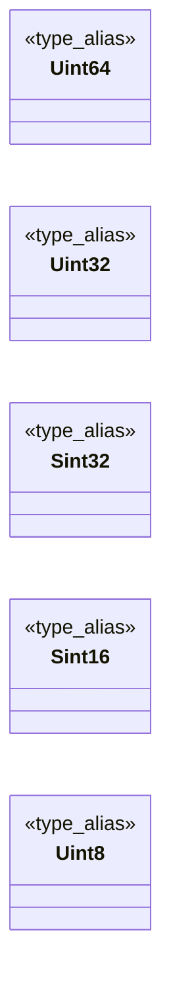

# `progs/pokemon/minios_stubs/SDL.h`

> Source: [progs/pokemon/minios_stubs/SDL.h:1](../../progs/pokemon/minios_stubs/SDL.h#L1) | language `h` | coverage 18.2% | [API index](../index.md)

SDL.h stub for MiniOS cross-compilation

## Contents

- **Type Aliases:** [`Uint64`](#uint64), [`Uint32`](#uint32), [`Sint32`](#sint32), [`Sint16`](#sint16), [`Uint8`](#uint8)
- **Functions:** [`SDL_GetPerformanceCounter`](#sdl_getperformancecounter), [`SDL_GetPerformanceFrequency`](#sdl_getperformancefrequency), [`SDL_GetTicks`](#sdl_getticks), [`SDL_Delay`](#sdl_delay)
- **Macros:** [`SDL_H_STUB_MINIOS`](#sdl_h_stub_minios)

## Type Diagram



## Type Aliases

<a id="uint64"></a>

### `Uint64`

`type_alias` | [progs/pokemon/minios_stubs/SDL.h:5](../../progs/pokemon/minios_stubs/SDL.h#L5)

```c
typedef uint64_t Uint64;
```

/* SDL.h stub for MiniOS cross-compilation ifndef SDL_H_STUB_MINIOS define SDL_H_STUB_MINIOS include <stdint.h>

---

<a id="uint32"></a>

### `Uint32`

`type_alias` | [progs/pokemon/minios_stubs/SDL.h:6](../../progs/pokemon/minios_stubs/SDL.h#L6)

```c
typedef uint32_t Uint32;
```

---

<a id="sint32"></a>

### `Sint32`

`type_alias` | [progs/pokemon/minios_stubs/SDL.h:7](../../progs/pokemon/minios_stubs/SDL.h#L7)

```c
typedef int32_t Sint32;
```

---

<a id="sint16"></a>

### `Sint16`

`type_alias` | [progs/pokemon/minios_stubs/SDL.h:8](../../progs/pokemon/minios_stubs/SDL.h#L8)

```c
typedef int16_t Sint16;
```

---

<a id="uint8"></a>

### `Uint8`

`type_alias` | [progs/pokemon/minios_stubs/SDL.h:9](../../progs/pokemon/minios_stubs/SDL.h#L9)

```c
typedef uint8_t Uint8;
```

---

## Functions

<a id="sdl_getperformancecounter"></a>

### `SDL_GetPerformanceCounter`

`function` `inline` `static` | [progs/pokemon/minios_stubs/SDL.h:11](../../progs/pokemon/minios_stubs/SDL.h#L11)

```c
static inline Uint64 SDL_GetPerformanceCounter(void)
```

**Returns:** `Uint64`

---

<a id="sdl_getperformancefrequency"></a>

### `SDL_GetPerformanceFrequency`

`function` `inline` `static` | [progs/pokemon/minios_stubs/SDL.h:12](../../progs/pokemon/minios_stubs/SDL.h#L12)

```c
static inline Uint64 SDL_GetPerformanceFrequency(void)
```

**Returns:** `Uint64`

---

<a id="sdl_getticks"></a>

### `SDL_GetTicks`

`function` `inline` `static` | [progs/pokemon/minios_stubs/SDL.h:13](../../progs/pokemon/minios_stubs/SDL.h#L13)

```c
static inline Uint32 SDL_GetTicks(void)
```

**Returns:** `Uint32`

*Called by:* [`DG_GetTicksMs`](progs.doomgeneric.doomgeneric_sdl.c.md#dg_getticksms)

---

<a id="sdl_delay"></a>

### `SDL_Delay`

`function` `inline` `static` | [progs/pokemon/minios_stubs/SDL.h:14](../../progs/pokemon/minios_stubs/SDL.h#L14)

```c
static inline void SDL_Delay(Uint32 ms)
```

**Parameters**

| Name | Type | Default | Description |
|---|---|---|---|
| `ms` | `Uint32` |  |  |

*Called by:* [`DG_SleepMs`](progs.doomgeneric.doomgeneric_sdl.c.md#dg_sleepms)

---

## Macros

<a id="sdl_h_stub_minios"></a>

### `SDL_H_STUB_MINIOS`

`macro` | [progs/pokemon/minios_stubs/SDL.h:3](../../progs/pokemon/minios_stubs/SDL.h#L3)

```c
#define SDL_H_STUB_MINIOS
```

---
