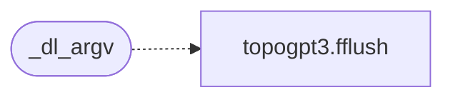

# `progs/pokemon/platform_minios.c`

> Source: [progs/pokemon/platform_minios.c:1](../../progs/pokemon/platform_minios.c#L1) | language `c` | coverage 11.9% | [API index](../index.md)

## Contents

- **Structs:** [`gb_voice_t`](#gb_voice_t)
- **Functions:** [`gain`](#gain), [`gb_platform_set_debug`](#gb_platform_set_debug), [`_dl_argv`](#_dl_argv), [`audio`](#audio), [`menu`](#menu), [`gb_platform_init`](#gb_platform_init), [`gb_platform_register_context`](#gb_platform_register_context), [`gb_platform_shutdown`](#gb_platform_shutdown), [`gb_platform_poll_events`](#gb_platform_poll_events), [`gb_platform_render_frame`](#gb_platform_render_frame), [`frames`](#frames), [`gb_platform_present_framebuffer`](#gb_platform_present_framebuffer), [`gb_platform_render_lcd_off_frame`](#gb_platform_render_lcd_off_frame), [`gb_platform_vsync`](#gb_platform_vsync), [`gb_platform_set_benchmark_mode`](#gb_platform_set_benchmark_mode), [`gb_platform_set_input_script`](#gb_platform_set_input_script), [`gb_platform_set_input_record_file`](#gb_platform_set_input_record_file), [`gb_platform_set_persistence_dir`](#gb_platform_set_persistence_dir), [`gb_platform_set_dump_frames`](#gb_platform_set_dump_frames), [`gb_platform_set_dump_present_frames`](#gb_platform_set_dump_present_frames), [`gb_platform_set_screenshot_prefix`](#gb_platform_set_screenshot_prefix), [`gb_platform_get_timing_info`](#gb_platform_get_timing_info), [`gb_platform_get_joypad`](#gb_platform_get_joypad), [`gb_platform_set_title`](#gb_platform_set_title), [`gb_platform_get_smooth_lcd_transitions`](#gb_platform_get_smooth_lcd_transitions), [`gb_platform_set_smooth_lcd_transitions`](#gb_platform_set_smooth_lcd_transitions), [`gb_platform_set_launcher_return_enabled`](#gb_platform_set_launcher_return_enabled), [`gb_platform_get_exit_action`](#gb_platform_get_exit_action), [`gb_platform_submit_port_frame`](#gb_platform_submit_port_frame), [`gb_platform_test_audio_concurrency`](#gb_platform_test_audio_concurrency), [`gb_platform_test_inject_persistence_fault`](#gb_platform_test_inject_persistence_fault)
- **Macros:** [`STB_IMAGE_IMPLEMENTATION`](#stb_image_implementation), [`STBI_ONLY_PNG`](#stbi_only_png), [`STBI_NO_STDIO`](#stbi_no_stdio), [`FB_ADDR`](#fb_addr), [`FB_W`](#fb_w), [`GB_SCALE`](#gb_scale), [`GB_DST_W`](#gb_dst_w), [`GB_DST_X0`](#gb_dst_x0), [`GB_DST_Y0`](#gb_dst_y0), [`MINIOS_AUDIO_RATE`](#minios_audio_rate), [`MINIOS_AUDIO_SILENCE_E`](#minios_audio_silence_e), [`MINIOS_AUDIO_MIN_HZ`](#minios_audio_min_hz), [`MINIOS_AUDIO_MAX_HZ`](#minios_audio_max_hz), [`MINIOS_ARP_BASS_MS`](#minios_arp_bass_ms), [`MINIOS_ARP_MEL_MS`](#minios_arp_mel_ms), [`MENU_FILE_X0`](#menu_file_x0), [`MENU_FILE_X1`](#menu_file_x1), [`MENU_DROP_X0`](#menu_drop_x0), [`MENU_DROP_W`](#menu_drop_w), [`MENU_NITEMS`](#menu_nitems), [`MENU_BG`](#menu_bg), [`MENU_FG`](#menu_fg), [`MENU_HOVER`](#menu_hover), [`MENU_OSD_BG`](#menu_osd_bg), [`MINIOS_AUTOSAVE_MS`](#minios_autosave_ms), [`MINIOS_FF_FRAMESKIP`](#minios_ff_frameskip)

## Call Graph

Solid arrows stay in this module, dashed arrows leave it.



## Structs

<a id="gb_voice_t"></a>

### `gb_voice_t`

`struct` | [progs/pokemon/platform_minios.c:302](../../progs/pokemon/platform_minios.c#L302)

```c
typedef struct
```

---

## Functions

<a id="gain"></a>

### `gain`

`function` | [progs/pokemon/platform_minios.c:143](../../progs/pokemon/platform_minios.c#L143)

```c
* timing gain (overshoot is microseconds against millisecond waits). * Difference-based, so it s...
```

**Parameters**

| Name | Type | Default | Description |
|---|---|---|---|
| `waits` | `overshoot is microseconds against millisecond` |  |  |

**Returns:** `* timing`

---

<a id="gb_platform_set_debug"></a>

### `gb_platform_set_debug`

`function` | [progs/pokemon/platform_minios.c:191](../../progs/pokemon/platform_minios.c#L191)

```c
void gb_platform_set_debug(bool enabled)
```

**Parameters**

| Name | Type | Default | Description |
|---|---|---|---|
| `enabled` | `bool` |  |  |

---

<a id="_dl_argv"></a>

### `_dl_argv`

`function` | [progs/pokemon/platform_minios.c:198](../../progs/pokemon/platform_minios.c#L198)

```c
* usable _dl_argv (it bound to unrelated storage and strcmp faulted). * DO NOT reintroduce argv ...
```

**Parameters**

| Name | Type | Default | Description |
|---|---|---|---|
| `faulted` | `it bound to unrelated storage and strcmp` |  |  |

**Returns:** `* usable`

*Calls:* [`fflush`](progs.topogpt3.topogpt3.c.md#fflush)

---

<a id="audio"></a>

### `audio`

`function` | [progs/pokemon/platform_minios.c:219](../../progs/pokemon/platform_minios.c#L219)

```c
* PC speaker audio (DOOM-style: sparse syscalls from poll points) * * Per rendered frame, live voice frequencies come from gb_audio_voice() * (runtime accessor over internal channel state: enabled, DA
```

**Parameters**

| Name | Type | Default | Description |
|---|---|---|---|
| `points` | `DOOM-style: sparse syscalls from poll` |  |  |

**Returns:** `* PC speaker`

---

<a id="menu"></a>

### `menu`

`function` | [progs/pokemon/platform_minios.c:572](../../progs/pokemon/platform_minios.c#L572)

```c
* FILE menu (no Nuklear on purpose) * * A 16 px menu bar lives in the top margin the 2x GB image never touches * (it starts at GB_DST_Y0 = 36). Clicking FILE (or pressing Esc) drops a * 5-item menu: S
```

**Parameters**

| Name | Type | Default | Description |
|---|---|---|---|
| `purpose` | `no Nuklear on` |  |  |

**Returns:** `* FILE`

*Called by:* [`main`](progs.minicraft.minicraft.c.md#main)

---

<a id="gb_platform_init"></a>

### `gb_platform_init`

`function` | [progs/pokemon/platform_minios.c:1057](../../progs/pokemon/platform_minios.c#L1057)

```c
bool gb_platform_init(int scale)
```

**Parameters**

| Name | Type | Default | Description |
|---|---|---|---|
| `scale` | `int` |  |  |

**Returns:** `bool`

---

<a id="gb_platform_register_context"></a>

### `gb_platform_register_context`

`function` | [progs/pokemon/platform_minios.c:1289](../../progs/pokemon/platform_minios.c#L1289)

```c
void gb_platform_register_context(GBContext *ctx)
```

**Parameters**

| Name | Type | Default | Description |
|---|---|---|---|
| `ctx` | `GBContext *` |  |  |

---

<a id="gb_platform_shutdown"></a>

### `gb_platform_shutdown`

`function` | [progs/pokemon/platform_minios.c:1311](../../progs/pokemon/platform_minios.c#L1311)

```c
void gb_platform_shutdown(void)
```

---

<a id="gb_platform_poll_events"></a>

### `gb_platform_poll_events`

`function` | [progs/pokemon/platform_minios.c:1322](../../progs/pokemon/platform_minios.c#L1322)

```c
bool gb_platform_poll_events(GBContext *ctx)
```

**Parameters**

| Name | Type | Default | Description |
|---|---|---|---|
| `ctx` | `GBContext *` |  |  |

**Returns:** `bool`

---

<a id="gb_platform_render_frame"></a>

### `gb_platform_render_frame`

`function` | [progs/pokemon/platform_minios.c:1331](../../progs/pokemon/platform_minios.c#L1331)

```c
void gb_platform_render_frame(const uint32_t *framebuffer)
```

**Parameters**

| Name | Type | Default | Description |
|---|---|---|---|
| `framebuffer` | `uint32_t *` |  |  |

---

<a id="frames"></a>

### `frames`

`function` | [progs/pokemon/platform_minios.c:1367](../../progs/pokemon/platform_minios.c#L1367)

```c
* frames (menu bar not on screen yet) and any frame after the * LCD-off path zeroed the ...
```

**Parameters**

| Name | Type | Default | Description |
|---|---|---|---|
| `yet` | `menu bar not on screen` |  |  |

**Returns:** `*`

---

<a id="gb_platform_present_framebuffer"></a>

### `gb_platform_present_framebuffer`

`function` | [progs/pokemon/platform_minios.c:1400](../../progs/pokemon/platform_minios.c#L1400)

```c
void gb_platform_present_framebuffer(const uint32_t *framebuffer)
```

**Parameters**

| Name | Type | Default | Description |
|---|---|---|---|
| `framebuffer` | `uint32_t *` |  |  |

---

<a id="gb_platform_render_lcd_off_frame"></a>

### `gb_platform_render_lcd_off_frame`

`function` | [progs/pokemon/platform_minios.c:1412](../../progs/pokemon/platform_minios.c#L1412)

```c
void gb_platform_render_lcd_off_frame(void)
```

---

<a id="gb_platform_vsync"></a>

### `gb_platform_vsync`

`function` | [progs/pokemon/platform_minios.c:1434](../../progs/pokemon/platform_minios.c#L1434)

```c
void gb_platform_vsync(uint32_t frame_cycles)
```

**Parameters**

| Name | Type | Default | Description |
|---|---|---|---|
| `frame_cycles` | `uint32_t` |  |  |

---

<a id="gb_platform_set_benchmark_mode"></a>

### `gb_platform_set_benchmark_mode`

`function` | [progs/pokemon/platform_minios.c:1451](../../progs/pokemon/platform_minios.c#L1451)

```c
void gb_platform_set_benchmark_mode(bool enabled)
```

**Parameters**

| Name | Type | Default | Description |
|---|---|---|---|
| `enabled` | `bool` |  |  |

---

<a id="gb_platform_set_input_script"></a>

### `gb_platform_set_input_script`

`function` | [progs/pokemon/platform_minios.c:1455](../../progs/pokemon/platform_minios.c#L1455)

```c
bool gb_platform_set_input_script(const char *script)
```

**Parameters**

| Name | Type | Default | Description |
|---|---|---|---|
| `script` | `char *` |  |  |

**Returns:** `bool`

---

<a id="gb_platform_set_input_record_file"></a>

### `gb_platform_set_input_record_file`

`function` | [progs/pokemon/platform_minios.c:1461](../../progs/pokemon/platform_minios.c#L1461)

```c
void gb_platform_set_input_record_file(const char *path)
```

**Parameters**

| Name | Type | Default | Description |
|---|---|---|---|
| `path` | `char *` |  |  |

---

<a id="gb_platform_set_persistence_dir"></a>

### `gb_platform_set_persistence_dir`

`function` | [progs/pokemon/platform_minios.c:1466](../../progs/pokemon/platform_minios.c#L1466)

```c
bool gb_platform_set_persistence_dir(const char *path)
```

**Parameters**

| Name | Type | Default | Description |
|---|---|---|---|
| `path` | `char *` |  |  |

**Returns:** `bool`

---

<a id="gb_platform_set_dump_frames"></a>

### `gb_platform_set_dump_frames`

`function` | [progs/pokemon/platform_minios.c:1475](../../progs/pokemon/platform_minios.c#L1475)

```c
void gb_platform_set_dump_frames(const char *frames)
```

**Parameters**

| Name | Type | Default | Description |
|---|---|---|---|
| `frames` | `char *` |  |  |

---

<a id="gb_platform_set_dump_present_frames"></a>

### `gb_platform_set_dump_present_frames`

`function` | [progs/pokemon/platform_minios.c:1497](../../progs/pokemon/platform_minios.c#L1497)

```c
void gb_platform_set_dump_present_frames(const char *frames)
```

**Parameters**

| Name | Type | Default | Description |
|---|---|---|---|
| `frames` | `char *` |  |  |

---

<a id="gb_platform_set_screenshot_prefix"></a>

### `gb_platform_set_screenshot_prefix`

`function` | [progs/pokemon/platform_minios.c:1518](../../progs/pokemon/platform_minios.c#L1518)

```c
void gb_platform_set_screenshot_prefix(const char *prefix)
```

**Parameters**

| Name | Type | Default | Description |
|---|---|---|---|
| `prefix` | `char *` |  |  |

---

<a id="gb_platform_get_timing_info"></a>

### `gb_platform_get_timing_info`

`function` | [progs/pokemon/platform_minios.c:1524](../../progs/pokemon/platform_minios.c#L1524)

```c
void gb_platform_get_timing_info(GBPlatformTimingInfo *out)
```

**Parameters**

| Name | Type | Default | Description |
|---|---|---|---|
| `out` | `GBPlatformTimingInfo *` |  |  |

---

<a id="gb_platform_get_joypad"></a>

### `gb_platform_get_joypad`

`function` | [progs/pokemon/platform_minios.c:1531](../../progs/pokemon/platform_minios.c#L1531)

```c
uint8_t gb_platform_get_joypad(void)
```

**Returns:** `uint8_t`

---

<a id="gb_platform_set_title"></a>

### `gb_platform_set_title`

`function` | [progs/pokemon/platform_minios.c:1535](../../progs/pokemon/platform_minios.c#L1535)

```c
void gb_platform_set_title(const char *title)
```

**Parameters**

| Name | Type | Default | Description |
|---|---|---|---|
| `title` | `char *` |  |  |

---

<a id="gb_platform_get_smooth_lcd_transitions"></a>

### `gb_platform_get_smooth_lcd_transitions`

`function` | [progs/pokemon/platform_minios.c:1541](../../progs/pokemon/platform_minios.c#L1541)

```c
bool gb_platform_get_smooth_lcd_transitions(void)
```

**Returns:** `bool`

---

<a id="gb_platform_set_smooth_lcd_transitions"></a>

### `gb_platform_set_smooth_lcd_transitions`

`function` | [progs/pokemon/platform_minios.c:1545](../../progs/pokemon/platform_minios.c#L1545)

```c
void gb_platform_set_smooth_lcd_transitions(bool enabled)
```

**Parameters**

| Name | Type | Default | Description |
|---|---|---|---|
| `enabled` | `bool` |  |  |

---

<a id="gb_platform_set_launcher_return_enabled"></a>

### `gb_platform_set_launcher_return_enabled`

`function` | [progs/pokemon/platform_minios.c:1549](../../progs/pokemon/platform_minios.c#L1549)

```c
void gb_platform_set_launcher_return_enabled(bool enabled)
```

**Parameters**

| Name | Type | Default | Description |
|---|---|---|---|
| `enabled` | `bool` |  |  |

---

<a id="gb_platform_get_exit_action"></a>

### `gb_platform_get_exit_action`

`function` | [progs/pokemon/platform_minios.c:1553](../../progs/pokemon/platform_minios.c#L1553)

```c
GBPlatformExitAction gb_platform_get_exit_action(void)
```

**Returns:** `GBPlatformExitAction`

---

<a id="gb_platform_submit_port_frame"></a>

### `gb_platform_submit_port_frame`

`function` | [progs/pokemon/platform_minios.c:1557](../../progs/pokemon/platform_minios.c#L1557)

```c
void gb_platform_submit_port_frame(void *user, const GBPortFrame *frame)
```

**Parameters**

| Name | Type | Default | Description |
|---|---|---|---|
| `user` | `void *` |  |  |
| `frame` | `GBPortFrame *` |  |  |

---

<a id="gb_platform_test_audio_concurrency"></a>

### `gb_platform_test_audio_concurrency`

`function` | [progs/pokemon/platform_minios.c:1563](../../progs/pokemon/platform_minios.c#L1563)

```c
bool gb_platform_test_audio_concurrency(uint32_t frames, void *out_result)
```

Test-hook stubs (no-ops on MiniOS)

**Parameters**

| Name | Type | Default | Description |
|---|---|---|---|
| `frames` | `uint32_t` |  |  |
| `out_result` | `void *` |  |  |

**Returns:** `bool`

---

<a id="gb_platform_test_inject_persistence_fault"></a>

### `gb_platform_test_inject_persistence_fault`

`function` | [progs/pokemon/platform_minios.c:1572](../../progs/pokemon/platform_minios.c#L1572)

```c
void gb_platform_test_inject_persistence_fault( GBPersistenceTestTarget target, GBPersistenceTestFault fault)
```

**Parameters**

| Name | Type | Default | Description |
|---|---|---|---|
| `target` | `GBPersistenceTestTarget` |  |  |
| `fault` | `GBPersistenceTestFault` |  |  |

---

## Macros

<a id="stb_image_implementation"></a>

### `STB_IMAGE_IMPLEMENTATION`

`macro` | [progs/pokemon/platform_minios.c:61](../../progs/pokemon/platform_minios.c#L61)

```c
#define STB_IMAGE_IMPLEMENTATION
```

---

<a id="stbi_only_png"></a>

### `STBI_ONLY_PNG`

`macro` | [progs/pokemon/platform_minios.c:62](../../progs/pokemon/platform_minios.c#L62)

```c
#define STBI_ONLY_PNG
```

---

<a id="stbi_no_stdio"></a>

### `STBI_NO_STDIO`

`macro` | [progs/pokemon/platform_minios.c:63](../../progs/pokemon/platform_minios.c#L63)

```c
#define STBI_NO_STDIO
```

---

<a id="fb_addr"></a>

### `FB_ADDR`

`macro` | [progs/pokemon/platform_minios.c:161](../../progs/pokemon/platform_minios.c#L161)

```c
#define FB_ADDR
```

Framebuffer geometry.

The boot loader probes VESA BIOS Extensions for a high-resolution linear framebuffer (32-bit true color first, then the 8-bit-palette modes) and records width, height, pitch, physical base and bits per pixel in the fixed VBE_INFO_ADDR struct; vga_fb_boot_config loads them into the globals below before the kernel maps the framebuffer. Without VBE the values are the Mode 13h defaults (320x200x8, phys 0xA0000). In a true-color mode the kernel's palette-index drawing is expanded to RGB on write, so desktop, icons and wallpaper are no longer quantized to the 256-entry VGA DAC; in 8-bit mode the DAC path is used unchanged. FB_ADDR is the fixed virtual address in the user window that both the kernel desktop and graphics programs write through. It sits in the reserved tail above DOOM_BACKBUF_ADDR (which is also the brk cap), so a program's heap can never grow over the framebuffer. All three pinned addresses derive from progs/minios_abi.h (single source of truth for the kernel-ABI layout).

> **Inherited:** Documentation from [`FB_ADDR`](#fb_addr) (headers/vga_fb.h:22).

---

<a id="fb_w"></a>

### `FB_W`

`macro` | [progs/pokemon/platform_minios.c:162](../../progs/pokemon/platform_minios.c#L162)

```c
#define FB_W
```

---

<a id="gb_scale"></a>

### `GB_SCALE`

`macro` | [progs/pokemon/platform_minios.c:165](../../progs/pokemon/platform_minios.c#L165)

```c
#define GB_SCALE
```

---

<a id="gb_dst_w"></a>

### `GB_DST_W`

`macro` | [progs/pokemon/platform_minios.c:166](../../progs/pokemon/platform_minios.c#L166)

```c
#define GB_DST_W
```

---

<a id="gb_dst_x0"></a>

### `GB_DST_X0`

`macro` | [progs/pokemon/platform_minios.c:168](../../progs/pokemon/platform_minios.c#L168)

```c
#define GB_DST_X0
```

288

---

<a id="gb_dst_y0"></a>

### `GB_DST_Y0`

`macro` | [progs/pokemon/platform_minios.c:169](../../progs/pokemon/platform_minios.c#L169)

```c
#define GB_DST_Y0
```

240

---

<a id="minios_audio_rate"></a>

### `MINIOS_AUDIO_RATE`

`macro` | [progs/pokemon/platform_minios.c:234](../../progs/pokemon/platform_minios.c#L234)

```c
#define MINIOS_AUDIO_RATE
```

---

<a id="minios_audio_silence_e"></a>

### `MINIOS_AUDIO_SILENCE_E`

`macro` | [progs/pokemon/platform_minios.c:235](../../progs/pokemon/platform_minios.c#L235)

```c
#define MINIOS_AUDIO_SILENCE_E
```

---

<a id="minios_audio_min_hz"></a>

### `MINIOS_AUDIO_MIN_HZ`

`macro` | [progs/pokemon/platform_minios.c:236](../../progs/pokemon/platform_minios.c#L236)

```c
#define MINIOS_AUDIO_MIN_HZ
```

mean-abs below this = silent

---

<a id="minios_audio_max_hz"></a>

### `MINIOS_AUDIO_MAX_HZ`

`macro` | [progs/pokemon/platform_minios.c:237](../../progs/pokemon/platform_minios.c#L237)

```c
#define MINIOS_AUDIO_MAX_HZ
```

---

<a id="minios_arp_bass_ms"></a>

### `MINIOS_ARP_BASS_MS`

`macro` | [progs/pokemon/platform_minios.c:238](../../progs/pokemon/platform_minios.c#L238)

```c
#define MINIOS_ARP_BASS_MS
```

---

<a id="minios_arp_mel_ms"></a>

### `MINIOS_ARP_MEL_MS`

`macro` | [progs/pokemon/platform_minios.c:239](../../progs/pokemon/platform_minios.c#L239)

```c
#define MINIOS_ARP_MEL_MS
```

---

<a id="menu_file_x0"></a>

### `MENU_FILE_X0`

`macro` | [progs/pokemon/platform_minios.c:588](../../progs/pokemon/platform_minios.c#L588)

```c
#define MENU_FILE_X0
```

---

<a id="menu_file_x1"></a>

### `MENU_FILE_X1`

`macro` | [progs/pokemon/platform_minios.c:589](../../progs/pokemon/platform_minios.c#L589)

```c
#define MENU_FILE_X1
```

---

<a id="menu_drop_x0"></a>

### `MENU_DROP_X0`

`macro` | [progs/pokemon/platform_minios.c:590](../../progs/pokemon/platform_minios.c#L590)

```c
#define MENU_DROP_X0
```

---

<a id="menu_drop_w"></a>

### `MENU_DROP_W`

`macro` | [progs/pokemon/platform_minios.c:591](../../progs/pokemon/platform_minios.c#L591)

```c
#define MENU_DROP_W
```

---

<a id="menu_nitems"></a>

### `MENU_NITEMS`

`macro` | [progs/pokemon/platform_minios.c:593](../../progs/pokemon/platform_minios.c#L593)

```c
#define MENU_NITEMS
```

---

<a id="menu_bg"></a>

### `MENU_BG`

`macro` | [progs/pokemon/platform_minios.c:596](../../progs/pokemon/platform_minios.c#L596)

```c
#define MENU_BG
```

3-3-2 palette indices (the pushed 332 ramp is live while we draw).

---

<a id="menu_fg"></a>

### `MENU_FG`

`macro` | [progs/pokemon/platform_minios.c:597](../../progs/pokemon/platform_minios.c#L597)

```c
#define MENU_FG
```

---

<a id="menu_hover"></a>

### `MENU_HOVER`

`macro` | [progs/pokemon/platform_minios.c:598](../../progs/pokemon/platform_minios.c#L598)

```c
#define MENU_HOVER
```

---

<a id="menu_osd_bg"></a>

### `MENU_OSD_BG`

`macro` | [progs/pokemon/platform_minios.c:599](../../progs/pokemon/platform_minios.c#L599)

```c
#define MENU_OSD_BG
```

---

<a id="minios_autosave_ms"></a>

### `MINIOS_AUTOSAVE_MS`

`macro` | [progs/pokemon/platform_minios.c:1194](../../progs/pokemon/platform_minios.c#L1194)

```c
#define MINIOS_AUTOSAVE_MS
```

---

<a id="minios_ff_frameskip"></a>

### `MINIOS_FF_FRAMESKIP`

`macro` | [progs/pokemon/platform_minios.c:1206](../../progs/pokemon/platform_minios.c#L1206)

```c
#define MINIOS_FF_FRAMESKIP
```

--- Fast-forward with SPACE (frameskip at max) ---

While SPACE (PS/2 Set 1 0x39) is held, or the sticky latch is set
(Ctrl+Space on, Ctrl+Shift+Space off, or the FILE menu items), the
emulator runs as fast as possible: vsync waits nothing, PC-speaker
audio is silenced (its DOOM-style busy-wait slots would cap the
speed), and only 1 of every MINIOS_FF_FRAMESKIP+1 frames is uploaded
(frameskip 29: past that the screen is a slideshow and the emulation
core itself, not the compositing, is the floor). SPACE is never a
joypad key, so holding it cannot leak into the game.

---
