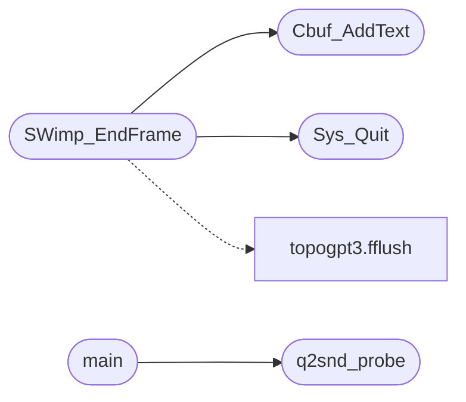

# `progs/quake2generic/q2generic_minios.c`

> Source: [progs/quake2generic/q2generic_minios.c:1](../../progs/quake2generic/q2generic_minios.c#L1) | language `c` | coverage 28.6% | [API index](../index.md)

q2generic_minios.c - MiniOS platform layer for quake2generic.

## Contents

- **Functions:** [`MINIOS_DOOM_BACKBUF_ADDR`](#minios_doom_backbuf_addr), [`MINIOS_GFX_BUF_GAME`](#minios_gfx_buf_game), [`Sys_Quit`](#sys_quit), [`Cbuf_AddText`](#cbuf_addtext), [`q2snd_probe`](#q2snd_probe), [`QG_GetMouseDiff`](#qg_getmousediff), [`QG_CaptureMouse`](#qg_capturemouse), [`QG_ReleaseMouse`](#qg_releasemouse), [`QG_Mkdir`](#qg_mkdir), [`SWimp_SetPalette`](#swimp_setpalette), [`SWimp_SetMode`](#swimp_setmode), [`SWimp_Init`](#swimp_init), [`SWimp_Shutdown`](#swimp_shutdown), [`SWimp_BeginFrame`](#swimp_beginframe), [`SWimp_EndFrame`](#swimp_endframe), [`SWimp_AppActivate`](#swimp_appactivate), [`QG_Milliseconds`](#qg_milliseconds), [`main`](#main)
- **Macros:** [`Q2G_FB_W`](#q2g_fb_w), [`Q2G_BACKBUF`](#q2g_backbuf)

## Call Graph

Solid arrows stay in this module, dashed arrows leave it.



## Functions

<a id="minios_doom_backbuf_addr"></a>

### `MINIOS_DOOM_BACKBUF_ADDR`

`function` | [progs/quake2generic/q2generic_minios.c:4](../../progs/quake2generic/q2generic_minios.c#L4)

```c
* MINIOS_DOOM_BACKBUF_ADDR (minios_abi.h);
```

========================================================================= Graphics back-buffers (kernel-mapped into user window) ========================================================================= The kernel allocates these from the kernel heap and maps them into the user window via the 4 KB page tables at boot (mm_setup_protections).

A ring-3 program writes to these addresses and calls the corresponding SYS_*_FRAME syscall; the kernel composites the buffer onto the desktop.

All three sit in the reserved tail above DOOM_BACKBUF_ADDR (the brk cap),
so a growing heap or mmap region can never reach them.  NK_BACKBUF sits
HIGHER than the framebuffer's maximum span: at 1024x768x24/32 the
framebuffer needs up to 3 MB, so a back-buffer at 0x0B400000 would overlap
its tail and steal its bottom rows (the mapped back-buffer overwrote the
framebuffer's second page-table slot, rendering the dock/taskbar black).
=========================================================================

**Parameters**

| Name | Type | Default | Description |
|---|---|---|---|
| `h` | `minios_abi.` |  |  |

**Returns:** `*`

> **Inherited:** Documentation from [`MINIOS_DOOM_BACKBUF_ADDR`](#minios_doom_backbuf_addr) (progs/minios_abi.h:140).

---

<a id="minios_gfx_buf_game"></a>

### `MINIOS_GFX_BUF_GAME`

`function` | [progs/quake2generic/q2generic_minios.c:5](../../progs/quake2generic/q2generic_minios.c#L5)

```c
* MINIOS_SYS_GFX_PRESENT with MINIOS_GFX_BUF_GAME (211 stays as a kernel * compat alias) and the...
```

Generic framebuffer/window present ABI (boyscout fix for app-specific syscalls).

DOOM_FRAME/NK_FRAME remain as compat numbers that route through the same compositor; new code uses GFX_PRESENT with a buffer id: 0 = 320x200 paletted game buffer (DOOM/Q2G path) 1 = 800x360 indexed Nuklear buffer (NK path, 256-color compat) 2 = 800x360 RGB Nuklear buffer (NK_RGB_ADDR, full color depth) GFX_SET_TITLE is already generic (renamed from Q2G_SET_TITLE).

**Parameters**

| Name | Type | Default | Description |
|---|---|---|---|
| `alias` | `211 stays as a kernel * compat` |  |  |

**Returns:** `* MINIOS_SYS_GFX_PRESENT with`

> **Inherited:** Documentation from [`MINIOS_GFX_BUF_GAME`](#minios_gfx_buf_game) (progs/minios_abi.h:416).

---

<a id="sys_quit"></a>

### `Sys_Quit`

`function` `extern` | [progs/quake2generic/q2generic_minios.c:99](../../progs/quake2generic/q2generic_minios.c#L99)

```c
extern void Sys_Quit(void);
```

Sys_Quit lives in the engine's system driver (other/q_system.c); not pulled in through quake2.h, so declare it here for the autoquit hook below.

*Called by:* [`SWimp_EndFrame`](#swimp_endframe)

---

<a id="cbuf_addtext"></a>

### `Cbuf_AddText`

`function` `extern` | [progs/quake2generic/q2generic_minios.c:102](../../progs/quake2generic/q2generic_minios.c#L102)

```c
extern void Cbuf_AddText(char *text);
```

Command buffer (other/cmd.c) for the in-game sound test hook below.

**Parameters**

| Name | Type | Default | Description |
|---|---|---|---|
| `text` | `char *` |  |  |

*Called by:* [`SWimp_EndFrame`](#swimp_endframe)

---

<a id="q2snd_probe"></a>

### `q2snd_probe`

`function` `extern` | [progs/quake2generic/q2generic_minios.c:106](../../progs/quake2generic/q2generic_minios.c#L106)

```c
extern int q2snd_probe(void);
```

Sound backend probe (snddma_minios.c): headless proof the DMA layer reaches the pcm2 path, run with `quake2generic.elf --pcm2-probe`.

**Returns:** `int`

*Called by:* [`main`](#main)

---

<a id="qg_getmousediff"></a>

### `QG_GetMouseDiff`

`function` | [progs/quake2generic/q2generic_minios.c:154](../../progs/quake2generic/q2generic_minios.c#L154)

```c
void QG_GetMouseDiff(int *dx, int *dy)
```

**Parameters**

| Name | Type | Default | Description |
|---|---|---|---|
| `dx` | `int *` |  |  |
| `dy` | `int *` |  |  |

---

<a id="qg_capturemouse"></a>

### `QG_CaptureMouse`

`function` | [progs/quake2generic/q2generic_minios.c:168](../../progs/quake2generic/q2generic_minios.c#L168)

```c
void QG_CaptureMouse(void)
```

---

<a id="qg_releasemouse"></a>

### `QG_ReleaseMouse`

`function` | [progs/quake2generic/q2generic_minios.c:172](../../progs/quake2generic/q2generic_minios.c#L172)

```c
void QG_ReleaseMouse(void)
```

---

<a id="qg_mkdir"></a>

### `QG_Mkdir`

`function` | [progs/quake2generic/q2generic_minios.c:175](../../progs/quake2generic/q2generic_minios.c#L175)

```c
void QG_Mkdir(const char *path)
```

**Parameters**

| Name | Type | Default | Description |
|---|---|---|---|
| `path` | `char *` |  |  |

---

<a id="swimp_setpalette"></a>

### `SWimp_SetPalette`

`function` | [progs/quake2generic/q2generic_minios.c:310](../../progs/quake2generic/q2generic_minios.c#L310)

```c
void SWimp_SetPalette(const unsigned char *palette)
```

**Parameters**

| Name | Type | Default | Description |
|---|---|---|---|
| `palette` | `unsigned char *` |  |  |

---

<a id="swimp_setmode"></a>

### `SWimp_SetMode`

`function` | [progs/quake2generic/q2generic_minios.c:320](../../progs/quake2generic/q2generic_minios.c#L320)

```c
rserr_t SWimp_SetMode(int *pwidth, int *pheight, int mode, qboolean fullscreen)
```

**Parameters**

| Name | Type | Default | Description |
|---|---|---|---|
| `pwidth` | `int *` |  |  |
| `pheight` | `int *` |  |  |
| `mode` | `int` |  |  |
| `fullscreen` | `qboolean` |  |  |

**Returns:** `rserr_t`

---

<a id="swimp_init"></a>

### `SWimp_Init`

`function` | [progs/quake2generic/q2generic_minios.c:337](../../progs/quake2generic/q2generic_minios.c#L337)

```c
int SWimp_Init(void *hInstance, void *wndProc)
```

**Parameters**

| Name | Type | Default | Description |
|---|---|---|---|
| `hInstance` | `void *` |  |  |
| `wndProc` | `void *` |  |  |

**Returns:** `int`

---

<a id="swimp_shutdown"></a>

### `SWimp_Shutdown`

`function` | [progs/quake2generic/q2generic_minios.c:346](../../progs/quake2generic/q2generic_minios.c#L346)

```c
void SWimp_Shutdown(void)
```

---

<a id="swimp_beginframe"></a>

### `SWimp_BeginFrame`

`function` | [progs/quake2generic/q2generic_minios.c:349](../../progs/quake2generic/q2generic_minios.c#L349)

```c
void SWimp_BeginFrame(float camera_separation)
```

**Parameters**

| Name | Type | Default | Description |
|---|---|---|---|
| `camera_separation` | `float` |  |  |

---

<a id="swimp_endframe"></a>

### `SWimp_EndFrame`

`function` | [progs/quake2generic/q2generic_minios.c:352](../../progs/quake2generic/q2generic_minios.c#L352)

```c
void SWimp_EndFrame(void)
```

*Calls:* [`Cbuf_AddText`](#cbuf_addtext), [`Sys_Quit`](#sys_quit), [`fflush`](progs.topogpt3.topogpt3.c.md#fflush)

---

<a id="swimp_appactivate"></a>

### `SWimp_AppActivate`

`function` | [progs/quake2generic/q2generic_minios.c:381](../../progs/quake2generic/q2generic_minios.c#L381)

```c
void SWimp_AppActivate(qboolean active)
```

**Parameters**

| Name | Type | Default | Description |
|---|---|---|---|
| `active` | `qboolean` |  |  |

---

<a id="qg_milliseconds"></a>

### `QG_Milliseconds`

`function` | [progs/quake2generic/q2generic_minios.c:385](../../progs/quake2generic/q2generic_minios.c#L385)

```c
int QG_Milliseconds(void)
```

**Returns:** `int`

---

<a id="main"></a>

### `main`

`function` | [progs/quake2generic/q2generic_minios.c:389](../../progs/quake2generic/q2generic_minios.c#L389)

```c
int main(int argc, char **argv)
```

**Parameters**

| Name | Type | Default | Description |
|---|---|---|---|
| `argc` | `int` |  |  |
| `argv` | `char **` |  |  |

**Returns:** `int`

*Calls:* [`q2snd_probe`](#q2snd_probe)

---

## Macros

<a id="q2g_fb_w"></a>

### `Q2G_FB_W`

`macro` | [progs/quake2generic/q2generic_minios.c:21](../../progs/quake2generic/q2generic_minios.c#L21)

```c
#define Q2G_FB_W
```

---

<a id="q2g_backbuf"></a>

### `Q2G_BACKBUF`

`macro` | [progs/quake2generic/q2generic_minios.c:78](../../progs/quake2generic/q2generic_minios.c#L78)

```c
#define Q2G_BACKBUF
```

---
