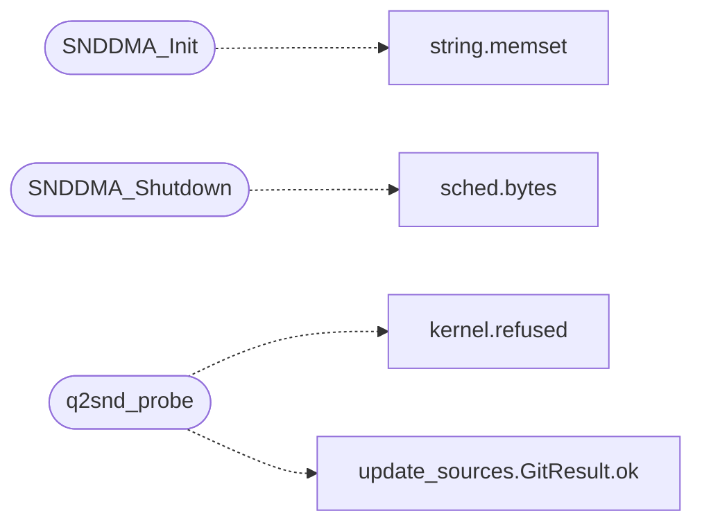

# `progs/quake2generic/snddma_minios.c`

> Source: [progs/quake2generic/snddma_minios.c:1](../../progs/quake2generic/snddma_minios.c#L1) | language `c` | coverage 41.7% | [API index](../index.md)

snddma_minios.c - Quake 2 DMA sound backend over the MiniOS pcm2 path.

## Contents

- **Functions:** [`SNDDMA_Init`](#snddma_init), [`SNDDMA_GetDMAPos`](#snddma_getdmapos), [`SNDDMA_Shutdown`](#snddma_shutdown), [`SNDDMA_BeginPainting`](#snddma_beginpainting), [`SNDDMA_Submit`](#snddma_submit), [`q2snd_probe`](#q2snd_probe)
- **Macros:** [`Q2SND_RATE`](#q2snd_rate), [`Q2SND_SAMPLES`](#q2snd_samples), [`Q2SND_SILENCE`](#q2snd_silence), [`Q2SND_AHEAD`](#q2snd_ahead), [`Q2SND_BUF_BYTES`](#q2snd_buf_bytes)

## Call Graph

Solid arrows stay in this module, dashed arrows leave it.



## Functions

<a id="snddma_init"></a>

### `SNDDMA_Init`

`function` | [progs/quake2generic/snddma_minios.c:138](../../progs/quake2generic/snddma_minios.c#L138)

```c
qboolean SNDDMA_Init(void)
```

**Returns:** `qboolean`

*Calls:* [`memset`](kernel.string.c.md#memset)

---

<a id="snddma_getdmapos"></a>

### `SNDDMA_GetDMAPos`

`function` | [progs/quake2generic/snddma_minios.c:182](../../progs/quake2generic/snddma_minios.c#L182)

```c
int SNDDMA_GetDMAPos(void)
```

**Returns:** `int`

---

<a id="snddma_shutdown"></a>

### `SNDDMA_Shutdown`

`function` | [progs/quake2generic/snddma_minios.c:190](../../progs/quake2generic/snddma_minios.c#L190)

```c
void SNDDMA_Shutdown(void)
```

*Calls:* [`bytes`](headers.sched.h.md#bytes)

---

<a id="snddma_beginpainting"></a>

### `SNDDMA_BeginPainting`

`function` | [progs/quake2generic/snddma_minios.c:202](../../progs/quake2generic/snddma_minios.c#L202)

```c
void SNDDMA_BeginPainting(void)
```

---

<a id="snddma_submit"></a>

### `SNDDMA_Submit`

`function` | [progs/quake2generic/snddma_minios.c:205](../../progs/quake2generic/snddma_minios.c#L205)

```c
void SNDDMA_Submit(void)
```

---

<a id="q2snd_probe"></a>

### `q2snd_probe`

`function` | [progs/quake2generic/snddma_minios.c:222](../../progs/quake2generic/snddma_minios.c#L222)

```c
int q2snd_probe(void)
```

Headless plumbing probe (BDD hook): open pcm2, stream one pattern, close, report.

Needs no game data, so it runs on a bare boot with the SB16 attached and is the serial proof that the Quake 2 backend reaches the low-latency path.

**Returns:** `int`

*Calls:* [`refused`](headers.kernel.h.md#refused), [`GitResult.ok`](tools.update_sources.py.md#gitresult-ok)

---

## Macros

<a id="q2snd_rate"></a>

### `Q2SND_RATE`

`macro` | [progs/quake2generic/snddma_minios.c:48](../../progs/quake2generic/snddma_minios.c#L48)

```c
#define Q2SND_RATE
```

---

<a id="q2snd_samples"></a>

### `Q2SND_SAMPLES`

`macro` | [progs/quake2generic/snddma_minios.c:49](../../progs/quake2generic/snddma_minios.c#L49)

```c
#define Q2SND_SAMPLES
```

---

<a id="q2snd_silence"></a>

### `Q2SND_SILENCE`

`macro` | [progs/quake2generic/snddma_minios.c:50](../../progs/quake2generic/snddma_minios.c#L50)

```c
#define Q2SND_SILENCE
```

power of two for the engine's mask

---

<a id="q2snd_ahead"></a>

### `Q2SND_AHEAD`

`macro` | [progs/quake2generic/snddma_minios.c:54](../../progs/quake2generic/snddma_minios.c#L54)

```c
#define Q2SND_AHEAD
```

Submit window: frames kept queued ahead of the play position.

Matches the kernel ring (1024 B), so a NONBLOCK write takes the whole window without ever stalling the frame loop; larger would block, smaller would starve.

---

<a id="q2snd_buf_bytes"></a>

### `Q2SND_BUF_BYTES`

`macro` | [progs/quake2generic/snddma_minios.c:56](../../progs/quake2generic/snddma_minios.c#L56)

```c
#define Q2SND_BUF_BYTES
```

Mixer ring is 16-bit mono (see header comment); the device takes 8-bit.

---
