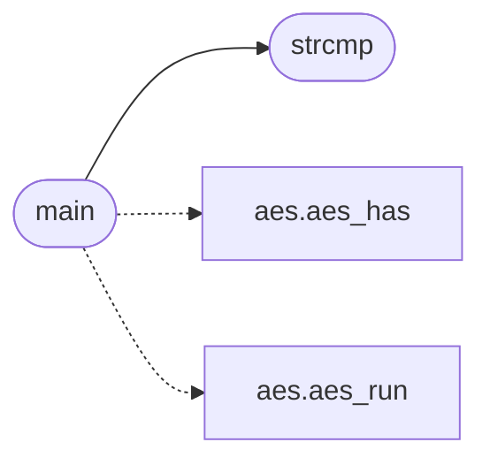

# `progs/src/aes.c`

> Source: [progs/src/aes.c:1](../../progs/src/aes.c#L1) | language `c` | coverage 2.9% | [API index](../index.md)

aes.c - command path AES-256-CTR encryption tools: aes and unaes.

## Contents

- **Functions:** [`GF`](#gf), [`putchar`](#putchar), [`strcmp`](#strcmp), [`strlen`](#strlen), [`fopen`](#fopen), [`fclose`](#fclose), [`fread`](#fread), [`fwrite`](#fwrite), [`fseek`](#fseek), [`ftell`](#ftell), [`rewind`](#rewind), [`malloc`](#malloc), [`free`](#free), [`main`](#main)
- **Macros:** [`AES_MAGIC0`](#aes_magic0), [`AES_MAGIC1`](#aes_magic1), [`AES_MAGIC2`](#aes_magic2), [`AES_MAGIC3`](#aes_magic3), [`AES_HDR_SIZE`](#aes_hdr_size), [`AES_BLOCK`](#aes_block), [`AES_KEY_BYTES`](#aes_key_bytes), [`AES_NONCE_BYTES`](#aes_nonce_bytes), [`AES_ROUNDS`](#aes_rounds), [`AES_RK_LEN`](#aes_rk_len), [`AES_SBOX_SIZE`](#aes_sbox_size), [`AES_RCON_SIZE`](#aes_rcon_size), [`AES_POLY`](#aes_poly), [`AES_AFFINE_C`](#aes_affine_c), [`AES_RCON_PAD`](#aes_rcon_pad), [`HEX_KEY_LEN`](#hex_key_len), [`HEX_NONCE_LEN`](#hex_nonce_len), [`AES_SEEK_END`](#aes_seek_end), [`AES_EXIT_FAIL`](#aes_exit_fail)

## Call Graph

Solid arrows stay in this module, dashed arrows leave it.



## Functions

<a id="gf"></a>

### `GF`

`function` | [progs/src/aes.c:8](../../progs/src/aes.c#L8)

```c
* generated procedurally from the GF(2^8) multiplicative inverse plus the * FIPS-197 affine transform, so the file carries no magic tables. The mode * is CTR (NIST SP 800-38A): no padding, encrypt and
```

**Parameters**

| Name | Type | Default | Description |
|---|---|---|---|
| `2^8` |  |  |  |

**Returns:** `* generated procedurally from the`

---

<a id="putchar"></a>

### `putchar`

`function` | [progs/src/aes.c:25](../../progs/src/aes.c#L25)

```c
int putchar();
```

**Returns:** `int`

---

<a id="strcmp"></a>

### `strcmp`

`function` | [progs/src/aes.c:26](../../progs/src/aes.c#L26)

```c
int strcmp();
```

**Returns:** `int`

*Called by:* [`main`](#main)

---

<a id="strlen"></a>

### `strlen`

`function` | [progs/src/aes.c:27](../../progs/src/aes.c#L27)

```c
int strlen();
```

**Returns:** `int`

---

<a id="fopen"></a>

### `fopen`

`function` | [progs/src/aes.c:28](../../progs/src/aes.c#L28)

```c
void *fopen();
```

**Returns:** `void *`

---

<a id="fclose"></a>

### `fclose`

`function` | [progs/src/aes.c:29](../../progs/src/aes.c#L29)

```c
int fclose();
```

**Returns:** `int`

---

<a id="fread"></a>

### `fread`

`function` | [progs/src/aes.c:30](../../progs/src/aes.c#L30)

```c
int fread();
```

**Returns:** `int`

---

<a id="fwrite"></a>

### `fwrite`

`function` | [progs/src/aes.c:31](../../progs/src/aes.c#L31)

```c
int fwrite();
```

**Returns:** `int`

---

<a id="fseek"></a>

### `fseek`

`function` | [progs/src/aes.c:32](../../progs/src/aes.c#L32)

```c
int fseek();
```

**Returns:** `int`

---

<a id="ftell"></a>

### `ftell`

`function` | [progs/src/aes.c:33](../../progs/src/aes.c#L33)

```c
int ftell();
```

**Returns:** `int`

---

<a id="rewind"></a>

### `rewind`

`function` | [progs/src/aes.c:34](../../progs/src/aes.c#L34)

```c
void rewind();
```

---

<a id="malloc"></a>

### `malloc`

`function` | [progs/src/aes.c:35](../../progs/src/aes.c#L35)

```c
void *malloc();
```

**Returns:** `void *`

---

<a id="free"></a>

### `free`

`function` | [progs/src/aes.c:36](../../progs/src/aes.c#L36)

```c
void free();
```

---

<a id="main"></a>

### `main`

`function` | [progs/src/aes.c:384](../../progs/src/aes.c#L384)

```c
int main(int argc, char **argv)
```

**Parameters**

| Name | Type | Default | Description |
|---|---|---|---|
| `argc` | `int` |  |  |
| `argv` | `char **` |  |  |

**Returns:** `int`

*Calls:* [`aes_has`](progs.asm.aes.s.md#aes_has), [`aes_run`](progs.asm.aes.s.md#aes_run), [`strcmp`](#strcmp)

---

## Macros

<a id="aes_magic0"></a>

### `AES_MAGIC0`

`macro` | [progs/src/aes.c:38](../../progs/src/aes.c#L38)

```c
#define AES_MAGIC0
```

---

<a id="aes_magic1"></a>

### `AES_MAGIC1`

`macro` | [progs/src/aes.c:39](../../progs/src/aes.c#L39)

```c
#define AES_MAGIC1
```

---

<a id="aes_magic2"></a>

### `AES_MAGIC2`

`macro` | [progs/src/aes.c:40](../../progs/src/aes.c#L40)

```c
#define AES_MAGIC2
```

---

<a id="aes_magic3"></a>

### `AES_MAGIC3`

`macro` | [progs/src/aes.c:41](../../progs/src/aes.c#L41)

```c
#define AES_MAGIC3
```

---

<a id="aes_hdr_size"></a>

### `AES_HDR_SIZE`

`macro` | [progs/src/aes.c:42](../../progs/src/aes.c#L42)

```c
#define AES_HDR_SIZE
```

---

<a id="aes_block"></a>

### `AES_BLOCK`

`macro` | [progs/src/aes.c:44](../../progs/src/aes.c#L44)

```c
#define AES_BLOCK
```

---

<a id="aes_key_bytes"></a>

### `AES_KEY_BYTES`

`macro` | [progs/src/aes.c:45](../../progs/src/aes.c#L45)

```c
#define AES_KEY_BYTES
```

---

<a id="aes_nonce_bytes"></a>

### `AES_NONCE_BYTES`

`macro` | [progs/src/aes.c:46](../../progs/src/aes.c#L46)

```c
#define AES_NONCE_BYTES
```

---

<a id="aes_rounds"></a>

### `AES_ROUNDS`

`macro` | [progs/src/aes.c:47](../../progs/src/aes.c#L47)

```c
#define AES_ROUNDS
```

---

<a id="aes_rk_len"></a>

### `AES_RK_LEN`

`macro` | [progs/src/aes.c:48](../../progs/src/aes.c#L48)

```c
#define AES_RK_LEN
```

---

<a id="aes_sbox_size"></a>

### `AES_SBOX_SIZE`

`macro` | [progs/src/aes.c:49](../../progs/src/aes.c#L49)

```c
#define AES_SBOX_SIZE
```

---

<a id="aes_rcon_size"></a>

### `AES_RCON_SIZE`

`macro` | [progs/src/aes.c:50](../../progs/src/aes.c#L50)

```c
#define AES_RCON_SIZE
```

---

<a id="aes_poly"></a>

### `AES_POLY`

`macro` | [progs/src/aes.c:52](../../progs/src/aes.c#L52)

```c
#define AES_POLY
```

---

<a id="aes_affine_c"></a>

### `AES_AFFINE_C`

`macro` | [progs/src/aes.c:53](../../progs/src/aes.c#L53)

```c
#define AES_AFFINE_C
```

---

<a id="aes_rcon_pad"></a>

### `AES_RCON_PAD`

`macro` | [progs/src/aes.c:54](../../progs/src/aes.c#L54)

```c
#define AES_RCON_PAD
```

---

<a id="hex_key_len"></a>

### `HEX_KEY_LEN`

`macro` | [progs/src/aes.c:56](../../progs/src/aes.c#L56)

```c
#define HEX_KEY_LEN
```

---

<a id="hex_nonce_len"></a>

### `HEX_NONCE_LEN`

`macro` | [progs/src/aes.c:57](../../progs/src/aes.c#L57)

```c
#define HEX_NONCE_LEN
```

---

<a id="aes_seek_end"></a>

### `AES_SEEK_END`

`macro` | [progs/src/aes.c:59](../../progs/src/aes.c#L59)

```c
#define AES_SEEK_END
```

---

<a id="aes_exit_fail"></a>

### `AES_EXIT_FAIL`

`macro` | [progs/src/aes.c:61](../../progs/src/aes.c#L61)

```c
#define AES_EXIT_FAIL
```

---
