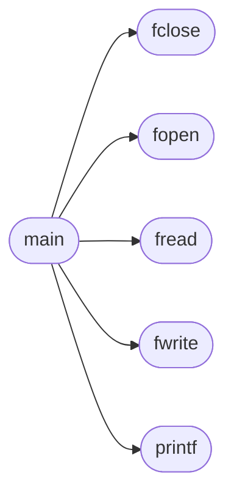

# `progs/src/cp.c`

> Source: [progs/src/cp.c:1](../../progs/src/cp.c#L1) | language `c` | coverage 0.0% | [API index](../index.md)

## Contents

- **Functions:** [`printf`](#printf), [`fopen`](#fopen), [`fclose`](#fclose), [`fread`](#fread), [`fwrite`](#fwrite), [`main`](#main)
- **Macros:** [`CP_BUF_SIZE`](#cp_buf_size), [`CP_EXIT_FAIL`](#cp_exit_fail)

## Call Graph

Solid arrows stay in this module, dashed arrows leave it.



## Functions

<a id="printf"></a>

### `printf`

`function` | [progs/src/cp.c:1](../../progs/src/cp.c#L1)

```c
int printf();
```

**Returns:** `int`

*Called by:* [`main`](#main)

---

<a id="fopen"></a>

### `fopen`

`function` | [progs/src/cp.c:2](../../progs/src/cp.c#L2)

```c
void *fopen();
```

**Returns:** `void *`

*Called by:* [`main`](#main)

---

<a id="fclose"></a>

### `fclose`

`function` | [progs/src/cp.c:3](../../progs/src/cp.c#L3)

```c
int fclose();
```

**Returns:** `int`

*Called by:* [`main`](#main)

---

<a id="fread"></a>

### `fread`

`function` | [progs/src/cp.c:4](../../progs/src/cp.c#L4)

```c
int fread();
```

**Returns:** `int`

*Called by:* [`main`](#main)

---

<a id="fwrite"></a>

### `fwrite`

`function` | [progs/src/cp.c:5](../../progs/src/cp.c#L5)

```c
int fwrite();
```

**Returns:** `int`

*Called by:* [`main`](#main)

---

<a id="main"></a>

### `main`

`function` | [progs/src/cp.c:10](../../progs/src/cp.c#L10)

```c
int main(int argc, char **argv)
```

**Parameters**

| Name | Type | Default | Description |
|---|---|---|---|
| `argc` | `int` |  |  |
| `argv` | `char **` |  |  |

**Returns:** `int`

*Calls:* [`fclose`](#fclose), [`fopen`](#fopen), [`fread`](#fread), [`fwrite`](#fwrite), [`printf`](#printf)

---

## Macros

<a id="cp_buf_size"></a>

### `CP_BUF_SIZE`

`macro` | [progs/src/cp.c:7](../../progs/src/cp.c#L7)

```c
#define CP_BUF_SIZE
```

---

<a id="cp_exit_fail"></a>

### `CP_EXIT_FAIL`

`macro` | [progs/src/cp.c:8](../../progs/src/cp.c#L8)

```c
#define CP_EXIT_FAIL
```

---
