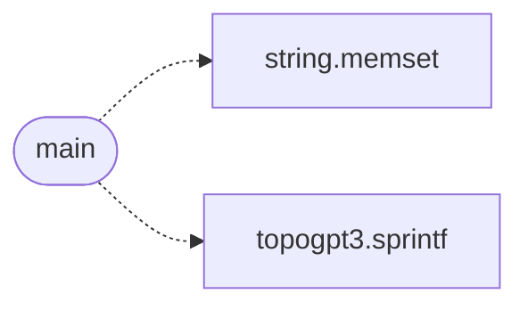

# `progs/src/cvmfmt.c`

> Source: [progs/src/cvmfmt.c:1](../../progs/src/cvmfmt.c#L1) | language `c` | coverage 50.0% | [API index](../index.md)

cvmfmt.c - CVM formatting probe.

## Contents

- **Functions:** [`main`](#main)

## Call Graph

Solid arrows stay in this module, dashed arrows leave it.



## Functions

<a id="main"></a>

### `main`

`function` | [progs/src/cvmfmt.c:19](../../progs/src/cvmfmt.c#L19)

```c
int main(void)
```

**Returns:** `int`

*Calls:* [`memset`](kernel.string.c.md#memset), [`sprintf`](progs.topogpt3.topogpt3.c.md#sprintf)

---
