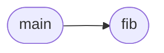

# `progs/src/fib.c`

> Source: [progs/src/fib.c:1](../../progs/src/fib.c#L1) | language `c` | coverage 0.0% | [API index](../index.md)

## Contents

- **Functions:** [`fib`](#fib), [`main`](#main)

## Call Graph

Solid arrows stay in this module, dashed arrows leave it.



## Functions

<a id="fib"></a>

### `fib`

`function` | [progs/src/fib.c:1](../../progs/src/fib.c#L1)

```c
int fib(int n)
```

**Parameters**

| Name | Type | Default | Description |
|---|---|---|---|
| `n` | `int` |  |  |

**Returns:** `int`

*Called by:* [`main`](#main)

---

<a id="main"></a>

### `main`

`function` | [progs/src/fib.c:6](../../progs/src/fib.c#L6)

```c
int main(void)
```

**Returns:** `int`

*Calls:* [`fib`](#fib)

---
