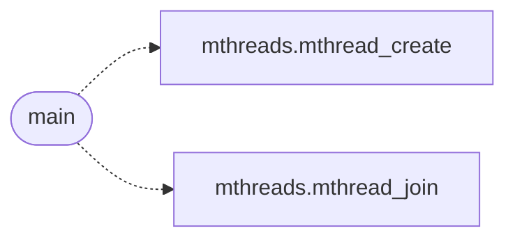

# `progs/src/fptest.c`

> Source: [progs/src/fptest.c:1](../../progs/src/fptest.c#L1) | language `c` | coverage 20.0% | [API index](../index.md)

fptest.c -- FPU/SSE context-switch probe (Phase 0.1, ADR-0014).

## Contents

- **Structs:** [`fp_slot_t`](#fp_slot_t)
- **Functions:** [`gettid`](#gettid), [`main`](#main)
- **Macros:** [`FP_ITERS`](#fp_iters)

## Call Graph

Solid arrows stay in this module, dashed arrows leave it.



## Structs

<a id="fp_slot_t"></a>

### `fp_slot_t`

`struct` | [progs/src/fptest.c:56](../../progs/src/fptest.c#L56)

```c
typedef struct
```

---

## Functions

<a id="gettid"></a>

### `gettid`

`function` | [progs/src/fptest.c:21](../../progs/src/fptest.c#L21)

```c
* * The same run smokes gettid (Phase 0.4: the two workers must observe * distinct tids, never the constant 1) and getrandom (Phase 0.5: it * must fill the buffer and report the count, never EFAULT).
```

**Parameters**

| Name | Type | Default | Description |
|---|---|---|---|
| `tids` | `Phase 0.4: the two workers must observe * distinct` |  |  |
| `constant` | `never the 1` |  |  |

**Returns:** `* * The same run smokes`

---

<a id="main"></a>

### `main`

`function` | [progs/src/fptest.c:148](../../progs/src/fptest.c#L148)

```c
int main(void)
```

**Returns:** `int`

*Calls:* [`mthread_create`](progs.src.mthreads.h.md#mthread_create), [`mthread_join`](progs.src.mthreads.h.md#mthread_join)

---

## Macros

<a id="fp_iters"></a>

### `FP_ITERS`

`macro` | [progs/src/fptest.c:38](../../progs/src/fptest.c#L38)

```c
#define FP_ITERS
```

---
