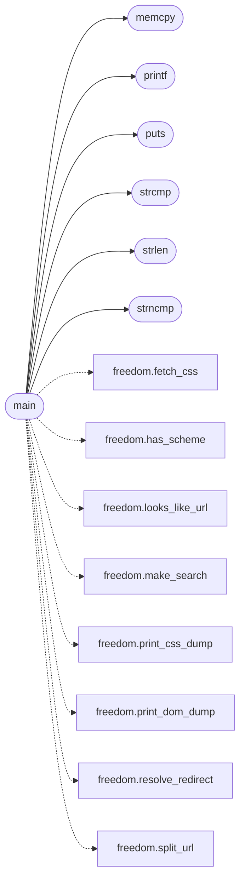

# `progs/src/freedom.c`

> Source: [progs/src/freedom.c:1](../../progs/src/freedom.c#L1) | language `c` | coverage 20.0% | [API index](../index.md)

freedom - a headless text browser for MiniOS.

## Contents

- **Functions:** [`curlfree`](#curlfree), [`net_dns_resolve`](#net_dns_resolve), [`tls_handshake`](#tls_handshake), [`tls_send`](#tls_send), [`tls_recv`](#tls_recv), [`socket`](#socket), [`connect`](#connect), [`sendto`](#sendto), [`recvfrom`](#recvfrom), [`close`](#close), [`printf`](#printf), [`puts`](#puts), [`strlen`](#strlen), [`strchr`](#strchr), [`strcmp`](#strcmp), [`strncmp`](#strncmp), [`memcpy`](#memcpy), [`memset`](#memset), [`putchar`](#putchar), [`main`](#main)
- **Macros:** [`FREEDOM_HOPS_MAX`](#freedom_hops_max), [`FREEDOM_HDR_MAX`](#freedom_hdr_max), [`FREEDOM_BUF`](#freedom_buf), [`FREEDOM_CHUNK_MAX`](#freedom_chunk_max), [`FREEDOM_CSS_MAX`](#freedom_css_max), [`FREEDOM_CSS_BUF`](#freedom_css_buf), [`FREEDOM_DOM_BUF`](#freedom_dom_buf), [`FREEDOM_ATTR_MAX`](#freedom_attr_max), [`FREEDOM_LINE_MAX`](#freedom_line_max)

## Call Graph

Solid arrows stay in this module, dashed arrows leave it.



## Functions

<a id="curlfree"></a>

### `curlfree`

`function` | [progs/src/freedom.c:4](../../progs/src/freedom.c#L4)

```c
* spirit of curlfree (http.c + htmlfilter.c): a bounded header phase, * Content-Length or EOF body reading, Transfer-Encoding: chunked * decoding, redirect chasing with a hop bound, and a filter that
```

**Parameters**

| Name | Type | Default | Description |
|---|---|---|---|
| `c` | `http.c + htmlfilter.` |  |  |

**Returns:** `a bounded header phase, * Content-Length or EOF body reading, Transfer-Encoding: chunked * decoding, redirect chasing with a hop bound, and a filter that`

---

<a id="net_dns_resolve"></a>

### `net_dns_resolve`

`function` | [progs/src/freedom.c:41](../../progs/src/freedom.c#L41)

```c
int net_dns_resolve(const char *host);
```

Ring-3 TLS build (phase 2 of docs/TLS_MIGRATION.md): host libc for sockets/stdio/strings (identical ABI numbers inside the guest); net_dns_resolve and tls_* link from the shared ring-3 TLS objects (progs/tls_u) instead of trapping kernel syscalls 200-203. stdlib.h * is deliberately absent: this file defines its own static atoi. include <stdio.h> include <string.h> include <unistd.h> include <sys/socket.h>

**Parameters**

| Name | Type | Default | Description |
|---|---|---|---|
| `host` | `char *` |  |  |

**Returns:** `int`

---

<a id="tls_handshake"></a>

### `tls_handshake`

`function` | [progs/src/freedom.c:42](../../progs/src/freedom.c#L42)

```c
int tls_handshake(int fd, char *host);
```

Blocking TLS 1.2 handshake over an open TCP socket (net fd index). host is the SNI + certificate hostname.

Returns 0 on success, -1 with a diagnostic on the console. The session lives on the kernel heap.

**Parameters**

| Name | Type | Default | Description |
|---|---|---|---|
| `fd` | `int` |  |  |
| `host` | `char *` |  |  |

**Returns:** `int`

> **Inherited:** Documentation from [`tls_handshake`](#tls_handshake) (headers/tls.h:277).

---

<a id="tls_send"></a>

### `tls_send`

`function` | [progs/src/freedom.c:43](../../progs/src/freedom.c#L43)

```c
int tls_send(int fd, char *buf, int len);
```

Send len plaintext bytes as one TLS record.

All-or-error.

**Parameters**

| Name | Type | Default | Description |
|---|---|---|---|
| `fd` | `int` |  |  |
| `buf` | `char *` |  |  |
| `len` | `int` |  |  |

**Returns:** `int`

> **Inherited:** Documentation from [`tls_send`](#tls_send) (headers/tls.h:280).

---

<a id="tls_recv"></a>

### `tls_recv`

`function` | [progs/src/freedom.c:44](../../progs/src/freedom.c#L44)

```c
int tls_recv(int fd, char *buf, int len);
```

Receive decrypted application bytes.

0 = clean EOF (close_notify or FIN at a record boundary); -1 = protocol error / truncation (diagnostic).

**Parameters**

| Name | Type | Default | Description |
|---|---|---|---|
| `fd` | `int` |  |  |
| `buf` | `char *` |  |  |
| `len` | `int` |  |  |

**Returns:** `int`

> **Inherited:** Documentation from [`tls_recv`](#tls_recv) (headers/tls.h:284).

---

<a id="socket"></a>

### `socket`

`function` | [progs/src/freedom.c:52](../../progs/src/freedom.c#L52)

```c
int socket(int domain, int type, int proto);
```

else

**Parameters**

| Name | Type | Default | Description |
|---|---|---|---|
| `domain` | `int` |  |  |
| `type` | `int` |  |  |
| `proto` | `int` |  |  |

**Returns:** `int`

---

<a id="connect"></a>

### `connect`

`function` | [progs/src/freedom.c:53](../../progs/src/freedom.c#L53)

```c
int connect(int fd, void *addr, int addrlen);
```

**Parameters**

| Name | Type | Default | Description |
|---|---|---|---|
| `fd` | `int` |  |  |
| `addr` | `void *` |  |  |
| `addrlen` | `int` |  |  |

**Returns:** `int`

---

<a id="sendto"></a>

### `sendto`

`function` | [progs/src/freedom.c:54](../../progs/src/freedom.c#L54)

```c
int sendto(int fd, char *buf, int len, int flags, void *to, int tolen);
```

**Parameters**

| Name | Type | Default | Description |
|---|---|---|---|
| `fd` | `int` |  |  |
| `buf` | `char *` |  |  |
| `len` | `int` |  |  |
| `flags` | `int` |  |  |
| `to` | `void *` |  |  |
| `tolen` | `int` |  |  |

**Returns:** `int`

---

<a id="recvfrom"></a>

### `recvfrom`

`function` | [progs/src/freedom.c:55](../../progs/src/freedom.c#L55)

```c
int recvfrom(int fd, char *buf, int len, int flags, void *from, int *fromlen);
```

**Parameters**

| Name | Type | Default | Description |
|---|---|---|---|
| `fd` | `int` |  |  |
| `buf` | `char *` |  |  |
| `len` | `int` |  |  |
| `flags` | `int` |  |  |
| `from` | `void *` |  |  |
| `fromlen` | `int *` |  |  |

**Returns:** `int`

---

<a id="close"></a>

### `close`

`function` | [progs/src/freedom.c:56](../../progs/src/freedom.c#L56)

```c
int close(int fd);
```

**Parameters**

| Name | Type | Default | Description |
|---|---|---|---|
| `fd` | `int` |  |  |

**Returns:** `int`

---

<a id="printf"></a>

### `printf`

`function` | [progs/src/freedom.c:63](../../progs/src/freedom.c#L63)

```c
int printf(char *fmt, ...);
```

**Parameters**

| Name | Type | Default | Description |
|---|---|---|---|
| `fmt` | `char *` |  |  |
| `...` |  |  |  |

**Returns:** `int`

*Called by:* [`main`](#main)

---

<a id="puts"></a>

### `puts`

`function` | [progs/src/freedom.c:64](../../progs/src/freedom.c#L64)

```c
int puts(char *s);
```

**Parameters**

| Name | Type | Default | Description |
|---|---|---|---|
| `s` | `char *` |  |  |

**Returns:** `int`

*Called by:* [`main`](#main)

---

<a id="strlen"></a>

### `strlen`

`function` | [progs/src/freedom.c:65](../../progs/src/freedom.c#L65)

```c
int strlen(char *s);
```

**Parameters**

| Name | Type | Default | Description |
|---|---|---|---|
| `s` | `char *` |  |  |

**Returns:** `int`

*Called by:* [`main`](#main)

---

<a id="strchr"></a>

### `strchr`

`function` | [progs/src/freedom.c:66](../../progs/src/freedom.c#L66)

```c
char *strchr(char *s, int c);
```

**Parameters**

| Name | Type | Default | Description |
|---|---|---|---|
| `s` | `char *` |  |  |
| `c` | `int` |  |  |

**Returns:** `char *`

---

<a id="strcmp"></a>

### `strcmp`

`function` | [progs/src/freedom.c:67](../../progs/src/freedom.c#L67)

```c
int strcmp(char *a, char *b);
```

**Parameters**

| Name | Type | Default | Description |
|---|---|---|---|
| `a` | `char *` |  |  |
| `b` | `char *` |  |  |

**Returns:** `int`

*Called by:* [`main`](#main)

---

<a id="strncmp"></a>

### `strncmp`

`function` | [progs/src/freedom.c:68](../../progs/src/freedom.c#L68)

```c
int strncmp(char *a, char *b, int n);
```

**Parameters**

| Name | Type | Default | Description |
|---|---|---|---|
| `a` | `char *` |  |  |
| `b` | `char *` |  |  |
| `n` | `int` |  |  |

**Returns:** `int`

*Called by:* [`main`](#main)

---

<a id="memcpy"></a>

### `memcpy`

`function` | [progs/src/freedom.c:69](../../progs/src/freedom.c#L69)

```c
int memcpy(char *dst, char *src, int n);
```

**Parameters**

| Name | Type | Default | Description |
|---|---|---|---|
| `dst` | `char *` |  |  |
| `src` | `char *` |  |  |
| `n` | `int` |  |  |

**Returns:** `int`

*Called by:* [`main`](#main)

---

<a id="memset"></a>

### `memset`

`function` | [progs/src/freedom.c:70](../../progs/src/freedom.c#L70)

```c
int memset(char *dst, int c, int n);
```

**Parameters**

| Name | Type | Default | Description |
|---|---|---|---|
| `dst` | `char *` |  |  |
| `c` | `int` |  |  |
| `n` | `int` |  |  |

**Returns:** `int`

---

<a id="putchar"></a>

### `putchar`

`function` | [progs/src/freedom.c:71](../../progs/src/freedom.c#L71)

```c
int putchar(int c);
```

**Parameters**

| Name | Type | Default | Description |
|---|---|---|---|
| `c` | `int` |  |  |

**Returns:** `int`

---

<a id="main"></a>

### `main`

`function` | [progs/src/freedom.c:1129](../../progs/src/freedom.c#L1129)

```c
int main(int argc, char **argv)
```

**Parameters**

| Name | Type | Default | Description |
|---|---|---|---|
| `argc` | `int` |  |  |
| `argv` | `char **` |  |  |

**Returns:** `int`

*Calls:* [`fetch_css`](progs.asm.freedom.s.md#fetch_css), [`has_scheme`](progs.asm.freedom.s.md#has_scheme), [`looks_like_url`](progs.asm.freedom.s.md#looks_like_url), [`make_search`](progs.asm.freedom.s.md#make_search), [`print_css_dump`](progs.asm.freedom.s.md#print_css_dump), [`print_dom_dump`](progs.asm.freedom.s.md#print_dom_dump), [`resolve_redirect`](progs.asm.freedom.s.md#resolve_redirect), [`split_url`](progs.asm.freedom.s.md#split_url), [`memcpy`](#memcpy), [`printf`](#printf), [`puts`](#puts), [`strcmp`](#strcmp) and 2 more

---

## Macros

<a id="freedom_hops_max"></a>

### `FREEDOM_HOPS_MAX`

`macro` | [progs/src/freedom.c:74](../../progs/src/freedom.c#L74)

```c
#define FREEDOM_HOPS_MAX
```

---

<a id="freedom_hdr_max"></a>

### `FREEDOM_HDR_MAX`

`macro` | [progs/src/freedom.c:75](../../progs/src/freedom.c#L75)

```c
#define FREEDOM_HDR_MAX
```

---

<a id="freedom_buf"></a>

### `FREEDOM_BUF`

`macro` | [progs/src/freedom.c:76](../../progs/src/freedom.c#L76)

```c
#define FREEDOM_BUF
```

---

<a id="freedom_chunk_max"></a>

### `FREEDOM_CHUNK_MAX`

`macro` | [progs/src/freedom.c:77](../../progs/src/freedom.c#L77)

```c
#define FREEDOM_CHUNK_MAX
```

---

<a id="freedom_css_max"></a>

### `FREEDOM_CSS_MAX`

`macro` | [progs/src/freedom.c:78](../../progs/src/freedom.c#L78)

```c
#define FREEDOM_CSS_MAX
```

---

<a id="freedom_css_buf"></a>

### `FREEDOM_CSS_BUF`

`macro` | [progs/src/freedom.c:79](../../progs/src/freedom.c#L79)

```c
#define FREEDOM_CSS_BUF
```

---

<a id="freedom_dom_buf"></a>

### `FREEDOM_DOM_BUF`

`macro` | [progs/src/freedom.c:80](../../progs/src/freedom.c#L80)

```c
#define FREEDOM_DOM_BUF
```

---

<a id="freedom_attr_max"></a>

### `FREEDOM_ATTR_MAX`

`macro` | [progs/src/freedom.c:81](../../progs/src/freedom.c#L81)

```c
#define FREEDOM_ATTR_MAX
```

---

<a id="freedom_line_max"></a>

### `FREEDOM_LINE_MAX`

`macro` | [progs/src/freedom.c:82](../../progs/src/freedom.c#L82)

```c
#define FREEDOM_LINE_MAX
```

---
