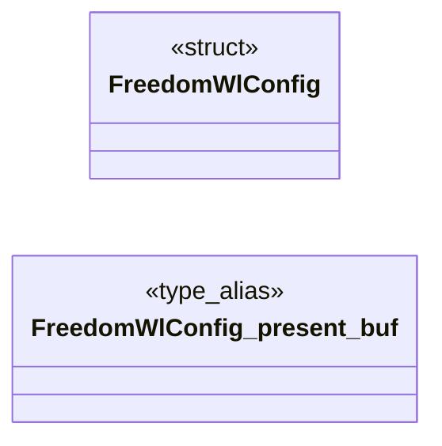

# `progs/src/freedom_wl.c`

> Source: [progs/src/freedom_wl.c:1](../../progs/src/freedom_wl.c#L1) | language `c` | coverage 34.6% | [API index](../index.md)

freedom_wl - Wayland to MiniOS intermediate layer for FreeDom.

## Contents

- **Structs:** [`FreedomWlConfig`](#freedomwlconfig)
- **Functions:** [`net_dns_resolve`](#net_dns_resolve), [`tls_handshake`](#tls_handshake), [`tls_send`](#tls_send), [`tls_recv`](#tls_recv), [`tls_close`](#tls_close), [`freedom_wl_host_probe`](#freedom_wl_host_probe), [`main`](#main)
- **Macros:** [`WL_COLS`](#wl_cols), [`WL_ROWS`](#wl_rows), [`WL_TEXT_ROWS`](#wl_text_rows), [`WL_LINES_MAX`](#wl_lines_max), [`WL_LINE_LEN`](#wl_line_len), [`WL_BODY_CAP`](#wl_body_cap), [`WL_HDR_MAX`](#wl_hdr_max), [`WL_NET_BUF`](#wl_net_buf), [`WL_REQ_MAX`](#wl_req_max), [`WL_HOST_MAX`](#wl_host_max), [`WL_PATH_MAX`](#wl_path_max), [`WL_URL_MAX`](#wl_url_max), [`WL_HOPS_MAX`](#wl_hops_max), [`WL_FONT_W`](#wl_font_w), [`WL_TAG_MAX`](#wl_tag_max), [`WL_ENT_MAX`](#wl_ent_max)

## Type Diagram



## Structs

<a id="freedomwlconfig"></a>

### `FreedomWlConfig`

`struct` | [progs/src/freedom_wl.c:76](../../progs/src/freedom_wl.c#L76)

```c
typedef struct FreedomWlConfig
```

Centralized configuration for the Wayland to MiniOS mapping.

**Members**

| Member | Kind | Summary |
|---|---|---|
| [`present_buf`](#freedomwlconfig-present_buf) | type_alias | Centralized configuration for the Wayland to MiniOS mapping. |

<a id="freedomwlconfig-present_buf"></a>

#### `FreedomWlConfig.present_buf`

`type_alias` | [progs/src/freedom_wl.c:76](../../progs/src/freedom_wl.c#L76)

```c
typedef struct FreedomWlConfig { long present_buf;
```

Centralized configuration for the Wayland to MiniOS mapping.

---

## Functions

<a id="net_dns_resolve"></a>

### `net_dns_resolve`

`function` | [progs/src/freedom_wl.c:42](../../progs/src/freedom_wl.c#L42)

```c
int net_dns_resolve(const char *host);
```

**Parameters**

| Name | Type | Default | Description |
|---|---|---|---|
| `host` | `char *` |  |  |

**Returns:** `int`

---

<a id="tls_handshake"></a>

### `tls_handshake`

`function` | [progs/src/freedom_wl.c:43](../../progs/src/freedom_wl.c#L43)

```c
int tls_handshake(int fd, char *host);
```

Blocking TLS 1.2 handshake over an open TCP socket (net fd index). host is the SNI + certificate hostname.

Returns 0 on success, -1 with a diagnostic on the console. The session lives on the kernel heap.

**Parameters**

| Name | Type | Default | Description |
|---|---|---|---|
| `fd` | `int` |  |  |
| `host` | `char *` |  |  |

**Returns:** `int`

> **Inherited:** Documentation from [`tls_handshake`](#tls_handshake) (headers/tls.h:277).

---

<a id="tls_send"></a>

### `tls_send`

`function` | [progs/src/freedom_wl.c:44](../../progs/src/freedom_wl.c#L44)

```c
int tls_send(int fd, char *buf, int len);
```

Send len plaintext bytes as one TLS record.

All-or-error.

**Parameters**

| Name | Type | Default | Description |
|---|---|---|---|
| `fd` | `int` |  |  |
| `buf` | `char *` |  |  |
| `len` | `int` |  |  |

**Returns:** `int`

> **Inherited:** Documentation from [`tls_send`](#tls_send) (headers/tls.h:280).

---

<a id="tls_recv"></a>

### `tls_recv`

`function` | [progs/src/freedom_wl.c:45](../../progs/src/freedom_wl.c#L45)

```c
int tls_recv(int fd, char *buf, int len);
```

Receive decrypted application bytes.

0 = clean EOF (close_notify or FIN at a record boundary); -1 = protocol error / truncation (diagnostic).

**Parameters**

| Name | Type | Default | Description |
|---|---|---|---|
| `fd` | `int` |  |  |
| `buf` | `char *` |  |  |
| `len` | `int` |  |  |

**Returns:** `int`

> **Inherited:** Documentation from [`tls_recv`](#tls_recv) (headers/tls.h:284).

---

<a id="tls_close"></a>

### `tls_close`

`function` | [progs/src/freedom_wl.c:46](../../progs/src/freedom_wl.c#L46)

```c
void tls_close(int fd);
```

**Parameters**

| Name | Type | Default | Description |
|---|---|---|---|
| `fd` | `int` |  |  |

---

<a id="freedom_wl_host_probe"></a>

### `freedom_wl_host_probe`

`function` | [progs/src/freedom_wl.c:1696](../../progs/src/freedom_wl.c#L1696)

```c
int freedom_wl_host_probe(FreedomWlConfig *c)
```

Host harness entry for the pure mapping logic.

**Parameters**

| Name | Type | Default | Description |
|---|---|---|---|
| `c` | `FreedomWlConfig *` |  |  |

**Returns:** `int`

---

<a id="main"></a>

### `main`

`function` | [progs/src/freedom_wl.c:1731](../../progs/src/freedom_wl.c#L1731)

```c
int main(int argc, char **argv)
```

Guest entry point shared by the MiniFS binary.

**Parameters**

| Name | Type | Default | Description |
|---|---|---|---|
| `argc` | `int` |  |  |
| `argv` | `char **` |  |  |

**Returns:** `int`

---

## Macros

<a id="wl_cols"></a>

### `WL_COLS`

`macro` | [progs/src/freedom_wl.c:49](../../progs/src/freedom_wl.c#L49)

```c
#define WL_COLS
```

Named limits for the browser.

---

<a id="wl_rows"></a>

### `WL_ROWS`

`macro` | [progs/src/freedom_wl.c:50](../../progs/src/freedom_wl.c#L50)

```c
#define WL_ROWS
```

---

<a id="wl_text_rows"></a>

### `WL_TEXT_ROWS`

`macro` | [progs/src/freedom_wl.c:51](../../progs/src/freedom_wl.c#L51)

```c
#define WL_TEXT_ROWS
```

---

<a id="wl_lines_max"></a>

### `WL_LINES_MAX`

`macro` | [progs/src/freedom_wl.c:52](../../progs/src/freedom_wl.c#L52)

```c
#define WL_LINES_MAX
```

---

<a id="wl_line_len"></a>

### `WL_LINE_LEN`

`macro` | [progs/src/freedom_wl.c:53](../../progs/src/freedom_wl.c#L53)

```c
#define WL_LINE_LEN
```

---

<a id="wl_body_cap"></a>

### `WL_BODY_CAP`

`macro` | [progs/src/freedom_wl.c:54](../../progs/src/freedom_wl.c#L54)

```c
#define WL_BODY_CAP
```

---

<a id="wl_hdr_max"></a>

### `WL_HDR_MAX`

`macro` | [progs/src/freedom_wl.c:55](../../progs/src/freedom_wl.c#L55)

```c
#define WL_HDR_MAX
```

---

<a id="wl_net_buf"></a>

### `WL_NET_BUF`

`macro` | [progs/src/freedom_wl.c:56](../../progs/src/freedom_wl.c#L56)

```c
#define WL_NET_BUF
```

---

<a id="wl_req_max"></a>

### `WL_REQ_MAX`

`macro` | [progs/src/freedom_wl.c:57](../../progs/src/freedom_wl.c#L57)

```c
#define WL_REQ_MAX
```

---

<a id="wl_host_max"></a>

### `WL_HOST_MAX`

`macro` | [progs/src/freedom_wl.c:58](../../progs/src/freedom_wl.c#L58)

```c
#define WL_HOST_MAX
```

---

<a id="wl_path_max"></a>

### `WL_PATH_MAX`

`macro` | [progs/src/freedom_wl.c:59](../../progs/src/freedom_wl.c#L59)

```c
#define WL_PATH_MAX
```

---

<a id="wl_url_max"></a>

### `WL_URL_MAX`

`macro` | [progs/src/freedom_wl.c:60](../../progs/src/freedom_wl.c#L60)

```c
#define WL_URL_MAX
```

---

<a id="wl_hops_max"></a>

### `WL_HOPS_MAX`

`macro` | [progs/src/freedom_wl.c:61](../../progs/src/freedom_wl.c#L61)

```c
#define WL_HOPS_MAX
```

---

<a id="wl_font_w"></a>

### `WL_FONT_W`

`macro` | [progs/src/freedom_wl.c:62](../../progs/src/freedom_wl.c#L62)

```c
#define WL_FONT_W
```

---

<a id="wl_tag_max"></a>

### `WL_TAG_MAX`

`macro` | [progs/src/freedom_wl.c:64](../../progs/src/freedom_wl.c#L64)

```c
#define WL_TAG_MAX
```

---

<a id="wl_ent_max"></a>

### `WL_ENT_MAX`

`macro` | [progs/src/freedom_wl.c:65](../../progs/src/freedom_wl.c#L65)

```c
#define WL_ENT_MAX
```

---
