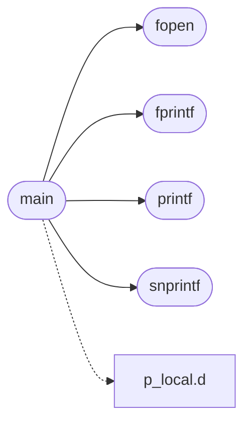

# `progs/src/ftest.c`

> Source: [progs/src/ftest.c:1](../../progs/src/ftest.c#L1) | language `c` | coverage 14.3% | [API index](../index.md)

## Contents

- **Functions:** [`fprintf`](#fprintf), [`snprintf`](#snprintf), [`printf`](#printf), [`exit`](#exit), [`fopen`](#fopen), [`main`](#main)
- **Variables:** [`stdout`](#stdout), [`stderr`](#stderr), [`errno`](#errno)

## Call Graph

Solid arrows stay in this module, dashed arrows leave it.



## Functions

<a id="fprintf"></a>

### `fprintf`

`function` `extern` | [progs/src/ftest.c:4](../../progs/src/ftest.c#L4)

```c
extern int fprintf(void *stream, const char *fmt, ...);
```

Exercises the kernel libc surface used by loaded .o programs: fprintf to stdout/stderr, snprintf into a buffer, errno on a failed open, and exit().

**Parameters**

| Name | Type | Default | Description |
|---|---|---|---|
| `stream` | `void *` |  |  |
| `fmt` | `char *` |  |  |
| `...` |  |  |  |

**Returns:** `int`

*Called by:* [`main`](#main)

---

<a id="snprintf"></a>

### `snprintf`

`function` `extern` | [progs/src/ftest.c:5](../../progs/src/ftest.c#L5)

```c
extern int snprintf(char *buf, unsigned long size, const char *fmt, ...);
```

**Parameters**

| Name | Type | Default | Description |
|---|---|---|---|
| `buf` | `char *` |  |  |
| `size` | `unsigned long` |  |  |
| `fmt` | `char *` |  |  |
| `...` |  |  |  |

**Returns:** `int`

*Called by:* [`main`](#main)

---

<a id="printf"></a>

### `printf`

`function` `extern` | [progs/src/ftest.c:6](../../progs/src/ftest.c#L6)

```c
extern int printf(const char *fmt, ...);
```

**Parameters**

| Name | Type | Default | Description |
|---|---|---|---|
| `fmt` | `char *` |  |  |
| `...` |  |  |  |

**Returns:** `int`

*Called by:* [`main`](#main)

---

<a id="exit"></a>

### `exit`

`function` `extern` | [progs/src/ftest.c:7](../../progs/src/ftest.c#L7)

```c
extern void exit(int code);
```

**Parameters**

| Name | Type | Default | Description |
|---|---|---|---|
| `code` | `int` |  |  |

---

<a id="fopen"></a>

### `fopen`

`function` `extern` | [progs/src/ftest.c:11](../../progs/src/ftest.c#L11)

```c
extern void *fopen(const char *path, const char *mode);
```

**Parameters**

| Name | Type | Default | Description |
|---|---|---|---|
| `path` | `char *` |  |  |
| `mode` | `char *` |  |  |

**Returns:** `void *`

*Called by:* [`main`](#main)

---

<a id="main"></a>

### `main`

`function` | [progs/src/ftest.c:13](../../progs/src/ftest.c#L13)

```c
int main(int argc, char **argv)
```

**Parameters**

| Name | Type | Default | Description |
|---|---|---|---|
| `argc` | `int` |  |  |
| `argv` | `char **` |  |  |

**Returns:** `int`

*Calls:* [`d`](progs.doomgeneric.p_local.h.md#d), [`fopen`](#fopen), [`fprintf`](#fprintf), [`printf`](#printf), [`snprintf`](#snprintf)

---

## Variables

<a id="stdout"></a>

### `stdout`

`variable` `extern` | [progs/src/ftest.c:8](../../progs/src/ftest.c#L8)

```c
extern void *stdout;
```

---

<a id="stderr"></a>

### `stderr`

`variable` `extern` | [progs/src/ftest.c:9](../../progs/src/ftest.c#L9)

```c
extern void *stderr;
```

---

<a id="errno"></a>

### `errno`

`variable` `extern` | [progs/src/ftest.c:10](../../progs/src/ftest.c#L10)

```c
extern int errno;
```

---
