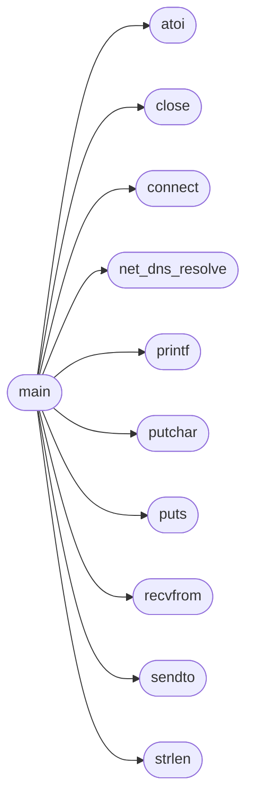

# `progs/src/http.c`

> Source: [progs/src/http.c:1](../../progs/src/http.c#L1) | language `c` | coverage 14.3% | [API index](../index.md)

Minimal HTTP/1.0 GET through the Linux socket syscalls.

## Contents

- **Functions:** [`kernel`](#kernel), [`connect`](#connect), [`sendto`](#sendto), [`recvfrom`](#recvfrom), [`shutdown`](#shutdown), [`close`](#close), [`net_dns_resolve`](#net_dns_resolve), [`puts`](#puts), [`printf`](#printf), [`strlen`](#strlen), [`putchar`](#putchar), [`atoi`](#atoi), [`main`](#main)

## Call Graph

Solid arrows stay in this module, dashed arrows leave it.



## Functions

<a id="kernel"></a>

### `kernel`

`function` | [progs/src/http.c:3](../../progs/src/http.c#L3)

```c
* Hostnames are resolved by the kernel (net_dns_resolve syscall). */ int socket(int domain, int type, int proto);
```

**Parameters**

| Name | Type | Default | Description |
|---|---|---|---|
| `syscall` | `net_dns_resolve` |  |  |

**Returns:** `* Hostnames are resolved by the`

---

<a id="connect"></a>

### `connect`

`function` | [progs/src/http.c:6](../../progs/src/http.c#L6)

```c
int connect(int fd, void *addr, int addrlen);
```

**Parameters**

| Name | Type | Default | Description |
|---|---|---|---|
| `fd` | `int` |  |  |
| `addr` | `void *` |  |  |
| `addrlen` | `int` |  |  |

**Returns:** `int`

*Called by:* [`main`](#main)

---

<a id="sendto"></a>

### `sendto`

`function` | [progs/src/http.c:7](../../progs/src/http.c#L7)

```c
int sendto(int fd, char *buf, int len, int flags, void *to, int tolen);
```

**Parameters**

| Name | Type | Default | Description |
|---|---|---|---|
| `fd` | `int` |  |  |
| `buf` | `char *` |  |  |
| `len` | `int` |  |  |
| `flags` | `int` |  |  |
| `to` | `void *` |  |  |
| `tolen` | `int` |  |  |

**Returns:** `int`

*Called by:* [`main`](#main)

---

<a id="recvfrom"></a>

### `recvfrom`

`function` | [progs/src/http.c:8](../../progs/src/http.c#L8)

```c
int recvfrom(int fd, char *buf, int len, int flags, void *from, int *fromlen);
```

**Parameters**

| Name | Type | Default | Description |
|---|---|---|---|
| `fd` | `int` |  |  |
| `buf` | `char *` |  |  |
| `len` | `int` |  |  |
| `flags` | `int` |  |  |
| `from` | `void *` |  |  |
| `fromlen` | `int *` |  |  |

**Returns:** `int`

*Called by:* [`main`](#main)

---

<a id="shutdown"></a>

### `shutdown`

`function` | [progs/src/http.c:9](../../progs/src/http.c#L9)

```c
int shutdown(int fd, int how);
```

**Parameters**

| Name | Type | Default | Description |
|---|---|---|---|
| `fd` | `int` |  |  |
| `how` | `int` |  |  |

**Returns:** `int`

---

<a id="close"></a>

### `close`

`function` | [progs/src/http.c:10](../../progs/src/http.c#L10)

```c
int close(int fd);
```

**Parameters**

| Name | Type | Default | Description |
|---|---|---|---|
| `fd` | `int` |  |  |

**Returns:** `int`

*Called by:* [`main`](#main)

---

<a id="net_dns_resolve"></a>

### `net_dns_resolve`

`function` | [progs/src/http.c:11](../../progs/src/http.c#L11)

```c
int net_dns_resolve(const char *host);
```

**Parameters**

| Name | Type | Default | Description |
|---|---|---|---|
| `host` | `char *` |  |  |

**Returns:** `int`

*Called by:* [`main`](#main)

---

<a id="puts"></a>

### `puts`

`function` | [progs/src/http.c:12](../../progs/src/http.c#L12)

```c
int puts(char *s);
```

**Parameters**

| Name | Type | Default | Description |
|---|---|---|---|
| `s` | `char *` |  |  |

**Returns:** `int`

*Called by:* [`main`](#main)

---

<a id="printf"></a>

### `printf`

`function` | [progs/src/http.c:13](../../progs/src/http.c#L13)

```c
int printf(char *fmt, ...);
```

**Parameters**

| Name | Type | Default | Description |
|---|---|---|---|
| `fmt` | `char *` |  |  |
| `...` |  |  |  |

**Returns:** `int`

*Called by:* [`main`](#main)

---

<a id="strlen"></a>

### `strlen`

`function` | [progs/src/http.c:14](../../progs/src/http.c#L14)

```c
int strlen(char *s);
```

**Parameters**

| Name | Type | Default | Description |
|---|---|---|---|
| `s` | `char *` |  |  |

**Returns:** `int`

*Called by:* [`main`](#main)

---

<a id="putchar"></a>

### `putchar`

`function` | [progs/src/http.c:15](../../progs/src/http.c#L15)

```c
int putchar(int c);
```

**Parameters**

| Name | Type | Default | Description |
|---|---|---|---|
| `c` | `int` |  |  |

**Returns:** `int`

*Called by:* [`main`](#main)

---

<a id="atoi"></a>

### `atoi`

`function` | [progs/src/http.c:18](../../progs/src/http.c#L18)

```c
int atoi(char *s)
```

Decimal string to int (the ld stub set has no atol).

**Parameters**

| Name | Type | Default | Description |
|---|---|---|---|
| `s` | `char *` |  |  |

**Returns:** `int`

*Called by:* [`main`](#main)

---

<a id="main"></a>

### `main`

`function` | [progs/src/http.c:29](../../progs/src/http.c#L29)

```c
int main(int argc, char **argv)
```

**Parameters**

| Name | Type | Default | Description |
|---|---|---|---|
| `argc` | `int` |  |  |
| `argv` | `char **` |  |  |

**Returns:** `int`

*Calls:* [`atoi`](#atoi), [`close`](#close), [`connect`](#connect), [`net_dns_resolve`](#net_dns_resolve), [`printf`](#printf), [`putchar`](#putchar), [`puts`](#puts), [`recvfrom`](#recvfrom), [`sendto`](#sendto), [`strlen`](#strlen)

---
