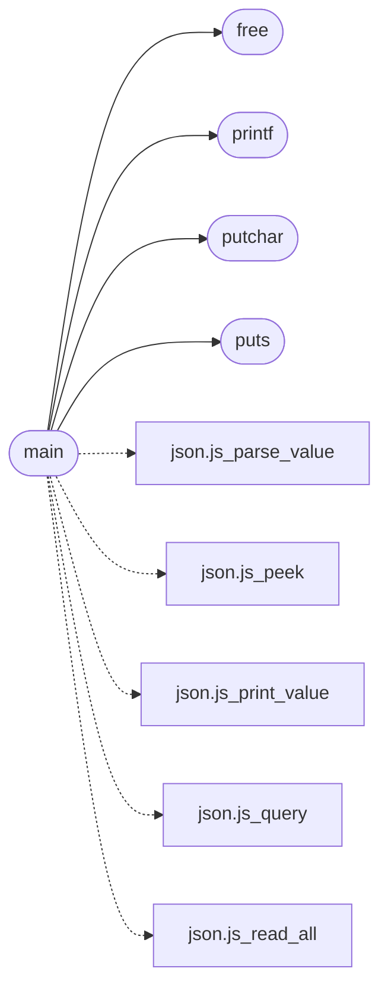

# `progs/src/json.c`

> Source: [progs/src/json.c:1](../../progs/src/json.c#L1) | language `c` | coverage 3.8% | [API index](../index.md)

json.c - command path JSON tool: validate, pretty-print and query.

## Contents

- **Functions:** [`js_str`](#js_str), [`free`](#free), [`printf`](#printf), [`putchar`](#putchar), [`puts`](#puts), [`strlen`](#strlen), [`strcmp`](#strcmp), [`fopen`](#fopen), [`fclose`](#fclose), [`fread`](#fread), [`fseek`](#fseek), [`ftell`](#ftell), [`rewind`](#rewind), [`main`](#main)
- **Macros:** [`JS_MAX_NODES`](#js_max_nodes), [`JS_POOL`](#js_pool), [`JS_NULL`](#js_null), [`JS_BOOL`](#js_bool), [`JS_NUM`](#js_num), [`JS_STR`](#js_str), [`JS_OBJ`](#js_obj), [`JS_ARR`](#js_arr), [`JS_SEEK_END`](#js_seek_end), [`JS_EXIT_OK`](#js_exit_ok), [`JS_EXIT_FAIL`](#js_exit_fail)

## Call Graph

Solid arrows stay in this module, dashed arrows leave it.



## Functions

<a id="js_str"></a>

### `js_str`

`function` | [progs/src/json.c:5](../../progs/src/json.c#L5)

```c
* members keep their key in js_str (the member value node) and their value * in the node itself, and object members / array elements are chained with * js_next. * * Usage: json <file> validate and pre
```

**Parameters**

| Name | Type | Default | Description |
|---|---|---|---|
| `node` | `the member value` |  |  |

**Returns:** `* members keep their key in`

---

<a id="free"></a>

### `free`

`function` | [progs/src/json.c:14](../../progs/src/json.c#L14)

```c
void free();
```

*Called by:* [`main`](#main)

---

<a id="printf"></a>

### `printf`

`function` | [progs/src/json.c:15](../../progs/src/json.c#L15)

```c
int printf();
```

**Returns:** `int`

*Called by:* [`main`](#main)

---

<a id="putchar"></a>

### `putchar`

`function` | [progs/src/json.c:16](../../progs/src/json.c#L16)

```c
int putchar();
```

**Returns:** `int`

*Called by:* [`main`](#main)

---

<a id="puts"></a>

### `puts`

`function` | [progs/src/json.c:17](../../progs/src/json.c#L17)

```c
int puts();
```

**Returns:** `int`

*Called by:* [`main`](#main)

---

<a id="strlen"></a>

### `strlen`

`function` | [progs/src/json.c:18](../../progs/src/json.c#L18)

```c
int strlen();
```

**Returns:** `int`

---

<a id="strcmp"></a>

### `strcmp`

`function` | [progs/src/json.c:19](../../progs/src/json.c#L19)

```c
int strcmp();
```

**Returns:** `int`

---

<a id="fopen"></a>

### `fopen`

`function` | [progs/src/json.c:20](../../progs/src/json.c#L20)

```c
void *fopen();
```

**Returns:** `void *`

---

<a id="fclose"></a>

### `fclose`

`function` | [progs/src/json.c:21](../../progs/src/json.c#L21)

```c
int fclose();
```

**Returns:** `int`

---

<a id="fread"></a>

### `fread`

`function` | [progs/src/json.c:22](../../progs/src/json.c#L22)

```c
int fread();
```

**Returns:** `int`

---

<a id="fseek"></a>

### `fseek`

`function` | [progs/src/json.c:23](../../progs/src/json.c#L23)

```c
int fseek();
```

**Returns:** `int`

---

<a id="ftell"></a>

### `ftell`

`function` | [progs/src/json.c:24](../../progs/src/json.c#L24)

```c
int ftell();
```

**Returns:** `int`

---

<a id="rewind"></a>

### `rewind`

`function` | [progs/src/json.c:25](../../progs/src/json.c#L25)

```c
void rewind();
```

---

<a id="main"></a>

### `main`

`function` | [progs/src/json.c:401](../../progs/src/json.c#L401)

```c
int main(int argc, char **argv)
```

**Parameters**

| Name | Type | Default | Description |
|---|---|---|---|
| `argc` | `int` |  |  |
| `argv` | `char **` |  |  |

**Returns:** `int`

*Calls:* [`js_parse_value`](progs.asm.json.s.md#js_parse_value), [`js_peek`](progs.asm.json.s.md#js_peek), [`js_print_value`](progs.asm.json.s.md#js_print_value), [`js_query`](progs.asm.json.s.md#js_query), [`js_read_all`](progs.asm.json.s.md#js_read_all), [`free`](#free), [`printf`](#printf), [`putchar`](#putchar), [`puts`](#puts)

---

## Macros

<a id="js_max_nodes"></a>

### `JS_MAX_NODES`

`macro` | [progs/src/json.c:27](../../progs/src/json.c#L27)

```c
#define JS_MAX_NODES
```

---

<a id="js_pool"></a>

### `JS_POOL`

`macro` | [progs/src/json.c:28](../../progs/src/json.c#L28)

```c
#define JS_POOL
```

---

<a id="js_null"></a>

### `JS_NULL`

`macro` | [progs/src/json.c:30](../../progs/src/json.c#L30)

```c
#define JS_NULL
```

---

<a id="js_bool"></a>

### `JS_BOOL`

`macro` | [progs/src/json.c:31](../../progs/src/json.c#L31)

```c
#define JS_BOOL
```

---

<a id="js_num"></a>

### `JS_NUM`

`macro` | [progs/src/json.c:32](../../progs/src/json.c#L32)

```c
#define JS_NUM
```

---

<a id="js_str"></a>

### `JS_STR`

`macro` | [progs/src/json.c:33](../../progs/src/json.c#L33)

```c
#define JS_STR
```

---

<a id="js_obj"></a>

### `JS_OBJ`

`macro` | [progs/src/json.c:34](../../progs/src/json.c#L34)

```c
#define JS_OBJ
```

---

<a id="js_arr"></a>

### `JS_ARR`

`macro` | [progs/src/json.c:35](../../progs/src/json.c#L35)

```c
#define JS_ARR
```

---

<a id="js_seek_end"></a>

### `JS_SEEK_END`

`macro` | [progs/src/json.c:37](../../progs/src/json.c#L37)

```c
#define JS_SEEK_END
```

---

<a id="js_exit_ok"></a>

### `JS_EXIT_OK`

`macro` | [progs/src/json.c:38](../../progs/src/json.c#L38)

```c
#define JS_EXIT_OK
```

---

<a id="js_exit_fail"></a>

### `JS_EXIT_FAIL`

`macro` | [progs/src/json.c:39](../../progs/src/json.c#L39)

```c
#define JS_EXIT_FAIL
```

---
