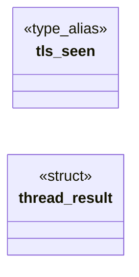

# `progs/src/lxabi.c`

> Source: [progs/src/lxabi.c:1](../../progs/src/lxabi.c#L1) | language `c` | coverage 3.7% | [API index](../index.md)

## Contents

- **Structs:** [`thread_result`](#thread_result)
- **Type Aliases:** [`tls_seen`](#tls_seen)
- **Functions:** [`process`](#process), [`main`](#main)
- **Macros:** [`_GNU_SOURCE`](#_gnu_source), [`LXABI_CHILD_DELAY_MS`](#lxabi_child_delay_ms), [`LXABI_THREADS`](#lxabi_threads), [`LXABI_THREAD_ITERS`](#lxabi_thread_iters), [`LXABI_DETACHED`](#lxabi_detached), [`LXABI_WAIT_SPINS`](#lxabi_wait_spins), [`LXABI_GROUP_EXIT_CODE`](#lxabi_group_exit_code), [`LXABI_SLEEP_MS`](#lxabi_sleep_ms), [`LXABI_MAX_SANE_CPUS`](#lxabi_max_sane_cpus), [`LXABI_TIMEDWAIT_MS`](#lxabi_timedwait_ms), [`LXABI_EPOCH_2023`](#lxabi_epoch_2023), [`LXABI_CLOCK_SKEW_S`](#lxabi_clock_skew_s), [`LXABI_REG_PROBE_WORDS`](#lxabi_reg_probe_words), [`LXABI_CLONE_NR`](#lxabi_clone_nr), [`LXABI_SIGCHLD`](#lxabi_sigchld), [`LXABI_A6_MAGIC`](#lxabi_a6_magic), [`LXABI_CHILD_BAD`](#lxabi_child_bad), [`LXABI_MKDIR_PATH`](#lxabi_mkdir_path), [`LXABI_MKDIR_FILE`](#lxabi_mkdir_file), [`LXABI_CLOSE_RANGE_NR`](#lxabi_close_range_nr), [`LXABI_PAGE`](#lxabi_page), [`LXABI_COW_WORD`](#lxabi_cow_word)

## Type Diagram



## Call Graph

Solid arrows stay in this module, dashed arrows leave it.


## Structs

<a id="thread_result"></a>

### `thread_result`

`struct` | [progs/src/lxabi.c:195](../../progs/src/lxabi.c#L195)

```c
typedef struct thread_result
```

---

## Type Aliases

<a id="tls_seen"></a>

### `tls_seen`

`type_alias` | [progs/src/lxabi.c:194](../../progs/src/lxabi.c#L194)

```c
typedef struct thread_result { long tls_seen;
```

---

## Functions

<a id="process"></a>

### `process`

`function` | [progs/src/lxabi.c:581](../../progs/src/lxabi.c#L581)

```c
* process (never a kernel panic), and kill(pid, 0) or a harmless signal * leaves the target aliv...
```

**Parameters**

| Name | Type | Default | Description |
|---|---|---|---|
| `panic` | `never a kernel` |  |  |

**Returns:** `*`

*Calls:* [`kill`](kernel.syscalls_proc.c.md#kill)

---

<a id="main"></a>

### `main`

`function` | [progs/src/lxabi.c:754](../../progs/src/lxabi.c#L754)

```c
int main(void)
```

**Returns:** `int`

---

## Macros

<a id="_gnu_source"></a>

### `_GNU_SOURCE`

`macro` | [progs/src/lxabi.c:17](../../progs/src/lxabi.c#L17)

```c
#define _GNU_SOURCE
```

lxabi.c - Linux process, thread and descriptor ABI probe (FreeDom readiness, docs/spec/smp-sched.md "Linux process, thread and descriptor ABI").

A static glibc program that exercises exactly the kernel surface the full
FreeDom GUI needs: register state across fork, clone threads with TLS and
join, auto-reaped detached threads, futex bitset waits with timeouts, pipe2
and fcntl flags, blocking and non-blocking pipe I/O with EOF and EPIPE,
close-on-exit of a child's descriptors, writev into a pipe, eventfd, poll on
pipes and eventfds, close_range, time(2) and mkdir. Every check prints
"lxabi: <check> ok" or "lxabi: <check> FAIL <detail>"; the run ends with
"lxabi: all ok" and exit 0, or "lxabi: <n> failed" and exit 1.

Built with -mno-red-zone: the register probe pushes onto the stack from
inline assembly.

---

<a id="lxabi_child_delay_ms"></a>

### `LXABI_CHILD_DELAY_MS`

`macro` | [progs/src/lxabi.c:41](../../progs/src/lxabi.c#L41)

```c
#define LXABI_CHILD_DELAY_MS
```

---

<a id="lxabi_threads"></a>

### `LXABI_THREADS`

`macro` | [progs/src/lxabi.c:42](../../progs/src/lxabi.c#L42)

```c
#define LXABI_THREADS
```

---

<a id="lxabi_thread_iters"></a>

### `LXABI_THREAD_ITERS`

`macro` | [progs/src/lxabi.c:43](../../progs/src/lxabi.c#L43)

```c
#define LXABI_THREAD_ITERS
```

---

<a id="lxabi_detached"></a>

### `LXABI_DETACHED`

`macro` | [progs/src/lxabi.c:44](../../progs/src/lxabi.c#L44)

```c
#define LXABI_DETACHED
```

---

<a id="lxabi_wait_spins"></a>

### `LXABI_WAIT_SPINS`

`macro` | [progs/src/lxabi.c:45](../../progs/src/lxabi.c#L45)

```c
#define LXABI_WAIT_SPINS
```

---

<a id="lxabi_group_exit_code"></a>

### `LXABI_GROUP_EXIT_CODE`

`macro` | [progs/src/lxabi.c:46](../../progs/src/lxabi.c#L46)

```c
#define LXABI_GROUP_EXIT_CODE
```

---

<a id="lxabi_sleep_ms"></a>

### `LXABI_SLEEP_MS`

`macro` | [progs/src/lxabi.c:47](../../progs/src/lxabi.c#L47)

```c
#define LXABI_SLEEP_MS
```

---

<a id="lxabi_max_sane_cpus"></a>

### `LXABI_MAX_SANE_CPUS`

`macro` | [progs/src/lxabi.c:48](../../progs/src/lxabi.c#L48)

```c
#define LXABI_MAX_SANE_CPUS
```

---

<a id="lxabi_timedwait_ms"></a>

### `LXABI_TIMEDWAIT_MS`

`macro` | [progs/src/lxabi.c:49](../../progs/src/lxabi.c#L49)

```c
#define LXABI_TIMEDWAIT_MS
```

---

<a id="lxabi_epoch_2023"></a>

### `LXABI_EPOCH_2023`

`macro` | [progs/src/lxabi.c:50](../../progs/src/lxabi.c#L50)

```c
#define LXABI_EPOCH_2023
```

---

<a id="lxabi_clock_skew_s"></a>

### `LXABI_CLOCK_SKEW_S`

`macro` | [progs/src/lxabi.c:51](../../progs/src/lxabi.c#L51)

```c
#define LXABI_CLOCK_SKEW_S
```

---

<a id="lxabi_reg_probe_words"></a>

### `LXABI_REG_PROBE_WORDS`

`macro` | [progs/src/lxabi.c:52](../../progs/src/lxabi.c#L52)

```c
#define LXABI_REG_PROBE_WORDS
```

---

<a id="lxabi_clone_nr"></a>

### `LXABI_CLONE_NR`

`macro` | [progs/src/lxabi.c:53](../../progs/src/lxabi.c#L53)

```c
#define LXABI_CLONE_NR
```

---

<a id="lxabi_sigchld"></a>

### `LXABI_SIGCHLD`

`macro` | [progs/src/lxabi.c:54](../../progs/src/lxabi.c#L54)

```c
#define LXABI_SIGCHLD
```

---

<a id="lxabi_a6_magic"></a>

### `LXABI_A6_MAGIC`

`macro` | [progs/src/lxabi.c:55](../../progs/src/lxabi.c#L55)

```c
#define LXABI_A6_MAGIC
```

---

<a id="lxabi_child_bad"></a>

### `LXABI_CHILD_BAD`

`macro` | [progs/src/lxabi.c:56](../../progs/src/lxabi.c#L56)

```c
#define LXABI_CHILD_BAD
```

---

<a id="lxabi_mkdir_path"></a>

### `LXABI_MKDIR_PATH`

`macro` | [progs/src/lxabi.c:57](../../progs/src/lxabi.c#L57)

```c
#define LXABI_MKDIR_PATH
```

---

<a id="lxabi_mkdir_file"></a>

### `LXABI_MKDIR_FILE`

`macro` | [progs/src/lxabi.c:58](../../progs/src/lxabi.c#L58)

```c
#define LXABI_MKDIR_FILE
```

---

<a id="lxabi_close_range_nr"></a>

### `LXABI_CLOSE_RANGE_NR`

`macro` | [progs/src/lxabi.c:59](../../progs/src/lxabi.c#L59)

```c
#define LXABI_CLOSE_RANGE_NR
```

---

<a id="lxabi_page"></a>

### `LXABI_PAGE`

`macro` | [progs/src/lxabi.c:60](../../progs/src/lxabi.c#L60)

```c
#define LXABI_PAGE
```

---

<a id="lxabi_cow_word"></a>

### `LXABI_COW_WORD`

`macro` | [progs/src/lxabi.c:61](../../progs/src/lxabi.c#L61)

```c
#define LXABI_COW_WORD
```

---
