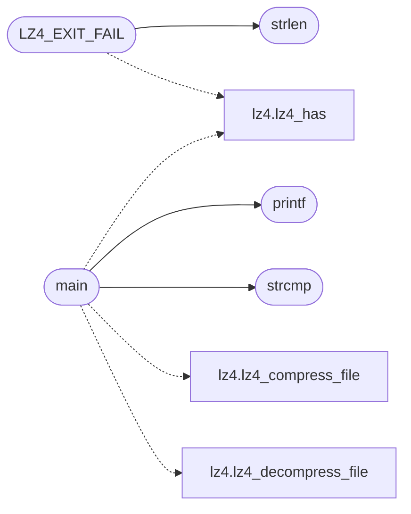

# `progs/src/lz4.c`

> Source: [progs/src/lz4.c:1](../../progs/src/lz4.c#L1) | language `c` | coverage 4.5% | [API index](../index.md)

lz4.c - command path LZ4 (de)compression tools: lz4 and unlz4.

## Contents

- **Functions:** [`kernel`](#kernel), [`free`](#free), [`printf`](#printf), [`strcmp`](#strcmp), [`strlen`](#strlen), [`fopen`](#fopen), [`fclose`](#fclose), [`fread`](#fread), [`fwrite`](#fwrite), [`fseek`](#fseek), [`ftell`](#ftell), [`rewind`](#rewind), [`lz4_compress`](#lz4_compress), [`lz4_decompress`](#lz4_decompress), [`main`](#main)
- **Macros:** [`LZ4_HDR_SIZE`](#lz4_hdr_size), [`LZ4_BOUND_DEN`](#lz4_bound_den), [`LZ4_BOUND_SLACK`](#lz4_bound_slack), [`LZ4_MAX_BLOCK`](#lz4_max_block), [`LZ4_SEEK_END`](#lz4_seek_end), [`LZ4_EXIT_FAIL`](#lz4_exit_fail)

## Call Graph

Solid arrows stay in this module, dashed arrows leave it.



## Functions

<a id="kernel"></a>

### `kernel`

`function` | [progs/src/lz4.c:6](../../progs/src/lz4.c#L6)

```c
* * The codec lives in the kernel (lz4_kernel.c, the same one MiniFS uses), so * these tools are thin front-ends over the two MiniOS syscalls 216 * (lz4_compress) and 217 (lz4_decompress), which mirro
```

**Parameters**

| Name | Type | Default | Description |
|---|---|---|---|
| `c` | `lz4_kernel.` |  |  |
| `uses` | `the same one MiniFS` |  |  |

**Returns:** `* * The codec lives in the`

---

<a id="free"></a>

### `free`

`function` | [progs/src/lz4.c:15](../../progs/src/lz4.c#L15)

```c
void free();
```

---

<a id="printf"></a>

### `printf`

`function` | [progs/src/lz4.c:16](../../progs/src/lz4.c#L16)

```c
int printf();
```

**Returns:** `int`

*Called by:* [`main`](#main)

---

<a id="strcmp"></a>

### `strcmp`

`function` | [progs/src/lz4.c:17](../../progs/src/lz4.c#L17)

```c
int strcmp();
```

**Returns:** `int`

*Called by:* [`main`](#main)

---

<a id="strlen"></a>

### `strlen`

`function` | [progs/src/lz4.c:18](../../progs/src/lz4.c#L18)

```c
int strlen();
```

**Returns:** `int`

*Called by:* [`LZ4_EXIT_FAIL`](#lz4_exit_fail)

---

<a id="fopen"></a>

### `fopen`

`function` | [progs/src/lz4.c:19](../../progs/src/lz4.c#L19)

```c
void *fopen();
```

**Returns:** `void *`

---

<a id="fclose"></a>

### `fclose`

`function` | [progs/src/lz4.c:20](../../progs/src/lz4.c#L20)

```c
int fclose();
```

**Returns:** `int`

---

<a id="fread"></a>

### `fread`

`function` | [progs/src/lz4.c:21](../../progs/src/lz4.c#L21)

```c
int fread();
```

**Returns:** `int`

---

<a id="fwrite"></a>

### `fwrite`

`function` | [progs/src/lz4.c:22](../../progs/src/lz4.c#L22)

```c
int fwrite();
```

**Returns:** `int`

---

<a id="fseek"></a>

### `fseek`

`function` | [progs/src/lz4.c:23](../../progs/src/lz4.c#L23)

```c
int fseek();
```

**Returns:** `int`

---

<a id="ftell"></a>

### `ftell`

`function` | [progs/src/lz4.c:24](../../progs/src/lz4.c#L24)

```c
int ftell();
```

**Returns:** `int`

---

<a id="rewind"></a>

### `rewind`

`function` | [progs/src/lz4.c:25](../../progs/src/lz4.c#L25)

```c
void rewind();
```

---

<a id="lz4_compress"></a>

### `lz4_compress`

`function` | [progs/src/lz4.c:27](../../progs/src/lz4.c#L27)

```c
int lz4_compress(char *src, int srclen, char *dst, int dstcap);
```

**Parameters**

| Name | Type | Default | Description |
|---|---|---|---|
| `src` | `char *` |  |  |
| `srclen` | `int` |  |  |
| `dst` | `char *` |  |  |
| `dstcap` | `int` |  |  |

**Returns:** `int`

---

<a id="lz4_decompress"></a>

### `lz4_decompress`

`function` | [progs/src/lz4.c:28](../../progs/src/lz4.c#L28)

```c
int lz4_decompress(char *src, int srclen, char *dst, int dstcap);
```

**Parameters**

| Name | Type | Default | Description |
|---|---|---|---|
| `src` | `char *` |  |  |
| `srclen` | `int` |  |  |
| `dst` | `char *` |  |  |
| `dstcap` | `int` |  |  |

**Returns:** `int`

---

<a id="main"></a>

### `main`

`function` | [progs/src/lz4.c:164](../../progs/src/lz4.c#L164)

```c
int main(int argc, char **argv)
```

**Parameters**

| Name | Type | Default | Description |
|---|---|---|---|
| `argc` | `int` |  |  |
| `argv` | `char **` |  |  |

**Returns:** `int`

*Calls:* [`lz4_compress_file`](progs.asm.lz4.s.md#lz4_compress_file), [`lz4_decompress_file`](progs.asm.lz4.s.md#lz4_decompress_file), [`lz4_has`](progs.asm.lz4.s.md#lz4_has), [`printf`](#printf), [`strcmp`](#strcmp)

---

## Macros

<a id="lz4_hdr_size"></a>

### `LZ4_HDR_SIZE`

`macro` | [progs/src/lz4.c:30](../../progs/src/lz4.c#L30)

```c
#define LZ4_HDR_SIZE
```

---

<a id="lz4_bound_den"></a>

### `LZ4_BOUND_DEN`

`macro` | [progs/src/lz4.c:31](../../progs/src/lz4.c#L31)

```c
#define LZ4_BOUND_DEN
```

---

<a id="lz4_bound_slack"></a>

### `LZ4_BOUND_SLACK`

`macro` | [progs/src/lz4.c:32](../../progs/src/lz4.c#L32)

```c
#define LZ4_BOUND_SLACK
```

---

<a id="lz4_max_block"></a>

### `LZ4_MAX_BLOCK`

`macro` | [progs/src/lz4.c:33](../../progs/src/lz4.c#L33)

```c
#define LZ4_MAX_BLOCK
```

---

<a id="lz4_seek_end"></a>

### `LZ4_SEEK_END`

`macro` | [progs/src/lz4.c:35](../../progs/src/lz4.c#L35)

```c
#define LZ4_SEEK_END
```

---

<a id="lz4_exit_fail"></a>

### `LZ4_EXIT_FAIL`

`macro` | [progs/src/lz4.c:37](../../progs/src/lz4.c#L37)

```c
#define LZ4_EXIT_FAIL
```

*Calls:* [`lz4_has`](progs.asm.lz4.s.md#lz4_has), [`strlen`](#strlen)

---
