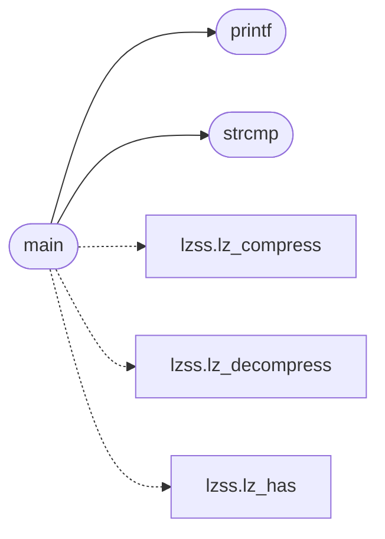

# `progs/src/lzss.c`

> Source: [progs/src/lzss.c:1](../../progs/src/lzss.c#L1) | language `c` | coverage 3.1% | [API index](../index.md)

lzss.c - command path LZSS (de)compression tools: lzss and unlzss.

## Contents

- **Functions:** [`malloc`](#malloc), [`free`](#free), [`printf`](#printf), [`strcmp`](#strcmp), [`strlen`](#strlen), [`fopen`](#fopen), [`fclose`](#fclose), [`fread`](#fread), [`fwrite`](#fwrite), [`fseek`](#fseek), [`ftell`](#ftell), [`rewind`](#rewind), [`main`](#main)
- **Macros:** [`LZSS_EI`](#lzss_ei), [`LZSS_EJ`](#lzss_ej), [`LZSS_P`](#lzss_p), [`LZSS_N`](#lzss_n), [`LZSS_F`](#lzss_f), [`LZSS_WIN`](#lzss_win), [`LZSS_MAGIC0`](#lzss_magic0), [`LZSS_MAGIC1`](#lzss_magic1), [`LZSS_MAGIC2`](#lzss_magic2), [`LZSS_MAGIC3`](#lzss_magic3), [`LZSS_HDR_SIZE`](#lzss_hdr_size), [`LZSS_ENC_SLACK`](#lzss_enc_slack), [`LZSS_EXPAND_NUM`](#lzss_expand_num), [`LZSS_EXPAND_DEN`](#lzss_expand_den), [`LZSS_SEEK_END`](#lzss_seek_end), [`LZSS_ERR_NONE`](#lzss_err_none), [`LZSS_ERR_OVERFLOW`](#lzss_err_overflow), [`LZSS_EXIT_FAIL`](#lzss_exit_fail)

## Call Graph

Solid arrows stay in this module, dashed arrows leave it.



## Functions

<a id="malloc"></a>

### `malloc`

`function` | [progs/src/lzss.c:13](../../progs/src/lzss.c#L13)

```c
void *malloc();
```

**Returns:** `void *`

---

<a id="free"></a>

### `free`

`function` | [progs/src/lzss.c:14](../../progs/src/lzss.c#L14)

```c
void free();
```

---

<a id="printf"></a>

### `printf`

`function` | [progs/src/lzss.c:15](../../progs/src/lzss.c#L15)

```c
int printf();
```

**Returns:** `int`

*Called by:* [`main`](#main)

---

<a id="strcmp"></a>

### `strcmp`

`function` | [progs/src/lzss.c:16](../../progs/src/lzss.c#L16)

```c
int strcmp();
```

**Returns:** `int`

*Called by:* [`main`](#main)

---

<a id="strlen"></a>

### `strlen`

`function` | [progs/src/lzss.c:17](../../progs/src/lzss.c#L17)

```c
int strlen();
```

**Returns:** `int`

---

<a id="fopen"></a>

### `fopen`

`function` | [progs/src/lzss.c:18](../../progs/src/lzss.c#L18)

```c
void *fopen();
```

**Returns:** `void *`

---

<a id="fclose"></a>

### `fclose`

`function` | [progs/src/lzss.c:19](../../progs/src/lzss.c#L19)

```c
int fclose();
```

**Returns:** `int`

---

<a id="fread"></a>

### `fread`

`function` | [progs/src/lzss.c:20](../../progs/src/lzss.c#L20)

```c
int fread();
```

**Returns:** `int`

---

<a id="fwrite"></a>

### `fwrite`

`function` | [progs/src/lzss.c:21](../../progs/src/lzss.c#L21)

```c
int fwrite();
```

**Returns:** `int`

---

<a id="fseek"></a>

### `fseek`

`function` | [progs/src/lzss.c:22](../../progs/src/lzss.c#L22)

```c
int fseek();
```

**Returns:** `int`

---

<a id="ftell"></a>

### `ftell`

`function` | [progs/src/lzss.c:23](../../progs/src/lzss.c#L23)

```c
int ftell();
```

**Returns:** `int`

---

<a id="rewind"></a>

### `rewind`

`function` | [progs/src/lzss.c:24](../../progs/src/lzss.c#L24)

```c
void rewind();
```

---

<a id="main"></a>

### `main`

`function` | [progs/src/lzss.c:397](../../progs/src/lzss.c#L397)

```c
int main(int argc, char **argv)
```

**Parameters**

| Name | Type | Default | Description |
|---|---|---|---|
| `argc` | `int` |  |  |
| `argv` | `char **` |  |  |

**Returns:** `int`

*Calls:* [`lz_compress`](progs.asm.lzss.s.md#lz_compress), [`lz_decompress`](progs.asm.lzss.s.md#lz_decompress), [`lz_has`](progs.asm.lzss.s.md#lz_has), [`printf`](#printf), [`strcmp`](#strcmp)

---

## Macros

<a id="lzss_ei"></a>

### `LZSS_EI`

`macro` | [progs/src/lzss.c:26](../../progs/src/lzss.c#L26)

```c
#define LZSS_EI
```

---

<a id="lzss_ej"></a>

### `LZSS_EJ`

`macro` | [progs/src/lzss.c:27](../../progs/src/lzss.c#L27)

```c
#define LZSS_EJ
```

---

<a id="lzss_p"></a>

### `LZSS_P`

`macro` | [progs/src/lzss.c:28](../../progs/src/lzss.c#L28)

```c
#define LZSS_P
```

---

<a id="lzss_n"></a>

### `LZSS_N`

`macro` | [progs/src/lzss.c:29](../../progs/src/lzss.c#L29)

```c
#define LZSS_N
```

---

<a id="lzss_f"></a>

### `LZSS_F`

`macro` | [progs/src/lzss.c:30](../../progs/src/lzss.c#L30)

```c
#define LZSS_F
```

---

<a id="lzss_win"></a>

### `LZSS_WIN`

`macro` | [progs/src/lzss.c:31](../../progs/src/lzss.c#L31)

```c
#define LZSS_WIN
```

---

<a id="lzss_magic0"></a>

### `LZSS_MAGIC0`

`macro` | [progs/src/lzss.c:33](../../progs/src/lzss.c#L33)

```c
#define LZSS_MAGIC0
```

---

<a id="lzss_magic1"></a>

### `LZSS_MAGIC1`

`macro` | [progs/src/lzss.c:34](../../progs/src/lzss.c#L34)

```c
#define LZSS_MAGIC1
```

---

<a id="lzss_magic2"></a>

### `LZSS_MAGIC2`

`macro` | [progs/src/lzss.c:35](../../progs/src/lzss.c#L35)

```c
#define LZSS_MAGIC2
```

---

<a id="lzss_magic3"></a>

### `LZSS_MAGIC3`

`macro` | [progs/src/lzss.c:36](../../progs/src/lzss.c#L36)

```c
#define LZSS_MAGIC3
```

---

<a id="lzss_hdr_size"></a>

### `LZSS_HDR_SIZE`

`macro` | [progs/src/lzss.c:37](../../progs/src/lzss.c#L37)

```c
#define LZSS_HDR_SIZE
```

---

<a id="lzss_enc_slack"></a>

### `LZSS_ENC_SLACK`

`macro` | [progs/src/lzss.c:39](../../progs/src/lzss.c#L39)

```c
#define LZSS_ENC_SLACK
```

---

<a id="lzss_expand_num"></a>

### `LZSS_EXPAND_NUM`

`macro` | [progs/src/lzss.c:40](../../progs/src/lzss.c#L40)

```c
#define LZSS_EXPAND_NUM
```

---

<a id="lzss_expand_den"></a>

### `LZSS_EXPAND_DEN`

`macro` | [progs/src/lzss.c:41](../../progs/src/lzss.c#L41)

```c
#define LZSS_EXPAND_DEN
```

---

<a id="lzss_seek_end"></a>

### `LZSS_SEEK_END`

`macro` | [progs/src/lzss.c:43](../../progs/src/lzss.c#L43)

```c
#define LZSS_SEEK_END
```

---

<a id="lzss_err_none"></a>

### `LZSS_ERR_NONE`

`macro` | [progs/src/lzss.c:45](../../progs/src/lzss.c#L45)

```c
#define LZSS_ERR_NONE
```

---

<a id="lzss_err_overflow"></a>

### `LZSS_ERR_OVERFLOW`

`macro` | [progs/src/lzss.c:46](../../progs/src/lzss.c#L46)

```c
#define LZSS_ERR_OVERFLOW
```

---

<a id="lzss_exit_fail"></a>

### `LZSS_EXIT_FAIL`

`macro` | [progs/src/lzss.c:48](../../progs/src/lzss.c#L48)

```c
#define LZSS_EXIT_FAIL
```

---
