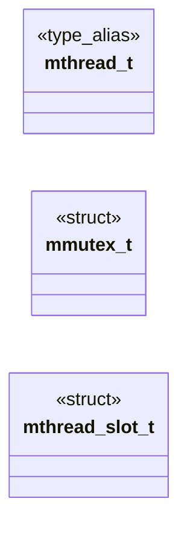
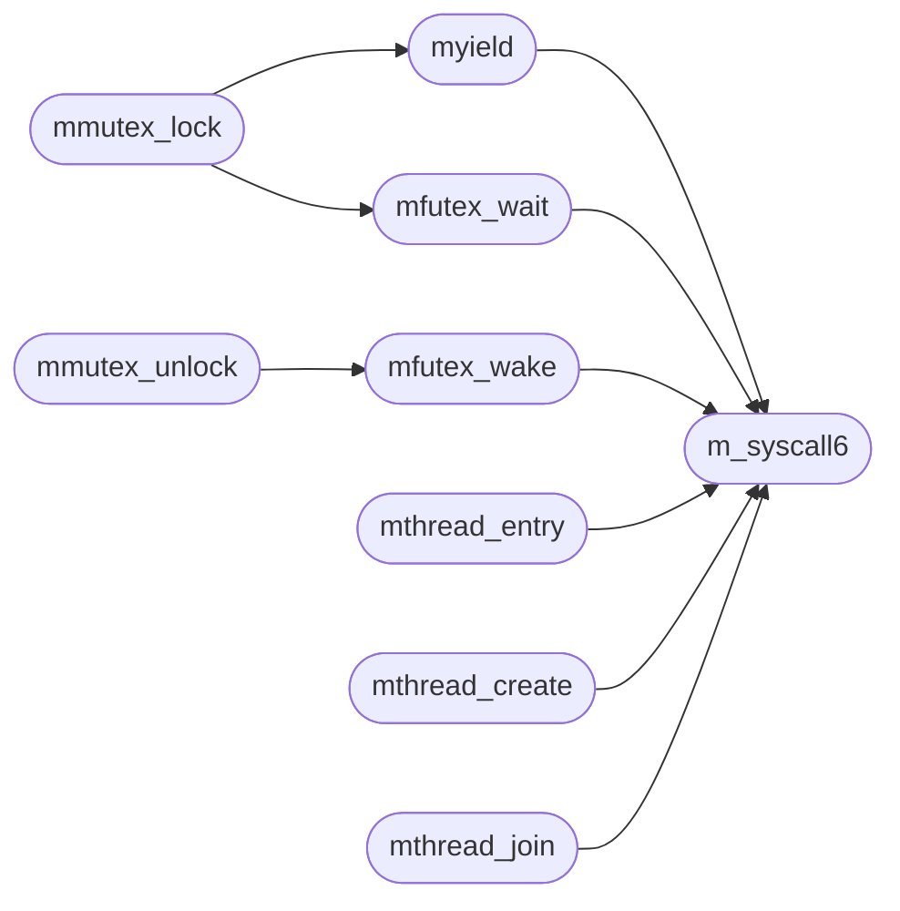

# `progs/src/mthreads.h`

> Source: [progs/src/mthreads.h:1](../../progs/src/mthreads.h#L1) | language `h` | coverage 20.0% | [API index](../index.md)

mthreads.h -- Minimal pthread-like threads for MiniOS ELFs (roadmap

## Contents

- **Structs:** [`mmutex_t`](#mmutex_t), [`mthread_slot_t`](#mthread_slot_t)
- **Type Aliases:** [`mthread_t`](#mthread_t)
- **Functions:** [`m_syscall6`](#m_syscall6), [`myield`](#myield), [`mfutex_wait`](#mfutex_wait), [`mfutex_wake`](#mfutex_wake), [`mmutex_init`](#mmutex_init), [`mmutex_lock`](#mmutex_lock), [`mmutex_unlock`](#mmutex_unlock), [`mthread_entry`](#mthread_entry), [`mthread_create`](#mthread_create), [`mthread_join`](#mthread_join)
- **Macros:** [`MTHREAD_STACK_SZ`](#mthread_stack_sz), [`MTHREAD_MAX`](#mthread_max), [`MMUTEX_FREE`](#mmutex_free), [`MMUTEX_HELD`](#mmutex_held), [`MMUTEX_CONTENDED`](#mmutex_contended), [`MMUTEX_SPINS`](#mmutex_spins)

## Type Diagram



## Call Graph

Solid arrows stay in this module, dashed arrows leave it.



## Structs

<a id="mmutex_t"></a>

### `mmutex_t`

`struct` | [progs/src/mthreads.h:38](../../progs/src/mthreads.h#L38)

```c
typedef struct
```

---

<a id="mthread_slot_t"></a>

### `mthread_slot_t`

`struct` | [progs/src/mthreads.h:42](../../progs/src/mthreads.h#L42)

```c
typedef struct
```

---

## Type Aliases

<a id="mthread_t"></a>

### `mthread_t`

`type_alias` | [progs/src/mthreads.h:35](../../progs/src/mthreads.h#L35)

```c
typedef int mthread_t;
```

define MMUTEX_FREE 0 define MMUTEX_HELD 1 define MMUTEX_CONTENDED 2 define MMUTEX_SPINS 100

---

## Functions

<a id="m_syscall6"></a>

### `m_syscall6`

`function` `inline` `static` | [progs/src/mthreads.h:50](../../progs/src/mthreads.h#L50)

```c
static inline long m_syscall6(long n, long a, long b, long c)
```

**Parameters**

| Name | Type | Default | Description |
|---|---|---|---|
| `n` | `long` |  |  |
| `a` | `long` |  |  |
| `b` | `long` |  |  |
| `c` | `long` |  |  |

**Returns:** `long`

*Called by:* [`mfutex_wait`](#mfutex_wait), [`mfutex_wake`](#mfutex_wake), [`mthread_create`](#mthread_create), [`mthread_entry`](#mthread_entry), [`mthread_join`](#mthread_join), [`myield`](#myield)

---

<a id="myield"></a>

### `myield`

`function` `inline` `static` | [progs/src/mthreads.h:59](../../progs/src/mthreads.h#L59)

```c
static inline void myield(void)
```

*Calls:* [`m_syscall6`](#m_syscall6)

*Called by:* [`mmutex_lock`](#mmutex_lock)

---

<a id="mfutex_wait"></a>

### `mfutex_wait`

`function` `inline` `static` | [progs/src/mthreads.h:63](../../progs/src/mthreads.h#L63)

```c
static inline long mfutex_wait(volatile int *addr, int val)
```

**Parameters**

| Name | Type | Default | Description |
|---|---|---|---|
| `addr` | `volatile int *` |  |  |
| `val` | `int` |  |  |

**Returns:** `long`

*Calls:* [`m_syscall6`](#m_syscall6)

*Called by:* [`mmutex_lock`](#mmutex_lock)

---

<a id="mfutex_wake"></a>

### `mfutex_wake`

`function` `inline` `static` | [progs/src/mthreads.h:67](../../progs/src/mthreads.h#L67)

```c
static inline long mfutex_wake(volatile int *addr, int n)
```

**Parameters**

| Name | Type | Default | Description |
|---|---|---|---|
| `addr` | `volatile int *` |  |  |
| `n` | `int` |  |  |

**Returns:** `long`

*Calls:* [`m_syscall6`](#m_syscall6)

*Called by:* [`mmutex_unlock`](#mmutex_unlock)

---

<a id="mmutex_init"></a>

### `mmutex_init`

`function` `inline` `static` | [progs/src/mthreads.h:71](../../progs/src/mthreads.h#L71)

```c
static inline void mmutex_init(mmutex_t *m)
```

**Parameters**

| Name | Type | Default | Description |
|---|---|---|---|
| `m` | `mmutex_t *` |  |  |

*Called by:* [`main`](progs.src.thdemo.c.md#main)

---

<a id="mmutex_lock"></a>

### `mmutex_lock`

`function` `inline` `static` | [progs/src/mthreads.h:75](../../progs/src/mthreads.h#L75)

```c
static inline void mmutex_lock(mmutex_t *m)
```

**Parameters**

| Name | Type | Default | Description |
|---|---|---|---|
| `m` | `mmutex_t *` |  |  |

*Calls:* [`mfutex_wait`](#mfutex_wait), [`myield`](#myield)

*Called by:* [`main`](progs.src.thdemo.c.md#main)

---

<a id="mmutex_unlock"></a>

### `mmutex_unlock`

`function` `inline` `static` | [progs/src/mthreads.h:90](../../progs/src/mthreads.h#L90)

```c
static inline void mmutex_unlock(mmutex_t *m)
```

**Parameters**

| Name | Type | Default | Description |
|---|---|---|---|
| `m` | `mmutex_t *` |  |  |

*Calls:* [`mfutex_wake`](#mfutex_wake)

*Called by:* [`main`](progs.src.thdemo.c.md#main)

---

<a id="mthread_entry"></a>

### `mthread_entry`

`function` `static` | [progs/src/mthreads.h:98](../../progs/src/mthreads.h#L98)

```c
static void mthread_entry(void *p)
```

Thread entry trampoline: runs fn(arg), stores the return, exits 0.

The exit code is always 0; join reads retval from the shared slot.

**Parameters**

| Name | Type | Default | Description |
|---|---|---|---|
| `p` | `void *` |  |  |

*Calls:* [`m_syscall6`](#m_syscall6)

---

<a id="mthread_create"></a>

### `mthread_create`

`function` `static` | [progs/src/mthreads.h:117](../../progs/src/mthreads.h#L117)

```c
static int mthread_create(mthread_t *t, void *(*fn)(void *), void *arg)
```

**Parameters**

| Name | Type | Default | Description |
|---|---|---|---|
| `t` | `mthread_t *` |  |  |
| `void` | `void *(*fn)( *)` |  |  |
| `arg` | `void *` |  |  |

**Returns:** `int`

*Calls:* [`m_syscall6`](#m_syscall6)

*Called by:* [`main`](progs.src.fptest.c.md#main), [`_start`](progs.src.scfuzz.c.md#_start), [`main`](progs.src.thdemo.c.md#main)

---

<a id="mthread_join"></a>

### `mthread_join`

`function` `static` | [progs/src/mthreads.h:144](../../progs/src/mthreads.h#L144)

```c
static int mthread_join(mthread_t t, void **retval)
```

Join: wait4 (Linux semantics) answers the reaped pid and stores the status word; the thread always exits 0, so a join succeeds only when the pid it reaped is this thread's and the status says exit 0.

Returns 0, the negative errno from wait4, or -1 for any other outcome.

**Parameters**

| Name | Type | Default | Description |
|---|---|---|---|
| `t` | `mthread_t` |  |  |
| `retval` | `void **` |  |  |

**Returns:** `int`

*Calls:* [`m_syscall6`](#m_syscall6)

*Called by:* [`main`](progs.src.fptest.c.md#main), [`_start`](progs.src.scfuzz.c.md#_start), [`main`](progs.src.thdemo.c.md#main)

---

## Macros

<a id="mthread_stack_sz"></a>

### `MTHREAD_STACK_SZ`

`macro` | [progs/src/mthreads.h:28](../../progs/src/mthreads.h#L28)

```c
#define MTHREAD_STACK_SZ
```

---

<a id="mthread_max"></a>

### `MTHREAD_MAX`

`macro` | [progs/src/mthreads.h:29](../../progs/src/mthreads.h#L29)

```c
#define MTHREAD_MAX
```

---

<a id="mmutex_free"></a>

### `MMUTEX_FREE`

`macro` | [progs/src/mthreads.h:31](../../progs/src/mthreads.h#L31)

```c
#define MMUTEX_FREE
```

---

<a id="mmutex_held"></a>

### `MMUTEX_HELD`

`macro` | [progs/src/mthreads.h:32](../../progs/src/mthreads.h#L32)

```c
#define MMUTEX_HELD
```

---

<a id="mmutex_contended"></a>

### `MMUTEX_CONTENDED`

`macro` | [progs/src/mthreads.h:33](../../progs/src/mthreads.h#L33)

```c
#define MMUTEX_CONTENDED
```

---

<a id="mmutex_spins"></a>

### `MMUTEX_SPINS`

`macro` | [progs/src/mthreads.h:34](../../progs/src/mthreads.h#L34)

```c
#define MMUTEX_SPINS
```

---
