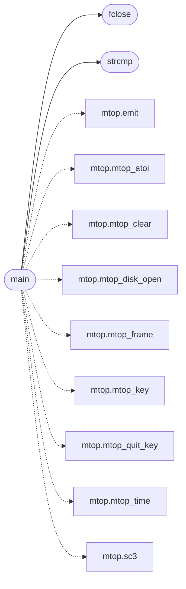

# `progs/src/mtop.c`

> Source: [progs/src/mtop.c:1](../../progs/src/mtop.c#L1) | language `c` | coverage 5.9% | [API index](../index.md)

mtop.c - ASCII real-time system monitor for MiniOS.

## Contents

- **Functions:** [`syscall`](#syscall), [`putchar`](#putchar), [`strlen`](#strlen), [`strcmp`](#strcmp), [`fopen`](#fopen), [`fclose`](#fclose), [`fread`](#fread), [`rewind`](#rewind), [`socket`](#socket), [`close`](#close), [`net_dns_resolve`](#net_dns_resolve), [`main`](#main)
- **Macros:** [`MTOP_HIST`](#mtop_hist), [`MTOP_DISK_BUF`](#mtop_disk_buf), [`MTOP_DISK_MAX`](#mtop_disk_max), [`MTOP_MINFO`](#mtop_minfo)

## Call Graph

Solid arrows stay in this module, dashed arrows leave it.



## Functions

<a id="syscall"></a>

### `syscall`

`function` | [progs/src/mtop.c:12](../../progs/src/mtop.c#L12)

```c
* * All system figures come from the MINFO syscall (251): heap used / * free, ramdisk used / cap, MiniFS free / total blocks, cpu total / * idle 100 Hz ticks, cpu count / uptime. CPU busy percent is *
```

**Parameters**

| Name | Type | Default | Description |
|---|---|---|---|
| `251` |  |  |  |

**Returns:** `heap used / * free, ramdisk used / cap, MiniFS free / total blocks, cpu total / * idle 100 Hz ticks, cpu count / uptime. CPU busy percent is *`

---

<a id="putchar"></a>

### `putchar`

`function` | [progs/src/mtop.c:35](../../progs/src/mtop.c#L35)

```c
int putchar();
```

**Returns:** `int`

---

<a id="strlen"></a>

### `strlen`

`function` | [progs/src/mtop.c:36](../../progs/src/mtop.c#L36)

```c
int strlen();
```

**Returns:** `int`

---

<a id="strcmp"></a>

### `strcmp`

`function` | [progs/src/mtop.c:37](../../progs/src/mtop.c#L37)

```c
int strcmp();
```

**Returns:** `int`

*Called by:* [`main`](#main)

---

<a id="fopen"></a>

### `fopen`

`function` | [progs/src/mtop.c:38](../../progs/src/mtop.c#L38)

```c
void *fopen();
```

**Returns:** `void *`

---

<a id="fclose"></a>

### `fclose`

`function` | [progs/src/mtop.c:39](../../progs/src/mtop.c#L39)

```c
int fclose();
```

**Returns:** `int`

*Called by:* [`main`](#main)

---

<a id="fread"></a>

### `fread`

`function` | [progs/src/mtop.c:40](../../progs/src/mtop.c#L40)

```c
int fread();
```

**Returns:** `int`

---

<a id="rewind"></a>

### `rewind`

`function` | [progs/src/mtop.c:41](../../progs/src/mtop.c#L41)

```c
void rewind();
```

---

<a id="socket"></a>

### `socket`

`function` | [progs/src/mtop.c:42](../../progs/src/mtop.c#L42)

```c
int socket();
```

**Returns:** `int`

---

<a id="close"></a>

### `close`

`function` | [progs/src/mtop.c:43](../../progs/src/mtop.c#L43)

```c
int close();
```

**Returns:** `int`

---

<a id="net_dns_resolve"></a>

### `net_dns_resolve`

`function` | [progs/src/mtop.c:44](../../progs/src/mtop.c#L44)

```c
int net_dns_resolve();
```

**Returns:** `int`

---

<a id="main"></a>

### `main`

`function` | [progs/src/mtop.c:531](../../progs/src/mtop.c#L531)

```c
int main(int argc, char **argv)
```

**Parameters**

| Name | Type | Default | Description |
|---|---|---|---|
| `argc` | `int` |  |  |
| `argv` | `char **` |  |  |

**Returns:** `int`

*Calls:* [`emit`](progs.asm.mtop.s.md#emit), [`mtop_atoi`](progs.asm.mtop.s.md#mtop_atoi), [`mtop_clear`](progs.asm.mtop.s.md#mtop_clear), [`mtop_disk_open`](progs.asm.mtop.s.md#mtop_disk_open), [`mtop_frame`](progs.asm.mtop.s.md#mtop_frame), [`mtop_key`](progs.asm.mtop.s.md#mtop_key), [`mtop_quit_key`](progs.asm.mtop.s.md#mtop_quit_key), [`mtop_time`](progs.asm.mtop.s.md#mtop_time), [`sc3`](progs.asm.mtop.s.md#sc3), [`fclose`](#fclose), [`strcmp`](#strcmp)

---

## Macros

<a id="mtop_hist"></a>

### `MTOP_HIST`

`macro` | [progs/src/mtop.c:46](../../progs/src/mtop.c#L46)

```c
#define MTOP_HIST
```

---

<a id="mtop_disk_buf"></a>

### `MTOP_DISK_BUF`

`macro` | [progs/src/mtop.c:47](../../progs/src/mtop.c#L47)

```c
#define MTOP_DISK_BUF
```

---

<a id="mtop_disk_max"></a>

### `MTOP_DISK_MAX`

`macro` | [progs/src/mtop.c:48](../../progs/src/mtop.c#L48)

```c
#define MTOP_DISK_MAX
```

---

<a id="mtop_minfo"></a>

### `MTOP_MINFO`

`macro` | [progs/src/mtop.c:49](../../progs/src/mtop.c#L49)

```c
#define MTOP_MINFO
```

---
