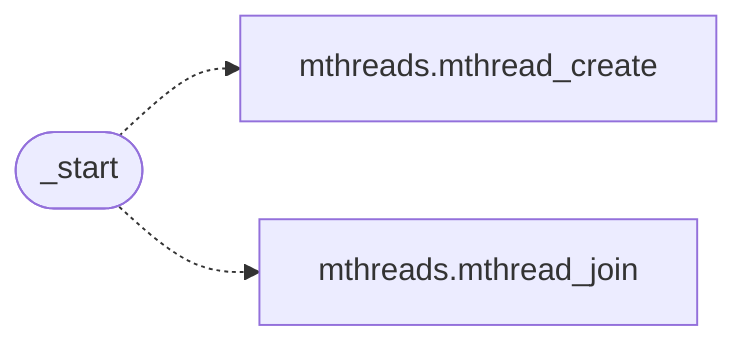

# `progs/src/scfuzz.c`

> Source: [progs/src/scfuzz.c:1](../../progs/src/scfuzz.c#L1) | language `c` | coverage 9.1% | [API index](../index.md)

scfuzz: deterministic syscall fuzzer (syzkaller spirit, BDD scale).

## Contents

- **Functions:** [`guest`](#guest), [`_start`](#_start)
- **Macros:** [`SC_OPS`](#sc_ops), [`SC_ARENA`](#sc_arena), [`SC_PAGE`](#sc_page), [`SC_PAGES`](#sc_pages), [`SC_T0_BASE`](#sc_t0_base), [`SC_T0_N`](#sc_t0_n), [`SC_T1_BASE`](#sc_t1_base), [`SC_T1_N`](#sc_t1_n)

## Call Graph

Solid arrows stay in this module, dashed arrows leave it.



## Functions

<a id="guest"></a>

### `guest`

`function` | [progs/src/scfuzz.c:7](../../progs/src/scfuzz.c#L7)

```c
* the guest (the BDD timeout then talks). All fuzz maps stay inside * one private 4 MB arena (pa...
```

**Parameters**

| Name | Type | Default | Description |
|---|---|---|---|
| `talks` | `the BDD timeout then` |  |  |

**Returns:** `* the`

---

<a id="_start"></a>

### `_start`

`function` | [progs/src/scfuzz.c:160](../../progs/src/scfuzz.c#L160)

```c
void _start(void)
```

*Calls:* [`mthread_create`](progs.src.mthreads.h.md#mthread_create), [`mthread_join`](progs.src.mthreads.h.md#mthread_join)

---

## Macros

<a id="sc_ops"></a>

### `SC_OPS`

`macro` | [progs/src/scfuzz.c:15](../../progs/src/scfuzz.c#L15)

```c
#define SC_OPS
```

---

<a id="sc_arena"></a>

### `SC_ARENA`

`macro` | [progs/src/scfuzz.c:16](../../progs/src/scfuzz.c#L16)

```c
#define SC_ARENA
```

---

<a id="sc_page"></a>

### `SC_PAGE`

`macro` | [progs/src/scfuzz.c:17](../../progs/src/scfuzz.c#L17)

```c
#define SC_PAGE
```

---

<a id="sc_pages"></a>

### `SC_PAGES`

`macro` | [progs/src/scfuzz.c:18](../../progs/src/scfuzz.c#L18)

```c
#define SC_PAGES
```

---

<a id="sc_t0_base"></a>

### `SC_T0_BASE`

`macro` | [progs/src/scfuzz.c:19](../../progs/src/scfuzz.c#L19)

```c
#define SC_T0_BASE
```

---

<a id="sc_t0_n"></a>

### `SC_T0_N`

`macro` | [progs/src/scfuzz.c:20](../../progs/src/scfuzz.c#L20)

```c
#define SC_T0_N
```

---

<a id="sc_t1_base"></a>

### `SC_T1_BASE`

`macro` | [progs/src/scfuzz.c:21](../../progs/src/scfuzz.c#L21)

```c
#define SC_T1_BASE
```

---

<a id="sc_t1_n"></a>

### `SC_T1_N`

`macro` | [progs/src/scfuzz.c:22](../../progs/src/scfuzz.c#L22)

```c
#define SC_T1_N
```

---
