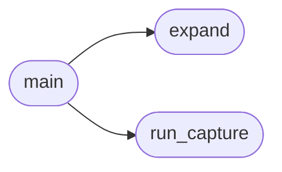

# `progs.src.shell`

> Source: [progs/src/shell.py:1](../../progs/src/shell.py#L1) | language `py` | coverage 25.0% | [API index](../index.md)

shell.py -- pybash: a Python shell layer on top of MiniOS's C shell.

The C shell is untouched. This is an additional capability layer that gives MiniOS pipelines, variables and control flow in Python, so new behaviour no longer requires recompiling kernel.c. The core primitive is minios.run(), which invokes any ramdisk program through SYS_SPAWN while preserving the interpreter, and minios.run(..., redirect=file) to capture a program's console output for composition.  Usage (inside MiniOS): micropython src/shell.py

## Contents

- **Functions:** [`run_capture`](#run_capture), [`expand`](#expand), [`main`](#main)
- **Constants:** [`TMP`](#tmp)

## Call Graph

Solid arrows stay in this module, dashed arrows leave it.



## Functions

<a id="run_capture"></a>

### `run_capture`

`function` | [progs/src/shell.py:20](../../progs/src/shell.py#L20)

```python
def run_capture(cmd, args)
```

**Parameters**

| Name | Type | Default | Description |
|---|---|---|---|
| `cmd` |  |  |  |
| `args` |  |  |  |

*Called by:* [`main`](#main)

---

<a id="expand"></a>

### `expand`

`function` | [progs/src/shell.py:30](../../progs/src/shell.py#L30)

```python
def expand(line, env)
```

**Parameters**

| Name | Type | Default | Description |
|---|---|---|---|
| `line` |  |  |  |
| `env` |  |  |  |

*Called by:* [`main`](#main)

---

<a id="main"></a>

### `main`

`function` | [progs/src/shell.py:36](../../progs/src/shell.py#L36)

```python
def main()
```

*Calls:* [`expand`](#expand), [`run_capture`](#run_capture)

---

## Constants

<a id="tmp"></a>

### `TMP`

`constant` | [progs/src/shell.py:17](../../progs/src/shell.py#L17)

```python
TMP = '/tmp/cap.txt'
```

---
