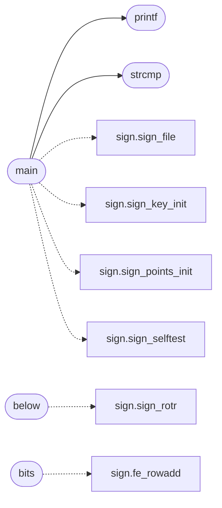

# `progs/src/sign.c`

> Source: [progs/src/sign.c:1](../../progs/src/sign.c#L1) | language `c` | coverage 3.1% | [API index](../index.md)

sign.c - in-OS Ed25519 code signer for MiniOS secure boot.

## Contents

- **Functions:** [`printf`](#printf), [`strcmp`](#strcmp), [`fopen`](#fopen), [`fclose`](#fclose), [`fread`](#fread), [`fwrite`](#fwrite), [`fseek`](#fseek), [`ftell`](#ftell), [`malloc`](#malloc), [`free`](#free), [`below`](#below), [`bits`](#bits), [`main`](#main)
- **Macros:** [`SIGN_KEY_ID`](#sign_key_id), [`SIGN_EXIT_FAIL`](#sign_exit_fail), [`SIGN_ET_EXEC`](#sign_et_exec), [`SIGN_ET_DYN`](#sign_et_dyn), [`SIGN_EM_X86_64`](#sign_em_x86_64), [`SIGN_PT_LOAD`](#sign_pt_load), [`SIGN_PT_NOTE`](#sign_pt_note), [`SIGN_SHT_NOTE`](#sign_sht_note), [`SIGN_EHDR_SIZE`](#sign_ehdr_size), [`SIGN_PHDR_SIZE`](#sign_phdr_size), [`SIGN_SHDR_SIZE`](#sign_shdr_size), [`SIGN_NOTE_HDR`](#sign_note_hdr), [`SIGN_DESC_BYTES`](#sign_desc_bytes), [`SIGN_SIG_BYTES`](#sign_sig_bytes), [`SIGN_NOTE_TOTAL`](#sign_note_total), [`SIGN_NOTE_TYPE`](#sign_note_type), [`SIGN_MAX_FILE`](#sign_max_file), [`SIGN_SEEK_END`](#sign_seek_end)

## Call Graph

Solid arrows stay in this module, dashed arrows leave it.



## Functions

<a id="printf"></a>

### `printf`

`function` | [progs/src/sign.c:28](../../progs/src/sign.c#L28)

```c
int printf();
```

**Returns:** `int`

*Called by:* [`main`](#main)

---

<a id="strcmp"></a>

### `strcmp`

`function` | [progs/src/sign.c:29](../../progs/src/sign.c#L29)

```c
int strcmp();
```

**Returns:** `int`

*Called by:* [`main`](#main)

---

<a id="fopen"></a>

### `fopen`

`function` | [progs/src/sign.c:30](../../progs/src/sign.c#L30)

```c
void *fopen();
```

**Returns:** `void *`

---

<a id="fclose"></a>

### `fclose`

`function` | [progs/src/sign.c:31](../../progs/src/sign.c#L31)

```c
int fclose();
```

**Returns:** `int`

---

<a id="fread"></a>

### `fread`

`function` | [progs/src/sign.c:32](../../progs/src/sign.c#L32)

```c
int fread();
```

**Returns:** `int`

---

<a id="fwrite"></a>

### `fwrite`

`function` | [progs/src/sign.c:33](../../progs/src/sign.c#L33)

```c
int fwrite();
```

**Returns:** `int`

---

<a id="fseek"></a>

### `fseek`

`function` | [progs/src/sign.c:34](../../progs/src/sign.c#L34)

```c
int fseek();
```

**Returns:** `int`

---

<a id="ftell"></a>

### `ftell`

`function` | [progs/src/sign.c:35](../../progs/src/sign.c#L35)

```c
int ftell();
```

**Returns:** `int`

---

<a id="malloc"></a>

### `malloc`

`function` | [progs/src/sign.c:36](../../progs/src/sign.c#L36)

```c
void *malloc();
```

**Returns:** `void *`

---

<a id="free"></a>

### `free`

`function` | [progs/src/sign.c:37](../../progs/src/sign.c#L37)

```c
void free();
```

---

<a id="below"></a>

### `below`

`function` | [progs/src/sign.c:195](../../progs/src/sign.c#L195)

```c
* every other op below (`|`, `<<`) is low-32 exact. */ static void sign_rotr(unsigned int *lo, un...
```

**Parameters**

| Name | Type | Default | Description |
|---|---|---|---|
| `` `|` `` |  |  |  |
| `` `<<` `` |  |  |  |

**Returns:** `* every other op`

*Calls:* [`sign_rotr`](progs.asm.sign.s.md#sign_rotr)

---

<a id="bits"></a>

### `bits`

`function` | [progs/src/sign.c:672](../../progs/src/sign.c#L672)

```c
* values here always fit 32 bits (limbs below 2^16, carries and * products below 2^32), so the s...
```

**Parameters**

| Name | Type | Default | Description |
|---|---|---|---|
| `below` | `limbs 2^16` |  |  |
| `below` | `carries and * products 2^32` |  |  |

**Returns:** `* values here always fit 32`

*Calls:* [`fe_rowadd`](progs.asm.sign.s.md#fe_rowadd)

---

<a id="main"></a>

### `main`

`function` | [progs/src/sign.c:1657](../../progs/src/sign.c#L1657)

```c
int main(int argc, char **argv)
```

**Parameters**

| Name | Type | Default | Description |
|---|---|---|---|
| `argc` | `int` |  |  |
| `argv` | `char **` |  |  |

**Returns:** `int`

*Calls:* [`sign_file`](progs.asm.sign.s.md#sign_file), [`sign_key_init`](progs.asm.sign.s.md#sign_key_init), [`sign_points_init`](progs.asm.sign.s.md#sign_points_init), [`sign_selftest`](progs.asm.sign.s.md#sign_selftest), [`printf`](#printf), [`strcmp`](#strcmp)

---

## Macros

<a id="sign_key_id"></a>

### `SIGN_KEY_ID`

`macro` | [progs/src/sign.c:39](../../progs/src/sign.c#L39)

```c
#define SIGN_KEY_ID
```

---

<a id="sign_exit_fail"></a>

### `SIGN_EXIT_FAIL`

`macro` | [progs/src/sign.c:40](../../progs/src/sign.c#L40)

```c
#define SIGN_EXIT_FAIL
```

---

<a id="sign_et_exec"></a>

### `SIGN_ET_EXEC`

`macro` | [progs/src/sign.c:42](../../progs/src/sign.c#L42)

```c
#define SIGN_ET_EXEC
```

---

<a id="sign_et_dyn"></a>

### `SIGN_ET_DYN`

`macro` | [progs/src/sign.c:43](../../progs/src/sign.c#L43)

```c
#define SIGN_ET_DYN
```

---

<a id="sign_em_x86_64"></a>

### `SIGN_EM_X86_64`

`macro` | [progs/src/sign.c:44](../../progs/src/sign.c#L44)

```c
#define SIGN_EM_X86_64
```

---

<a id="sign_pt_load"></a>

### `SIGN_PT_LOAD`

`macro` | [progs/src/sign.c:45](../../progs/src/sign.c#L45)

```c
#define SIGN_PT_LOAD
```

---

<a id="sign_pt_note"></a>

### `SIGN_PT_NOTE`

`macro` | [progs/src/sign.c:46](../../progs/src/sign.c#L46)

```c
#define SIGN_PT_NOTE
```

---

<a id="sign_sht_note"></a>

### `SIGN_SHT_NOTE`

`macro` | [progs/src/sign.c:47](../../progs/src/sign.c#L47)

```c
#define SIGN_SHT_NOTE
```

---

<a id="sign_ehdr_size"></a>

### `SIGN_EHDR_SIZE`

`macro` | [progs/src/sign.c:48](../../progs/src/sign.c#L48)

```c
#define SIGN_EHDR_SIZE
```

---

<a id="sign_phdr_size"></a>

### `SIGN_PHDR_SIZE`

`macro` | [progs/src/sign.c:49](../../progs/src/sign.c#L49)

```c
#define SIGN_PHDR_SIZE
```

---

<a id="sign_shdr_size"></a>

### `SIGN_SHDR_SIZE`

`macro` | [progs/src/sign.c:50](../../progs/src/sign.c#L50)

```c
#define SIGN_SHDR_SIZE
```

---

<a id="sign_note_hdr"></a>

### `SIGN_NOTE_HDR`

`macro` | [progs/src/sign.c:51](../../progs/src/sign.c#L51)

```c
#define SIGN_NOTE_HDR
```

---

<a id="sign_desc_bytes"></a>

### `SIGN_DESC_BYTES`

`macro` | [progs/src/sign.c:52](../../progs/src/sign.c#L52)

```c
#define SIGN_DESC_BYTES
```

---

<a id="sign_sig_bytes"></a>

### `SIGN_SIG_BYTES`

`macro` | [progs/src/sign.c:53](../../progs/src/sign.c#L53)

```c
#define SIGN_SIG_BYTES
```

---

<a id="sign_note_total"></a>

### `SIGN_NOTE_TOTAL`

`macro` | [progs/src/sign.c:54](../../progs/src/sign.c#L54)

```c
#define SIGN_NOTE_TOTAL
```

---

<a id="sign_note_type"></a>

### `SIGN_NOTE_TYPE`

`macro` | [progs/src/sign.c:55](../../progs/src/sign.c#L55)

```c
#define SIGN_NOTE_TYPE
```

---

<a id="sign_max_file"></a>

### `SIGN_MAX_FILE`

`macro` | [progs/src/sign.c:56](../../progs/src/sign.c#L56)

```c
#define SIGN_MAX_FILE
```

---

<a id="sign_seek_end"></a>

### `SIGN_SEEK_END`

`macro` | [progs/src/sign.c:57](../../progs/src/sign.c#L57)

```c
#define SIGN_SEEK_END
```

---
