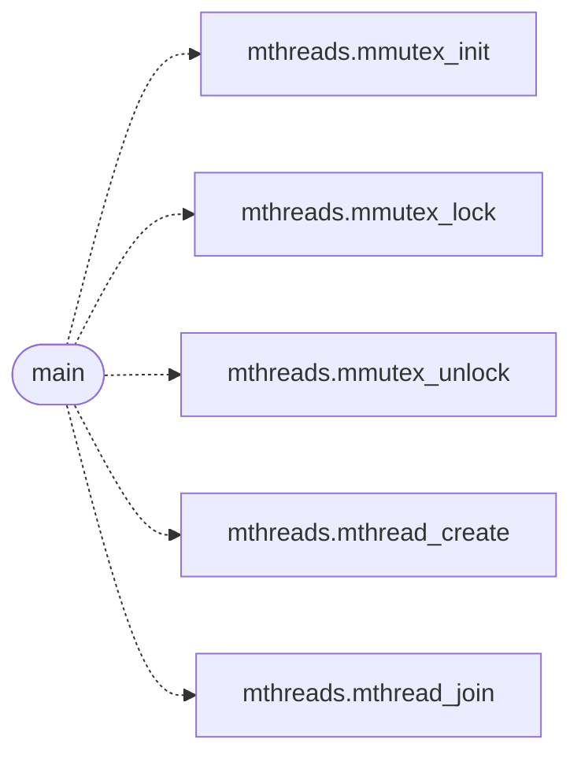

# `progs/src/thdemo.c`

> Source: [progs/src/thdemo.c:1](../../progs/src/thdemo.c#L1) | language `c` | coverage 11.1% | [API index](../index.md)

thdemo.c -- Producer-consumer over mthreads (roadmap Phase 1, M1).

## Contents

- **Functions:** [`threads`](#threads), [`main`](#main)
- **Macros:** [`NPROD`](#nprod), [`NCONS`](#ncons), [`PER_PROD`](#per_prod), [`BUFSZ`](#bufsz), [`EXPECTED_N`](#expected_n), [`EXPECTED_SUM`](#expected_sum)

## Call Graph

Solid arrows stay in this module, dashed arrows leave it.



## Functions

<a id="threads"></a>

### `threads`

`function` | [progs/src/thdemo.c:3](../../progs/src/thdemo.c#L3)

```c
* * Ten threads (1 main + 5 producers + 4 consumers) share one address * space through thread_spawn (MiniOS syscall 225): a bounded buffer, * a spin mutex and Mesa-style spin-waits. Workers never touc
```

**Parameters**

| Name | Type | Default | Description |
|---|---|---|---|
| `consumers` | `1 main + 5 producers + 4` |  |  |

**Returns:** `* * Ten`

---

<a id="main"></a>

### `main`

`function` | [progs/src/thdemo.c:82](../../progs/src/thdemo.c#L82)

```c
int main(void)
```

**Returns:** `int`

*Calls:* [`mmutex_init`](progs.src.mthreads.h.md#mmutex_init), [`mmutex_lock`](progs.src.mthreads.h.md#mmutex_lock), [`mmutex_unlock`](progs.src.mthreads.h.md#mmutex_unlock), [`mthread_create`](progs.src.mthreads.h.md#mthread_create), [`mthread_join`](progs.src.mthreads.h.md#mthread_join)

---

## Macros

<a id="nprod"></a>

### `NPROD`

`macro` | [progs/src/thdemo.c:21](../../progs/src/thdemo.c#L21)

```c
#define NPROD
```

---

<a id="ncons"></a>

### `NCONS`

`macro` | [progs/src/thdemo.c:22](../../progs/src/thdemo.c#L22)

```c
#define NCONS
```

---

<a id="per_prod"></a>

### `PER_PROD`

`macro` | [progs/src/thdemo.c:23](../../progs/src/thdemo.c#L23)

```c
#define PER_PROD
```

---

<a id="bufsz"></a>

### `BUFSZ`

`macro` | [progs/src/thdemo.c:24](../../progs/src/thdemo.c#L24)

```c
#define BUFSZ
```

---

<a id="expected_n"></a>

### `EXPECTED_N`

`macro` | [progs/src/thdemo.c:26](../../progs/src/thdemo.c#L26)

```c
#define EXPECTED_N
```

---

<a id="expected_sum"></a>

### `EXPECTED_SUM`

`macro` | [progs/src/thdemo.c:27](../../progs/src/thdemo.c#L27)

```c
#define EXPECTED_SUM
```

---
