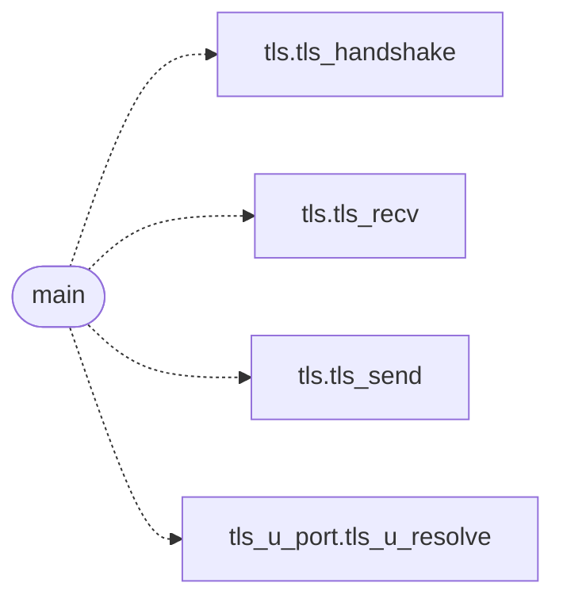

# `progs/tls_u/tls_u_main.c`

> Source: [progs/tls_u/tls_u_main.c:1](../../progs/tls_u/tls_u_main.c#L1) | language `c` | coverage 20.0% | [API index](../index.md)

tlsget - minimal HTTPS GET over the ring-3 TLS stack.

## Contents

- **Functions:** [`syscall`](#syscall), [`main`](#main)
- **Macros:** [`_POSIX_C_SOURCE`](#_posix_c_source), [`_DEFAULT_SOURCE`](#_default_source)

## Call Graph

Solid arrows stay in this module, dashed arrows leave it.



## Functions

<a id="syscall"></a>

### `syscall`

`function` | [progs/tls_u/tls_u_main.c:10](../../progs/tls_u/tls_u_main.c#L10)

```c
* the MiniOS DNS syscall (200, sig 0: error-check only, sends nothing). * The kernel keeps servi...
```

**Parameters**

| Name | Type | Default | Description |
|---|---|---|---|
| `200` |  |  |  |
| `only` | `sig 0: error-check` |  |  |
| `nothing` | `sends` |  |  |

**Returns:** `* the MiniOS DNS`

---

<a id="main"></a>

### `main`

`function` | [progs/tls_u/tls_u_main.c:61](../../progs/tls_u/tls_u_main.c#L61)

```c
int main(int argc, char **argv)
```

**Parameters**

| Name | Type | Default | Description |
|---|---|---|---|
| `argc` | `int` |  |  |
| `argv` | `char **` |  |  |

**Returns:** `int`

*Calls:* [`tls_handshake`](headers.tls.h.md#tls_handshake), [`tls_recv`](headers.tls.h.md#tls_recv), [`tls_send`](headers.tls.h.md#tls_send), [`tls_u_resolve`](progs.tls_u.tls_u_port.c.md#tls_u_resolve)

---

## Macros

<a id="_posix_c_source"></a>

### `_POSIX_C_SOURCE`

`macro` | [progs/tls_u/tls_u_main.c:14](../../progs/tls_u/tls_u_main.c#L14)

```c
#define _POSIX_C_SOURCE
```

---

<a id="_default_source"></a>

### `_DEFAULT_SOURCE`

`macro` | [progs/tls_u/tls_u_main.c:15](../../progs/tls_u/tls_u_main.c#L15)

```c
#define _DEFAULT_SOURCE
```

---
