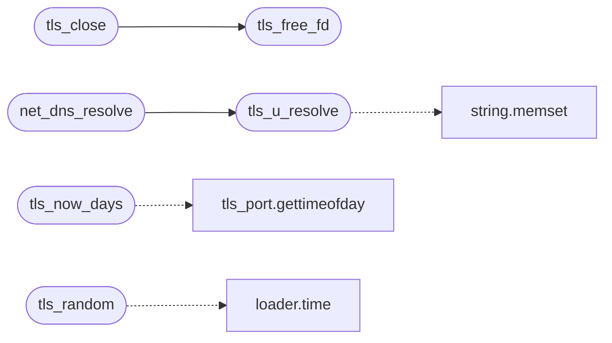

# `progs/tls_u/tls_u_port.c`

> Source: [progs/tls_u/tls_u_port.c:1](../../progs/tls_u/tls_u_port.c#L1) | language `c` | coverage 28.6% | [API index](../index.md)

tls_u_port.c - ring-3 transport for the shared TLS stack (TLS_RING3).

## Contents

- **Functions:** [`sockets`](#sockets), [`tls_u_recv`](#tls_u_recv), [`tls_u_recv_timeout`](#tls_u_recv_timeout), [`tls_u_close`](#tls_u_close), [`tls_free_fd`](#tls_free_fd), [`tls_close`](#tls_close), [`tls_now_days`](#tls_now_days), [`tls_random`](#tls_random), [`tls_u_resolve`](#tls_u_resolve), [`answer`](#answer), [`net_dns_resolve`](#net_dns_resolve)
- **Macros:** [`_POSIX_C_SOURCE`](#_posix_c_source), [`_DEFAULT_SOURCE`](#_default_source)

## Call Graph

Solid arrows stay in this module, dashed arrows leave it.



## Functions

<a id="sockets"></a>

### `sockets`

`function` | [progs/tls_u/tls_u_port.c:5](../../progs/tls_u/tls_u_port.c#L5)

```c
* sockets: on the host they are host sockets (used by the * openssl-s_server interop test), insi...
```

**Parameters**

| Name | Type | Default | Description |
|---|---|---|---|
| `test` | `used by the * openssl-s_server interop` |  |  |

**Returns:** `*`

---

<a id="tls_u_recv"></a>

### `tls_u_recv`

`function` | [progs/tls_u/tls_u_port.c:39](../../progs/tls_u/tls_u_port.c#L39)

```c
int tls_u_recv(int fd, char *buf, int len)
```

**Parameters**

| Name | Type | Default | Description |
|---|---|---|---|
| `fd` | `int` |  |  |
| `buf` | `char *` |  |  |
| `len` | `int` |  |  |

**Returns:** `int`

---

<a id="tls_u_recv_timeout"></a>

### `tls_u_recv_timeout`

`function` | [progs/tls_u/tls_u_port.c:44](../../progs/tls_u/tls_u_port.c#L44)

```c
int tls_u_recv_timeout(int fd, char *buf, int len, unsigned long ms)
```

**Parameters**

| Name | Type | Default | Description |
|---|---|---|---|
| `fd` | `int` |  |  |
| `buf` | `char *` |  |  |
| `len` | `int` |  |  |
| `ms` | `unsigned long` |  |  |

**Returns:** `int`

---

<a id="tls_u_close"></a>

### `tls_u_close`

`function` | [progs/tls_u/tls_u_port.c:55](../../progs/tls_u/tls_u_port.c#L55)

```c
void tls_u_close(int fd)
```

**Parameters**

| Name | Type | Default | Description |
|---|---|---|---|
| `fd` | `int` |  |  |

---

<a id="tls_free_fd"></a>

### `tls_free_fd`

`function` | [progs/tls_u/tls_u_port.c:66](../../progs/tls_u/tls_u_port.c#L66)

```c
void tls_free_fd(int fd);
```

Session-aware close for multi-fetch processes (freedom follows redirects and linked stylesheets, reusing the lowest free fd number every time).

The engine keys sessions by raw fd and only clears the slot on handshake error; a successful session lives until someone frees it, so plain close() leaks the slot and the next handshake on the recycled fd number fails with "session already exists". Freeing an fd with no session is a safe no-op.

**Parameters**

| Name | Type | Default | Description |
|---|---|---|---|
| `fd` | `int` |  |  |

*Called by:* [`tls_close`](#tls_close)

---

<a id="tls_close"></a>

### `tls_close`

`function` | [progs/tls_u/tls_u_port.c:67](../../progs/tls_u/tls_u_port.c#L67)

```c
void tls_close(int fd)
```

session table owner: net/tls.c

**Parameters**

| Name | Type | Default | Description |
|---|---|---|---|
| `fd` | `int` |  |  |

*Calls:* [`tls_free_fd`](#tls_free_fd)

---

<a id="tls_now_days"></a>

### `tls_now_days`

`function` | [progs/tls_u/tls_u_port.c:72](../../progs/tls_u/tls_u_port.c#L72)

```c
long tls_now_days(void)
```

**Returns:** `long`

*Calls:* [`gettimeofday`](headers.tls_port.h.md#gettimeofday)

---

<a id="tls_random"></a>

### `tls_random`

`function` | [progs/tls_u/tls_u_port.c:78](../../progs/tls_u/tls_u_port.c#L78)

```c
void tls_random(unsigned char *out, unsigned len)
```

**Parameters**

| Name | Type | Default | Description |
|---|---|---|---|
| `out` | `unsigned char *` |  |  |
| `len` | `unsigned` |  |  |

*Calls:* [`time`](kernel.loader.c.md#time)

---

<a id="tls_u_resolve"></a>

### `tls_u_resolve`

`function` | [progs/tls_u/tls_u_port.c:147](../../progs/tls_u/tls_u_port.c#L147)

```c
int tls_u_resolve(const char *host, unsigned *ip_out)
```

**Parameters**

| Name | Type | Default | Description |
|---|---|---|---|
| `host` | `char *` |  |  |
| `ip_out` | `unsigned *` |  |  |

**Returns:** `int`

*Calls:* [`memset`](kernel.string.c.md#memset)

*Called by:* [`main`](progs.tls_u.tls_u_main.c.md#main), [`net_dns_resolve`](#net_dns_resolve)

---

<a id="answer"></a>

### `answer`

`function` | [progs/tls_u/tls_u_port.c:163](../../progs/tls_u/tls_u_port.c#L163)

```c
* answer (some resolvers go IPv6-only on the first query). */ memset(&hints, 0, sizeof(hints));
```

**Parameters**

| Name | Type | Default | Description |
|---|---|---|---|
| `query` | `some resolvers go IPv6-only on the first` |  |  |

**Returns:** `*`

---

<a id="net_dns_resolve"></a>

### `net_dns_resolve`

`function` | [progs/tls_u/tls_u_port.c:183](../../progs/tls_u/tls_u_port.c#L183)

```c
int net_dns_resolve(const char *host)
```

freedom's resolver name: kernel DNS value semantics (u32 host order, -1 on failure).

**Parameters**

| Name | Type | Default | Description |
|---|---|---|---|
| `host` | `char *` |  |  |

**Returns:** `int`

*Calls:* [`tls_u_resolve`](#tls_u_resolve)

---

## Macros

<a id="_posix_c_source"></a>

### `_POSIX_C_SOURCE`

`macro` | [progs/tls_u/tls_u_port.c:12](../../progs/tls_u/tls_u_port.c#L12)

```c
#define _POSIX_C_SOURCE
```

---

<a id="_default_source"></a>

### `_DEFAULT_SOURCE`

`macro` | [progs/tls_u/tls_u_port.c:13](../../progs/tls_u/tls_u_port.c#L13)

```c
#define _DEFAULT_SOURCE
```

---
