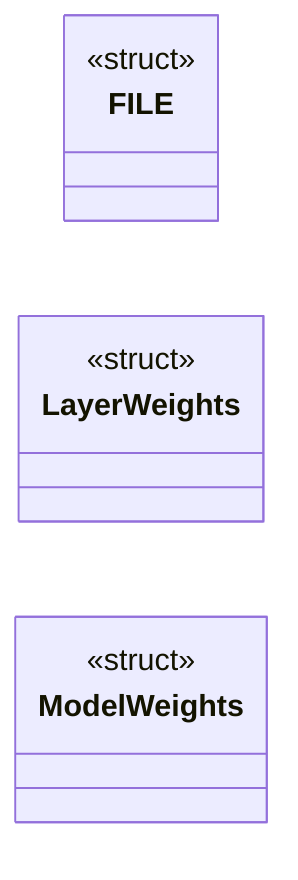
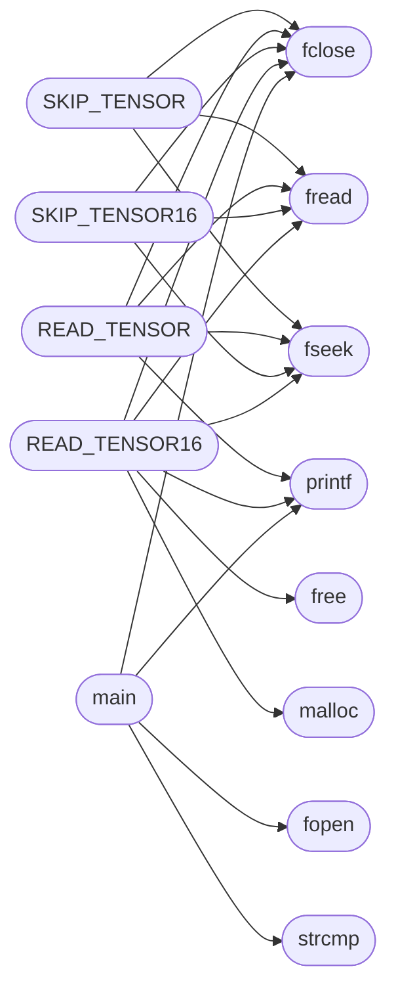

# `progs/topogpt3/topogpt3.c`

> Source: [progs/topogpt3/topogpt3.c:1](../../progs/topogpt3/topogpt3.c#L1) | language `c` | coverage 8.7% | [API index](../index.md)

## Contents

- **Structs:** [`FILE`](#file), [`LayerWeights`](#layerweights), [`ModelWeights`](#modelweights)
- **Functions:** [`printf`](#printf), [`fprintf`](#fprintf), [`sprintf`](#sprintf), [`snprintf`](#snprintf), [`puts`](#puts), [`putchar`](#putchar), [`fputc`](#fputc), [`fputs`](#fputs), [`fopen`](#fopen), [`fclose`](#fclose), [`fread`](#fread), [`fwrite`](#fwrite), [`fseek`](#fseek), [`ftell`](#ftell), [`fflush`](#fflush), [`malloc`](#malloc), [`free`](#free), [`memcpy`](#memcpy), [`memset`](#memset), [`strcmp`](#strcmp), [`strncmp`](#strncmp), [`strlen`](#strlen), [`strstr`](#strstr), [`main`](#main)
- **Macros:** [`NULL`](#null), [`SEEK_SET`](#seek_set), [`SEEK_CUR`](#seek_cur), [`SEEK_END`](#seek_end), [`VOCAB_SIZE`](#vocab_size), [`D_MODEL`](#d_model), [`N_HEADS`](#n_heads), [`N_KV_HEADS`](#n_kv_heads), [`GQA_GROUPS`](#gqa_groups), [`D_HEAD`](#d_head), [`D_QUAT`](#d_quat), [`N_LAYERS`](#n_layers), [`MAX_SEQ_LEN`](#max_seq_len), [`N_EXPERTS`](#n_experts), [`MOE_TOP_K`](#moe_top_k), [`N_NODES`](#n_nodes), [`N_RADIAL`](#n_radial), [`N_ANGULAR`](#n_angular), [`N_EDGE_TYPES`](#n_edge_types), [`N_EDGES`](#n_edges), [`SPECTRAL_LATENT_DIM`](#spectral_latent_dim), [`D_LAT_Q`](#d_lat_q), [`TORUS_GRID_W`](#torus_grid_w), [`FREQ_W`](#freq_w), [`N_SPECTRAL_LAYERS`](#n_spectral_layers), [`EXPERT_INNER`](#expert_inner), [`READOUT_INNER`](#readout_inner), [`EOS_TOKEN`](#eos_token), [`EMBED_INNER`](#embed_inner), [`PI`](#pi), [`EPS_RMS`](#eps_rms), [`TORUS_TEMP`](#torus_temp), [`MAX_TOKENS`](#max_tokens), [`MAX_PROMPT_LEN`](#max_prompt_len), [`MAX_LINE`](#max_line), [`TOK_TAB_SIZE`](#tok_tab_size), [`TOK_VOCAB_SIZE`](#tok_vocab_size), [`SKIP_TENSOR`](#skip_tensor), [`READ_TENSOR`](#read_tensor), [`SKIP_TENSOR16`](#skip_tensor16), [`READ_TENSOR16`](#read_tensor16)
- **Variables:** [`stdin`](#stdin), [`stdout`](#stdout), [`stderr`](#stderr)

## Type Diagram



## Call Graph

Solid arrows stay in this module, dashed arrows leave it.



## Structs

<a id="file"></a>

### `FILE`

`struct` | [progs/topogpt3/topogpt3.c:24](../../progs/topogpt3/topogpt3.c#L24)

```c
typedef struct { int _fd; } FILE;
```

MiniOS standalone: declare stdio from ld stubs

---

<a id="layerweights"></a>

### `LayerWeights`

`struct` | [progs/topogpt3/topogpt3.c:176](../../progs/topogpt3/topogpt3.c#L176)

```c
typedef struct
```

---

<a id="modelweights"></a>

### `ModelWeights`

`struct` | [progs/topogpt3/topogpt3.c:224](../../progs/topogpt3/topogpt3.c#L224)

```c
typedef struct
```

---

## Functions

<a id="printf"></a>

### `printf`

`function` `extern` | [progs/topogpt3/topogpt3.c:28](../../progs/topogpt3/topogpt3.c#L28)

```c
extern int printf(const char *, ...);
```

**Parameters**

| Name | Type | Default | Description |
|---|---|---|---|
| `char` |  |  |  |
| `...` |  |  |  |

**Returns:** `int`

*Called by:* [`READ_TENSOR`](#read_tensor), [`READ_TENSOR16`](#read_tensor16), [`main`](#main)

---

<a id="fprintf"></a>

### `fprintf`

`function` `extern` | [progs/topogpt3/topogpt3.c:29](../../progs/topogpt3/topogpt3.c#L29)

```c
extern int fprintf(FILE *, const char *, ...);
```

**Parameters**

| Name | Type | Default | Description |
|---|---|---|---|
| `FILE` |  |  |  |
| `char` |  |  |  |
| `...` |  |  |  |

**Returns:** `int`

---

<a id="sprintf"></a>

### `sprintf`

`function` `extern` | [progs/topogpt3/topogpt3.c:30](../../progs/topogpt3/topogpt3.c#L30)

```c
extern int sprintf(char *, const char *, ...);
```

**Parameters**

| Name | Type | Default | Description |
|---|---|---|---|
| `char` |  |  |  |
| `char` |  |  |  |
| `...` |  |  |  |

**Returns:** `int`

---

<a id="snprintf"></a>

### `snprintf`

`function` `extern` | [progs/topogpt3/topogpt3.c:31](../../progs/topogpt3/topogpt3.c#L31)

```c
extern int snprintf(char *, unsigned long, const char *, ...);
```

**Parameters**

| Name | Type | Default | Description |
|---|---|---|---|
| `char` |  |  |  |
| `long` | `unsigned` |  |  |
| `char` |  |  |  |
| `...` |  |  |  |

**Returns:** `int`

---

<a id="puts"></a>

### `puts`

`function` `extern` | [progs/topogpt3/topogpt3.c:32](../../progs/topogpt3/topogpt3.c#L32)

```c
extern int puts(const char *);
```

**Parameters**

| Name | Type | Default | Description |
|---|---|---|---|
| `char` |  |  |  |

**Returns:** `int`

---

<a id="putchar"></a>

### `putchar`

`function` `extern` | [progs/topogpt3/topogpt3.c:33](../../progs/topogpt3/topogpt3.c#L33)

```c
extern int putchar(int);
```

**Returns:** `int`

---

<a id="fputc"></a>

### `fputc`

`function` `extern` | [progs/topogpt3/topogpt3.c:34](../../progs/topogpt3/topogpt3.c#L34)

```c
extern int fputc(int, FILE *);
```

**Parameters**

| Name | Type | Default | Description |
|---|---|---|---|
| `FILE` |  |  |  |

**Returns:** `int`

---

<a id="fputs"></a>

### `fputs`

`function` `extern` | [progs/topogpt3/topogpt3.c:35](../../progs/topogpt3/topogpt3.c#L35)

```c
extern int fputs(const char *, FILE *);
```

**Parameters**

| Name | Type | Default | Description |
|---|---|---|---|
| `char` |  |  |  |
| `FILE` |  |  |  |

**Returns:** `int`

---

<a id="fopen"></a>

### `fopen`

`function` `extern` | [progs/topogpt3/topogpt3.c:36](../../progs/topogpt3/topogpt3.c#L36)

```c
extern FILE *fopen(const char *, const char *);
```

**Parameters**

| Name | Type | Default | Description |
|---|---|---|---|
| `char` |  |  |  |
| `char` |  |  |  |

**Returns:** `FILE *`

*Called by:* [`main`](#main)

---

<a id="fclose"></a>

### `fclose`

`function` `extern` | [progs/topogpt3/topogpt3.c:37](../../progs/topogpt3/topogpt3.c#L37)

```c
extern int fclose(FILE *);
```

**Parameters**

| Name | Type | Default | Description |
|---|---|---|---|
| `FILE` |  |  |  |

**Returns:** `int`

*Called by:* [`READ_TENSOR`](#read_tensor), [`READ_TENSOR16`](#read_tensor16), [`SKIP_TENSOR`](#skip_tensor), [`SKIP_TENSOR16`](#skip_tensor16), [`main`](#main)

---

<a id="fread"></a>

### `fread`

`function` `extern` | [progs/topogpt3/topogpt3.c:38](../../progs/topogpt3/topogpt3.c#L38)

```c
extern unsigned long fread(void *, unsigned long, unsigned long, FILE *);
```

**Parameters**

| Name | Type | Default | Description |
|---|---|---|---|
| `void` |  |  |  |
| `long` | `unsigned` |  |  |
| `long` | `unsigned` |  |  |
| `FILE` |  |  |  |

**Returns:** `unsigned long`

*Called by:* [`READ_TENSOR`](#read_tensor), [`READ_TENSOR16`](#read_tensor16), [`SKIP_TENSOR`](#skip_tensor), [`SKIP_TENSOR16`](#skip_tensor16)

---

<a id="fwrite"></a>

### `fwrite`

`function` `extern` | [progs/topogpt3/topogpt3.c:39](../../progs/topogpt3/topogpt3.c#L39)

```c
extern unsigned long fwrite(const void *, unsigned long, unsigned long, FILE *);
```

**Parameters**

| Name | Type | Default | Description |
|---|---|---|---|
| `void` |  |  |  |
| `long` | `unsigned` |  |  |
| `long` | `unsigned` |  |  |
| `FILE` |  |  |  |

**Returns:** `unsigned long`

---

<a id="fseek"></a>

### `fseek`

`function` `extern` | [progs/topogpt3/topogpt3.c:40](../../progs/topogpt3/topogpt3.c#L40)

```c
extern int fseek(FILE *, long, int);
```

**Parameters**

| Name | Type | Default | Description |
|---|---|---|---|
| `FILE` |  |  |  |

**Returns:** `int`

*Called by:* [`READ_TENSOR`](#read_tensor), [`READ_TENSOR16`](#read_tensor16), [`SKIP_TENSOR`](#skip_tensor), [`SKIP_TENSOR16`](#skip_tensor16)

---

<a id="ftell"></a>

### `ftell`

`function` `extern` | [progs/topogpt3/topogpt3.c:41](../../progs/topogpt3/topogpt3.c#L41)

```c
extern long ftell(FILE *);
```

**Parameters**

| Name | Type | Default | Description |
|---|---|---|---|
| `FILE` |  |  |  |

**Returns:** `long`

---

<a id="fflush"></a>

### `fflush`

`function` `extern` | [progs/topogpt3/topogpt3.c:42](../../progs/topogpt3/topogpt3.c#L42)

```c
extern int fflush(FILE *);
```

**Parameters**

| Name | Type | Default | Description |
|---|---|---|---|
| `FILE` |  |  |  |

**Returns:** `int`

*Called by:* [`DG_DrawFrame`](progs.doomgeneric.doomgeneric_minios.c.md#dg_drawframe), [`I_Error`](progs.doomgeneric.i_system.c.md#i_error), [`pf_window_present`](progs.freedomui.platform_minios.c.md#pf_window_present), [`main`](progs.minicraft.minicraft.c.md#main), [`_dl_argv`](progs.pokemon.platform_minios.c.md#_dl_argv), [`SWimp_EndFrame`](progs.quake2generic.q2generic_minios.c.md#swimp_endframe), [`main`](progs.src.lxproc.c.md#main)

---

<a id="malloc"></a>

### `malloc`

`function` `extern` | [progs/topogpt3/topogpt3.c:47](../../progs/topogpt3/topogpt3.c#L47)

```c
extern void *malloc(unsigned long);
```

define NULL ((void*)0) define SEEK_SET 0 define SEEK_CUR 1 define SEEK_END 2

**Parameters**

| Name | Type | Default | Description |
|---|---|---|---|
| `long` | `unsigned` |  |  |

**Returns:** `void *`

*Called by:* [`READ_TENSOR16`](#read_tensor16)

---

<a id="free"></a>

### `free`

`function` `extern` | [progs/topogpt3/topogpt3.c:48](../../progs/topogpt3/topogpt3.c#L48)

```c
extern void free(void *);
```

**Parameters**

| Name | Type | Default | Description |
|---|---|---|---|
| `void` |  |  |  |

*Called by:* [`READ_TENSOR16`](#read_tensor16)

---

<a id="memcpy"></a>

### `memcpy`

`function` `extern` | [progs/topogpt3/topogpt3.c:49](../../progs/topogpt3/topogpt3.c#L49)

```c
extern void *memcpy(void *, const void *, unsigned long);
```

**Parameters**

| Name | Type | Default | Description |
|---|---|---|---|
| `void` |  |  |  |
| `void` |  |  |  |
| `long` | `unsigned` |  |  |

**Returns:** `void *`

---

<a id="memset"></a>

### `memset`

`function` `extern` | [progs/topogpt3/topogpt3.c:50](../../progs/topogpt3/topogpt3.c#L50)

```c
extern void *memset(void *, int, unsigned long);
```

**Parameters**

| Name | Type | Default | Description |
|---|---|---|---|
| `void` |  |  |  |
| `long` | `unsigned` |  |  |

**Returns:** `void *`

---

<a id="strcmp"></a>

### `strcmp`

`function` `extern` | [progs/topogpt3/topogpt3.c:51](../../progs/topogpt3/topogpt3.c#L51)

```c
extern int strcmp(const char *, const char *);
```

**Parameters**

| Name | Type | Default | Description |
|---|---|---|---|
| `char` |  |  |  |
| `char` |  |  |  |

**Returns:** `int`

*Called by:* [`main`](#main)

---

<a id="strncmp"></a>

### `strncmp`

`function` `extern` | [progs/topogpt3/topogpt3.c:52](../../progs/topogpt3/topogpt3.c#L52)

```c
extern int strncmp(const char *, const char *, unsigned long);
```

**Parameters**

| Name | Type | Default | Description |
|---|---|---|---|
| `char` |  |  |  |
| `char` |  |  |  |
| `long` | `unsigned` |  |  |

**Returns:** `int`

---

<a id="strlen"></a>

### `strlen`

`function` `extern` | [progs/topogpt3/topogpt3.c:53](../../progs/topogpt3/topogpt3.c#L53)

```c
extern unsigned long strlen(const char *);
```

**Parameters**

| Name | Type | Default | Description |
|---|---|---|---|
| `char` |  |  |  |

**Returns:** `unsigned long`

---

<a id="strstr"></a>

### `strstr`

`function` `extern` | [progs/topogpt3/topogpt3.c:54](../../progs/topogpt3/topogpt3.c#L54)

```c
extern char *strstr(const char *, const char *);
```

**Parameters**

| Name | Type | Default | Description |
|---|---|---|---|
| `char` |  |  |  |
| `char` |  |  |  |

**Returns:** `char *`

*Called by:* [`M_StringReplace`](progs.doomgeneric.m_misc.c.md#m_stringreplace)

---

<a id="main"></a>

### `main`

`function` | [progs/topogpt3/topogpt3.c:1885](../../progs/topogpt3/topogpt3.c#L1885)

```c
int main(int argc, char **argv)
```

**Parameters**

| Name | Type | Default | Description |
|---|---|---|---|
| `argc` | `int` |  |  |
| `argv` | `char **` |  |  |

**Returns:** `int`

*Calls:* [`fclose`](#fclose), [`fopen`](#fopen), [`printf`](#printf), [`strcmp`](#strcmp)

---

## Macros

<a id="null"></a>

### `NULL`

`macro` | [progs/topogpt3/topogpt3.c:43](../../progs/topogpt3/topogpt3.c#L43)

```c
#define NULL
```

---

<a id="seek_set"></a>

### `SEEK_SET`

`macro` | [progs/topogpt3/topogpt3.c:44](../../progs/topogpt3/topogpt3.c#L44)

```c
#define SEEK_SET
```

---

<a id="seek_cur"></a>

### `SEEK_CUR`

`macro` | [progs/topogpt3/topogpt3.c:45](../../progs/topogpt3/topogpt3.c#L45)

```c
#define SEEK_CUR
```

---

<a id="seek_end"></a>

### `SEEK_END`

`macro` | [progs/topogpt3/topogpt3.c:46](../../progs/topogpt3/topogpt3.c#L46)

```c
#define SEEK_END
```

---

<a id="vocab_size"></a>

### `VOCAB_SIZE`

`macro` | [progs/topogpt3/topogpt3.c:65](../../progs/topogpt3/topogpt3.c#L65)

```c
#define VOCAB_SIZE
```

---

<a id="d_model"></a>

### `D_MODEL`

`macro` | [progs/topogpt3/topogpt3.c:66](../../progs/topogpt3/topogpt3.c#L66)

```c
#define D_MODEL
```

---

<a id="n_heads"></a>

### `N_HEADS`

`macro` | [progs/topogpt3/topogpt3.c:67](../../progs/topogpt3/topogpt3.c#L67)

```c
#define N_HEADS
```

---

<a id="n_kv_heads"></a>

### `N_KV_HEADS`

`macro` | [progs/topogpt3/topogpt3.c:68](../../progs/topogpt3/topogpt3.c#L68)

```c
#define N_KV_HEADS
```

---

<a id="gqa_groups"></a>

### `GQA_GROUPS`

`macro` | [progs/topogpt3/topogpt3.c:69](../../progs/topogpt3/topogpt3.c#L69)

```c
#define GQA_GROUPS
```

---

<a id="d_head"></a>

### `D_HEAD`

`macro` | [progs/topogpt3/topogpt3.c:70](../../progs/topogpt3/topogpt3.c#L70)

```c
#define D_HEAD
```

---

<a id="d_quat"></a>

### `D_QUAT`

`macro` | [progs/topogpt3/topogpt3.c:71](../../progs/topogpt3/topogpt3.c#L71)

```c
#define D_QUAT
```

---

<a id="n_layers"></a>

### `N_LAYERS`

`macro` | [progs/topogpt3/topogpt3.c:72](../../progs/topogpt3/topogpt3.c#L72)

```c
#define N_LAYERS
```

---

<a id="max_seq_len"></a>

### `MAX_SEQ_LEN`

`macro` | [progs/topogpt3/topogpt3.c:73](../../progs/topogpt3/topogpt3.c#L73)

```c
#define MAX_SEQ_LEN
```

---

<a id="n_experts"></a>

### `N_EXPERTS`

`macro` | [progs/topogpt3/topogpt3.c:74](../../progs/topogpt3/topogpt3.c#L74)

```c
#define N_EXPERTS
```

---

<a id="moe_top_k"></a>

### `MOE_TOP_K`

`macro` | [progs/topogpt3/topogpt3.c:75](../../progs/topogpt3/topogpt3.c#L75)

```c
#define MOE_TOP_K
```

---

<a id="n_nodes"></a>

### `N_NODES`

`macro` | [progs/topogpt3/topogpt3.c:76](../../progs/topogpt3/topogpt3.c#L76)

```c
#define N_NODES
```

---

<a id="n_radial"></a>

### `N_RADIAL`

`macro` | [progs/topogpt3/topogpt3.c:77](../../progs/topogpt3/topogpt3.c#L77)

```c
#define N_RADIAL
```

---

<a id="n_angular"></a>

### `N_ANGULAR`

`macro` | [progs/topogpt3/topogpt3.c:78](../../progs/topogpt3/topogpt3.c#L78)

```c
#define N_ANGULAR
```

---

<a id="n_edge_types"></a>

### `N_EDGE_TYPES`

`macro` | [progs/topogpt3/topogpt3.c:79](../../progs/topogpt3/topogpt3.c#L79)

```c
#define N_EDGE_TYPES
```

---

<a id="n_edges"></a>

### `N_EDGES`

`macro` | [progs/topogpt3/topogpt3.c:80](../../progs/topogpt3/topogpt3.c#L80)

```c
#define N_EDGES
```

---

<a id="spectral_latent_dim"></a>

### `SPECTRAL_LATENT_DIM`

`macro` | [progs/topogpt3/topogpt3.c:81](../../progs/topogpt3/topogpt3.c#L81)

```c
#define SPECTRAL_LATENT_DIM
```

---

<a id="d_lat_q"></a>

### `D_LAT_Q`

`macro` | [progs/topogpt3/topogpt3.c:82](../../progs/topogpt3/topogpt3.c#L82)

```c
#define D_LAT_Q
```

---

<a id="torus_grid_w"></a>

### `TORUS_GRID_W`

`macro` | [progs/topogpt3/topogpt3.c:84](../../progs/topogpt3/topogpt3.c#L84)

```c
#define TORUS_GRID_W
```

---

<a id="freq_w"></a>

### `FREQ_W`

`macro` | [progs/topogpt3/topogpt3.c:85](../../progs/topogpt3/topogpt3.c#L85)

```c
#define FREQ_W
```

---

<a id="n_spectral_layers"></a>

### `N_SPECTRAL_LAYERS`

`macro` | [progs/topogpt3/topogpt3.c:86](../../progs/topogpt3/topogpt3.c#L86)

```c
#define N_SPECTRAL_LAYERS
```

---

<a id="expert_inner"></a>

### `EXPERT_INNER`

`macro` | [progs/topogpt3/topogpt3.c:87](../../progs/topogpt3/topogpt3.c#L87)

```c
#define EXPERT_INNER
```

---

<a id="readout_inner"></a>

### `READOUT_INNER`

`macro` | [progs/topogpt3/topogpt3.c:88](../../progs/topogpt3/topogpt3.c#L88)

```c
#define READOUT_INNER
```

---

<a id="eos_token"></a>

### `EOS_TOKEN`

`macro` | [progs/topogpt3/topogpt3.c:89](../../progs/topogpt3/topogpt3.c#L89)

```c
#define EOS_TOKEN
```

---

<a id="embed_inner"></a>

### `EMBED_INNER`

`macro` | [progs/topogpt3/topogpt3.c:90](../../progs/topogpt3/topogpt3.c#L90)

```c
#define EMBED_INNER
```

---

<a id="pi"></a>

### `PI`

`macro` | [progs/topogpt3/topogpt3.c:91](../../progs/topogpt3/topogpt3.c#L91)

```c
#define PI
```

---

<a id="eps_rms"></a>

### `EPS_RMS`

`macro` | [progs/topogpt3/topogpt3.c:92](../../progs/topogpt3/topogpt3.c#L92)

```c
#define EPS_RMS
```

---

<a id="torus_temp"></a>

### `TORUS_TEMP`

`macro` | [progs/topogpt3/topogpt3.c:93](../../progs/topogpt3/topogpt3.c#L93)

```c
#define TORUS_TEMP
```

---

<a id="max_tokens"></a>

### `MAX_TOKENS`

`macro` | [progs/topogpt3/topogpt3.c:94](../../progs/topogpt3/topogpt3.c#L94)

```c
#define MAX_TOKENS
```

---

<a id="max_prompt_len"></a>

### `MAX_PROMPT_LEN`

`macro` | [progs/topogpt3/topogpt3.c:95](../../progs/topogpt3/topogpt3.c#L95)

```c
#define MAX_PROMPT_LEN
```

---

<a id="max_line"></a>

### `MAX_LINE`

`macro` | [progs/topogpt3/topogpt3.c:96](../../progs/topogpt3/topogpt3.c#L96)

```c
#define MAX_LINE
```

---

<a id="tok_tab_size"></a>

### `TOK_TAB_SIZE`

`macro` | [progs/topogpt3/topogpt3.c:97](../../progs/topogpt3/topogpt3.c#L97)

```c
#define TOK_TAB_SIZE
```

---

<a id="tok_vocab_size"></a>

### `TOK_VOCAB_SIZE`

`macro` | [progs/topogpt3/topogpt3.c:98](../../progs/topogpt3/topogpt3.c#L98)

```c
#define TOK_VOCAB_SIZE
```

---

<a id="skip_tensor"></a>

### `SKIP_TENSOR`

`macro` | [progs/topogpt3/topogpt3.c:1300](../../progs/topogpt3/topogpt3.c#L1300)

```c
#define SKIP_TENSOR()
```

Skip tensor: read header + data and discard

*Calls:* [`fclose`](#fclose), [`fread`](#fread), [`fseek`](#fseek)

---

<a id="read_tensor"></a>

### `READ_TENSOR`

`macro` | [progs/topogpt3/topogpt3.c:1310](../../progs/topogpt3/topogpt3.c#L1310)

```c
#define READ_TENSOR(dest, count)
```

Read one tensor into dest buffer

*Calls:* [`fclose`](#fclose), [`fread`](#fread), [`fseek`](#fseek), [`printf`](#printf)

---

<a id="skip_tensor16"></a>

### `SKIP_TENSOR16`

`macro` | [progs/topogpt3/topogpt3.c:1470](../../progs/topogpt3/topogpt3.c#L1470)

```c
#define SKIP_TENSOR16()
```

Skip tensor: read header + fp16 data and discard

*Calls:* [`fclose`](#fclose), [`fread`](#fread), [`fseek`](#fseek)

---

<a id="read_tensor16"></a>

### `READ_TENSOR16`

`macro` | [progs/topogpt3/topogpt3.c:1480](../../progs/topogpt3/topogpt3.c#L1480)

```c
#define READ_TENSOR16(dest, count)
```

Read fp16 tensor into float32 dest buffer, converting on the fly

*Calls:* [`fclose`](#fclose), [`fread`](#fread), [`free`](#free), [`fseek`](#fseek), [`malloc`](#malloc), [`printf`](#printf)

---

## Variables

<a id="stdin"></a>

### `stdin`

`variable` `extern` | [progs/topogpt3/topogpt3.c:25](../../progs/topogpt3/topogpt3.c#L25)

```c
extern FILE *stdin;
```

---

<a id="stdout"></a>

### `stdout`

`variable` `extern` | [progs/topogpt3/topogpt3.c:26](../../progs/topogpt3/topogpt3.c#L26)

```c
extern FILE *stdout;
```

---

<a id="stderr"></a>

### `stderr`

`variable` `extern` | [progs/topogpt3/topogpt3.c:27](../../progs/topogpt3/topogpt3.c#L27)

```c
extern FILE *stderr;
```

---
