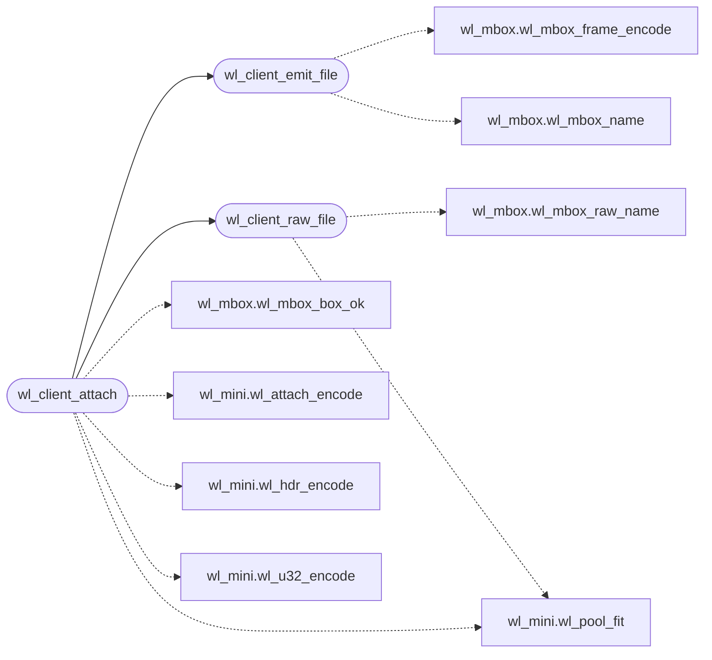

# `progs/wl/wl_client.h`

> Source: [progs/wl/wl_client.h:1](../../progs/wl/wl_client.h#L1) | language `h` | coverage 80.0% | [API index](../index.md)

wl_client.h - Thin mailbox client for Wayland-mini (ADR-0026).

## Contents

- **Functions:** [`wl_client_emit_file`](#wl_client_emit_file), [`wl_client_raw_file`](#wl_client_raw_file), [`wl_client_attach`](#wl_client_attach)
- **Macros:** [`WL_CLIENT_MSGS`](#wl_client_msgs)

## Call Graph

Solid arrows stay in this module, dashed arrows leave it.



## Functions

<a id="wl_client_emit_file"></a>

### `wl_client_emit_file`

`function` `inline` `static` | [progs/wl/wl_client.h:21](../../progs/wl/wl_client.h#L21)

```c
static inline int wl_client_emit_file(const char *box, unsigned int seq, const unsigned char *msg, int mlen)
```

Write one framed session message as its own mailbox file.

**Parameters**

| Name | Type | Default | Description |
|---|---|---|---|
| `box` | `char *` |  |  |
| `seq` | `unsigned int` |  |  |
| `msg` | `unsigned char *` |  |  |
| `mlen` | `int` |  |  |

**Returns:** `int`

*Calls:* [`wl_mbox_frame_encode`](progs.wl.wl_mbox.h.md#wl_mbox_frame_encode), [`wl_mbox_name`](progs.wl.wl_mbox.h.md#wl_mbox_name)

*Called by:* [`wl_client_attach`](#wl_client_attach)

---

<a id="wl_client_raw_file"></a>

### `wl_client_raw_file`

`function` `inline` `static` | [progs/wl/wl_client.h:48](../../progs/wl/wl_client.h#L48)

```c
static inline int wl_client_raw_file(const char *box, const unsigned char *px, int w, int h)
```

Write the pixel blob the next attach sizes.

Pixels first so the server never attaches a surface whose raw file is missing.

**Parameters**

| Name | Type | Default | Description |
|---|---|---|---|
| `box` | `char *` |  |  |
| `px` | `unsigned char *` |  |  |
| `w` | `int` |  |  |
| `h` | `int` |  |  |

**Returns:** `int`

*Calls:* [`wl_mbox_raw_name`](progs.wl.wl_mbox.h.md#wl_mbox_raw_name), [`wl_pool_fit`](progs.wl.wl_mini.h.md#wl_pool_fit)

*Called by:* [`wl_client_attach`](#wl_client_attach)

---

<a id="wl_client_attach"></a>

### `wl_client_attach`

`function` `inline` `static` | [progs/wl/wl_client.h:75](../../progs/wl/wl_client.h#L75)

```c
static inline int wl_client_attach(const char *box, unsigned int seq0, const unsigned char *px, int w, int h)
```

Attach one surface: pixels first, then display, bind, create, pool, attach and commit, each sequenced from seq0.

Returns WL_ERR_OK when all six messages landed.

**Parameters**

| Name | Type | Default | Description |
|---|---|---|---|
| `box` | `char *` |  |  |
| `seq0` | `unsigned int` |  |  |
| `px` | `unsigned char *` |  |  |
| `w` | `int` |  |  |
| `h` | `int` |  |  |

**Returns:** `int`

*Calls:* [`wl_client_emit_file`](#wl_client_emit_file), [`wl_client_raw_file`](#wl_client_raw_file), [`wl_mbox_box_ok`](progs.wl.wl_mbox.h.md#wl_mbox_box_ok), [`wl_attach_encode`](progs.wl.wl_mini.h.md#wl_attach_encode), [`wl_hdr_encode`](progs.wl.wl_mini.h.md#wl_hdr_encode), [`wl_pool_fit`](progs.wl.wl_mini.h.md#wl_pool_fit), [`wl_u32_encode`](progs.wl.wl_mini.h.md#wl_u32_encode)

---

## Macros

<a id="wl_client_msgs"></a>

### `WL_CLIENT_MSGS`

`macro` | [progs/wl/wl_client.h:18](../../progs/wl/wl_client.h#L18)

```c
#define WL_CLIENT_MSGS
```

---
