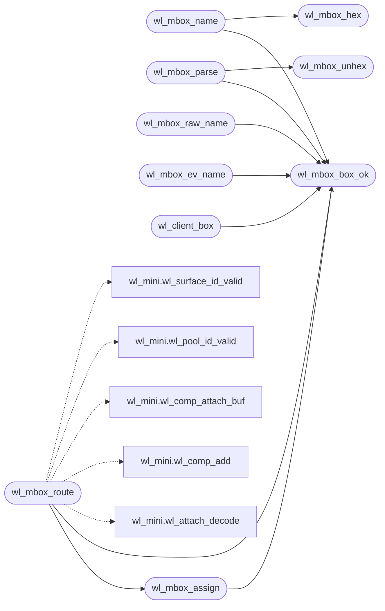

# `progs/wl/wl_mbox.h`

> Source: [progs/wl/wl_mbox.h:1](../../progs/wl/wl_mbox.h#L1) | language `h` | coverage 46.2% | [API index](../index.md)

wl_mbox.h - Mailbox file transport for Wayland-mini (ADR-0026).

## Contents

- **Structs:** [`wl_mbox_box_t`](#wl_mbox_box_t)
- **Functions:** [`wl_mbox_init`](#wl_mbox_init), [`wl_mbox_box_ok`](#wl_mbox_box_ok), [`wl_mbox_hex`](#wl_mbox_hex), [`wl_mbox_unhex`](#wl_mbox_unhex), [`wl_mbox_name`](#wl_mbox_name), [`wl_mbox_parse`](#wl_mbox_parse), [`wl_mbox_raw_name`](#wl_mbox_raw_name), [`wl_mbox_ev_name`](#wl_mbox_ev_name), [`wl_client_box`](#wl_client_box), [`wl_mbox_frame_encode`](#wl_mbox_frame_encode), [`wl_mbox_frame_decode`](#wl_mbox_frame_decode), [`wl_mbox_assign`](#wl_mbox_assign), [`wl_mbox_fresh`](#wl_mbox_fresh), [`wl_mbox_route`](#wl_mbox_route)
- **Macros:** [`WL_MBOX_DIR`](#wl_mbox_dir), [`WL_MBOX_SUFFIX`](#wl_mbox_suffix), [`WL_MBOX_RAW_SUFFIX`](#wl_mbox_raw_suffix), [`WL_MBOX_EV_SUFFIX`](#wl_mbox_ev_suffix), [`WL_MBOX_BOX_MAX`](#wl_mbox_box_max), [`WL_MBOX_NAME_MAX`](#wl_mbox_name_max), [`WL_MBOX_MAGIC`](#wl_mbox_magic), [`WL_MBOX_FRAME_HEAD`](#wl_mbox_frame_head), [`WL_MBOX_POLL_MAX`](#wl_mbox_poll_max), [`WL_MBOX_SEQ_HEX`](#wl_mbox_seq_hex)

## Call Graph

Solid arrows stay in this module, dashed arrows leave it.



## Structs

<a id="wl_mbox_box_t"></a>

### `wl_mbox_box_t`

`struct` | [progs/wl/wl_mbox.h:30](../../progs/wl/wl_mbox.h#L30)

```c
typedef struct
```

---

## Functions

<a id="wl_mbox_init"></a>

### `wl_mbox_init`

`function` `inline` `static` | [progs/wl/wl_mbox.h:36](../../progs/wl/wl_mbox.h#L36)

```c
static inline void wl_mbox_init(wl_mbox_box_t *boxes)
```

**Parameters**

| Name | Type | Default | Description |
|---|---|---|---|
| `boxes` | `wl_mbox_box_t *` |  |  |

---

<a id="wl_mbox_box_ok"></a>

### `wl_mbox_box_ok`

`function` `inline` `static` | [progs/wl/wl_mbox.h:51](../../progs/wl/wl_mbox.h#L51)

```c
static inline int wl_mbox_box_ok(const char *box)
```

Box names are lowercase alphanumerics so they can never escape the directory through dot or slash tricks.

**Parameters**

| Name | Type | Default | Description |
|---|---|---|---|
| `box` | `char *` |  |  |

**Returns:** `int`

*Called by:* [`wl_client_attach`](progs.wl.wl_client.h.md#wl_client_attach), [`wl_client_box`](#wl_client_box), [`wl_mbox_assign`](#wl_mbox_assign), [`wl_mbox_ev_name`](#wl_mbox_ev_name), [`wl_mbox_name`](#wl_mbox_name), [`wl_mbox_parse`](#wl_mbox_parse), [`wl_mbox_raw_name`](#wl_mbox_raw_name), [`wl_mbox_route`](#wl_mbox_route)

---

<a id="wl_mbox_hex"></a>

### `wl_mbox_hex`

`function` `inline` `static` | [progs/wl/wl_mbox.h:74](../../progs/wl/wl_mbox.h#L74)

```c
static inline int wl_mbox_hex(unsigned int v, char *dst)
```

Sequence as fixed 8 lowercase hex so names sort chronologically.

**Parameters**

| Name | Type | Default | Description |
|---|---|---|---|
| `v` | `unsigned int` |  |  |
| `dst` | `char *` |  |  |

**Returns:** `int`

*Called by:* [`wl_mbox_name`](#wl_mbox_name)

---

<a id="wl_mbox_unhex"></a>

### `wl_mbox_unhex`

`function` `inline` `static` | [progs/wl/wl_mbox.h:87](../../progs/wl/wl_mbox.h#L87)

```c
static inline int wl_mbox_unhex(char ch, unsigned int *v)
```

**Parameters**

| Name | Type | Default | Description |
|---|---|---|---|
| `ch` | `char` |  |  |
| `v` | `unsigned int *` |  |  |

**Returns:** `int`

*Called by:* [`wl_mbox_parse`](#wl_mbox_parse)

---

<a id="wl_mbox_name"></a>

### `wl_mbox_name`

`function` `inline` `static` | [progs/wl/wl_mbox.h:103](../../progs/wl/wl_mbox.h#L103)

```c
static inline int wl_mbox_name(char *dst, int cap, const char *box, unsigned int seq)
```

Build WL_MBOX_DIR/box-seq.msg.

Returns the length, never a prefix of it, so a short buffer reads as an error and not a stray file.

**Parameters**

| Name | Type | Default | Description |
|---|---|---|---|
| `dst` | `char *` |  |  |
| `cap` | `int` |  |  |
| `box` | `char *` |  |  |
| `seq` | `unsigned int` |  |  |

**Returns:** `int`

*Calls:* [`wl_mbox_box_ok`](#wl_mbox_box_ok), [`wl_mbox_hex`](#wl_mbox_hex)

*Called by:* [`wl_client_emit_file`](progs.wl.wl_client.h.md#wl_client_emit_file)

---

<a id="wl_mbox_parse"></a>

### `wl_mbox_parse`

`function` `inline` `static` | [progs/wl/wl_mbox.h:147](../../progs/wl/wl_mbox.h#L147)

```c
static inline int wl_mbox_parse(const char *path, char *box, int boxcap, unsigned int *seq)
```

Parse a mailbox path back into box plus sequence.

Only exact matches pass; a renamed stray or a foreign suffix never dispatches.

**Parameters**

| Name | Type | Default | Description |
|---|---|---|---|
| `path` | `char *` |  |  |
| `box` | `char *` |  |  |
| `boxcap` | `int` |  |  |
| `seq` | `unsigned int *` |  |  |

**Returns:** `int`

*Calls:* [`wl_mbox_box_ok`](#wl_mbox_box_ok), [`wl_mbox_unhex`](#wl_mbox_unhex)

---

<a id="wl_mbox_raw_name"></a>

### `wl_mbox_raw_name`

`function` `inline` `static` | [progs/wl/wl_mbox.h:194](../../progs/wl/wl_mbox.h#L194)

```c
static inline int wl_mbox_raw_name(char *dst, int cap, const char *box)
```

Raw pixel path beside the mailbox, sized w*h by the last attach.

**Parameters**

| Name | Type | Default | Description |
|---|---|---|---|
| `dst` | `char *` |  |  |
| `cap` | `int` |  |  |
| `box` | `char *` |  |  |

**Returns:** `int`

*Calls:* [`wl_mbox_box_ok`](#wl_mbox_box_ok)

*Called by:* [`wl_client_raw_file`](progs.wl.wl_client.h.md#wl_client_raw_file)

---

<a id="wl_mbox_ev_name"></a>

### `wl_mbox_ev_name`

`function` `inline` `static` | [progs/wl/wl_mbox.h:225](../../progs/wl/wl_mbox.h#L225)

```c
static inline int wl_mbox_ev_name(char *dst, int cap, const char *box)
```

Event path beside the mailbox, one fixed frame per focused box.

**Parameters**

| Name | Type | Default | Description |
|---|---|---|---|
| `dst` | `char *` |  |  |
| `cap` | `int` |  |  |
| `box` | `char *` |  |  |

**Returns:** `int`

*Calls:* [`wl_mbox_box_ok`](#wl_mbox_box_ok)

---

<a id="wl_client_box"></a>

### `wl_client_box`

`function` `inline` `static` | [progs/wl/wl_mbox.h:257](../../progs/wl/wl_mbox.h#L257)

```c
static inline int wl_client_box(const char *prog, long pid, char *dst, int cap)
```

Client box name: lowercase alnum program plus decimal pid, so two instances of one app never share a mailbox.

Pure, host-tested.

**Parameters**

| Name | Type | Default | Description |
|---|---|---|---|
| `prog` | `char *` |  |  |
| `pid` | `long` |  |  |
| `dst` | `char *` |  |  |
| `cap` | `int` |  |  |

**Returns:** `int`

*Calls:* [`wl_mbox_box_ok`](#wl_mbox_box_ok)

---

<a id="wl_mbox_frame_encode"></a>

### `wl_mbox_frame_encode`

`function` `inline` `static` | [progs/wl/wl_mbox.h:310](../../progs/wl/wl_mbox.h#L310)

```c
static inline int wl_mbox_frame_encode(unsigned char *dst, int cap, unsigned int seq, const unsigned char *msg, int mlen)
```

Frame one wire message: magic plus sequence plus the raw message.

The reader refuses anything short, anything foreign and anything with trailing bytes, so a torn write waits for the next poll.

**Parameters**

| Name | Type | Default | Description |
|---|---|---|---|
| `dst` | `unsigned char *` |  |  |
| `cap` | `int` |  |  |
| `seq` | `unsigned int` |  |  |
| `msg` | `unsigned char *` |  |  |
| `mlen` | `int` |  |  |

**Returns:** `int`

*Called by:* [`wl_client_emit_file`](progs.wl.wl_client.h.md#wl_client_emit_file)

---

<a id="wl_mbox_frame_decode"></a>

### `wl_mbox_frame_decode`

`function` `inline` `static` | [progs/wl/wl_mbox.h:332](../../progs/wl/wl_mbox.h#L332)

```c
static inline int wl_mbox_frame_decode(const unsigned char *src, int len, unsigned int *seq, int *off, int *mlen)
```

**Parameters**

| Name | Type | Default | Description |
|---|---|---|---|
| `src` | `unsigned char *` |  |  |
| `len` | `int` |  |  |
| `seq` | `unsigned int *` |  |  |
| `off` | `int *` |  |  |
| `mlen` | `int *` |  |  |

**Returns:** `int`

---

<a id="wl_mbox_assign"></a>

### `wl_mbox_assign`

`function` `inline` `static` | [progs/wl/wl_mbox.h:358](../../progs/wl/wl_mbox.h#L358)

```c
static inline int wl_mbox_assign(wl_mbox_box_t *boxes, const char *box)
```

Claim the slot a box owns, stable across polls, fail-closed when the server is full or the name is wild.

**Parameters**

| Name | Type | Default | Description |
|---|---|---|---|
| `boxes` | `wl_mbox_box_t *` |  |  |
| `box` | `char *` |  |  |

**Returns:** `int`

*Calls:* [`wl_mbox_box_ok`](#wl_mbox_box_ok)

*Called by:* [`wl_mbox_route`](#wl_mbox_route)

---

<a id="wl_mbox_fresh"></a>

### `wl_mbox_fresh`

`function` `inline` `static` | [progs/wl/wl_mbox.h:394](../../progs/wl/wl_mbox.h#L394)

```c
static inline int wl_mbox_fresh(const wl_mbox_box_t *boxes, int slot, unsigned int seq)
```

Freshness of an arriving sequence: a repeat of the last accepted one is a duplicate the server already consumed, anything else is new work.

Fail-closed on wild slots.

**Parameters**

| Name | Type | Default | Description |
|---|---|---|---|
| `boxes` | `wl_mbox_box_t *` |  |  |
| `slot` | `int` |  |  |
| `seq` | `unsigned int` |  |  |

**Returns:** `int`

---

<a id="wl_mbox_route"></a>

### `wl_mbox_route`

`function` `inline` `static` | [progs/wl/wl_mbox.h:409](../../progs/wl/wl_mbox.h#L409)

```c
static inline int wl_mbox_route(wl_comp_t *c, wl_mbox_box_t *boxes, const char *box, unsigned int id, unsigned int opcode, const unsigned char *arg, int alen, int *slot, int *w, int *h)
```

Route one mailbox message to the compositor state.

The box owns its slot, so a client id is only checked for range, never for global meaning: each connection speaks its own id space exactly like a real Wayland client, and the slot is the server resource. Attach reports w/h for the pixel load, commit reports -1 for no change, anything else that validates reports the slot too.

**Parameters**

| Name | Type | Default | Description |
|---|---|---|---|
| `c` | `wl_comp_t *` |  |  |
| `boxes` | `wl_mbox_box_t *` |  |  |
| `box` | `char *` |  |  |
| `id` | `unsigned int` |  |  |
| `opcode` | `unsigned int` |  |  |
| `arg` | `unsigned char *` |  |  |
| `alen` | `int` |  |  |
| `slot` | `int *` |  |  |
| `w` | `int *` |  |  |
| `h` | `int *` |  |  |

**Returns:** `int`

*Calls:* [`wl_mbox_assign`](#wl_mbox_assign), [`wl_mbox_box_ok`](#wl_mbox_box_ok), [`wl_attach_decode`](progs.wl.wl_mini.h.md#wl_attach_decode), [`wl_comp_add`](progs.wl.wl_mini.h.md#wl_comp_add), [`wl_comp_attach_buf`](progs.wl.wl_mini.h.md#wl_comp_attach_buf), [`wl_pool_id_valid`](progs.wl.wl_mini.h.md#wl_pool_id_valid), [`wl_surface_id_valid`](progs.wl.wl_mini.h.md#wl_surface_id_valid)

---

## Macros

<a id="wl_mbox_dir"></a>

### `WL_MBOX_DIR`

`macro` | [progs/wl/wl_mbox.h:19](../../progs/wl/wl_mbox.h#L19)

```c
#define WL_MBOX_DIR
```

---

<a id="wl_mbox_suffix"></a>

### `WL_MBOX_SUFFIX`

`macro` | [progs/wl/wl_mbox.h:20](../../progs/wl/wl_mbox.h#L20)

```c
#define WL_MBOX_SUFFIX
```

---

<a id="wl_mbox_raw_suffix"></a>

### `WL_MBOX_RAW_SUFFIX`

`macro` | [progs/wl/wl_mbox.h:21](../../progs/wl/wl_mbox.h#L21)

```c
#define WL_MBOX_RAW_SUFFIX
```

---

<a id="wl_mbox_ev_suffix"></a>

### `WL_MBOX_EV_SUFFIX`

`macro` | [progs/wl/wl_mbox.h:22](../../progs/wl/wl_mbox.h#L22)

```c
#define WL_MBOX_EV_SUFFIX
```

---

<a id="wl_mbox_box_max"></a>

### `WL_MBOX_BOX_MAX`

`macro` | [progs/wl/wl_mbox.h:23](../../progs/wl/wl_mbox.h#L23)

```c
#define WL_MBOX_BOX_MAX
```

---

<a id="wl_mbox_name_max"></a>

### `WL_MBOX_NAME_MAX`

`macro` | [progs/wl/wl_mbox.h:24](../../progs/wl/wl_mbox.h#L24)

```c
#define WL_MBOX_NAME_MAX
```

---

<a id="wl_mbox_magic"></a>

### `WL_MBOX_MAGIC`

`macro` | [progs/wl/wl_mbox.h:25](../../progs/wl/wl_mbox.h#L25)

```c
#define WL_MBOX_MAGIC
```

---

<a id="wl_mbox_frame_head"></a>

### `WL_MBOX_FRAME_HEAD`

`macro` | [progs/wl/wl_mbox.h:26](../../progs/wl/wl_mbox.h#L26)

```c
#define WL_MBOX_FRAME_HEAD
```

---

<a id="wl_mbox_poll_max"></a>

### `WL_MBOX_POLL_MAX`

`macro` | [progs/wl/wl_mbox.h:27](../../progs/wl/wl_mbox.h#L27)

```c
#define WL_MBOX_POLL_MAX
```

---

<a id="wl_mbox_seq_hex"></a>

### `WL_MBOX_SEQ_HEX`

`macro` | [progs/wl/wl_mbox.h:28](../../progs/wl/wl_mbox.h#L28)

```c
#define WL_MBOX_SEQ_HEX
```

---
