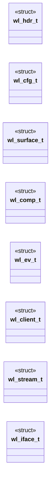

# `progs/wl/wl_mini.h`

> Source: [progs/wl/wl_mini.h:1](../../progs/wl/wl_mini.h#L1) | language `h` | coverage 18.3% | [API index](../index.md)

wl_mini.h - Wayland-mini subset contract (header-only, ADR-0024).

## Contents

- **Structs:** [`wl_hdr_t`](#wl_hdr_t), [`wl_cfg_t`](#wl_cfg_t), [`wl_surface_t`](#wl_surface_t), [`wl_comp_t`](#wl_comp_t), [`wl_ev_t`](#wl_ev_t), [`wl_client_t`](#wl_client_t), [`wl_stream_t`](#wl_stream_t), [`wl_iface_t`](#wl_iface_t)
- **Functions:** [`wl_hdr_encode`](#wl_hdr_encode), [`wl_hdr_decode`](#wl_hdr_decode), [`wl_u32_encode`](#wl_u32_encode), [`wl_u32_decode`](#wl_u32_decode), [`wl_strlen_bounded`](#wl_strlen_bounded), [`wl_str_encode`](#wl_str_encode), [`wl_str_decode`](#wl_str_decode), [`wl_surface_id_valid`](#wl_surface_id_valid), [`wl_pool_id_valid`](#wl_pool_id_valid), [`wl_pool_fit`](#wl_pool_fit), [`wl_comp_init`](#wl_comp_init), [`wl_comp_refresh_active`](#wl_comp_refresh_active), [`wl_comp_add`](#wl_comp_add), [`wl_comp_remove`](#wl_comp_remove), [`wl_comp_focus`](#wl_comp_focus), [`wl_comp_hit`](#wl_comp_hit), [`wl_surface_hit_zone`](#wl_surface_hit_zone), [`wl_comp_top_visible`](#wl_comp_top_visible), [`wl_comp_set_minimized`](#wl_comp_set_minimized), [`wl_comp_set_color`](#wl_comp_set_color), [`wlcomp_render`](#wlcomp_render), [`wl_comp_set_rect`](#wl_comp_set_rect), [`wl_comp_layout_tile`](#wl_comp_layout_tile), [`wlcomp_blit`](#wlcomp_blit), [`body`](#body), [`wl_scale_nearest`](#wl_scale_nearest), [`wl_attach_encode`](#wl_attach_encode), [`wl_attach_decode`](#wl_attach_decode), [`wl_commit_encode`](#wl_commit_encode), [`wl_commit_decode`](#wl_commit_decode), [`wl_clip_encode`](#wl_clip_encode), [`wl_clip_decode`](#wl_clip_decode), [`coords`](#coords), [`wl_ev_encode`](#wl_ev_encode), [`wl_ev_decode`](#wl_ev_decode), [`wl_ev_map`](#wl_ev_map), [`wl_client_init`](#wl_client_init), [`wl_client_surface`](#wl_client_surface), [`wl_client_pool`](#wl_client_pool), [`wl_stream_init`](#wl_stream_init), [`wl_stream_feed`](#wl_stream_feed), [`wl_stream_next`](#wl_stream_next), [`wl_stream_consume`](#wl_stream_consume), [`wl_iface_find`](#wl_iface_find), [`wl_comp_attach_buf`](#wl_comp_attach_buf), [`wl_dispatch`](#wl_dispatch)
- **Macros:** [`WL_MAX_MSG`](#wl_max_msg), [`WL_MAX_STR`](#wl_max_str), [`WL_MAX_SURFACES`](#wl_max_surfaces), [`WL_MAX_POOLS`](#wl_max_pools), [`WL_SURF_MAX_W`](#wl_surf_max_w), [`WL_POOL_MAX`](#wl_pool_max), [`WL_HDR_SZ`](#wl_hdr_sz), [`WL_ATTACH_SZ`](#wl_attach_sz), [`WL_COMMIT_SZ`](#wl_commit_sz), [`WL_ERR_OK`](#wl_err_ok), [`WL_ERR_BOUND`](#wl_err_bound), [`WL_ERR_TRUNC`](#wl_err_trunc), [`WL_ERR_SIZE`](#wl_err_size), [`WL_ERR_ID`](#wl_err_id), [`WL_ERR_STR`](#wl_err_str), [`WL_ERR_MORE`](#wl_err_more), [`WL_ID_DISPLAY`](#wl_id_display), [`WL_ID_REGISTRY`](#wl_id_registry), [`WL_ID_COMPOSITOR`](#wl_id_compositor), [`WL_ID_SHM`](#wl_id_shm), [`WL_ID_XDG_BASE`](#wl_id_xdg_base), [`WL_ID_SURFACE_BASE`](#wl_id_surface_base), [`WL_ID_POOL_BASE`](#wl_id_pool_base), [`WL_ID_BUFFER_BASE`](#wl_id_buffer_base), [`WL_OP_DISPLAY_GET_REGISTRY`](#wl_op_display_get_registry), [`WL_OP_REGISTRY_BIND`](#wl_op_registry_bind), [`WL_OP_COMPOSITOR_CREATE_SURFACE`](#wl_op_compositor_create_surface), [`WL_OP_SHM_CREATE_POOL`](#wl_op_shm_create_pool), [`WL_OP_POOL_CREATE_BUFFER`](#wl_op_pool_create_buffer), [`WL_OP_SURFACE_ATTACH`](#wl_op_surface_attach), [`WL_OP_SURFACE_COMMIT`](#wl_op_surface_commit), [`WL_OP_XDG_GET_TOPLEVEL`](#wl_op_xdg_get_toplevel), [`WL_CFG_DEFAULT`](#wl_cfg_default), [`WL_CLOSE_W`](#wl_close_w), [`WL_RESIZE_EDGE`](#wl_resize_edge), [`WL_TITLE_ACTIVE`](#wl_title_active), [`WL_TITLE_INACTIVE`](#wl_title_inactive), [`WL_CLOSE_INK`](#wl_close_ink), [`WL_HIT_NONE`](#wl_hit_none), [`WL_HIT_BODY`](#wl_hit_body), [`WL_HIT_TITLE`](#wl_hit_title), [`WL_HIT_CLOSE`](#wl_hit_close), [`WL_HIT_RESIZE`](#wl_hit_resize), [`WLCOMP_BG`](#wlcomp_bg), [`WLCOMP_BORDER`](#wlcomp_border), [`WL_ID_CLIPBOARD`](#wl_id_clipboard), [`WL_OP_CLIPBOARD_SET`](#wl_op_clipboard_set), [`WL_OP_CLIPBOARD_GET`](#wl_op_clipboard_get), [`WL_CLIP_MAX`](#wl_clip_max), [`WL_EV_MAGIC`](#wl_ev_magic), [`WL_EV_SC_MAX`](#wl_ev_sc_max), [`WL_EV_SZ`](#wl_ev_sz), [`WL_STREAM_CAP`](#wl_stream_cap), [`WL_IFACE_COUNT`](#wl_iface_count)

## Type Diagram



## Call Graph

Solid arrows stay in this module, dashed arrows leave it.

```mermaid
flowchart LR
    n_progs_wl_wl_mini_h__wl_str_encode(["wl_str_encode"])
    n_progs_wl_wl_mini_h__wl_strlen_bounded(["wl_strlen_bounded"])
    n_progs_wl_wl_mini_h__wl_u32_encode(["wl_u32_encode"])
    n_progs_wl_wl_mini_h__wl_str_decode(["wl_str_decode"])
    n_progs_wl_wl_mini_h__wl_u32_decode(["wl_u32_decode"])
    n_progs_wl_wl_mini_h__wl_comp_add(["wl_comp_add"])
    n_progs_wl_wl_mini_h__wl_comp_refresh_active(["wl_comp_refresh_active"])
    n_progs_wl_wl_mini_h__wl_pool_fit(["wl_pool_fit"])
    n_progs_wl_wl_mini_h__wl_surface_id_valid(["wl_surface_id_valid"])
    n_progs_wl_wl_mini_h__wl_comp_remove(["wl_comp_remove"])
    n_progs_wl_wl_mini_h__wl_comp_focus(["wl_comp_focus"])
    n_progs_wl_wl_mini_h__wl_comp_set_minimized(["wl_comp_set_minimized"])
    n_progs_wl_wl_mini_h__wl_comp_top_visible(["wl_comp_top_visible"])
    n_progs_wl_wl_mini_h__wl_comp_set_rect(["wl_comp_set_rect"])
    n_progs_wl_wl_mini_h__wl_comp_layout_tile(["wl_comp_layout_tile"])
    n_progs_wl_wl_mini_h__wl_attach_encode(["wl_attach_encode"])
    n_progs_wl_wl_mini_h__wl_pool_id_valid(["wl_pool_id_valid"])
    n_progs_wl_wl_mini_h__wl_attach_decode(["wl_attach_decode"])
    n_progs_wl_wl_mini_h__wl_commit_encode(["wl_commit_encode"])
    n_progs_wl_wl_mini_h__wl_commit_decode(["wl_commit_decode"])
    n_progs_wl_wl_mini_h__wl_clip_encode(["wl_clip_encode"])
    n_progs_wl_wl_mini_h__wl_clip_decode(["wl_clip_decode"])
    n_progs_wl_wl_mini_h__wl_ev_encode(["wl_ev_encode"])
    n_progs_wl_wl_mini_h__wl_str_encode --> n_progs_wl_wl_mini_h__wl_strlen_bounded
    n_progs_wl_wl_mini_h__wl_str_encode --> n_progs_wl_wl_mini_h__wl_u32_encode
    n_progs_wl_wl_mini_h__wl_str_decode --> n_progs_wl_wl_mini_h__wl_u32_decode
    n_progs_wl_wl_mini_h__wl_comp_add --> n_progs_wl_wl_mini_h__wl_comp_refresh_active
    n_progs_wl_wl_mini_h__wl_comp_add --> n_progs_wl_wl_mini_h__wl_pool_fit
    n_progs_wl_wl_mini_h__wl_comp_add --> n_progs_wl_wl_mini_h__wl_surface_id_valid
    n_progs_wl_wl_mini_h__wl_comp_remove --> n_progs_wl_wl_mini_h__wl_comp_refresh_active
    n_progs_wl_wl_mini_h__wl_comp_focus --> n_progs_wl_wl_mini_h__wl_comp_refresh_active
    n_progs_wl_wl_mini_h__wl_comp_set_minimized --> n_progs_wl_wl_mini_h__wl_comp_refresh_active
    n_progs_wl_wl_mini_h__wl_comp_set_minimized --> n_progs_wl_wl_mini_h__wl_comp_top_visible
    n_progs_wl_wl_mini_h__wl_comp_set_rect --> n_progs_wl_wl_mini_h__wl_pool_fit
    n_progs_wl_wl_mini_h__wl_comp_layout_tile --> n_progs_wl_wl_mini_h__wl_pool_fit
    n_progs_wl_wl_mini_h__wl_attach_encode --> n_progs_wl_wl_mini_h__wl_pool_fit
    n_progs_wl_wl_mini_h__wl_attach_encode --> n_progs_wl_wl_mini_h__wl_pool_id_valid
    n_progs_wl_wl_mini_h__wl_attach_encode --> n_progs_wl_wl_mini_h__wl_u32_encode
    n_progs_wl_wl_mini_h__wl_attach_decode --> n_progs_wl_wl_mini_h__wl_pool_id_valid
    n_progs_wl_wl_mini_h__wl_attach_decode --> n_progs_wl_wl_mini_h__wl_u32_decode
    n_progs_wl_wl_mini_h__wl_commit_encode --> n_progs_wl_wl_mini_h__wl_surface_id_valid
    n_progs_wl_wl_mini_h__wl_commit_encode --> n_progs_wl_wl_mini_h__wl_u32_encode
    n_progs_wl_wl_mini_h__wl_commit_decode --> n_progs_wl_wl_mini_h__wl_surface_id_valid
    n_progs_wl_wl_mini_h__wl_commit_decode --> n_progs_wl_wl_mini_h__wl_u32_decode
    n_progs_wl_wl_mini_h__wl_clip_encode --> n_progs_wl_wl_mini_h__wl_u32_encode
    n_progs_wl_wl_mini_h__wl_clip_decode --> n_progs_wl_wl_mini_h__wl_u32_decode
    n_progs_wl_wl_mini_h__wl_ev_encode --> n_progs_wl_wl_mini_h__wl_u32_encode
```



## Structs

<a id="wl_hdr_t"></a>

### `wl_hdr_t`

`struct` | [progs/wl/wl_mini.h:57](../../progs/wl/wl_mini.h#L57)

```c
typedef struct
```

---

<a id="wl_cfg_t"></a>

### `wl_cfg_t`

`struct` | [progs/wl/wl_mini.h:63](../../progs/wl/wl_mini.h#L63)

```c
typedef struct
```

---

<a id="wl_surface_t"></a>

### `wl_surface_t`

`struct` | [progs/wl/wl_mini.h:251](../../progs/wl/wl_mini.h#L251)

```c
typedef struct
```

---

<a id="wl_comp_t"></a>

### `wl_comp_t`

`struct` | [progs/wl/wl_mini.h:264](../../progs/wl/wl_mini.h#L264)

```c
typedef struct
```

---

<a id="wl_ev_t"></a>

### `wl_ev_t`

`struct` | [progs/wl/wl_mini.h:968](../../progs/wl/wl_mini.h#L968)

```c
typedef struct
```

---

<a id="wl_client_t"></a>

### `wl_client_t`

`struct` | [progs/wl/wl_mini.h:1086](../../progs/wl/wl_mini.h#L1086)

```c
typedef struct
```

---

<a id="wl_stream_t"></a>

### `wl_stream_t`

`struct` | [progs/wl/wl_mini.h:1124](../../progs/wl/wl_mini.h#L1124)

```c
typedef struct
```

---

<a id="wl_iface_t"></a>

### `wl_iface_t`

`struct` | [progs/wl/wl_mini.h:1179](../../progs/wl/wl_mini.h#L1179)

```c
typedef struct
```

Interface descriptor table, the hand-written wl_interface subset. request and event counts name what wl_dispatch answers, nothing more; a scanner earns its place only if the subset grows.

---

## Functions

<a id="wl_hdr_encode"></a>

### `wl_hdr_encode`

`function` `inline` `static` | [progs/wl/wl_mini.h:71](../../progs/wl/wl_mini.h#L71)

```c
static inline int wl_hdr_encode(unsigned char *dst, int cap, unsigned int id, unsigned int opcode, unsigned int size, wl_hdr_t *out)
```

**Parameters**

| Name | Type | Default | Description |
|---|---|---|---|
| `dst` | `unsigned char *` |  |  |
| `cap` | `int` |  |  |
| `id` | `unsigned int` |  |  |
| `opcode` | `unsigned int` |  |  |
| `size` | `unsigned int` |  |  |
| `out` | `wl_hdr_t *` |  |  |

**Returns:** `int`

*Called by:* [`wl_client_attach`](progs.wl.wl_client.h.md#wl_client_attach)

---

<a id="wl_hdr_decode"></a>

### `wl_hdr_decode`

`function` `inline` `static` | [progs/wl/wl_mini.h:99](../../progs/wl/wl_mini.h#L99)

```c
static inline int wl_hdr_decode(const unsigned char *src, int len, wl_hdr_t *out)
```

**Parameters**

| Name | Type | Default | Description |
|---|---|---|---|
| `src` | `unsigned char *` |  |  |
| `len` | `int` |  |  |
| `out` | `wl_hdr_t *` |  |  |

**Returns:** `int`

*Called by:* [`wl_stream_next`](#wl_stream_next)

---

<a id="wl_u32_encode"></a>

### `wl_u32_encode`

`function` `inline` `static` | [progs/wl/wl_mini.h:128](../../progs/wl/wl_mini.h#L128)

```c
static inline int wl_u32_encode(unsigned char *dst, int cap, int off, unsigned int v)
```

**Parameters**

| Name | Type | Default | Description |
|---|---|---|---|
| `dst` | `unsigned char *` |  |  |
| `cap` | `int` |  |  |
| `off` | `int` |  |  |
| `v` | `unsigned int` |  |  |

**Returns:** `int`

*Called by:* [`wl_client_attach`](progs.wl.wl_client.h.md#wl_client_attach), [`wl_attach_encode`](#wl_attach_encode), [`wl_clip_encode`](#wl_clip_encode), [`wl_commit_encode`](#wl_commit_encode), [`wl_ev_encode`](#wl_ev_encode), [`wl_str_encode`](#wl_str_encode)

---

<a id="wl_u32_decode"></a>

### `wl_u32_decode`

`function` `inline` `static` | [progs/wl/wl_mini.h:139](../../progs/wl/wl_mini.h#L139)

```c
static inline int wl_u32_decode(const unsigned char *src, int len, int off, unsigned int *v)
```

**Parameters**

| Name | Type | Default | Description |
|---|---|---|---|
| `src` | `unsigned char *` |  |  |
| `len` | `int` |  |  |
| `off` | `int` |  |  |
| `v` | `unsigned int *` |  |  |

**Returns:** `int`

*Called by:* [`wl_attach_decode`](#wl_attach_decode), [`wl_clip_decode`](#wl_clip_decode), [`wl_commit_decode`](#wl_commit_decode), [`wl_ev_decode`](#wl_ev_decode), [`wl_str_decode`](#wl_str_decode)

---

<a id="wl_strlen_bounded"></a>

### `wl_strlen_bounded`

`function` `inline` `static` | [progs/wl/wl_mini.h:150](../../progs/wl/wl_mini.h#L150)

```c
static inline int wl_strlen_bounded(const char *s)
```

**Parameters**

| Name | Type | Default | Description |
|---|---|---|---|
| `s` | `char *` |  |  |

**Returns:** `int`

*Called by:* [`wl_str_encode`](#wl_str_encode)

---

<a id="wl_str_encode"></a>

### `wl_str_encode`

`function` `inline` `static` | [progs/wl/wl_mini.h:163](../../progs/wl/wl_mini.h#L163)

```c
static inline int wl_str_encode(unsigned char *dst, int cap, int off, const char *s)
```

String arg: u32 len (incl.

NUL) + bytes + pad to 4. Returns total or err.

**Parameters**

| Name | Type | Default | Description |
|---|---|---|---|
| `dst` | `unsigned char *` |  |  |
| `cap` | `int` |  |  |
| `off` | `int` |  |  |
| `s` | `char *` |  |  |

**Returns:** `int`

*Calls:* [`wl_strlen_bounded`](#wl_strlen_bounded), [`wl_u32_encode`](#wl_u32_encode)

---

<a id="wl_str_decode"></a>

### `wl_str_decode`

`function` `inline` `static` | [progs/wl/wl_mini.h:188](../../progs/wl/wl_mini.h#L188)

```c
static inline int wl_str_decode(const unsigned char *src, int len, int off, char *dst, int dcap)
```

**Parameters**

| Name | Type | Default | Description |
|---|---|---|---|
| `src` | `unsigned char *` |  |  |
| `len` | `int` |  |  |
| `off` | `int` |  |  |
| `dst` | `char *` |  |  |
| `dcap` | `int` |  |  |

**Returns:** `int`

*Calls:* [`wl_u32_decode`](#wl_u32_decode)

---

<a id="wl_surface_id_valid"></a>

### `wl_surface_id_valid`

`function` `inline` `static` | [progs/wl/wl_mini.h:214](../../progs/wl/wl_mini.h#L214)

```c
static inline int wl_surface_id_valid(unsigned int id)
```

**Parameters**

| Name | Type | Default | Description |
|---|---|---|---|
| `id` | `unsigned int` |  |  |

**Returns:** `int`

*Called by:* [`wl_mbox_route`](progs.wl.wl_mbox.h.md#wl_mbox_route), [`wl_commit_decode`](#wl_commit_decode), [`wl_commit_encode`](#wl_commit_encode), [`wl_comp_add`](#wl_comp_add), [`wl_comp_attach_buf`](#wl_comp_attach_buf), [`wl_dispatch`](#wl_dispatch)

---

<a id="wl_pool_id_valid"></a>

### `wl_pool_id_valid`

`function` `inline` `static` | [progs/wl/wl_mini.h:219](../../progs/wl/wl_mini.h#L219)

```c
static inline int wl_pool_id_valid(unsigned int id)
```

**Parameters**

| Name | Type | Default | Description |
|---|---|---|---|
| `id` | `unsigned int` |  |  |

**Returns:** `int`

*Called by:* [`wl_mbox_route`](progs.wl.wl_mbox.h.md#wl_mbox_route), [`wl_attach_decode`](#wl_attach_decode), [`wl_attach_encode`](#wl_attach_encode), [`wl_comp_attach_buf`](#wl_comp_attach_buf), [`wl_dispatch`](#wl_dispatch)

---

<a id="wl_pool_fit"></a>

### `wl_pool_fit`

`function` `inline` `static` | [progs/wl/wl_mini.h:223](../../progs/wl/wl_mini.h#L223)

```c
static inline int wl_pool_fit(int w, int h)
```

**Parameters**

| Name | Type | Default | Description |
|---|---|---|---|
| `w` | `int` |  |  |
| `h` | `int` |  |  |

**Returns:** `int`

*Called by:* [`wl_client_attach`](progs.wl.wl_client.h.md#wl_client_attach), [`wl_client_raw_file`](progs.wl.wl_client.h.md#wl_client_raw_file), [`wl_attach_encode`](#wl_attach_encode), [`wl_comp_add`](#wl_comp_add), [`wl_comp_attach_buf`](#wl_comp_attach_buf), [`wl_comp_layout_tile`](#wl_comp_layout_tile), [`wl_comp_set_rect`](#wl_comp_set_rect)

---

<a id="wl_comp_init"></a>

### `wl_comp_init`

`function` `inline` `static` | [progs/wl/wl_mini.h:271](../../progs/wl/wl_mini.h#L271)

```c
static inline void wl_comp_init(wl_comp_t *c)
```

**Parameters**

| Name | Type | Default | Description |
|---|---|---|---|
| `c` | `wl_comp_t *` |  |  |

*Called by:* [`main`](progs.wl.wlcomp.c.md#main)

---

<a id="wl_comp_refresh_active"></a>

### `wl_comp_refresh_active`

`function` `inline` `static` | [progs/wl/wl_mini.h:289](../../progs/wl/wl_mini.h#L289)

```c
static inline void wl_comp_refresh_active(wl_comp_t *c)
```

Refresh the active flag from z-order: only the top-most mapped, non-minimized surface reads active.

Single place so focus, add and remove can never disagree on which title paints bright.

**Parameters**

| Name | Type | Default | Description |
|---|---|---|---|
| `c` | `wl_comp_t *` |  |  |

*Called by:* [`wl_comp_add`](#wl_comp_add), [`wl_comp_focus`](#wl_comp_focus), [`wl_comp_remove`](#wl_comp_remove), [`wl_comp_set_minimized`](#wl_comp_set_minimized)

---

<a id="wl_comp_add"></a>

### `wl_comp_add`

`function` `inline` `static` | [progs/wl/wl_mini.h:309](../../progs/wl/wl_mini.h#L309)

```c
static inline int wl_comp_add(wl_comp_t *c, unsigned int id, int w, int h)
```

**Parameters**

| Name | Type | Default | Description |
|---|---|---|---|
| `c` | `wl_comp_t *` |  |  |
| `id` | `unsigned int` |  |  |
| `w` | `int` |  |  |
| `h` | `int` |  |  |

**Returns:** `int`

*Calls:* [`wl_comp_refresh_active`](#wl_comp_refresh_active), [`wl_pool_fit`](#wl_pool_fit), [`wl_surface_id_valid`](#wl_surface_id_valid)

*Called by:* [`wl_mbox_route`](progs.wl.wl_mbox.h.md#wl_mbox_route), [`wl_dispatch`](#wl_dispatch)

---

<a id="wl_comp_remove"></a>

### `wl_comp_remove`

`function` `inline` `static` | [progs/wl/wl_mini.h:345](../../progs/wl/wl_mini.h#L345)

```c
static inline int wl_comp_remove(wl_comp_t *c, unsigned int id)
```

**Parameters**

| Name | Type | Default | Description |
|---|---|---|---|
| `c` | `wl_comp_t *` |  |  |
| `id` | `unsigned int` |  |  |

**Returns:** `int`

*Calls:* [`wl_comp_refresh_active`](#wl_comp_refresh_active)

*Called by:* [`forever`](progs.wl.wlcomp.c.md#forever)

---

<a id="wl_comp_focus"></a>

### `wl_comp_focus`

`function` `inline` `static` | [progs/wl/wl_mini.h:372](../../progs/wl/wl_mini.h#L372)

```c
static inline int wl_comp_focus(wl_comp_t *c, unsigned int id)
```

**Parameters**

| Name | Type | Default | Description |
|---|---|---|---|
| `c` | `wl_comp_t *` |  |  |
| `id` | `unsigned int` |  |  |

**Returns:** `int`

*Calls:* [`wl_comp_refresh_active`](#wl_comp_refresh_active)

---

<a id="wl_comp_hit"></a>

### `wl_comp_hit`

`function` `inline` `static` | [progs/wl/wl_mini.h:397](../../progs/wl/wl_mini.h#L397)

```c
static inline int wl_comp_hit(const wl_comp_t *c, int x, int y)
```

**Parameters**

| Name | Type | Default | Description |
|---|---|---|---|
| `c` | `wl_comp_t *` |  |  |
| `x` | `int` |  |  |
| `y` | `int` |  |  |

**Returns:** `int`

---

<a id="wl_surface_hit_zone"></a>

### `wl_surface_hit_zone`

`function` `inline` `static` | [progs/wl/wl_mini.h:415](../../progs/wl/wl_mini.h#L415)

```c
static inline int wl_surface_hit_zone(const wl_surface_t *s, int x, int y)
```

Classify a point inside one surface: close button first, then title drag strip, then the resize rim, else body.

Points outside fail closed with HIT_NONE. Geometry mirrors wlcomp_blit_chrome so clicks and pixels can never disagree.

**Parameters**

| Name | Type | Default | Description |
|---|---|---|---|
| `s` | `wl_surface_t *` |  |  |
| `x` | `int` |  |  |
| `y` | `int` |  |  |

**Returns:** `int`

---

<a id="wl_comp_top_visible"></a>

### `wl_comp_top_visible`

`function` `inline` `static` | [progs/wl/wl_mini.h:441](../../progs/wl/wl_mini.h#L441)

```c
static inline int wl_comp_top_visible(const wl_comp_t *c)
```

Slot of the top-most mapped, non-minimized surface, or -1.

This is the window that owns keyboard input: the raw top of the z-order can be a minimized surface, which must never receive keys it cannot show.

**Parameters**

| Name | Type | Default | Description |
|---|---|---|---|
| `c` | `wl_comp_t *` |  |  |

**Returns:** `int`

*Called by:* [`wl_comp_set_minimized`](#wl_comp_set_minimized)

---

<a id="wl_comp_set_minimized"></a>

### `wl_comp_set_minimized`

`function` `inline` `static` | [progs/wl/wl_mini.h:460](../../progs/wl/wl_mini.h#L460)

```c
static inline int wl_comp_set_minimized(wl_comp_t *c, unsigned int id, int minimized)
```

Minimize/restore one surface.

Minimized surfaces keep their slot and geometry but skip hit testing, tiling and compositing until restored. Minimizing sinks the surface to the bottom of the z-order and hands focus to the top-most visible surface, so the next key or Alt+M lands on a window the user can see.

**Parameters**

| Name | Type | Default | Description |
|---|---|---|---|
| `c` | `wl_comp_t *` |  |  |
| `id` | `unsigned int` |  |  |
| `minimized` | `int` |  |  |

**Returns:** `int`

*Calls:* [`wl_comp_refresh_active`](#wl_comp_refresh_active), [`wl_comp_top_visible`](#wl_comp_top_visible)

---

<a id="wl_comp_set_color"></a>

### `wl_comp_set_color`

`function` `inline` `static` | [progs/wl/wl_mini.h:487](../../progs/wl/wl_mini.h#L487)

```c
static inline int wl_comp_set_color(wl_comp_t *c, unsigned int id, int color)
```

**Parameters**

| Name | Type | Default | Description |
|---|---|---|---|
| `c` | `wl_comp_t *` |  |  |
| `id` | `unsigned int` |  |  |
| `color` | `int` |  |  |

**Returns:** `int`

---

<a id="wlcomp_render"></a>

### `wlcomp_render`

`function` `inline` `static` | [progs/wl/wl_mini.h:512](../../progs/wl/wl_mini.h#L512)

```c
static inline int wlcomp_render(const wl_comp_t *c, unsigned char *fb, int fb_w, int fb_h)
```

**Parameters**

| Name | Type | Default | Description |
|---|---|---|---|
| `c` | `wl_comp_t *` |  |  |
| `fb` | `unsigned char *` |  |  |
| `fb_w` | `int` |  |  |
| `fb_h` | `int` |  |  |

**Returns:** `int`

---

<a id="wl_comp_set_rect"></a>

### `wl_comp_set_rect`

`function` `inline` `static` | [progs/wl/wl_mini.h:550](../../progs/wl/wl_mini.h#L550)

```c
static inline int wl_comp_set_rect(wl_comp_t *c, unsigned int id, int x, int y, int w, int h)
```

Move and resize a mapped surface.

Geometry validates through wl_pool_fit; positions allow a one-screen negative margin so a drag can park a surface partly offscreen, anything beyond fails closed.

**Parameters**

| Name | Type | Default | Description |
|---|---|---|---|
| `c` | `wl_comp_t *` |  |  |
| `id` | `unsigned int` |  |  |
| `x` | `int` |  |  |
| `y` | `int` |  |  |
| `w` | `int` |  |  |
| `h` | `int` |  |  |

**Returns:** `int`

*Calls:* [`wl_pool_fit`](#wl_pool_fit)

---

<a id="wl_comp_layout_tile"></a>

### `wl_comp_layout_tile`

`function` `inline` `static` | [progs/wl/wl_mini.h:577](../../progs/wl/wl_mini.h#L577)

```c
static inline int wl_comp_layout_tile(wl_comp_t *c, int fb_w, int fb_h)
```

Tile every mapped surface over the frame in z-order.

One surface fills the frame, two split it vertically, three or more form a rows-by-columns grid with the last row and column absorbing the integer remainder. Returns the tiled count, fail-closed when there is nothing mapped or the frame is degenerate.

**Parameters**

| Name | Type | Default | Description |
|---|---|---|---|
| `c` | `wl_comp_t *` |  |  |
| `fb_w` | `int` |  |  |
| `fb_h` | `int` |  |  |

**Returns:** `int`

*Calls:* [`wl_pool_fit`](#wl_pool_fit)

---

<a id="wlcomp_blit"></a>

### `wlcomp_blit`

`function` `inline` `static` | [progs/wl/wl_mini.h:637](../../progs/wl/wl_mini.h#L637)

```c
static inline int wlcomp_blit(const wl_comp_t *c, unsigned char *fb, int fb_w, int fb_h, const unsigned char * const *px, const int *pw, const int *ph)
```

Composite the surface stack with real client pixels. px, pw and ph are slot-indexed tables over items[]; a null slot entry renders the surface solid color exactly like wlcomp_render, which keeps single color clients working.

A present pixel table whose dimensions differ from the surface fails closed. Null table means all solid.

**Parameters**

| Name | Type | Default | Description |
|---|---|---|---|
| `c` | `wl_comp_t *` |  |  |
| `fb` | `unsigned char *` |  |  |
| `fb_w` | `int` |  |  |
| `fb_h` | `int` |  |  |
| `px` | `unsigned char * const *` |  |  |
| `pw` | `int *` |  |  |
| `ph` | `int *` |  |  |

**Returns:** `int`

---

<a id="body"></a>

### `body`

`function` | [progs/wl/wl_mini.h:698](../../progs/wl/wl_mini.h#L698)

```c
* resampled into the body (inside the 1 px border, below the title), * the exact rect wl_ev_map ...
```

**Parameters**

| Name | Type | Default | Description |
|---|---|---|---|
| `border` | `inside the 1 px` |  |  |
| `title` | `below the` |  |  |

**Returns:** `* resampled into the`

---

<a id="wl_scale_nearest"></a>

### `wl_scale_nearest`

`function` `inline` `static` | [progs/wl/wl_mini.h:793](../../progs/wl/wl_mini.h#L793)

```c
static inline int wl_scale_nearest(unsigned char *dst, int dw, int dh, const unsigned char *src, int sw, int sh)
```

Nearest-neighbour scale of an indexed frame, the compositor side of a client buffer meeting a layout cell of another size.

A real compositor scales or clips; refusing would unmap every client the moment it tiles, so the resample stays exact and bounded instead. Fail-closed on null or degenerate geometry and on arithmetic the frame cannot hold.

**Parameters**

| Name | Type | Default | Description |
|---|---|---|---|
| `dst` | `unsigned char *` |  |  |
| `dw` | `int` |  |  |
| `dh` | `int` |  |  |
| `src` | `unsigned char *` |  |  |
| `sw` | `int` |  |  |
| `sh` | `int` |  |  |

**Returns:** `int`

---

<a id="wl_attach_encode"></a>

### `wl_attach_encode`

`function` `inline` `static` | [progs/wl/wl_mini.h:823](../../progs/wl/wl_mini.h#L823)

```c
static inline int wl_attach_encode(unsigned char *dst, int cap, unsigned int pool, int w, int h)
```

Attach payload: u32 pool id, u32 width, u32 height.

The client speaks it over the mailbox transport; the compositor decodes it before touching any pixel, so a wild pool or an oversized frame never reaches layout.

**Parameters**

| Name | Type | Default | Description |
|---|---|---|---|
| `dst` | `unsigned char *` |  |  |
| `cap` | `int` |  |  |
| `pool` | `unsigned int` |  |  |
| `w` | `int` |  |  |
| `h` | `int` |  |  |

**Returns:** `int`

*Calls:* [`wl_pool_fit`](#wl_pool_fit), [`wl_pool_id_valid`](#wl_pool_id_valid), [`wl_u32_encode`](#wl_u32_encode)

*Called by:* [`wl_client_attach`](progs.wl.wl_client.h.md#wl_client_attach)

---

<a id="wl_attach_decode"></a>

### `wl_attach_decode`

`function` `inline` `static` | [progs/wl/wl_mini.h:842](../../progs/wl/wl_mini.h#L842)

```c
static inline int wl_attach_decode(const unsigned char *src, int len, unsigned int *pool, int *w, int *h)
```

**Parameters**

| Name | Type | Default | Description |
|---|---|---|---|
| `src` | `unsigned char *` |  |  |
| `len` | `int` |  |  |
| `pool` | `unsigned int *` |  |  |
| `w` | `int *` |  |  |
| `h` | `int *` |  |  |

**Returns:** `int`

*Calls:* [`wl_pool_id_valid`](#wl_pool_id_valid), [`wl_u32_decode`](#wl_u32_decode)

*Called by:* [`wl_mbox_route`](progs.wl.wl_mbox.h.md#wl_mbox_route), [`wl_dispatch`](#wl_dispatch)

---

<a id="wl_commit_encode"></a>

### `wl_commit_encode`

`function` `inline` `static` | [progs/wl/wl_mini.h:870](../../progs/wl/wl_mini.h#L870)

```c
static inline int wl_commit_encode(unsigned char *dst, int cap, unsigned int id)
```

Commit payload: u32 surface id naming the surface whose attached buffer becomes visible.

Wild ids fail closed, never focus a stranger.

**Parameters**

| Name | Type | Default | Description |
|---|---|---|---|
| `dst` | `unsigned char *` |  |  |
| `cap` | `int` |  |  |
| `id` | `unsigned int` |  |  |

**Returns:** `int`

*Calls:* [`wl_surface_id_valid`](#wl_surface_id_valid), [`wl_u32_encode`](#wl_u32_encode)

---

<a id="wl_commit_decode"></a>

### `wl_commit_decode`

`function` `inline` `static` | [progs/wl/wl_mini.h:883](../../progs/wl/wl_mini.h#L883)

```c
static inline int wl_commit_decode(const unsigned char *src, int len, unsigned int *id)
```

**Parameters**

| Name | Type | Default | Description |
|---|---|---|---|
| `src` | `unsigned char *` |  |  |
| `len` | `int` |  |  |
| `id` | `unsigned int *` |  |  |

**Returns:** `int`

*Calls:* [`wl_surface_id_valid`](#wl_surface_id_valid), [`wl_u32_decode`](#wl_u32_decode)

---

<a id="wl_clip_encode"></a>

### `wl_clip_encode`

`function` `inline` `static` | [progs/wl/wl_mini.h:907](../../progs/wl/wl_mini.h#L907)

```c
static inline int wl_clip_encode(unsigned char *dst, int cap, const unsigned char *text, unsigned n)
```

**Parameters**

| Name | Type | Default | Description |
|---|---|---|---|
| `dst` | `unsigned char *` |  |  |
| `cap` | `int` |  |  |
| `text` | `unsigned char *` |  |  |
| `n` | `unsigned` |  |  |

**Returns:** `int`

*Calls:* [`wl_u32_encode`](#wl_u32_encode)

---

<a id="wl_clip_decode"></a>

### `wl_clip_decode`

`function` `inline` `static` | [progs/wl/wl_mini.h:930](../../progs/wl/wl_mini.h#L930)

```c
static inline int wl_clip_decode(const unsigned char *src, int len, unsigned char *dst, int dcap, unsigned *n_out)
```

**Parameters**

| Name | Type | Default | Description |
|---|---|---|---|
| `src` | `unsigned char *` |  |  |
| `len` | `int` |  |  |
| `dst` | `unsigned char *` |  |  |
| `dcap` | `int` |  |  |
| `n_out` | `unsigned *` |  |  |

**Returns:** `int`

*Calls:* [`wl_u32_decode`](#wl_u32_decode)

---

<a id="coords"></a>

### `coords`

`function` | [progs/wl/wl_mini.h:959](../../progs/wl/wl_mini.h#L959)

```c
* coords (mapped by wl_ev_map, -1 when outside), wheel is a * monotonic total the client diffs, scancodes are raw Set-1 bytes * (E0 prefixes included) the client's own translator consumes. * A slow cl
```

**Parameters**

| Name | Type | Default | Description |
|---|---|---|---|
| `wl_ev_map` | `mapped by` |  |  |
| `outside` | `-1 when` |  |  |

**Returns:** `*`

---

<a id="wl_ev_encode"></a>

### `wl_ev_encode`

`function` `inline` `static` | [progs/wl/wl_mini.h:978](../../progs/wl/wl_mini.h#L978)

```c
static inline int wl_ev_encode(unsigned char *dst, int cap, const wl_ev_t *ev)
```

**Parameters**

| Name | Type | Default | Description |
|---|---|---|---|
| `dst` | `unsigned char *` |  |  |
| `cap` | `int` |  |  |
| `ev` | `wl_ev_t *` |  |  |

**Returns:** `int`

*Calls:* [`wl_u32_encode`](#wl_u32_encode)

---

<a id="wl_ev_decode"></a>

### `wl_ev_decode`

`function` `inline` `static` | [progs/wl/wl_mini.h:1008](../../progs/wl/wl_mini.h#L1008)

```c
static inline int wl_ev_decode(const unsigned char *src, int len, wl_ev_t *ev)
```

**Parameters**

| Name | Type | Default | Description |
|---|---|---|---|
| `src` | `unsigned char *` |  |  |
| `len` | `int` |  |  |
| `ev` | `wl_ev_t *` |  |  |

**Returns:** `int`

*Calls:* [`wl_u32_decode`](#wl_u32_decode)

---

<a id="wl_ev_map"></a>

### `wl_ev_map`

`function` `inline` `static` | [progs/wl/wl_mini.h:1051](../../progs/wl/wl_mini.h#L1051)

```c
static inline int wl_ev_map(int fx, int fy, int sx, int sy, int sw, int sh, int rw, int rh, int *cx, int *cy)
```

Map a frame point into a client's raw buffer coords.

The content area starts below the 1px border plus the title bar; the scale covers layout cells differing from attach dims. Outside maps to (-1,-1) with 0, never a clamped edge that would warp clicks.

**Parameters**

| Name | Type | Default | Description |
|---|---|---|---|
| `fx` | `int` |  |  |
| `fy` | `int` |  |  |
| `sx` | `int` |  |  |
| `sy` | `int` |  |  |
| `sw` | `int` |  |  |
| `sh` | `int` |  |  |
| `rw` | `int` |  |  |
| `rh` | `int` |  |  |
| `cx` | `int *` |  |  |
| `cy` | `int *` |  |  |

**Returns:** `int`

---

<a id="wl_client_init"></a>

### `wl_client_init`

`function` `inline` `static` | [progs/wl/wl_mini.h:1092](../../progs/wl/wl_mini.h#L1092)

```c
static inline void wl_client_init(wl_client_t *cl)
```

**Parameters**

| Name | Type | Default | Description |
|---|---|---|---|
| `cl` | `wl_client_t *` |  |  |

---

<a id="wl_client_surface"></a>

### `wl_client_surface`

`function` `inline` `static` | [progs/wl/wl_mini.h:1100](../../progs/wl/wl_mini.h#L1100)

```c
static inline int wl_client_surface(wl_client_t *cl, unsigned int *id)
```

**Parameters**

| Name | Type | Default | Description |
|---|---|---|---|
| `cl` | `wl_client_t *` |  |  |
| `id` | `unsigned int *` |  |  |

**Returns:** `int`

*Called by:* [`wl_dispatch`](#wl_dispatch)

---

<a id="wl_client_pool"></a>

### `wl_client_pool`

`function` `inline` `static` | [progs/wl/wl_mini.h:1109](../../progs/wl/wl_mini.h#L1109)

```c
static inline int wl_client_pool(wl_client_t *cl, unsigned int *id)
```

**Parameters**

| Name | Type | Default | Description |
|---|---|---|---|
| `cl` | `wl_client_t *` |  |  |
| `id` | `unsigned int *` |  |  |

**Returns:** `int`

*Called by:* [`wl_dispatch`](#wl_dispatch)

---

<a id="wl_stream_init"></a>

### `wl_stream_init`

`function` `inline` `static` | [progs/wl/wl_mini.h:1129](../../progs/wl/wl_mini.h#L1129)

```c
static inline void wl_stream_init(wl_stream_t *s)
```

**Parameters**

| Name | Type | Default | Description |
|---|---|---|---|
| `s` | `wl_stream_t *` |  |  |

---

<a id="wl_stream_feed"></a>

### `wl_stream_feed`

`function` `inline` `static` | [progs/wl/wl_mini.h:1135](../../progs/wl/wl_mini.h#L1135)

```c
static inline int wl_stream_feed(wl_stream_t *s, const unsigned char *src, int n)
```

**Parameters**

| Name | Type | Default | Description |
|---|---|---|---|
| `s` | `wl_stream_t *` |  |  |
| `src` | `unsigned char *` |  |  |
| `n` | `int` |  |  |

**Returns:** `int`

---

<a id="wl_stream_next"></a>

### `wl_stream_next`

`function` `inline` `static` | [progs/wl/wl_mini.h:1150](../../progs/wl/wl_mini.h#L1150)

```c
static inline int wl_stream_next(wl_stream_t *s, int *size)
```

**Parameters**

| Name | Type | Default | Description |
|---|---|---|---|
| `s` | `wl_stream_t *` |  |  |
| `size` | `int *` |  |  |

**Returns:** `int`

*Calls:* [`wl_hdr_decode`](#wl_hdr_decode)

---

<a id="wl_stream_consume"></a>

### `wl_stream_consume`

`function` `inline` `static` | [progs/wl/wl_mini.h:1166](../../progs/wl/wl_mini.h#L1166)

```c
static inline int wl_stream_consume(wl_stream_t *s, int n)
```

**Parameters**

| Name | Type | Default | Description |
|---|---|---|---|
| `s` | `wl_stream_t *` |  |  |
| `n` | `int` |  |  |

**Returns:** `int`

---

<a id="wl_iface_find"></a>

### `wl_iface_find`

`function` `inline` `static` | [progs/wl/wl_mini.h:1187](../../progs/wl/wl_mini.h#L1187)

```c
static inline int wl_iface_find(const char *name)
```

**Parameters**

| Name | Type | Default | Description |
|---|---|---|---|
| `name` | `char *` |  |  |

**Returns:** `int`

---

<a id="wl_comp_attach_buf"></a>

### `wl_comp_attach_buf`

`function` `inline` `static` | [progs/wl/wl_mini.h:1218](../../progs/wl/wl_mini.h#L1218)

```c
static inline int wl_comp_attach_buf(wl_comp_t *c, unsigned int id, unsigned int pool, int w, int h)
```

Bind an attached buffer to a surface, keeping its position.

The pool id stands in for the passed fd miniOS cannot carry, validated here before any pixel is ever addressed through it.

**Parameters**

| Name | Type | Default | Description |
|---|---|---|---|
| `c` | `wl_comp_t *` |  |  |
| `id` | `unsigned int` |  |  |
| `pool` | `unsigned int` |  |  |
| `w` | `int` |  |  |
| `h` | `int` |  |  |

**Returns:** `int`

*Calls:* [`wl_pool_fit`](#wl_pool_fit), [`wl_pool_id_valid`](#wl_pool_id_valid), [`wl_surface_id_valid`](#wl_surface_id_valid)

*Called by:* [`wl_mbox_route`](progs.wl.wl_mbox.h.md#wl_mbox_route), [`wl_dispatch`](#wl_dispatch)

---

<a id="wl_dispatch"></a>

### `wl_dispatch`

`function` `inline` `static` | [progs/wl/wl_mini.h:1245](../../progs/wl/wl_mini.h#L1245)

```c
static inline int wl_dispatch(wl_comp_t *c, wl_client_t *cl, unsigned int id, unsigned int opcode, const unsigned char *arg, int alen)
```

Route one framed request to the compositor state, the protocol.c plus server.c shape collapsed into one pure function.

Unknown ids name strangers, unknown opcodes name unimplemented verbs, short payloads never reach the surface they address.

**Parameters**

| Name | Type | Default | Description |
|---|---|---|---|
| `c` | `wl_comp_t *` |  |  |
| `cl` | `wl_client_t *` |  |  |
| `id` | `unsigned int` |  |  |
| `opcode` | `unsigned int` |  |  |
| `arg` | `unsigned char *` |  |  |
| `alen` | `int` |  |  |

**Returns:** `int`

*Calls:* [`wl_attach_decode`](#wl_attach_decode), [`wl_client_pool`](#wl_client_pool), [`wl_client_surface`](#wl_client_surface), [`wl_comp_add`](#wl_comp_add), [`wl_comp_attach_buf`](#wl_comp_attach_buf), [`wl_pool_id_valid`](#wl_pool_id_valid), [`wl_surface_id_valid`](#wl_surface_id_valid)

---

## Macros

<a id="wl_max_msg"></a>

### `WL_MAX_MSG`

`macro` | [progs/wl/wl_mini.h:20](../../progs/wl/wl_mini.h#L20)

```c
#define WL_MAX_MSG
```

---

<a id="wl_max_str"></a>

### `WL_MAX_STR`

`macro` | [progs/wl/wl_mini.h:21](../../progs/wl/wl_mini.h#L21)

```c
#define WL_MAX_STR
```

---

<a id="wl_max_surfaces"></a>

### `WL_MAX_SURFACES`

`macro` | [progs/wl/wl_mini.h:22](../../progs/wl/wl_mini.h#L22)

```c
#define WL_MAX_SURFACES
```

---

<a id="wl_max_pools"></a>

### `WL_MAX_POOLS`

`macro` | [progs/wl/wl_mini.h:23](../../progs/wl/wl_mini.h#L23)

```c
#define WL_MAX_POOLS
```

---

<a id="wl_surf_max_w"></a>

### `WL_SURF_MAX_W`

`macro` | [progs/wl/wl_mini.h:24](../../progs/wl/wl_mini.h#L24)

```c
#define WL_SURF_MAX_W
```

---

<a id="wl_pool_max"></a>

### `WL_POOL_MAX`

`macro` | [progs/wl/wl_mini.h:26](../../progs/wl/wl_mini.h#L26)

```c
#define WL_POOL_MAX
```

---

<a id="wl_hdr_sz"></a>

### `WL_HDR_SZ`

`macro` | [progs/wl/wl_mini.h:27](../../progs/wl/wl_mini.h#L27)

```c
#define WL_HDR_SZ
```

---

<a id="wl_attach_sz"></a>

### `WL_ATTACH_SZ`

`macro` | [progs/wl/wl_mini.h:28](../../progs/wl/wl_mini.h#L28)

```c
#define WL_ATTACH_SZ
```

---

<a id="wl_commit_sz"></a>

### `WL_COMMIT_SZ`

`macro` | [progs/wl/wl_mini.h:29](../../progs/wl/wl_mini.h#L29)

```c
#define WL_COMMIT_SZ
```

---

<a id="wl_err_ok"></a>

### `WL_ERR_OK`

`macro` | [progs/wl/wl_mini.h:31](../../progs/wl/wl_mini.h#L31)

```c
#define WL_ERR_OK
```

---

<a id="wl_err_bound"></a>

### `WL_ERR_BOUND`

`macro` | [progs/wl/wl_mini.h:32](../../progs/wl/wl_mini.h#L32)

```c
#define WL_ERR_BOUND
```

---

<a id="wl_err_trunc"></a>

### `WL_ERR_TRUNC`

`macro` | [progs/wl/wl_mini.h:33](../../progs/wl/wl_mini.h#L33)

```c
#define WL_ERR_TRUNC
```

---

<a id="wl_err_size"></a>

### `WL_ERR_SIZE`

`macro` | [progs/wl/wl_mini.h:34](../../progs/wl/wl_mini.h#L34)

```c
#define WL_ERR_SIZE
```

---

<a id="wl_err_id"></a>

### `WL_ERR_ID`

`macro` | [progs/wl/wl_mini.h:35](../../progs/wl/wl_mini.h#L35)

```c
#define WL_ERR_ID
```

---

<a id="wl_err_str"></a>

### `WL_ERR_STR`

`macro` | [progs/wl/wl_mini.h:36](../../progs/wl/wl_mini.h#L36)

```c
#define WL_ERR_STR
```

---

<a id="wl_err_more"></a>

### `WL_ERR_MORE`

`macro` | [progs/wl/wl_mini.h:37](../../progs/wl/wl_mini.h#L37)

```c
#define WL_ERR_MORE
```

---

<a id="wl_id_display"></a>

### `WL_ID_DISPLAY`

`macro` | [progs/wl/wl_mini.h:39](../../progs/wl/wl_mini.h#L39)

```c
#define WL_ID_DISPLAY
```

---

<a id="wl_id_registry"></a>

### `WL_ID_REGISTRY`

`macro` | [progs/wl/wl_mini.h:40](../../progs/wl/wl_mini.h#L40)

```c
#define WL_ID_REGISTRY
```

---

<a id="wl_id_compositor"></a>

### `WL_ID_COMPOSITOR`

`macro` | [progs/wl/wl_mini.h:41](../../progs/wl/wl_mini.h#L41)

```c
#define WL_ID_COMPOSITOR
```

---

<a id="wl_id_shm"></a>

### `WL_ID_SHM`

`macro` | [progs/wl/wl_mini.h:42](../../progs/wl/wl_mini.h#L42)

```c
#define WL_ID_SHM
```

---

<a id="wl_id_xdg_base"></a>

### `WL_ID_XDG_BASE`

`macro` | [progs/wl/wl_mini.h:43](../../progs/wl/wl_mini.h#L43)

```c
#define WL_ID_XDG_BASE
```

---

<a id="wl_id_surface_base"></a>

### `WL_ID_SURFACE_BASE`

`macro` | [progs/wl/wl_mini.h:44](../../progs/wl/wl_mini.h#L44)

```c
#define WL_ID_SURFACE_BASE
```

---

<a id="wl_id_pool_base"></a>

### `WL_ID_POOL_BASE`

`macro` | [progs/wl/wl_mini.h:45](../../progs/wl/wl_mini.h#L45)

```c
#define WL_ID_POOL_BASE
```

---

<a id="wl_id_buffer_base"></a>

### `WL_ID_BUFFER_BASE`

`macro` | [progs/wl/wl_mini.h:46](../../progs/wl/wl_mini.h#L46)

```c
#define WL_ID_BUFFER_BASE
```

---

<a id="wl_op_display_get_registry"></a>

### `WL_OP_DISPLAY_GET_REGISTRY`

`macro` | [progs/wl/wl_mini.h:48](../../progs/wl/wl_mini.h#L48)

```c
#define WL_OP_DISPLAY_GET_REGISTRY
```

---

<a id="wl_op_registry_bind"></a>

### `WL_OP_REGISTRY_BIND`

`macro` | [progs/wl/wl_mini.h:49](../../progs/wl/wl_mini.h#L49)

```c
#define WL_OP_REGISTRY_BIND
```

---

<a id="wl_op_compositor_create_surface"></a>

### `WL_OP_COMPOSITOR_CREATE_SURFACE`

`macro` | [progs/wl/wl_mini.h:50](../../progs/wl/wl_mini.h#L50)

```c
#define WL_OP_COMPOSITOR_CREATE_SURFACE
```

---

<a id="wl_op_shm_create_pool"></a>

### `WL_OP_SHM_CREATE_POOL`

`macro` | [progs/wl/wl_mini.h:51](../../progs/wl/wl_mini.h#L51)

```c
#define WL_OP_SHM_CREATE_POOL
```

---

<a id="wl_op_pool_create_buffer"></a>

### `WL_OP_POOL_CREATE_BUFFER`

`macro` | [progs/wl/wl_mini.h:52](../../progs/wl/wl_mini.h#L52)

```c
#define WL_OP_POOL_CREATE_BUFFER
```

---

<a id="wl_op_surface_attach"></a>

### `WL_OP_SURFACE_ATTACH`

`macro` | [progs/wl/wl_mini.h:53](../../progs/wl/wl_mini.h#L53)

```c
#define WL_OP_SURFACE_ATTACH
```

---

<a id="wl_op_surface_commit"></a>

### `WL_OP_SURFACE_COMMIT`

`macro` | [progs/wl/wl_mini.h:54](../../progs/wl/wl_mini.h#L54)

```c
#define WL_OP_SURFACE_COMMIT
```

---

<a id="wl_op_xdg_get_toplevel"></a>

### `WL_OP_XDG_GET_TOPLEVEL`

`macro` | [progs/wl/wl_mini.h:55](../../progs/wl/wl_mini.h#L55)

```c
#define WL_OP_XDG_GET_TOPLEVEL
```

---

<a id="wl_cfg_default"></a>

### `WL_CFG_DEFAULT`

`macro` | [progs/wl/wl_mini.h:69](../../progs/wl/wl_mini.h#L69)

```c
#define WL_CFG_DEFAULT
```

---

<a id="wl_close_w"></a>

### `WL_CLOSE_W`

`macro` | [progs/wl/wl_mini.h:239](../../progs/wl/wl_mini.h#L239)

```c
#define WL_CLOSE_W
```

---

<a id="wl_resize_edge"></a>

### `WL_RESIZE_EDGE`

`macro` | [progs/wl/wl_mini.h:240](../../progs/wl/wl_mini.h#L240)

```c
#define WL_RESIZE_EDGE
```

---

<a id="wl_title_active"></a>

### `WL_TITLE_ACTIVE`

`macro` | [progs/wl/wl_mini.h:241](../../progs/wl/wl_mini.h#L241)

```c
#define WL_TITLE_ACTIVE
```

---

<a id="wl_title_inactive"></a>

### `WL_TITLE_INACTIVE`

`macro` | [progs/wl/wl_mini.h:242](../../progs/wl/wl_mini.h#L242)

```c
#define WL_TITLE_INACTIVE
```

---

<a id="wl_close_ink"></a>

### `WL_CLOSE_INK`

`macro` | [progs/wl/wl_mini.h:243](../../progs/wl/wl_mini.h#L243)

```c
#define WL_CLOSE_INK
```

---

<a id="wl_hit_none"></a>

### `WL_HIT_NONE`

`macro` | [progs/wl/wl_mini.h:245](../../progs/wl/wl_mini.h#L245)

```c
#define WL_HIT_NONE
```

---

<a id="wl_hit_body"></a>

### `WL_HIT_BODY`

`macro` | [progs/wl/wl_mini.h:246](../../progs/wl/wl_mini.h#L246)

```c
#define WL_HIT_BODY
```

---

<a id="wl_hit_title"></a>

### `WL_HIT_TITLE`

`macro` | [progs/wl/wl_mini.h:247](../../progs/wl/wl_mini.h#L247)

```c
#define WL_HIT_TITLE
```

---

<a id="wl_hit_close"></a>

### `WL_HIT_CLOSE`

`macro` | [progs/wl/wl_mini.h:248](../../progs/wl/wl_mini.h#L248)

```c
#define WL_HIT_CLOSE
```

---

<a id="wl_hit_resize"></a>

### `WL_HIT_RESIZE`

`macro` | [progs/wl/wl_mini.h:249](../../progs/wl/wl_mini.h#L249)

```c
#define WL_HIT_RESIZE
```

---

<a id="wlcomp_bg"></a>

### `WLCOMP_BG`

`macro` | [progs/wl/wl_mini.h:509](../../progs/wl/wl_mini.h#L509)

```c
#define WLCOMP_BG
```

Software composite of the surface stack into a palette-index fb.

Pure function, no syscalls: the guest points fb at the NK back-buffer, the host test points it at malloc. Colors are desktop palette indices 0-14 (vga_fb.h COL_*, exact so the desktop behind never recolors); callers pass their own pixels for richer content in later phases. Fills bg, then mapped surfaces bottom-to-top, each clipped to the fb with a 1px border. Fail-closed on null or degenerate geometry.

---

<a id="wlcomp_border"></a>

### `WLCOMP_BORDER`

`macro` | [progs/wl/wl_mini.h:510](../../progs/wl/wl_mini.h#L510)

```c
#define WLCOMP_BORDER
```

---

<a id="wl_id_clipboard"></a>

### `WL_ID_CLIPBOARD`

`macro` | [progs/wl/wl_mini.h:902](../../progs/wl/wl_mini.h#L902)

```c
#define WL_ID_CLIPBOARD
```

Shared text clipboard (terminal copy, vedit paste).

One text slot per compositor, plain bytes (no NUL required), capped at WL_CLIP_MAX. Object WL_ID_CLIPBOARD carries SET (publish) and GET (fetch); the kernel clip.c store and the shell `clip` builtin speak the same bounds, so a client publishing past the cap is refused at encode, never truncated on the wire.

---

<a id="wl_op_clipboard_set"></a>

### `WL_OP_CLIPBOARD_SET`

`macro` | [progs/wl/wl_mini.h:903](../../progs/wl/wl_mini.h#L903)

```c
#define WL_OP_CLIPBOARD_SET
```

---

<a id="wl_op_clipboard_get"></a>

### `WL_OP_CLIPBOARD_GET`

`macro` | [progs/wl/wl_mini.h:904](../../progs/wl/wl_mini.h#L904)

```c
#define WL_OP_CLIPBOARD_GET
```

---

<a id="wl_clip_max"></a>

### `WL_CLIP_MAX`

`macro` | [progs/wl/wl_mini.h:905](../../progs/wl/wl_mini.h#L905)

```c
#define WL_CLIP_MAX
```

---

<a id="wl_ev_magic"></a>

### `WL_EV_MAGIC`

`macro` | [progs/wl/wl_mini.h:964](../../progs/wl/wl_mini.h#L964)

```c
#define WL_EV_MAGIC
```

Server-to-client input event, one fixed frame per focused box.

The server owns PS/2 while it owns the display, so clients never touch the port in client mode: they poll their <box>.ev file and feed whatever batch carries a newer seq. Mouse is client-buffer coords (mapped by wl_ev_map, -1 when outside), wheel is a monotonic total the client diffs, scancodes are raw Set-1 bytes (E0 prefixes included) the client's own translator consumes. A slow client loses middle batches (latest wins, documented); a batch is never replayed because the server clears after write.

---

<a id="wl_ev_sc_max"></a>

### `WL_EV_SC_MAX`

`macro` | [progs/wl/wl_mini.h:965](../../progs/wl/wl_mini.h#L965)

```c
#define WL_EV_SC_MAX
```

---

<a id="wl_ev_sz"></a>

### `WL_EV_SZ`

`macro` | [progs/wl/wl_mini.h:966](../../progs/wl/wl_mini.h#L966)

```c
#define WL_EV_SZ
```

---

<a id="wl_stream_cap"></a>

### `WL_STREAM_CAP`

`macro` | [progs/wl/wl_mini.h:1122](../../progs/wl/wl_mini.h#L1122)

```c
#define WL_STREAM_CAP
```

Bounded reassembly buffer for one connection.

Bytes arrive split anywhere, even mid-header, so feed appends and next only reports a message whose declared size fully arrived. MORE means feed again, SIZE means the peer lied and the connection must die.

---

<a id="wl_iface_count"></a>

### `WL_IFACE_COUNT`

`macro` | [progs/wl/wl_mini.h:1185](../../progs/wl/wl_mini.h#L1185)

```c
#define WL_IFACE_COUNT
```

---
