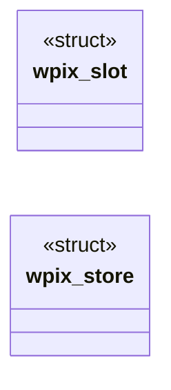
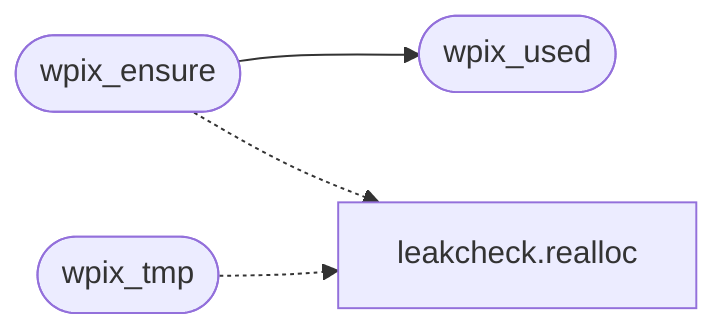

# `progs/wl/wl_pixbuf.h`

> Source: [progs/wl/wl_pixbuf.h:1](../../progs/wl/wl_pixbuf.h#L1) | language `h` | coverage 76.5% | [API index](../index.md)

Docstring: heap pixel store for the Wayland-mini server.

## Contents

- **Structs:** [`wpix_slot`](#wpix_slot), [`wpix_store`](#wpix_store)
- **Functions:** [`wpix_init`](#wpix_init), [`wpix_free`](#wpix_free), [`wpix_used`](#wpix_used), [`wpix_ptr`](#wpix_ptr), [`wpix_raw`](#wpix_raw), [`wpix_dst`](#wpix_dst), [`wpix_drop`](#wpix_drop), [`wpix_tmp`](#wpix_tmp), [`wpix_ensure`](#wpix_ensure), [`wpix_commit`](#wpix_commit)
- **Macros:** [`WPIX_MAX_SLOTS`](#wpix_max_slots), [`WPIX_MAX_W`](#wpix_max_w), [`WPIX_SLOT_MAX`](#wpix_slot_max), [`WPIX_BUDGET_MAX`](#wpix_budget_max)

## Type Diagram



## Call Graph

Solid arrows stay in this module, dashed arrows leave it.



## Structs

<a id="wpix_slot"></a>

### `wpix_slot`

`struct` | [progs/wl/wl_pixbuf.h:48](../../progs/wl/wl_pixbuf.h#L48)

```c
struct wpix_slot
```

Docstring: one slot cache, empty when p is null or w*h is zero.

---

<a id="wpix_store"></a>

### `wpix_store`

`struct` | [progs/wl/wl_pixbuf.h:55](../../progs/wl/wl_pixbuf.h#L55)

```c
struct wpix_store
```

Docstring: slot caches plus one reusable raw/decode scratch pair.

---

## Functions

<a id="wpix_init"></a>

### `wpix_init`

`function` `static` | [progs/wl/wl_pixbuf.h:63](../../progs/wl/wl_pixbuf.h#L63)

```c
static int wpix_init(struct wpix_store *s)
```

Docstring: zero init every slot and scratch pointer.

**Parameters**

| Name | Type | Default | Description |
|---|---|---|---|
| `s` | `struct wpix_store *` |  |  |

**Returns:** `int`

---

<a id="wpix_free"></a>

### `wpix_free`

`function` `static` | [progs/wl/wl_pixbuf.h:78](../../progs/wl/wl_pixbuf.h#L78)

```c
static void wpix_free(struct wpix_store *s)
```

Docstring: release every slot and scratch buffer, back to zero init.

**Parameters**

| Name | Type | Default | Description |
|---|---|---|---|
| `s` | `struct wpix_store *` |  |  |

---

<a id="wpix_used"></a>

### `wpix_used`

`function` `static` | [progs/wl/wl_pixbuf.h:95](../../progs/wl/wl_pixbuf.h#L95)

```c
static size_t wpix_used(const struct wpix_store *s)
```

Docstring: live pixel bytes held across all slots.

**Parameters**

| Name | Type | Default | Description |
|---|---|---|---|
| `s` | `struct wpix_store *` |  |  |

**Returns:** `size_t`

*Called by:* [`wpix_ensure`](#wpix_ensure)

---

<a id="wpix_ptr"></a>

### `wpix_ptr`

`function` `static` | [progs/wl/wl_pixbuf.h:107](../../progs/wl/wl_pixbuf.h#L107)

```c
static unsigned char *wpix_ptr(struct wpix_store *s, int idx)
```

Docstring: readable pixels for slot idx, null when empty or wild.

**Parameters**

| Name | Type | Default | Description |
|---|---|---|---|
| `s` | `struct wpix_store *` |  |  |
| `idx` | `int` |  |  |

**Returns:** `unsigned char *`

---

<a id="wpix_raw"></a>

### `wpix_raw`

`function` `static` | [progs/wl/wl_pixbuf.h:115](../../progs/wl/wl_pixbuf.h#L115)

```c
static unsigned char *wpix_raw(struct wpix_store *s)
```

Docstring: raw scratch for mailbox file reads, null below capacity.

**Parameters**

| Name | Type | Default | Description |
|---|---|---|---|
| `s` | `struct wpix_store *` |  |  |

**Returns:** `unsigned char *`

---

<a id="wpix_dst"></a>

### `wpix_dst`

`function` `static` | [progs/wl/wl_pixbuf.h:121](../../progs/wl/wl_pixbuf.h#L121)

```c
static unsigned char *wpix_dst(struct wpix_store *s)
```

Docstring: decode scratch for resampled cells, null below capacity.

**Parameters**

| Name | Type | Default | Description |
|---|---|---|---|
| `s` | `struct wpix_store *` |  |  |

**Returns:** `unsigned char *`

---

<a id="wpix_drop"></a>

### `wpix_drop`

`function` `static` | [progs/wl/wl_pixbuf.h:127](../../progs/wl/wl_pixbuf.h#L127)

```c
static void wpix_drop(struct wpix_store *s, int idx)
```

Docstring: drop slot pixels and release its memory to the budget.

**Parameters**

| Name | Type | Default | Description |
|---|---|---|---|
| `s` | `struct wpix_store *` |  |  |
| `idx` | `int` |  |  |

---

<a id="wpix_tmp"></a>

### `wpix_tmp`

`function` `static` | [progs/wl/wl_pixbuf.h:136](../../progs/wl/wl_pixbuf.h#L136)

```c
static int wpix_tmp(struct wpix_store *s, size_t need)
```

Docstring: grow both scratch buffers to need bytes, old kept on failure.

**Parameters**

| Name | Type | Default | Description |
|---|---|---|---|
| `s` | `struct wpix_store *` |  |  |
| `need` | `size_t` |  |  |

**Returns:** `int`

*Calls:* [`realloc`](headers.leakcheck.h.md#realloc)

---

<a id="wpix_ensure"></a>

### `wpix_ensure`

`function` `static` | [progs/wl/wl_pixbuf.h:153](../../progs/wl/wl_pixbuf.h#L153)

```c
static int wpix_ensure(struct wpix_store *s, int idx, int w, int h)
```

Docstring: size slot idx for w*h cells inside bounds and budget.

**Parameters**

| Name | Type | Default | Description |
|---|---|---|---|
| `s` | `struct wpix_store *` |  |  |
| `idx` | `int` |  |  |
| `w` | `int` |  |  |
| `h` | `int` |  |  |

**Returns:** `int`

*Calls:* [`realloc`](headers.leakcheck.h.md#realloc), [`wpix_used`](#wpix_used)

---

<a id="wpix_commit"></a>

### `wpix_commit`

`function` `static` | [progs/wl/wl_pixbuf.h:175](../../progs/wl/wl_pixbuf.h#L175)

```c
static int wpix_commit(struct wpix_store *s, int idx, const unsigned char *src, int w, int h)
```

Docstring: copy cells into a matching slot, fail closed on mismatch.

**Parameters**

| Name | Type | Default | Description |
|---|---|---|---|
| `s` | `struct wpix_store *` |  |  |
| `idx` | `int` |  |  |
| `src` | `unsigned char *` |  |  |
| `w` | `int` |  |  |
| `h` | `int` |  |  |

**Returns:** `int`

---

## Macros

<a id="wpix_max_slots"></a>

### `WPIX_MAX_SLOTS`

`macro` | [progs/wl/wl_pixbuf.h:28](../../progs/wl/wl_pixbuf.h#L28)

```c
#define WPIX_MAX_SLOTS
```

---

<a id="wpix_max_w"></a>

### `WPIX_MAX_W`

`macro` | [progs/wl/wl_pixbuf.h:32](../../progs/wl/wl_pixbuf.h#L32)

```c
#define WPIX_MAX_W
```

---

<a id="wpix_slot_max"></a>

### `WPIX_SLOT_MAX`

`macro` | [progs/wl/wl_pixbuf.h:40](../../progs/wl/wl_pixbuf.h#L40)

```c
#define WPIX_SLOT_MAX
```

---

<a id="wpix_budget_max"></a>

### `WPIX_BUDGET_MAX`

`macro` | [progs/wl/wl_pixbuf.h:44](../../progs/wl/wl_pixbuf.h#L44)

```c
#define WPIX_BUDGET_MAX
```

---
