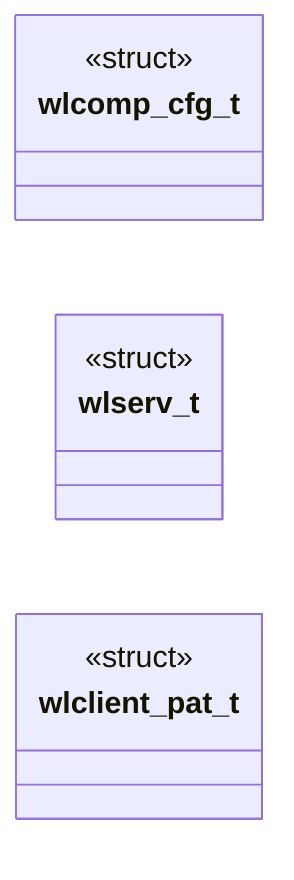
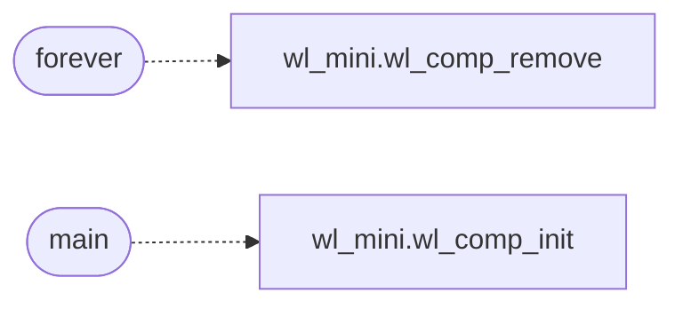

# `progs/wl/wlcomp.c`

> Source: [progs/wl/wlcomp.c:1](../../progs/wl/wlcomp.c#L1) | language `c` | coverage 37.5% | [API index](../index.md)

wlcomp - Wayland-mini ring-3 compositor (ADR-0024, ADR-0026).

## Contents

- **Structs:** [`wlcomp_cfg_t`](#wlcomp_cfg_t), [`wlserv_t`](#wlserv_t), [`wlclient_pat_t`](#wlclient_pat_t)
- **Functions:** [`forever`](#forever), [`main`](#main)
- **Macros:** [`WLCOMP_W`](#wlcomp_w), [`WLCOMP_CFG_DEFAULT`](#wlcomp_cfg_default)

## Type Diagram



## Call Graph

Solid arrows stay in this module, dashed arrows leave it.



## Structs

<a id="wlcomp_cfg_t"></a>

### `wlcomp_cfg_t`

`struct` | [progs/wl/wlcomp.c:43](../../progs/wl/wlcomp.c#L43)

```c
typedef struct
```

Centralized compositor configuration, no magic numbers at call sites.

---

<a id="wlserv_t"></a>

### `wlserv_t`

`struct` | [progs/wl/wlcomp.c:406](../../progs/wl/wlcomp.c#L406)

```c
typedef struct
```

---

<a id="wlclient_pat_t"></a>

### `wlclient_pat_t`

`struct` | [progs/wl/wlcomp.c:995](../../progs/wl/wlcomp.c#L995)

```c
typedef struct
```

Client pattern table, one row per attachable demo client.

---

## Functions

<a id="forever"></a>

### `forever`

`function` | [progs/wl/wlcomp.c:844](../../progs/wl/wlcomp.c#L844)

```c
* one of the WL_MAX_SURFACES slots forever (eight bad names used to lock * every real client out until restart). */ static void wlserv_unclaim(wlserv_t *s, int slot)
```

**Parameters**

| Name | Type | Default | Description |
|---|---|---|---|
| `restart` | `eight bad names used to lock * every real client out until` |  |  |

**Returns:** `* one of the WL_MAX_SURFACES slots`

*Calls:* [`wl_comp_remove`](progs.wl.wl_mini.h.md#wl_comp_remove)

---

<a id="main"></a>

### `main`

`function` | [progs/wl/wlcomp.c:1467](../../progs/wl/wlcomp.c#L1467)

```c
int main(int argc, char **argv)
```

**Parameters**

| Name | Type | Default | Description |
|---|---|---|---|
| `argc` | `int` |  |  |
| `argv` | `char **` |  |  |

**Returns:** `int`

*Calls:* [`wl_comp_init`](progs.wl.wl_mini.h.md#wl_comp_init)

---

## Macros

<a id="wlcomp_w"></a>

### `WLCOMP_W`

`macro` | [progs/wl/wlcomp.c:39](../../progs/wl/wlcomp.c#L39)

```c
#define WLCOMP_W
```

---

<a id="wlcomp_cfg_default"></a>

### `WLCOMP_CFG_DEFAULT`

`macro` | [progs/wl/wlcomp.c:53](../../progs/wl/wlcomp.c#L53)

```c
#define WLCOMP_CFG_DEFAULT
```

---
