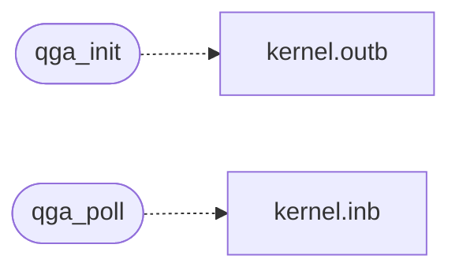

# `qga.c`

> Source: [qga.c:1](../../qga.c#L1) | language `c` | coverage 40.0% | [API index](../index.md)

MiniOS QEMU guest agent (QGA).

## Contents

- **Structs:** [`qga_pair`](#qga_pair)
- **Functions:** [`channel`](#channel), [`qga_init`](#qga_init), [`qga_poll`](#qga_poll)

## Call Graph

Solid arrows stay in this module, dashed arrows leave it.



## Structs

<a id="qga_pair"></a>

### `qga_pair`

`struct` | [qga.c:49](../../qga.c#L49)

```c
struct qga_pair
```

---

## Functions

<a id="channel"></a>

### `channel`

`function` | [qga.c:10](../../qga.c#L10)

```c
* * Polled channel (no interrupt controller): qga_init sets up COM2 and * qga_poll, called from raw_blocking_getc, services one complete line per * call. Every input path is bounded and fail-closed: a
```

**Parameters**

| Name | Type | Default | Description |
|---|---|---|---|
| `controller` | `no interrupt` |  |  |

**Returns:** `qga_init sets up COM2 and * qga_poll, called from raw_blocking_getc, services one complete line per * call. Every input path is bounded and fail-closed: a`

---

<a id="qga_init"></a>

### `qga_init`

`function` | [qga.c:35](../../qga.c#L35)

```c
void qga_init(void)
```

*Calls:* [`outb`](headers.kernel.h.md#outb)

---

<a id="qga_poll"></a>

### `qga_poll`

`function` | [qga.c:446](../../qga.c#L446)

```c
void qga_poll(void)
```

Accumulate bytes until a complete line, then parse and answer it.

Callers call it once per idle spin of the shell's raw input loop.

*Calls:* [`inb`](headers.kernel.h.md#inb)

---
