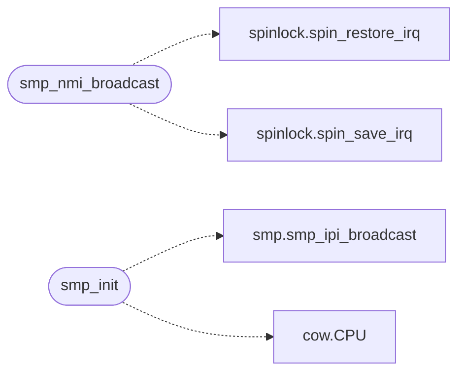

# `smp.c`

> Source: [smp.c:1](../../smp.c#L1) | language `c` | coverage 40.5% | [API index](../index.md)

SMP application-processor bring-up.

## Contents

- **Functions:** [`syscall_entry`](#syscall_entry), [`smp_nmi_broadcast`](#smp_nmi_broadcast), [`BSP`](#bsp), [`routine`](#routine), [`smp_init`](#smp_init), [`INIT`](#init)
- **Macros:** [`LAPIC_BASE`](#lapic_base), [`LAPIC_ID_OFF`](#lapic_id_off), [`LAPIC_SVR_OFF`](#lapic_svr_off), [`LAPIC_ICR_HI`](#lapic_icr_hi), [`LAPIC_ICR_LO`](#lapic_icr_lo), [`LAPIC_LVT_TIMER`](#lapic_lvt_timer), [`LAPIC_LVT_LINT0`](#lapic_lvt_lint0), [`LAPIC_LVT_LINT1`](#lapic_lvt_lint1), [`LAPIC_LVT_MASKED`](#lapic_lvt_masked), [`LAPIC_LVT_EXTINT`](#lapic_lvt_extint), [`LAPIC_EOI_OFF`](#lapic_eoi_off), [`LAPIC_TIMER_DIV`](#lapic_timer_div), [`LAPIC_TIMER_INIT`](#lapic_timer_init), [`LAPIC_TIMER_CUR`](#lapic_timer_cur), [`LAPIC_SVR_ENABLE`](#lapic_svr_enable), [`LAPIC_ICR_BUSY`](#lapic_icr_busy), [`LAPIC_ICR_INIT`](#lapic_icr_init), [`LAPIC_ICR_SIPI`](#lapic_icr_sipi), [`LAPIC_ICR_ALL_EXC`](#lapic_icr_all_exc), [`LAPIC_ICR_LEVEL`](#lapic_icr_level), [`LAPIC_ICR_TRIGGER`](#lapic_icr_trigger), [`LAPIC_ICR_NMI`](#lapic_icr_nmi), [`LAPIC_ICR_IDLE_SPINS`](#lapic_icr_idle_spins), [`SIPI_VECTOR`](#sipi_vector), [`PIT_HZ`](#pit_hz), [`LAPIC_TIMER_DIVIDE_16`](#lapic_timer_divide_16), [`LAPIC_TIMER_PERIODIC`](#lapic_timer_periodic), [`LAPIC_PD_ADDR`](#lapic_pd_addr), [`LAPIC_PDPT_SLOT`](#lapic_pdpt_slot), [`LAPIC_PD_IDX`](#lapic_pd_idx)

## Call Graph

Solid arrows stay in this module, dashed arrows leave it.



## Functions

<a id="syscall_entry"></a>

### `syscall_entry`

`function` `extern` | [smp.c:86](../../smp.c#L86)

```c
extern void syscall_entry(void);
```

The syscall trampoline lives in kernel.c (declared global there).

---

<a id="smp_nmi_broadcast"></a>

### `smp_nmi_broadcast`

`function` | [smp.c:113](../../smp.c#L113)

```c
void smp_nmi_broadcast(void)
```

Broadcast an NMI to every other CPU (TLB shootdown, kernel/mm/tlb.c).

Any CPU may call it: interrupts stay off across the two ICR writes so a tick on this CPU cannot interleave its own broadcast between them, and a previous send still in flight is waited out first.

*Calls:* [`spin_restore_irq`](headers.spinlock.h.md#spin_restore_irq), [`spin_save_irq`](headers.spinlock.h.md#spin_save_irq)

---

<a id="bsp"></a>

### `BSP`

`function` | [smp.c:258](../../smp.c#L258)

```c
* were programmed only on the BSP (syscall_init runs in kmain), so * an AP's first sysretq loaded SS from a zeroed STAR (selector 0x08, * kernel code, as SS) and died with #SS. The values mirror * sys
```

**Parameters**

| Name | Type | Default | Description |
|---|---|---|---|
| `kmain` | `syscall_init runs in` |  |  |

**Returns:** `* were programmed only on the`

---

<a id="routine"></a>

### `routine`

`function` | [smp.c:286](../../smp.c#L286)

```c
* routine (FreeDom's fetch threads, under -smp 2). */ cpu_enable_caches();
```

**Parameters**

| Name | Type | Default | Description |
|---|---|---|---|
| `smp` | `FreeDom's fetch threads, under - 2` |  |  |

**Returns:** `*`

---

<a id="smp_init"></a>

### `smp_init`

`function` | [smp.c:341](../../smp.c#L341)

```c
void smp_init(void)
```

*Calls:* [`smp_ipi_broadcast`](headers.smp.h.md#smp_ipi_broadcast), [`CPU`](kernel.mm.cow.c.md#cpu)

---

<a id="init"></a>

### `INIT`

`function` | [smp.c:359](../../smp.c#L359)

```c
* INIT (edge-triggered): resets APs to wait-for-SIPI state. * QEMU 11 drops level-triggered INIT (delivery status never clears), * so edge-triggered is used. Two SIPIs deliver the startup vector. */ l
```

**Parameters**

| Name | Type | Default | Description |
|---|---|---|---|
| `triggered` | `edge-` |  |  |

**Returns:** `resets APs to wait-for-SIPI state. * QEMU 11 drops level-triggered INIT (delivery status never clears), * so edge-triggered is used. Two SIPIs deliver the startup vector. */ l`

---

## Macros

<a id="lapic_base"></a>

### `LAPIC_BASE`

`macro` | [smp.c:29](../../smp.c#L29)

```c
#define LAPIC_BASE
```

---

<a id="lapic_id_off"></a>

### `LAPIC_ID_OFF`

`macro` | [smp.c:30](../../smp.c#L30)

```c
#define LAPIC_ID_OFF
```

---

<a id="lapic_svr_off"></a>

### `LAPIC_SVR_OFF`

`macro` | [smp.c:31](../../smp.c#L31)

```c
#define LAPIC_SVR_OFF
```

---

<a id="lapic_icr_hi"></a>

### `LAPIC_ICR_HI`

`macro` | [smp.c:32](../../smp.c#L32)

```c
#define LAPIC_ICR_HI
```

---

<a id="lapic_icr_lo"></a>

### `LAPIC_ICR_LO`

`macro` | [smp.c:33](../../smp.c#L33)

```c
#define LAPIC_ICR_LO
```

---

<a id="lapic_lvt_timer"></a>

### `LAPIC_LVT_TIMER`

`macro` | [smp.c:34](../../smp.c#L34)

```c
#define LAPIC_LVT_TIMER
```

---

<a id="lapic_lvt_lint0"></a>

### `LAPIC_LVT_LINT0`

`macro` | [smp.c:35](../../smp.c#L35)

```c
#define LAPIC_LVT_LINT0
```

timer LVT

---

<a id="lapic_lvt_lint1"></a>

### `LAPIC_LVT_LINT1`

`macro` | [smp.c:36](../../smp.c#L36)

```c
#define LAPIC_LVT_LINT1
```

local pin 0 (PIC INTR line in virtual wire)

---

<a id="lapic_lvt_masked"></a>

### `LAPIC_LVT_MASKED`

`macro` | [smp.c:37](../../smp.c#L37)

```c
#define LAPIC_LVT_MASKED
```

local pin 1 (NMI)

---

<a id="lapic_lvt_extint"></a>

### `LAPIC_LVT_EXTINT`

`macro` | [smp.c:38](../../smp.c#L38)

```c
#define LAPIC_LVT_EXTINT
```

---

<a id="lapic_eoi_off"></a>

### `LAPIC_EOI_OFF`

`macro` | [smp.c:39](../../smp.c#L39)

```c
#define LAPIC_EOI_OFF
```

delivery mode 7: passthrough from PIC

---

<a id="lapic_timer_div"></a>

### `LAPIC_TIMER_DIV`

`macro` | [smp.c:40](../../smp.c#L40)

```c
#define LAPIC_TIMER_DIV
```

---

<a id="lapic_timer_init"></a>

### `LAPIC_TIMER_INIT`

`macro` | [smp.c:41](../../smp.c#L41)

```c
#define LAPIC_TIMER_INIT
```

---

<a id="lapic_timer_cur"></a>

### `LAPIC_TIMER_CUR`

`macro` | [smp.c:42](../../smp.c#L42)

```c
#define LAPIC_TIMER_CUR
```

---

<a id="lapic_svr_enable"></a>

### `LAPIC_SVR_ENABLE`

`macro` | [smp.c:44](../../smp.c#L44)

```c
#define LAPIC_SVR_ENABLE
```

---

<a id="lapic_icr_busy"></a>

### `LAPIC_ICR_BUSY`

`macro` | [smp.c:45](../../smp.c#L45)

```c
#define LAPIC_ICR_BUSY
```

---

<a id="lapic_icr_init"></a>

### `LAPIC_ICR_INIT`

`macro` | [smp.c:46](../../smp.c#L46)

```c
#define LAPIC_ICR_INIT
```

---

<a id="lapic_icr_sipi"></a>

### `LAPIC_ICR_SIPI`

`macro` | [smp.c:47](../../smp.c#L47)

```c
#define LAPIC_ICR_SIPI
```

---

<a id="lapic_icr_all_exc"></a>

### `LAPIC_ICR_ALL_EXC`

`macro` | [smp.c:48](../../smp.c#L48)

```c
#define LAPIC_ICR_ALL_EXC
```

---

<a id="lapic_icr_level"></a>

### `LAPIC_ICR_LEVEL`

`macro` | [smp.c:49](../../smp.c#L49)

```c
#define LAPIC_ICR_LEVEL
```

destination shorthand: all excl. self (bits 19:18)

---

<a id="lapic_icr_trigger"></a>

### `LAPIC_ICR_TRIGGER`

`macro` | [smp.c:50](../../smp.c#L50)

```c
#define LAPIC_ICR_TRIGGER
```

level-assert (bit 14)

---

<a id="lapic_icr_nmi"></a>

### `LAPIC_ICR_NMI`

`macro` | [smp.c:51](../../smp.c#L51)

```c
#define LAPIC_ICR_NMI
```

level-trigger mode (bit 15)

---

<a id="lapic_icr_idle_spins"></a>

### `LAPIC_ICR_IDLE_SPINS`

`macro` | [smp.c:53](../../smp.c#L53)

```c
#define LAPIC_ICR_IDLE_SPINS
```

Polls of the ICR delivery-status bit before a send proceeds anyway.

---

<a id="sipi_vector"></a>

### `SIPI_VECTOR`

`macro` | [smp.c:55](../../smp.c#L55)

```c
#define SIPI_VECTOR
```

---

<a id="pit_hz"></a>

### `PIT_HZ`

`macro` | [smp.c:58](../../smp.c#L58)

```c
#define PIT_HZ
```

PIT frequency used by the BSP for calibration.

---

<a id="lapic_timer_divide_16"></a>

### `LAPIC_TIMER_DIVIDE_16`

`macro` | [smp.c:61](../../smp.c#L61)

```c
#define LAPIC_TIMER_DIVIDE_16
```

LAPIC timer divide-by-16, periodic mode, vector 32 (same as PIT).

---

<a id="lapic_timer_periodic"></a>

### `LAPIC_TIMER_PERIODIC`

`macro` | [smp.c:62](../../smp.c#L62)

```c
#define LAPIC_TIMER_PERIODIC
```

---

<a id="lapic_pd_addr"></a>

### `LAPIC_PD_ADDR`

`macro` | [smp.c:70](../../smp.c#L70)

```c
#define LAPIC_PD_ADDR
```

LAPIC region mapped as 2 MB uncached (PCD|PWT) pages.

A dedicated PD is parked at 0x70000 (identity mapped, fixed), just above the user page-table zone [0x10000,0x70000) and below the syscall kernel stack (0x88000).  It must NOT sit at 0x60000: with a 192 MB user window the page-table zone extends there and the index-82 PT (the ~165 MB window) lives at 0x60000, so zeroing a LAPIC PD there would unmaps those user pages.

---

<a id="lapic_pdpt_slot"></a>

### `LAPIC_PDPT_SLOT`

`macro` | [smp.c:71](../../smp.c#L71)

```c
#define LAPIC_PDPT_SLOT
```

---

<a id="lapic_pd_idx"></a>

### `LAPIC_PD_IDX`

`macro` | [smp.c:72](../../smp.c#L72)

```c
#define LAPIC_PD_IDX
```

= 3

---
