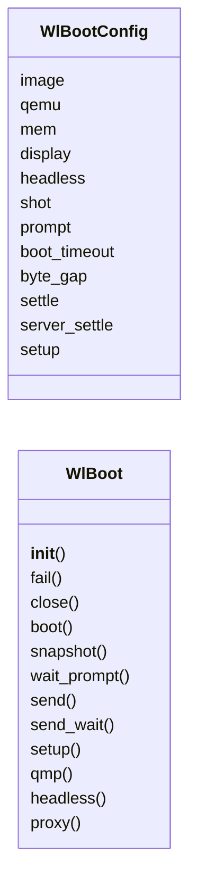
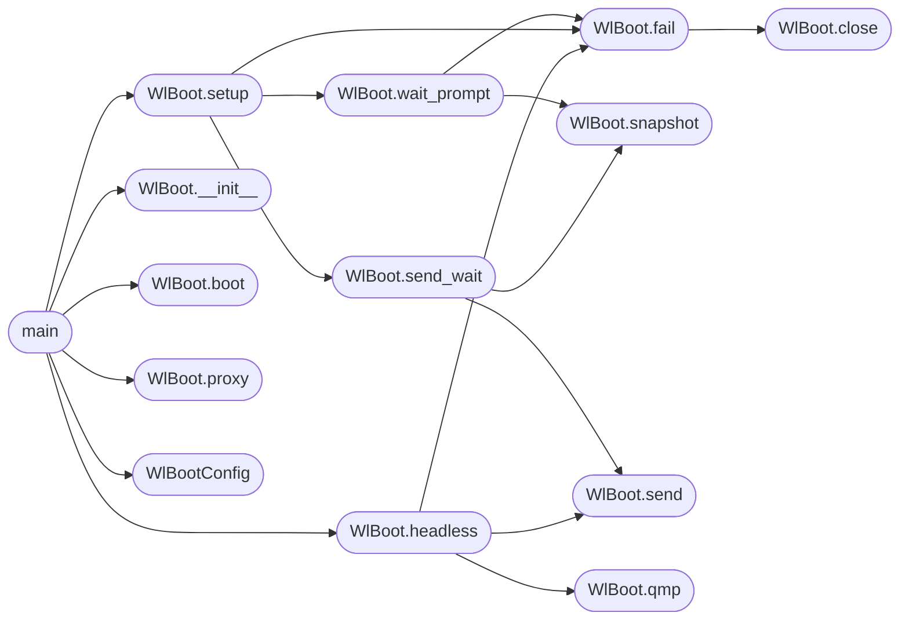

# `tools.boot_wl`

> Source: [tools/boot_wl.py:1](../../tools/boot_wl.py#L1) | language `py` | coverage 6.2% | [API index](../index.md)

boot_wl.py - boot the miniOS Wayland-mini desktop in one step.

Builds nothing; `make wl` owns the build. Boots os.img, waits for the
shell prompt over a pty serial console, types the desktop setup
(mailbox clean, mirror flag, three real app frames via their
selftests run strictly sequentially, one terminal-pattern client,
server in background) with paced bytes and an echo backstop, then
either proxies the user terminal to the guest for interactive use or,
with WL_HEADLESS=1, screendumps the framebuffer over QMP, powers off
and reports the shot path. Setup steps never overlap: each program
runs alone and the harness waits for the shell prompt before the next
starts, which is the reliable configuration while concurrent
heavyweights are under diagnosis (see the honest-limits note in
CLAUDE.md).

Usage:
  python3 tools/boot_wl.py
  WL_HEADLESS=1 WL_SHOT=/tmp/wl.png python3 tools/boot_wl.py

Every tunable lives in WlBootConfig; no host assumption beyond the
QEMU binary name, which WL_QEMU overrides. Failure paths report and
release the child; a stuck prompt fails after WL_BOOT_TIMEOUT instead
of hanging the make run.

## Contents

- **Classes:** [`WlBootConfig`](#wlbootconfig), [`WlBoot`](#wlboot)
- **Functions:** [`main`](#main)

## Type Diagram



## Call Graph

Solid arrows stay in this module, dashed arrows leave it.



## Classes

<a id="wlbootconfig"></a>

### `WlBootConfig`

`class` | [tools/boot_wl.py:40](../../tools/boot_wl.py#L40)

```python
class WlBootConfig
```

**Attributes**

| Name | Type | Default | Description |
|---|---|---|---|
| [`image`](#wlbootconfig-image) |  | `os.path.join(os.path.dirname(os.path.abspath(__file__)), '..', 'os.img')` |  |
| [`qemu`](#wlbootconfig-qemu) |  | `os.environ.get('WL_QEMU', 'qemu-system-x86_64')` |  |
| [`mem`](#wlbootconfig-mem) |  | `os.environ.get('WL_MEM', '1G')` |  |
| [`display`](#wlbootconfig-display) |  | `os.environ.get('WL_DISPLAY', 'none' if os.environ.get('WL_HEADLESS', '') == '1' else 'sdl')` |  |
| [`headless`](#wlbootconfig-headless) |  | `os.environ.get('WL_HEADLESS', '') == '1'` |  |
| [`shot`](#wlbootconfig-shot) |  | `os.environ.get('WL_SHOT', os.path.join(tempfile.gettempdir(), 'wl.png'))` |  |
| [`prompt`](#wlbootconfig-prompt) |  | `'miniOS> '` |  |
| [`boot_timeout`](#wlbootconfig-boot_timeout) |  | `float(os.environ.get('WL_BOOT_TIMEOUT', '150'))` |  |
| [`byte_gap`](#wlbootconfig-byte_gap) |  | `0.02` |  |
| [`settle`](#wlbootconfig-settle) |  | `0.6` |  |
| [`server_settle`](#wlbootconfig-server_settle) |  | `4.0` |  |
| [`setup`](#wlbootconfig-setup) |  | `['wlcomp --clean', 'echo 1 > shm/wl/mirror', 'paint --selftest', 'vedit --selftest', 'nuklear --selftest', 'wlcomp --client term0 term', 'run wlcomp --server &']` |  |

---

<a id="wlboot"></a>

### `WlBoot`

`class` | [tools/boot_wl.py:67](../../tools/boot_wl.py#L67)

```python
class WlBoot
```

**Members**

| Member | Kind | Summary |
|---|---|---|
| [`__init__`](#wlboot-__init__) | constructor |  |
| [`fail`](#wlboot-fail) | method |  |
| [`close`](#wlboot-close) | method |  |
| [`boot`](#wlboot-boot) | method |  |
| [`snapshot`](#wlboot-snapshot) | method |  |
| [`wait_prompt`](#wlboot-wait_prompt) | method |  |
| [`send`](#wlboot-send) | method |  |
| [`send_wait`](#wlboot-send_wait) | method |  |
| [`setup`](#wlboot-setup) | method |  |
| [`qmp`](#wlboot-qmp) | method |  |
| [`headless`](#wlboot-headless) | method |  |
| [`proxy`](#wlboot-proxy) | method |  |

<a id="wlboot-__init__"></a>

#### `WlBoot.__init__`

`constructor` | [tools/boot_wl.py:68](../../tools/boot_wl.py#L68)

```python
def __init__(self, cfg)
```

**Parameters**

| Name | Type | Default | Description |
|---|---|---|---|
| `cfg` |  |  |  |

*Called by:* [`main`](#main)

<a id="wlboot-fail"></a>

#### `WlBoot.fail`

`method` | [tools/boot_wl.py:75](../../tools/boot_wl.py#L75)

```python
def fail(self, msg)
```

**Parameters**

| Name | Type | Default | Description |
|---|---|---|---|
| `msg` |  |  |  |

*Calls:* [`WlBoot.close`](#wlboot-close)

*Called by:* [`WlBoot.headless`](#wlboot-headless), [`WlBoot.setup`](#wlboot-setup), [`WlBoot.wait_prompt`](#wlboot-wait_prompt)

<a id="wlboot-close"></a>

#### `WlBoot.close`

`method` | [tools/boot_wl.py:80](../../tools/boot_wl.py#L80)

```python
def close(self)
```

*Called by:* [`WlBoot.fail`](#wlboot-fail)

<a id="wlboot-boot"></a>

#### `WlBoot.boot`

`method` | [tools/boot_wl.py:91](../../tools/boot_wl.py#L91)

```python
def boot(self)
```

*Called by:* [`main`](#main)

<a id="wlboot-snapshot"></a>

#### `WlBoot.snapshot`

`method` | [tools/boot_wl.py:107](../../tools/boot_wl.py#L107)

```python
def snapshot(self, timeout=1.0)
```

**Parameters**

| Name | Type | Default | Description |
|---|---|---|---|
| `timeout` |  | `1.0` |  |

*Called by:* [`WlBoot.send_wait`](#wlboot-send_wait), [`WlBoot.wait_prompt`](#wlboot-wait_prompt)

<a id="wlboot-wait_prompt"></a>

#### `WlBoot.wait_prompt`

`method` | [tools/boot_wl.py:124](../../tools/boot_wl.py#L124)

```python
def wait_prompt(self)
```

*Calls:* [`WlBoot.fail`](#wlboot-fail), [`WlBoot.snapshot`](#wlboot-snapshot)

*Called by:* [`WlBoot.setup`](#wlboot-setup)

<a id="wlboot-send"></a>

#### `WlBoot.send`

`method` | [tools/boot_wl.py:135](../../tools/boot_wl.py#L135)

```python
def send(self, line)
```

**Parameters**

| Name | Type | Default | Description |
|---|---|---|---|
| `line` |  |  |  |

*Called by:* [`WlBoot.headless`](#wlboot-headless), [`WlBoot.send_wait`](#wlboot-send_wait)

<a id="wlboot-send_wait"></a>

#### `WlBoot.send_wait`

`method` | [tools/boot_wl.py:142](../../tools/boot_wl.py#L142)

```python
def send_wait(self, line, timeout=120.0)
```

**Parameters**

| Name | Type | Default | Description |
|---|---|---|---|
| `line` |  |  |  |
| `timeout` |  | `120.0` |  |

*Calls:* [`WlBoot.send`](#wlboot-send), [`WlBoot.snapshot`](#wlboot-snapshot)

*Called by:* [`WlBoot.setup`](#wlboot-setup)

<a id="wlboot-setup"></a>

#### `WlBoot.setup`

`method` | [tools/boot_wl.py:154](../../tools/boot_wl.py#L154)

```python
def setup(self)
```

*Calls:* [`WlBoot.fail`](#wlboot-fail), [`WlBoot.send_wait`](#wlboot-send_wait), [`WlBoot.wait_prompt`](#wlboot-wait_prompt)

*Called by:* [`main`](#main)

<a id="wlboot-qmp"></a>

#### `WlBoot.qmp`

`method` | [tools/boot_wl.py:165](../../tools/boot_wl.py#L165)

```python
def qmp(self, obj)
```

**Parameters**

| Name | Type | Default | Description |
|---|---|---|---|
| `obj` |  |  |  |

*Called by:* [`WlBoot.headless`](#wlboot-headless), [`main`](tools.probe_compute_vga.py.md#main)

<a id="wlboot-headless"></a>

#### `WlBoot.headless`

`method` | [tools/boot_wl.py:182](../../tools/boot_wl.py#L182)

```python
def headless(self)
```

*Calls:* [`WlBoot.fail`](#wlboot-fail), [`WlBoot.qmp`](#wlboot-qmp), [`WlBoot.send`](#wlboot-send)

*Called by:* [`main`](#main)

<a id="wlboot-proxy"></a>

#### `WlBoot.proxy`

`method` | [tools/boot_wl.py:195](../../tools/boot_wl.py#L195)

```python
def proxy(self)
```

*Called by:* [`shell_exec_builtin`](kernel.shell.c.md#shell_exec_builtin), [`main`](#main)

---

## Functions

<a id="main"></a>

### `main`

`function` | [tools/boot_wl.py:226](../../tools/boot_wl.py#L226)

```python
def main()
```

*Calls:* [`WlBoot.__init__`](#wlboot-__init__), [`WlBoot.boot`](#wlboot-boot), [`WlBoot.headless`](#wlboot-headless), [`WlBoot.proxy`](#wlboot-proxy), [`WlBoot.setup`](#wlboot-setup), [`WlBootConfig`](#wlbootconfig)

---
