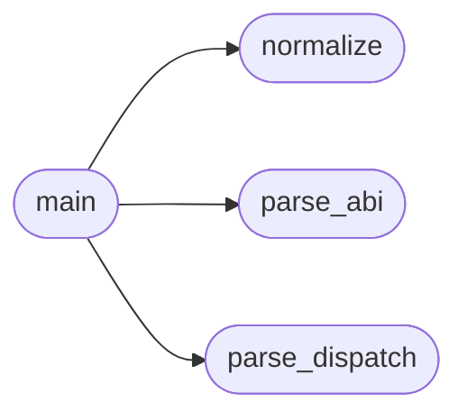

# `tools.check_abi_numbers`

> Source: [tools/check_abi_numbers.py:1](../../tools/check_abi_numbers.py#L1) | language `py` | coverage 20.0% | [API index](../index.md)

check_abi_numbers.py -- MiniOS syscall numbers vs Linux x86-64 truth.

Phase 0.6 of the FreeDom readiness plan: a browser is the first program
that depends on syscalls telling the truth, and several MiniOS numbers
drifted from the Linux table (the class that bit us at [74] = flock
while Linux x86-64 74 = fsync, 73 = flock). A static host-compiled ELF
traps the Linux number and gets whatever MiniOS registered there.

Ground truth is Linux arch/x86/entry/syscalls/syscall_64.tbl
(x86-64 common range), frozen here so the gate needs no kernel headers.
Two checks, both fail-closed (exit 1) on undocumented drift:

Rule A -- compat claims in progs/minios_abi.h: a MINIOS_SYS_FOO whose
  normalized name exists in the Linux table and whose value is < 200
  must equal the Linux number exactly.
Rule B -- MiniOS-wins shadows: a MiniOS number that collides with a
  *different* Linux syscall must be listed in DEVIATIONS with the ADR
  that justifies it (fix or documented deviation, never silence).
Rule C -- dispatch site in kernel/syscalls.c: every
  `[N] = { fn, "name" }` entry of linux_syscall_table and every
  `case N:` fall-through in ksyscall_dispatch must resolve N to the
  Linux number for "name".

Usage: python3 tools/check_abi_numbers.py [--abi PATH] [--syscalls PATH]
Exits 0 printing "abi: ok" when every number is either exact or listed.

## Contents

- **Functions:** [`normalize`](#normalize), [`parse_abi`](#parse_abi), [`parse_dispatch`](#parse_dispatch), [`main`](#main)
- **Constants:** [`LINUX_X86_64`](#linux_x86_64), [`DEVIATIONS`](#deviations), [`ABI_RE`](#abi_re), [`TABLE_RE`](#table_re), [`CASE_RE`](#case_re)

## Call Graph

Solid arrows stay in this module, dashed arrows leave it.



## Functions

<a id="normalize"></a>

### `normalize`

`function` | [tools/check_abi_numbers.py:130](../../tools/check_abi_numbers.py#L130)

```python
def normalize(minios_name)
```

**Parameters**

| Name | Type | Default | Description |
|---|---|---|---|
| `minios_name` |  |  |  |

*Called by:* [`main`](#main)

---

<a id="parse_abi"></a>

### `parse_abi`

`function` | [tools/check_abi_numbers.py:134](../../tools/check_abi_numbers.py#L134)

```python
def parse_abi(path)
```

**Parameters**

| Name | Type | Default | Description |
|---|---|---|---|
| `path` |  |  |  |

*Called by:* [`main`](#main)

---

<a id="parse_dispatch"></a>

### `parse_dispatch`

`function` | [tools/check_abi_numbers.py:145](../../tools/check_abi_numbers.py#L145)

```python
def parse_dispatch(path)
```

**Parameters**

| Name | Type | Default | Description |
|---|---|---|---|
| `path` |  |  |  |

*Called by:* [`main`](#main)

---

<a id="main"></a>

### `main`

`function` | [tools/check_abi_numbers.py:158](../../tools/check_abi_numbers.py#L158)

```python
def main()
```

*Calls:* [`normalize`](#normalize), [`parse_abi`](#parse_abi), [`parse_dispatch`](#parse_dispatch)

---

## Constants

<a id="linux_x86_64"></a>

### `LINUX_X86_64`

`constant` | [tools/check_abi_numbers.py:31](../../tools/check_abi_numbers.py#L31)

```python
LINUX_X86_64
```

---

<a id="deviations"></a>

### `DEVIATIONS`

`constant` | [tools/check_abi_numbers.py:82](../../tools/check_abi_numbers.py#L82)

```python
DEVIATIONS
```

---

<a id="abi_re"></a>

### `ABI_RE`

`constant` | [tools/check_abi_numbers.py:125](../../tools/check_abi_numbers.py#L125)

```python
ABI_RE = re.compile('#define\\s+(MINIOS_SYS_[A-Z0-9_]+)\\s+(\\d+)')
```

---

<a id="table_re"></a>

### `TABLE_RE`

`constant` | [tools/check_abi_numbers.py:126](../../tools/check_abi_numbers.py#L126)

```python
TABLE_RE
```

---

<a id="case_re"></a>

### `CASE_RE`

`constant` | [tools/check_abi_numbers.py:127](../../tools/check_abi_numbers.py#L127)

```python
CASE_RE = re.compile('^\\s*case\\s+(\\d+)\\s*:[^/]*(?:/\\*\\s*([a-z0-9_]+))?')
```

---
