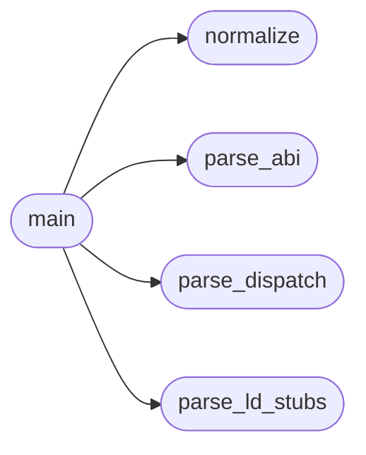

# `tools.check_abi_numbers`

> Source: [tools/check_abi_numbers.py:1](../../tools/check_abi_numbers.py#L1) | language `py` | coverage 33.3% | [API index](../index.md)

check_abi_numbers.py -- MiniOS syscall numbers vs Linux x86-64 truth.

Phase 0.6 of the FreeDom readiness plan: a browser is the first program
that depends on syscalls telling the truth, and several MiniOS numbers
drifted from the Linux table (the class that bit us at [74] = flock
while Linux x86-64 74 = fsync, 73 = flock). A static host-compiled ELF
traps the Linux number and gets whatever MiniOS registered there.

Ground truth is Linux arch/x86/entry/syscalls/syscall_64.tbl
(x86-64 common range), frozen here so the gate needs no kernel headers.
Two checks, both fail-closed (exit 1) on undocumented drift:

Rule A -- compat claims in progs/minios_abi.h: a MINIOS_SYS_FOO whose
  normalized name exists in the Linux table and whose value is < 200
  must equal the Linux number exactly.
Rule B -- MiniOS-wins shadows: a MiniOS number that collides with a
  *different* Linux syscall must be listed in DEVIATIONS with the ADR
  that justifies it (fix or documented deviation, never silence).
Rule C -- dispatch site in kernel/syscalls.c: every
  `[N] = { fn, "name" }` entry of linux_syscall_table and every
  `case N:` fall-through in ksyscall_dispatch must resolve N to the
  Linux number for "name".
Rule D -- MiniOS-internal collisions: two MINIOS_SYS_* names must never
  share a number. The dispatch table is indexed by number, so a second
  name silently overwrites the first (lz4_decompress vs pcm2_close both
  claimed 248 and only the last entry survived).
Rule E -- toolchain stubs: the sibling `ld` links every miniGCC program
  with a built-in libc whose MiniOS stubs hardcode syscall numbers. A
  stale stub number sends the program to the wrong handler, so every
  stub must match progs/minios_abi.h (or the Linux table).

Usage: python3 tools/check_abi_numbers.py [--abi PATH] [--syscalls PATH]
          [--ld PATH]
Exits 0 printing "abi: ok" when every number is either exact or listed.

## Contents

- **Functions:** [`normalize`](#normalize), [`parse_abi`](#parse_abi), [`parse_ld_stubs`](#parse_ld_stubs), [`parse_dispatch`](#parse_dispatch), [`main`](#main)
- **Constants:** [`LINUX_X86_64`](#linux_x86_64), [`DEVIATIONS`](#deviations), [`ABI_RE`](#abi_re), [`TABLE_RE`](#table_re), [`CASE_RE`](#case_re), [`LD_STUB_RE`](#ld_stub_re)

## Call Graph

Solid arrows stay in this module, dashed arrows leave it.



## Functions

<a id="normalize"></a>

### `normalize`

`function` | [tools/check_abi_numbers.py:142](../../tools/check_abi_numbers.py#L142)

```python
def normalize(minios_name)
```

**Parameters**

| Name | Type | Default | Description |
|---|---|---|---|
| `minios_name` |  |  |  |

*Called by:* [`main`](#main)

---

<a id="parse_abi"></a>

### `parse_abi`

`function` | [tools/check_abi_numbers.py:146](../../tools/check_abi_numbers.py#L146)

```python
def parse_abi(path)
```

**Parameters**

| Name | Type | Default | Description |
|---|---|---|---|
| `path` |  |  |  |

*Called by:* [`main`](#main)

---

<a id="parse_ld_stubs"></a>

### `parse_ld_stubs`

`function` | [tools/check_abi_numbers.py:157](../../tools/check_abi_numbers.py#L157)

```python
def parse_ld_stubs(path)
```

Read the sibling ld's built-in libc stubs: symbol -> syscall number.

**Parameters**

| Name | Type | Default | Description |
|---|---|---|---|
| `path` |  |  |  |

*Called by:* [`main`](#main)

---

<a id="parse_dispatch"></a>

### `parse_dispatch`

`function` | [tools/check_abi_numbers.py:164](../../tools/check_abi_numbers.py#L164)

```python
def parse_dispatch(path)
```

**Parameters**

| Name | Type | Default | Description |
|---|---|---|---|
| `path` |  |  |  |

*Called by:* [`main`](#main)

---

<a id="main"></a>

### `main`

`function` | [tools/check_abi_numbers.py:177](../../tools/check_abi_numbers.py#L177)

```python
def main()
```

*Calls:* [`normalize`](#normalize), [`parse_abi`](#parse_abi), [`parse_dispatch`](#parse_dispatch), [`parse_ld_stubs`](#parse_ld_stubs)

---

## Constants

<a id="linux_x86_64"></a>

### `LINUX_X86_64`

`constant` | [tools/check_abi_numbers.py:40](../../tools/check_abi_numbers.py#L40)

```python
LINUX_X86_64
```

---

<a id="deviations"></a>

### `DEVIATIONS`

`constant` | [tools/check_abi_numbers.py:91](../../tools/check_abi_numbers.py#L91)

```python
DEVIATIONS
```

---

<a id="abi_re"></a>

### `ABI_RE`

`constant` | [tools/check_abi_numbers.py:134](../../tools/check_abi_numbers.py#L134)

```python
ABI_RE = re.compile('#define\\s+(MINIOS_SYS_[A-Z0-9_]+)\\s+(\\d+)')
```

---

<a id="table_re"></a>

### `TABLE_RE`

`constant` | [tools/check_abi_numbers.py:135](../../tools/check_abi_numbers.py#L135)

```python
TABLE_RE
```

---

<a id="case_re"></a>

### `CASE_RE`

`constant` | [tools/check_abi_numbers.py:136](../../tools/check_abi_numbers.py#L136)

```python
CASE_RE = re.compile('^\\s*case\\s+(\\d+)\\s*:[^/]*(?:/\\*\\s*([a-z0-9_]+))?')
```

---

<a id="ld_stub_re"></a>

### `LD_STUB_RE`

`constant` | [tools/check_abi_numbers.py:137](../../tools/check_abi_numbers.py#L137)

```python
LD_STUB_RE
```

---
