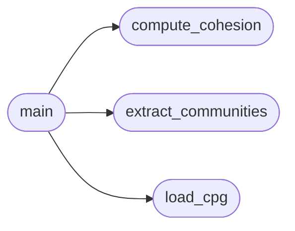

# `tools.check_cohesion`

> Source: [tools/check_cohesion.py:1](../../tools/check_cohesion.py#L1) | language `py` | coverage 80.0% | [API index](../index.md)

check_cohesion.py -- Architectural cohesion gate for MiniOS CI.

Parses the CPG JSON-LD output from readmenator and fails the build if any
root community's cohesion drops below the configured threshold.

Usage:
    python3 tools/check_cohesion.py [cpg.jsonld] [--threshold 0.25]

Exit codes:
    0 -- all communities above threshold
    1 -- cohesion regression detected
    2 -- input file missing or malformed

## Contents

- **Functions:** [`load_cpg`](#load_cpg), [`compute_cohesion`](#compute_cohesion), [`extract_communities`](#extract_communities), [`main`](#main)
- **Constants:** [`DEFAULT_THRESHOLD`](#default_threshold), [`DEFAULT_CPG_PATH`](#default_cpg_path)

## Call Graph

Solid arrows stay in this module, dashed arrows leave it.



## Functions

<a id="load_cpg"></a>

### `load_cpg`

`function` | [tools/check_cohesion.py:23](../../tools/check_cohesion.py#L23)

```python
def load_cpg(path)
```

Load and parse the CPG JSON-LD file.

**Parameters**

| Name | Type | Default | Description |
|---|---|---|---|
| `path` |  |  |  |

*Called by:* [`main`](#main)

---

<a id="compute_cohesion"></a>

### `compute_cohesion`

`function` | [tools/check_cohesion.py:31](../../tools/check_cohesion.py#L31)

```python
def compute_cohesion(community_nodes, community_edges)
```

Compute cohesion as internal_edges / max_possible_edges.

**Parameters**

| Name | Type | Default | Description |
|---|---|---|---|
| `community_nodes` |  |  |  |
| `community_edges` |  |  |  |

*Called by:* [`main`](#main)

---

<a id="extract_communities"></a>

### `extract_communities`

`function` | [tools/check_cohesion.py:42](../../tools/check_cohesion.py#L42)

```python
def extract_communities(cpg)
```

Extract communities and their internal edges from CPG.

**Parameters**

| Name | Type | Default | Description |
|---|---|---|---|
| `cpg` |  |  |  |

*Called by:* [`main`](#main)

---

<a id="main"></a>

### `main`

`function` | [tools/check_cohesion.py:58](../../tools/check_cohesion.py#L58)

```python
def main()
```

*Calls:* [`compute_cohesion`](#compute_cohesion), [`extract_communities`](#extract_communities), [`load_cpg`](#load_cpg)

---

## Constants

<a id="default_threshold"></a>

### `DEFAULT_THRESHOLD`

`constant` | [tools/check_cohesion.py:19](../../tools/check_cohesion.py#L19)

```python
DEFAULT_THRESHOLD = 0.25
```

---

<a id="default_cpg_path"></a>

### `DEFAULT_CPG_PATH`

`constant` | [tools/check_cohesion.py:20](../../tools/check_cohesion.py#L20)

```python
DEFAULT_CPG_PATH = 'KNOWLEDGE_BASE.jsonld'
```

---
