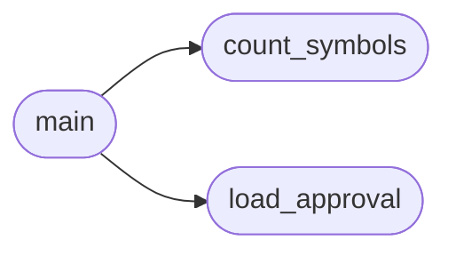

# `tools.check_complexity`

> Source: [tools/check_complexity.py:1](../../tools/check_complexity.py#L1) | language `py` | coverage 75.0% | [API index](../index.md)

check_complexity.py -- Kernel complexity gate for MiniOS CI.

Validates that kernel.c does not exceed the configured symbol count
threshold without explicit approval in ARCH_POLICY.yaml.

Usage:
    python3 tools/check_complexity.py [--threshold 350] [--policy ARCH_POLICY.yaml]

Exit codes:
    0 -- within threshold or explicitly approved
    1 -- complexity exceeded without approval
    2 -- input files missing

## Contents

- **Functions:** [`count_symbols`](#count_symbols), [`load_approval`](#load_approval), [`main`](#main)
- **Constants:** [`DEFAULT_THRESHOLD`](#default_threshold), [`KERNEL_SOURCE`](#kernel_source), [`POLICY_FILE`](#policy_file)

## Call Graph

Solid arrows stay in this module, dashed arrows leave it.



## Functions

<a id="count_symbols"></a>

### `count_symbols`

`function` | [tools/check_complexity.py:24](../../tools/check_complexity.py#L24)

```python
def count_symbols(filepath)
```

Count top-level function and global variable definitions.

**Parameters**

| Name | Type | Default | Description |
|---|---|---|---|
| `filepath` |  |  |  |

*Called by:* [`main`](#main)

---

<a id="load_approval"></a>

### `load_approval`

`function` | [tools/check_complexity.py:46](../../tools/check_complexity.py#L46)

```python
def load_approval(policy_path)
```

Load explicit complexity approval from ARCH_POLICY.yaml.

**Parameters**

| Name | Type | Default | Description |
|---|---|---|---|
| `policy_path` |  |  |  |

*Called by:* [`main`](#main)

---

<a id="main"></a>

### `main`

`function` | [tools/check_complexity.py:61](../../tools/check_complexity.py#L61)

```python
def main()
```

*Calls:* [`count_symbols`](#count_symbols), [`load_approval`](#load_approval)

---

## Constants

<a id="default_threshold"></a>

### `DEFAULT_THRESHOLD`

`constant` | [tools/check_complexity.py:19](../../tools/check_complexity.py#L19)

```python
DEFAULT_THRESHOLD = 350
```

---

<a id="kernel_source"></a>

### `KERNEL_SOURCE`

`constant` | [tools/check_complexity.py:20](../../tools/check_complexity.py#L20)

```python
KERNEL_SOURCE = 'kernel.c'
```

---

<a id="policy_file"></a>

### `POLICY_FILE`

`constant` | [tools/check_complexity.py:21](../../tools/check_complexity.py#L21)

```python
POLICY_FILE = 'ARCH_POLICY.yaml'
```

---
