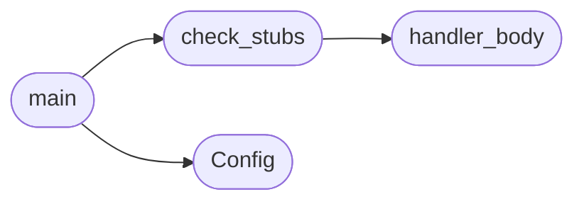

# `tools.check_fork_stubs`

> Source: [tools/check_fork_stubs.py:1](../../tools/check_fork_stubs.py#L1) | language `py` | coverage 100.0% | [API index](../index.md)

Fail-closed stub gate for unimplemented process syscalls.

vfork has no implementation in this kernel. A stub that answers success
lets userland believe a child exists when none does, so it must answer
Linux ENOSYS. execve used to be in this set; it is implemented now
(do_execve in kernel/sched.c, fork+exec proven by the execho BDD
scenario), so the gate no longer scans it: a stub regression there
fails the execho scenario instead of this gate. fork() is implemented
(do_fork with copy-on-write pages, kernel/sched.c) and is checked by
the fork BDD scenario instead. The check scans the handler
definitions and fails on any success return.

## Contents

- **Classes:** [`Config`](#config)
- **Functions:** [`handler_body`](#handler_body), [`check_stubs`](#check_stubs), [`main`](#main)

## Call Graph

Solid arrows stay in this module, dashed arrows leave it.



## Classes

<a id="config"></a>

### `Config`

`class` | [tools/check_fork_stubs.py:18](../../tools/check_fork_stubs.py#L18)

```python
class Config
```

Centralized tunable values for the stub gate.

**Attributes**

| Name | Type | Default | Description |
|---|---|---|---|
| [`target_file`](#config-target_file) |  | `'kernel/syscalls_proc.c'` |  |
| [`handlers`](#config-handlers) |  | `('sys_linux_vfork',)` |  |
| [`enosys_literal`](#config-enosys_literal) |  | `'-38'` |  |
| [`success_pattern`](#config-success_pattern) |  | `re.compile('\\breturn\\s+0\\s*;')` |  |

---

## Functions

<a id="handler_body"></a>

### `handler_body`

`function` | [tools/check_fork_stubs.py:27](../../tools/check_fork_stubs.py#L27)

```python
def handler_body(text, name)
```

Return the body of the named handler or empty string when absent.

**Parameters**

| Name | Type | Default | Description |
|---|---|---|---|
| `text` |  |  |  |
| `name` |  |  |  |

*Called by:* [`check_stubs`](#check_stubs)

---

<a id="check_stubs"></a>

### `check_stubs`

`function` | [tools/check_fork_stubs.py:37](../../tools/check_fork_stubs.py#L37)

```python
def check_stubs(text, cfg)
```

Collect failure strings for stubs that do not fail closed.

**Parameters**

| Name | Type | Default | Description |
|---|---|---|---|
| `text` |  |  |  |
| `cfg` |  |  |  |

*Calls:* [`handler_body`](#handler_body)

*Called by:* [`main`](#main)

---

<a id="main"></a>

### `main`

`function` | [tools/check_fork_stubs.py:52](../../tools/check_fork_stubs.py#L52)

```python
def main()
```

Entry point used by lint and CI.

*Calls:* [`Config`](#config), [`check_stubs`](#check_stubs)

---
