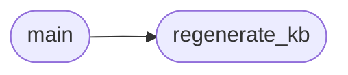

# `tools.check_kb_sync`

> Source: [tools/check_kb_sync.py:1](../../tools/check_kb_sync.py#L1) | language `py` | coverage 66.7% | [API index](../index.md)

check_kb_sync.py -- Verify KNOWLEDGE_BASE.md is in sync with code.

Runs readmenator to regenerate the knowledge base, then checks if the
output differs from the committed version.  Used in CI to prevent drift.

Usage:
    python3 tools/check_kb_sync.py [--kb KNOWLEDGE_BASE.md] [--regenerate]

Exit codes:
    0 -- KB is in sync
    1 -- KB is out of sync
    2 -- readmenator not available

## Contents

- **Functions:** [`regenerate_kb`](#regenerate_kb), [`main`](#main)
- **Constants:** [`DEFAULT_KB`](#default_kb), [`READMENATOR`](#readmenator)

## Call Graph

Solid arrows stay in this module, dashed arrows leave it.



## Functions

<a id="regenerate_kb"></a>

### `regenerate_kb`

`function` | [tools/check_kb_sync.py:24](../../tools/check_kb_sync.py#L24)

```python
def regenerate_kb()
```

Attempt to regenerate KNOWLEDGE_BASE.md using readmenator.

*Called by:* [`main`](#main)

---

<a id="main"></a>

### `main`

`function` | [tools/check_kb_sync.py:43](../../tools/check_kb_sync.py#L43)

```python
def main()
```

*Calls:* [`regenerate_kb`](#regenerate_kb)

---

## Constants

<a id="default_kb"></a>

### `DEFAULT_KB`

`constant` | [tools/check_kb_sync.py:20](../../tools/check_kb_sync.py#L20)

```python
DEFAULT_KB = 'KNOWLEDGE_BASE.md'
```

---

<a id="readmenator"></a>

### `READMENATOR`

`constant` | [tools/check_kb_sync.py:21](../../tools/check_kb_sync.py#L21)

```python
READMENATOR = 'tools/readmenator.py'
```

---
