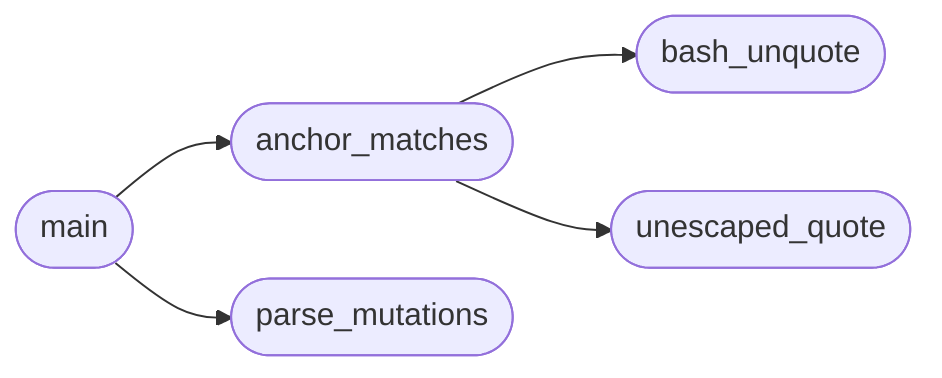

# `tools.check_mutant_anchors`

> Source: [tools/check_mutant_anchors.py:1](../../tools/check_mutant_anchors.py#L1) | language `py` | coverage 100.0% | [API index](../index.md)

Verify every mutate.sh mutant anchor matches its target file.

A mutant whose sed expression matches nothing is reported BROKEN by
mutate.sh instead of killed, so a stale anchor silently weakens the
mutation gate. Ground truth is sed itself: each expression is applied
to a scratch copy of its target and a no-change result is breakage.

Usage:
    python3 tools/check_mutant_anchors.py

## Contents

- **Classes:** [`Config`](#config)
- **Functions:** [`bash_unquote`](#bash_unquote), [`unescaped_quote`](#unescaped_quote), [`parse_mutations`](#parse_mutations), [`anchor_matches`](#anchor_matches), [`main`](#main)

## Call Graph

Solid arrows stay in this module, dashed arrows leave it.



## Classes

<a id="config"></a>

### `Config`

`class` | [tools/check_mutant_anchors.py:17](../../tools/check_mutant_anchors.py#L17)

```python
class Config
```

Central configuration for the anchor check.

**Attributes**

| Name | Type | Default | Description |
|---|---|---|---|
| [`repo`](#config-repo) |  | `Path(__file__).resolve().parent.parent` |  |
| [`mutate_sh`](#config-mutate_sh) |  | `repo / 'tools' / 'mutate.sh'` |  |
| [`table_start_marker`](#config-table_start_marker) |  | `'MUTATIONS="'` |  |
| [`table_end_marker`](#config-table_end_marker) |  | `'"'` |  |

---

## Functions

<a id="bash_unquote"></a>

### `bash_unquote`

`function` | [tools/check_mutant_anchors.py:26](../../tools/check_mutant_anchors.py#L26)

```python
def bash_unquote(expr)
```

Collapse the escapes bash applies inside the MUTATIONS string.

**Parameters**

| Name | Type | Default | Description |
|---|---|---|---|
| `expr` |  |  |  |

*Called by:* [`anchor_matches`](#anchor_matches)

---

<a id="unescaped_quote"></a>

### `unescaped_quote`

`function` | [tools/check_mutant_anchors.py:41](../../tools/check_mutant_anchors.py#L41)

```python
def unescaped_quote(expr)
```

True when expr holds a double quote bash would not keep.

The table is one double-quoted bash string: a bare " closes it, so sed
receives the expression with that quote stripped and matches nothing at
run time even though the raw text matches here.

**Parameters**

| Name | Type | Default | Description |
|---|---|---|---|
| `expr` |  |  |  |

*Called by:* [`anchor_matches`](#anchor_matches)

---

<a id="parse_mutations"></a>

### `parse_mutations`

`function` | [tools/check_mutant_anchors.py:58](../../tools/check_mutant_anchors.py#L58)

```python
def parse_mutations(text)
```

Extract (name, expression, target) triples from the MUTATIONS block.

Bounds derive from the block markers, never from line numbers, so
adding a mutant cannot silently push rows out of the checked range.

**Parameters**

| Name | Type | Default | Description |
|---|---|---|---|
| `text` |  |  |  |

*Called by:* [`main`](#main)

---

<a id="anchor_matches"></a>

### `anchor_matches`

`function` | [tools/check_mutant_anchors.py:84](../../tools/check_mutant_anchors.py#L84)

```python
def anchor_matches(repo, target, expr)
```

Apply the sed expression to a scratch copy; True when it changes it.

**Parameters**

| Name | Type | Default | Description |
|---|---|---|---|
| `repo` |  |  |  |
| `target` |  |  |  |
| `expr` |  |  |  |

*Calls:* [`bash_unquote`](#bash_unquote), [`unescaped_quote`](#unescaped_quote)

*Called by:* [`main`](#main)

---

<a id="main"></a>

### `main`

`function` | [tools/check_mutant_anchors.py:105](../../tools/check_mutant_anchors.py#L105)

```python
def main()
```

Entry point: report anchors that change nothing and exit nonzero.

*Calls:* [`anchor_matches`](#anchor_matches), [`parse_mutations`](#parse_mutations)

---
