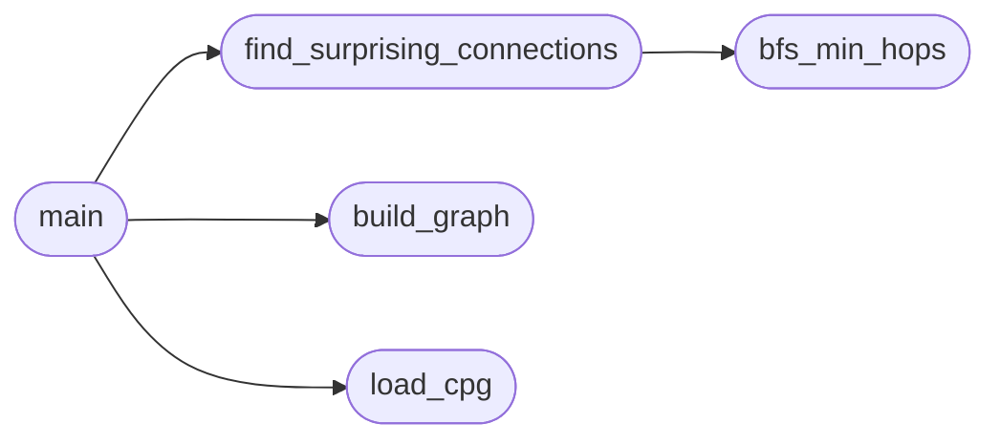

# `tools.check_surprising`

> Source: [tools/check_surprising.py:1](../../tools/check_surprising.py#L1) | language `py` | coverage 83.3% | [API index](../index.md)

check_surprising.py -- Detect surprising architectural connections.

Parses the CPG JSON-LD output from readmenator and flags new connections
of N or more hops between distinct communities.  These represent coupling
debt that should be visible and prioritizable.

Usage:
    python3 tools/check_surprising.py [cpg.jsonld] [--min-hops 5]

Exit codes:
    0 -- no surprising connections
    1 -- new surprising connections detected
    2 -- input file missing or malformed

## Contents

- **Functions:** [`load_cpg`](#load_cpg), [`build_graph`](#build_graph), [`bfs_min_hops`](#bfs_min_hops), [`find_surprising_connections`](#find_surprising_connections), [`main`](#main)
- **Constants:** [`DEFAULT_MIN_HOPS`](#default_min_hops), [`DEFAULT_CPG_PATH`](#default_cpg_path)

## Call Graph

Solid arrows stay in this module, dashed arrows leave it.



## Functions

<a id="load_cpg"></a>

### `load_cpg`

`function` | [tools/check_surprising.py:25](../../tools/check_surprising.py#L25)

```python
def load_cpg(path)
```

Load and parse the CPG JSON-LD file.

**Parameters**

| Name | Type | Default | Description |
|---|---|---|---|
| `path` |  |  |  |

*Called by:* [`main`](#main)

---

<a id="build_graph"></a>

### `build_graph`

`function` | [tools/check_surprising.py:33](../../tools/check_surprising.py#L33)

```python
def build_graph(cpg)
```

Build adjacency list from CPG nodes and edges.

**Parameters**

| Name | Type | Default | Description |
|---|---|---|---|
| `cpg` |  |  |  |

*Called by:* [`main`](#main)

---

<a id="bfs_min_hops"></a>

### `bfs_min_hops`

`function` | [tools/check_surprising.py:56](../../tools/check_surprising.py#L56)

```python
def bfs_min_hops(nodes, edges, source, target_community, max_hops)
```

BFS from source to any node in target_community, returning hop count.

**Parameters**

| Name | Type | Default | Description |
|---|---|---|---|
| `nodes` |  |  |  |
| `edges` |  |  |  |
| `source` |  |  |  |
| `target_community` |  |  |  |
| `max_hops` |  |  |  |

*Called by:* [`find_surprising_connections`](#find_surprising_connections)

---

<a id="find_surprising_connections"></a>

### `find_surprising_connections`

`function` | [tools/check_surprising.py:87](../../tools/check_surprising.py#L87)

```python
def find_surprising_connections(nodes, edges, min_hops)
```

Find connections of min_hops or more between distinct communities.

**Parameters**

| Name | Type | Default | Description |
|---|---|---|---|
| `nodes` |  |  |  |
| `edges` |  |  |  |
| `min_hops` |  |  |  |

*Calls:* [`bfs_min_hops`](#bfs_min_hops)

*Called by:* [`main`](#main)

---

<a id="main"></a>

### `main`

`function` | [tools/check_surprising.py:118](../../tools/check_surprising.py#L118)

```python
def main()
```

*Calls:* [`build_graph`](#build_graph), [`find_surprising_connections`](#find_surprising_connections), [`load_cpg`](#load_cpg)

---

## Constants

<a id="default_min_hops"></a>

### `DEFAULT_MIN_HOPS`

`constant` | [tools/check_surprising.py:21](../../tools/check_surprising.py#L21)

```python
DEFAULT_MIN_HOPS = 5
```

---

<a id="default_cpg_path"></a>

### `DEFAULT_CPG_PATH`

`constant` | [tools/check_surprising.py:22](../../tools/check_surprising.py#L22)

```python
DEFAULT_CPG_PATH = 'KNOWLEDGE_BASE.jsonld'
```

---
