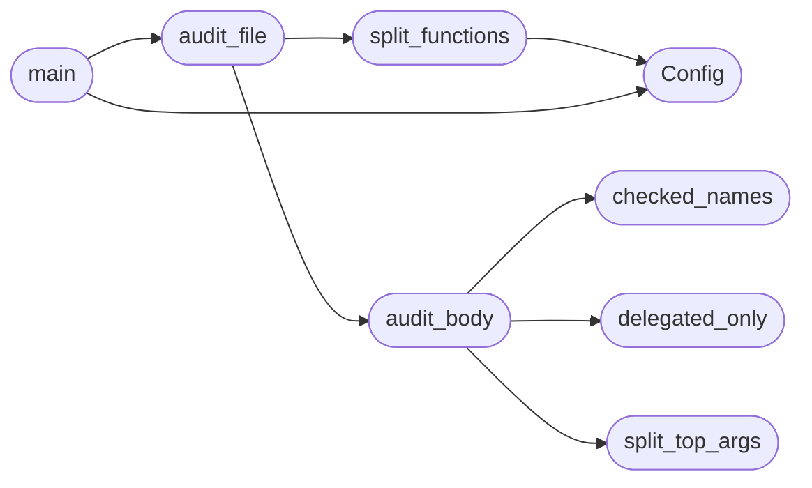

# `tools.check_syscall_sanitize`

> Source: [tools/check_syscall_sanitize.py:1](../../tools/check_syscall_sanitize.py#L1) | language `py` | coverage 100.0% | [API index](../index.md)

Scoped audit gate for syscall user-pointer sanitization.

Every ring-3 pointer that reaches a syscall handler as a1..a6 must pass a
SANITIZE_* macro or user_range_ok/user_str_ok check before its first
dereference. The discipline allows one delegation shape: an unchecked
pointer may flow only into a callee that sanitizes internally
(Config.delegated_callees); anything else is a fail-closed violation.

The analysis is textual and conservative: it over-reports, and Config
records each triaged outcome, so a new unsanitized dereference fails the
build instead of shipping silently.

## Contents

- **Classes:** [`Config`](#config)
- **Functions:** [`split_functions`](#split_functions), [`checked_names`](#checked_names), [`delegated_only`](#delegated_only), [`split_top_args`](#split_top_args), [`audit_body`](#audit_body), [`audit_file`](#audit_file), [`main`](#main)

## Call Graph

Solid arrows stay in this module, dashed arrows leave it.



## Classes

<a id="config"></a>

### `Config`

`class` | [tools/check_syscall_sanitize.py:18](../../tools/check_syscall_sanitize.py#L18)

```python
class Config
```

Centralized tunable values for the sanitize audit.

**Attributes**

| Name | Type | Default | Description |
|---|---|---|---|
| [`target_files`](#config-target_files) |  | `('kernel/syscalls.c', 'kernel/syscalls_proc.c')` |  |
| [`func_pattern`](#config-func_pattern) |  | `re.compile('^(?:static\\s+)?long\\s+(sys_\\w+\|do_\\w+\|ksyscall_\\w+\|k_syscall_\\w+)\\s*\\(')` |  |
| [`cast_pattern`](#config-cast_pattern) |  | `re.compile('\\(\\s*(?:const\\s+\|unsigned\\s+\|char\\s+\|int\\s+\|long\\s+\|void\\s+\|\\*\\s*)+\\*\\s*\\)\\s*\\(?\\s*(a[1-6])\\b')` |  |
| [`alias_pattern`](#config-alias_pattern) |  | `re.compile('(\\w+)\\s*=\\s*\\([^)]*\\*[^)]*\\)\\s*\\(?\\s*(a[1-6])\\b')` |  |
| [`scalar_pattern`](#config-scalar_pattern) |  | `re.compile('(\\w+)\\s*=\\s*\\(\\s*(?:unsigned\\s+long\|long\|unsigned\|int)\\s*\\)\\s*\\(?\\s*(a[1-6])\\b')` |  |
| [`check_patterns`](#config-check_patterns) |  | `(re.compile('SANITIZE_\\w+\\(([^;]*)\\)'), re.compile('user_range_ok\\(([^;]*)\\)'), re.compile('user_str_ok\\(([^;]*)\\)'))` |  |
| [`deref_template`](#config-deref_template) |  | `'(?:\\*\\s*{n}\\b\|{n}\\s*\\[\|{n}\\s*->)'` |  |
| [`delegated_callees`](#config-delegated_callees) |  | `('k_syscall_spawn', 'do_open_path', 'futex_wake', 'do_waitpid', 'do_waitpid_nb', 'do_kill', 'do_thread_spawn', 'select_common')` |  |
| [`dereferencing_callees`](#config-dereferencing_callees) |  | `('futex_wait', 'net_sys_dns', 'net_sys_connect', 'net_sys_sendto', 'net_sys_recvfrom', 'net_sys_poll', 'do_clone')` |  |
| [`callee_ptr_params`](#config-callee_ptr_params) |  | `{'futex_wait': (0,), 'net_sys_dns': (0,), 'net_sys_connect': (1,), 'net_sys_sendto': (1,), 'net_sys_recvfrom': (1,), 'net_sys_poll': (0,), 'do_clone': (1,)}` |  |

---

## Functions

<a id="split_functions"></a>

### `split_functions`

`function` | [tools/check_syscall_sanitize.py:70](../../tools/check_syscall_sanitize.py#L70)

```python
def split_functions(lines)
```

Yield (name, start, body_lines) triples using brace depth.

**Parameters**

| Name | Type | Default | Description |
|---|---|---|---|
| `lines` |  |  |  |

*Calls:* [`Config`](#config)

*Called by:* [`audit_file`](#audit_file)

---

<a id="checked_names"></a>

### `checked_names`

`function` | [tools/check_syscall_sanitize.py:113](../../tools/check_syscall_sanitize.py#L113)

```python
def checked_names(body)
```

Return identifiers named inside sanitizer checks in a body.

**Parameters**

| Name | Type | Default | Description |
|---|---|---|---|
| `body` |  |  |  |

*Called by:* [`audit_body`](#audit_body)

---

<a id="delegated_only"></a>

### `delegated_only`

`function` | [tools/check_syscall_sanitize.py:123](../../tools/check_syscall_sanitize.py#L123)

```python
def delegated_only(body, alias)
```

Decide whether an alias flows only into sanitizing callees.

**Parameters**

| Name | Type | Default | Description |
|---|---|---|---|
| `body` |  |  |  |
| `alias` |  |  |  |

*Called by:* [`audit_body`](#audit_body)

---

<a id="split_top_args"></a>

### `split_top_args`

`function` | [tools/check_syscall_sanitize.py:144](../../tools/check_syscall_sanitize.py#L144)

```python
def split_top_args(argtext)
```

Split a call argument list on top-level commas only.

**Parameters**

| Name | Type | Default | Description |
|---|---|---|---|
| `argtext` |  |  |  |

*Called by:* [`audit_body`](#audit_body)

---

<a id="audit_body"></a>

### `audit_body`

`function` | [tools/check_syscall_sanitize.py:163](../../tools/check_syscall_sanitize.py#L163)

```python
def audit_body(name, body)
```

Return violation strings for one function body.

**Parameters**

| Name | Type | Default | Description |
|---|---|---|---|
| `name` |  |  |  |
| `body` |  |  |  |

*Calls:* [`checked_names`](#checked_names), [`delegated_only`](#delegated_only), [`split_top_args`](#split_top_args)

*Called by:* [`audit_file`](#audit_file)

---

<a id="audit_file"></a>

### `audit_file`

`function` | [tools/check_syscall_sanitize.py:218](../../tools/check_syscall_sanitize.py#L218)

```python
def audit_file(path)
```

Audit every handler in one file, return violation strings.

**Parameters**

| Name | Type | Default | Description |
|---|---|---|---|
| `path` |  |  |  |

*Calls:* [`audit_body`](#audit_body), [`split_functions`](#split_functions)

*Called by:* [`main`](#main)

---

<a id="main"></a>

### `main`

`function` | [tools/check_syscall_sanitize.py:229](../../tools/check_syscall_sanitize.py#L229)

```python
def main()
```

Entry point used by lint and CI.

*Calls:* [`Config`](#config), [`audit_file`](#audit_file)

---
