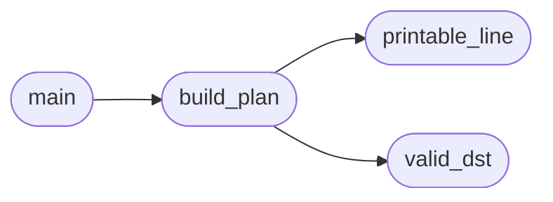

# `tools.clip_bridge`

> Source: [tools/clip_bridge.py:1](../../tools/clip_bridge.py#L1) | language `py` | coverage 100.0% | [API index](../index.md)

Host to MiniOS clipboard bridge plan builder.

Builds the exact shell lines that carry a host text file into the guest
through the shared 4 KB clipboard slot (syscalls 249/250) or, for
multi-line input, through the kernel line editor upload path the MCP
``minios_write`` tool already drives. This module never talks to QEMU
itself: it prints a plan the operator pastes into a live serial session
or feeds to ``minios_send`` line by line, so there is no host assumption
beyond the serial console both paths already require.

Single-line printable input within the clipboard cap travels as one
``clip <text>`` line and lands ready to paste with Ctrl+V at any prompt
or in vedit. Anything else (embedded newlines, overlong lines,
non-printable bytes) travels as an editor script (``edit <dst>`` plus
one ``a <line>`` per line plus ``x``), which is the only guest path
that preserves newlines: the ``clip`` builtin joins argv with spaces.

Every bound is fail-closed. A destination outside the character
whitelist, a line the kernel readline cannot carry, or content past the
clipboard cap is refused before a single plan line is printed, never
silently truncated.

## Contents

- **Classes:** [`ClipBridgeConfig`](#clipbridgeconfig)
- **Functions:** [`valid_dst`](#valid_dst), [`printable_line`](#printable_line), [`build_plan`](#build_plan), [`main`](#main)
- **Constants:** [`VALID_DST`](#valid_dst)

## Call Graph

Solid arrows stay in this module, dashed arrows leave it.



## Classes

<a id="clipbridgeconfig"></a>

### `ClipBridgeConfig`

`class` | [tools/clip_bridge.py:30](../../tools/clip_bridge.py#L30)

```python
class ClipBridgeConfig
```

Centralized bounds for the bridge plan.

**Attributes**

| Name | Type | Default | Description |
|---|---|---|---|
| [`CLIP_MAX`](#clipbridgeconfig-clip_max) |  | `4096` |  |
| [`EDIT_MAX_LINES`](#clipbridgeconfig-edit_max_lines) |  | `512` |  |
| [`EDIT_LINE_MAX`](#clipbridgeconfig-edit_line_max) |  | `128` |  |
| [`FNAME_MAX`](#clipbridgeconfig-fname_max) |  | `63` |  |
| [`PRINT_LO`](#clipbridgeconfig-print_lo) |  | `32` |  |
| [`PRINT_HI`](#clipbridgeconfig-print_hi) |  | `126` |  |

---

## Functions

<a id="valid_dst"></a>

### `valid_dst`

`function` | [tools/clip_bridge.py:41](../../tools/clip_bridge.py#L41)

```python
def valid_dst(name, cfg=ClipBridgeConfig)
```

True when name is a safe guest path.

**Parameters**

| Name | Type | Default | Description |
|---|---|---|---|
| `name` |  |  |  |
| `cfg` |  | `ClipBridgeConfig` |  |

*Called by:* [`build_plan`](#build_plan)

---

<a id="printable_line"></a>

### `printable_line`

`function` | [tools/clip_bridge.py:52](../../tools/clip_bridge.py#L52)

```python
def printable_line(line, cfg=ClipBridgeConfig)
```

True when every char survives the kernel readline.

**Parameters**

| Name | Type | Default | Description |
|---|---|---|---|
| `line` |  |  |  |
| `cfg` |  | `ClipBridgeConfig` |  |

*Called by:* [`build_plan`](#build_plan)

---

<a id="build_plan"></a>

### `build_plan`

`function` | [tools/clip_bridge.py:59](../../tools/clip_bridge.py#L59)

```python
def build_plan(text, dst, cfg=ClipBridgeConfig)
```

Return (ok, lines, diagnostic) for carrying text to dst.

**Parameters**

| Name | Type | Default | Description |
|---|---|---|---|
| `text` |  |  |  |
| `dst` |  |  |  |
| `cfg` |  | `ClipBridgeConfig` |  |

*Calls:* [`printable_line`](#printable_line), [`valid_dst`](#valid_dst)

*Called by:* [`main`](#main)

---

<a id="main"></a>

### `main`

`function` | [tools/clip_bridge.py:84](../../tools/clip_bridge.py#L84)

```python
def main(argv)
```

Entry point: clip_bridge.py <src-file> <dst-name>.

**Parameters**

| Name | Type | Default | Description |
|---|---|---|---|
| `argv` |  |  |  |

*Calls:* [`build_plan`](#build_plan)

---

## Constants

<a id="valid_dst"></a>

### `VALID_DST`

`constant` | [tools/clip_bridge.py:27](../../tools/clip_bridge.py#L27)

```python
VALID_DST = re.compile('[A-Za-z0-9._/-]+')
```

---
