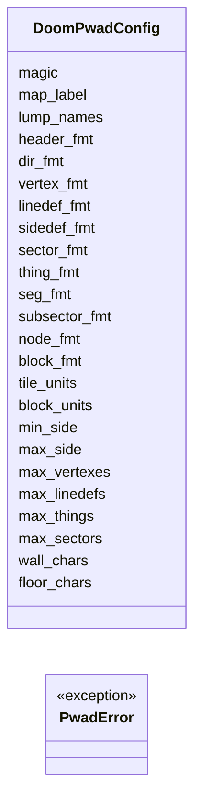
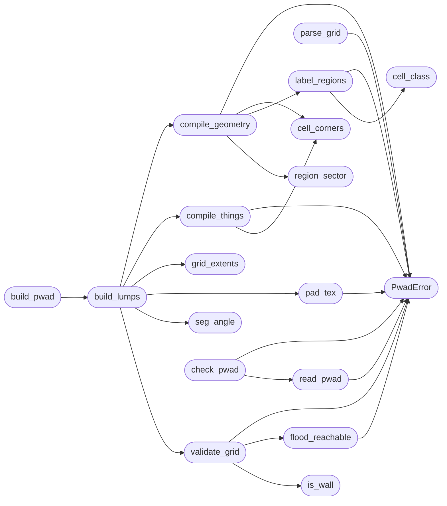

# `tools.doom_pwad`

> Source: [tools/doom_pwad.py:1](../../tools/doom_pwad.py#L1) | language `py` | coverage 100.0% | [API index](../index.md)

doom_pwad.py - grid map to vanilla Doom PWAD writer and checker.

Converts a text grid map into a single-level PWAD that replaces E1M1
in the shareware IWAD, and validates PWAD files produced by any tool.
The generated level is multi-sector: each same-style floor region and
each door block is its own sector, so rooms can differ in light, floor
height and flats, and doors genuinely open. The BSP stays trivially
correct: every linedef becomes one seg, all segs form one subsector,
and the root node points at that same subsector on both children. One
subsector needs no ordering, so no external node builder is required;
sight, collision and clipping all work off the line/sector lists.

Usage: doom_pwad.py build <grid.txt> <out.wad>
        doom_pwad.py check <file.wad>
        doom_pwad.py info <file.wad>

Grid legend: '#' wall, '.' floor, 'P' player 1 start, 'E' exit switch
marker, '+' door cell, ',' dark floor, '~' nukage pit, enemies 'i' imp,
'd' demon, 'z' zombieman, 'g' shotgun guy, 'v' spectre, 'b' baron,
weapons 's' shotgun, 'h' chaingun, 'r' rocket launcher, 'w' chainsaw,
ammo 'a' shells, 'u' clip, 'o' bullet box, 'k' rockets, 'x' rocket box,
'T' shell box, health 'm' medikit, 'q' stimpack, 'y' soulsphere,
'n' health bonus, armor 'f' armor bonus, 'G' green armor, 'U' blue
armor, keys '1' blue, '2' red, '3' yellow, powerups 'V' invisibility,
'R' radiation suit, 'C' computer map, 'L' light amp, gear 'D' backpack,
'B' barrel, decor '0' pillar.
A '+' cell is its own door sector (low ceiling, tagged) whose edges to
neighbouring rooms are two-sided D1 open-door lines, usable from either
side. A ',' region is the same room at low light; a '~' region is a
damaging nukage pit with a lowered floor. The exit marker must sit on
a normal or dark floor tile next to a wall; the shared edge becomes
the S1 exit switch linedef. The player start must sit on a normal or
dark floor tile. Every walkable tile must be reachable from the player
start, or the build is refused.

Only thing ids whose sprites ship in the shareware Doom1.wad are
exposed: cacodemon, lost soul, plasma rifle, BFG, berserk,
invulnerability and the megasphere have no sprites there, so spawning
them would crash the engine the moment they become visible. Doom has
no quad damage; the closest powerups are the ones listed above.

Texture, flat and thing ids below were verified byte-present in the
shipped shareware Doom1.wad, so the engine never resolves a missing
name from a generated file.

## Contents

- **Classes:** [`DoomPwadConfig`](#doompwadconfig)
- **Exceptions:** [`PwadError`](#pwaderror)
- **Functions:** [`pad_tex`](#pad_tex), [`parse_grid`](#parse_grid), [`grid_extents`](#grid_extents), [`is_wall`](#is_wall), [`flood_reachable`](#flood_reachable), [`validate_grid`](#validate_grid), [`cell_corners`](#cell_corners), [`cell_class`](#cell_class), [`label_regions`](#label_regions), [`region_sector`](#region_sector), [`compile_geometry`](#compile_geometry), [`compile_things`](#compile_things), [`seg_angle`](#seg_angle), [`build_lumps`](#build_lumps), [`build_pwad`](#build_pwad), [`read_pwad`](#read_pwad), [`check_pwad`](#check_pwad), [`cmd_build`](#cmd_build), [`cmd_check`](#cmd_check), [`main`](#main)

## Type Diagram



## Call Graph

Solid arrows stay in this module, dashed arrows leave it.



## Classes

<a id="doompwadconfig"></a>

### `DoomPwadConfig`

`class` | [tools/doom_pwad.py:52](../../tools/doom_pwad.py#L52)

```python
class DoomPwadConfig
```

Centralized tunables for the grid compiler and the PWAD checker.

**Attributes**

| Name | Type | Default | Description |
|---|---|---|---|
| [`magic`](#doompwadconfig-magic) |  | `b'PWAD'` |  |
| [`map_label`](#doompwadconfig-map_label) |  | `b'E1M1'` |  |
| [`lump_names`](#doompwadconfig-lump_names) |  | `(b'E1M1', b'THINGS', b'LINEDEFS', b'SIDEDEFS', b'VERTEXES', b'SEGS', b'SSECTORS', b'NODES', b'SECTORS', b'REJECT', b'BLOCKMAP')` |  |
| [`header_fmt`](#doompwadconfig-header_fmt) |  | `'<4sii'` |  |
| [`dir_fmt`](#doompwadconfig-dir_fmt) |  | `'<ii8s'` |  |
| [`vertex_fmt`](#doompwadconfig-vertex_fmt) |  | `'<hh'` |  |
| [`linedef_fmt`](#doompwadconfig-linedef_fmt) |  | `'<hhhhhhh'` |  |
| [`sidedef_fmt`](#doompwadconfig-sidedef_fmt) |  | `'<hh8s8s8sh'` |  |
| [`sector_fmt`](#doompwadconfig-sector_fmt) |  | `'<hh8s8shhh'` |  |
| [`thing_fmt`](#doompwadconfig-thing_fmt) |  | `'<hhhhh'` |  |
| [`seg_fmt`](#doompwadconfig-seg_fmt) |  | `'<hhhhhh'` |  |
| [`subsector_fmt`](#doompwadconfig-subsector_fmt) |  | `'<hh'` |  |
| [`node_fmt`](#doompwadconfig-node_fmt) |  | `'<4h8h2H'` |  |
| [`block_fmt`](#doompwadconfig-block_fmt) |  | `'<h'` |  |
| [`tile_units`](#doompwadconfig-tile_units) |  | `128` |  |
| [`block_units`](#doompwadconfig-block_units) |  | `128` |  |
| [`min_side`](#doompwadconfig-min_side) |  | `3` |  |
| [`max_side`](#doompwadconfig-max_side) |  | `64` |  |
| [`max_vertexes`](#doompwadconfig-max_vertexes) |  | `4096` |  |
| [`max_linedefs`](#doompwadconfig-max_linedefs) |  | `2048` |  |
| [`max_things`](#doompwadconfig-max_things) |  | `256` |  |
| [`max_sectors`](#doompwadconfig-max_sectors) |  | `256` |  |
| [`wall_chars`](#doompwadconfig-wall_chars) |  | `'#'` |  |
| [`floor_chars`](#doompwadconfig-floor_chars) |  | `'.PEidzgvsbhwrmaukxoTqynfGU123VRCLDJB0+,~'` |  |
| [`door_char`](#doompwadconfig-door_char) |  | `'+'` |  |
| [`dark_char`](#doompwadconfig-dark_char) |  | `','` |  |
| [`nukage_char`](#doompwadconfig-nukage_char) |  | `'~'` |  |
| [`flag_blocking`](#doompwadconfig-flag_blocking) |  | `1` |  |
| [`flag_twosided`](#doompwadconfig-flag_twosided) |  | `4` |  |
| [`special_exit`](#doompwadconfig-special_exit) |  | `11` |  |
| [`special_door`](#doompwadconfig-special_door) |  | `31` |  |
| [`no_side`](#doompwadconfig-no_side) |  | `-1` |  |
| [`front_sector`](#doompwadconfig-front_sector) |  | `0` |  |
| [`wall_mid`](#doompwadconfig-wall_mid) |  | `b'STARTAN3'` |  |
| [`exit_mid`](#doompwadconfig-exit_mid) |  | `b'SW1EXIT'` |  |
| [`door_upper`](#doompwadconfig-door_upper) |  | `b'DOORTRAK'` |  |
| [`dark_mid`](#doompwadconfig-dark_mid) |  | `b'BROWN1'` |  |
| [`nukage_mid`](#doompwadconfig-nukage_mid) |  | `b'STONE2'` |  |
| [`unused_tex`](#doompwadconfig-unused_tex) |  | `b'-'` |  |
| [`floor_flat`](#doompwadconfig-floor_flat) |  | `b'FLOOR4_8'` |  |
| [`ceil_flat`](#doompwadconfig-ceil_flat) |  | `b'CEIL3_5'` |  |
| [`nukage_flat`](#doompwadconfig-nukage_flat) |  | `b'NUKAGE1'` |  |
| [`floor_height`](#doompwadconfig-floor_height) |  | `0` |  |
| [`nukage_floor`](#doompwadconfig-nukage_floor) |  | `-16` |  |
| [`ceil_height`](#doompwadconfig-ceil_height) |  | `128` |  |
| [`door_ceil`](#doompwadconfig-door_ceil) |  | `64` |  |
| [`light_level`](#doompwadconfig-light_level) |  | `160` |  |
| [`dark_light`](#doompwadconfig-dark_light) |  | `96` |  |
| [`door_light`](#doompwadconfig-door_light) |  | `128` |  |
| [`sector_special`](#doompwadconfig-sector_special) |  | `0` |  |
| [`nukage_special`](#doompwadconfig-nukage_special) |  | `7` |  |
| [`sector_tag`](#doompwadconfig-sector_tag) |  | `0` |  |
| [`thing_types`](#doompwadconfig-thing_types) |  | `{'P': 1, 'i': 3001, 'd': 3002, 'z': 3004, 'g': 9, 'v': 58, 'b': 3003, 'B': 2035, 's': 2001, 'h': 2002, 'r': 2003, 'w': 2005, 'a': 2008, 'u': 2007, 'o': 2048, 'k': 2010, 'x': 2046, 'T': 2049, 'q': 2011, 'm': 2012, 'y': 2013, 'n': 2014, 'f': 2015, 'G': 2018, 'U': 2019, '1': 5, '2': 13, '3': 6, 'V': 2024, 'R': 2025, 'C': 2026, 'L': 2045, 'D': 8, '0': 2028}` |  |
| [`thing_options`](#doompwadconfig-thing_options) |  | `7` |  |
| [`player_angle`](#doompwadconfig-player_angle) |  | `0` |  |
| [`wall_mid`](#doompwadconfig-wall_mid) |  | `b'STARTAN3'` |  |
| [`exit_mid`](#doompwadconfig-exit_mid) |  | `b'SW1EXIT'` |  |
| [`node_leaf`](#doompwadconfig-node_leaf) |  | `32768` |  |
| [`exit_dirs`](#doompwadconfig-exit_dirs) |  | `((-1, 0), (0, 1), (1, 0), (0, -1))` |  |

---

## Exceptions

<a id="pwaderror"></a>

### `PwadError`

`exception` | [tools/doom_pwad.py:161](../../tools/doom_pwad.py#L161)

```python
class PwadError(Exception)
```

Bases: `Exception`

Fail-closed diagnostic raised for any invalid grid or PWAD.

---

## Functions

<a id="pad_tex"></a>

### `pad_tex`

`function` | [tools/doom_pwad.py:165](../../tools/doom_pwad.py#L165)

```python
def pad_tex(raw)
```

Return a texture or flat name padded to its 8-byte field.

**Parameters**

| Name | Type | Default | Description |
|---|---|---|---|
| `raw` |  |  |  |

**Raises**

- [`PwadError`](#pwaderror): (raised in the body, not documented)

*Calls:* [`PwadError`](#pwaderror)

*Called by:* [`build_lumps`](#build_lumps)

---

<a id="parse_grid"></a>

### `parse_grid`

`function` | [tools/doom_pwad.py:172](../../tools/doom_pwad.py#L172)

```python
def parse_grid(text)
```

Parse grid text into rows, refusing empty or ragged input.

**Parameters**

| Name | Type | Default | Description |
|---|---|---|---|
| `text` |  |  |  |

**Raises**

- [`PwadError`](#pwaderror): (raised in the body, not documented)

*Calls:* [`PwadError`](#pwaderror)

*Called by:* [`cmd_build`](#cmd_build)

---

<a id="grid_extents"></a>

### `grid_extents`

`function` | [tools/doom_pwad.py:195](../../tools/doom_pwad.py#L195)

```python
def grid_extents(rows)
```

Return coordinate bounds of the lattice in map units.

**Parameters**

| Name | Type | Default | Description |
|---|---|---|---|
| `rows` |  |  |  |

*Called by:* [`build_lumps`](#build_lumps)

---

<a id="is_wall"></a>

### `is_wall`

`function` | [tools/doom_pwad.py:203](../../tools/doom_pwad.py#L203)

```python
def is_wall(rows, row, col)
```

Treat out-of-bounds cells as solid wall so maps stay closed.

**Parameters**

| Name | Type | Default | Description |
|---|---|---|---|
| `rows` |  |  |  |
| `row` |  |  |  |
| `col` |  |  |  |

*Called by:* [`validate_grid`](#validate_grid)

---

<a id="flood_reachable"></a>

### `flood_reachable`

`function` | [tools/doom_pwad.py:210](../../tools/doom_pwad.py#L210)

```python
def flood_reachable(rows)
```

Return the walkable set reachable from the player start tile.

**Parameters**

| Name | Type | Default | Description |
|---|---|---|---|
| `rows` |  |  |  |

**Raises**

- [`PwadError`](#pwaderror): (raised in the body, not documented)

*Calls:* [`PwadError`](#pwaderror)

*Called by:* [`validate_grid`](#validate_grid)

---

<a id="validate_grid"></a>

### `validate_grid`

`function` | [tools/doom_pwad.py:240](../../tools/doom_pwad.py#L240)

```python
def validate_grid(rows)
```

Enforce single player, single exit, and full reachability.

**Parameters**

| Name | Type | Default | Description |
|---|---|---|---|
| `rows` |  |  |  |

**Raises**

- [`PwadError`](#pwaderror): (raised in the body, not documented)

*Calls:* [`PwadError`](#pwaderror), [`flood_reachable`](#flood_reachable), [`is_wall`](#is_wall)

*Called by:* [`build_lumps`](#build_lumps)

---

<a id="cell_corners"></a>

### `cell_corners`

`function` | [tools/doom_pwad.py:269](../../tools/doom_pwad.py#L269)

```python
def cell_corners(row, col)
```

Return cell corners as (x0, x1, y_top, y_bottom) in map units.

**Parameters**

| Name | Type | Default | Description |
|---|---|---|---|
| `row` |  |  |  |
| `col` |  |  |  |

*Called by:* [`compile_geometry`](#compile_geometry), [`compile_things`](#compile_things)

---

<a id="cell_class"></a>

### `cell_class`

`function` | [tools/doom_pwad.py:279](../../tools/doom_pwad.py#L279)

```python
def cell_class(cell)
```

Classify a walkable cell: doors stand alone, styles never merge.

**Parameters**

| Name | Type | Default | Description |
|---|---|---|---|
| `cell` |  |  |  |

*Called by:* [`label_regions`](#label_regions)

---

<a id="label_regions"></a>

### `label_regions`

`function` | [tools/doom_pwad.py:291](../../tools/doom_pwad.py#L291)

```python
def label_regions(rows)
```

Flood same-class walkable cells into region ids; walls stay -1.

**Parameters**

| Name | Type | Default | Description |
|---|---|---|---|
| `rows` |  |  |  |

**Raises**

- [`PwadError`](#pwaderror): (raised in the body, not documented)

*Calls:* [`PwadError`](#pwaderror), [`cell_class`](#cell_class)

*Called by:* [`compile_geometry`](#compile_geometry)

---

<a id="region_sector"></a>

### `region_sector`

`function` | [tools/doom_pwad.py:326](../../tools/doom_pwad.py#L326)

```python
def region_sector(region, door_tag)
```

Map a labelled region to its sector record fields and wall skin.

**Parameters**

| Name | Type | Default | Description |
|---|---|---|---|
| `region` |  |  |  |
| `door_tag` |  |  |  |

*Called by:* [`compile_geometry`](#compile_geometry)

---

<a id="compile_geometry"></a>

### `compile_geometry`

`function` | [tools/doom_pwad.py:371](../../tools/doom_pwad.py#L371)

```python
def compile_geometry(rows, exit_pos, wall_side)
```

Compile edges into vertexes, two-sided rooms and tagged doors.

Returns vertexes, linedefs as (v1, v2, flags, special, tag, s0, s1),
sidedefs as (xoff, yoff, upper, lower, mid, sector) and the exit edge.
Edges against walls are one-sided; room-to-room and room-to-door
edges are two-sided with the front on the cell being compiled.

**Parameters**

| Name | Type | Default | Description |
|---|---|---|---|
| `rows` |  |  |  |
| `exit_pos` |  |  |  |
| `wall_side` |  |  |  |

**Raises**

- [`PwadError`](#pwaderror): (raised in the body, not documented)

*Calls:* [`PwadError`](#pwaderror), [`cell_corners`](#cell_corners), [`label_regions`](#label_regions), [`region_sector`](#region_sector)

*Called by:* [`build_lumps`](#build_lumps)

---

<a id="compile_things"></a>

### `compile_things`

`function` | [tools/doom_pwad.py:485](../../tools/doom_pwad.py#L485)

```python
def compile_things(rows)
```

Compile thing stamps into mapthing records in scan order.

**Parameters**

| Name | Type | Default | Description |
|---|---|---|---|
| `rows` |  |  |  |

**Raises**

- [`PwadError`](#pwaderror): (raised in the body, not documented)

*Calls:* [`PwadError`](#pwaderror), [`cell_corners`](#cell_corners)

*Called by:* [`build_lumps`](#build_lumps)

---

<a id="seg_angle"></a>

### `seg_angle`

`function` | [tools/doom_pwad.py:506](../../tools/doom_pwad.py#L506)

```python
def seg_angle(dx, dy)
```

Return the stored short angle for a seg direction vector.

**Parameters**

| Name | Type | Default | Description |
|---|---|---|---|
| `dx` |  |  |  |
| `dy` |  |  |  |

*Called by:* [`build_lumps`](#build_lumps)

---

<a id="build_lumps"></a>

### `build_lumps`

`function` | [tools/doom_pwad.py:516](../../tools/doom_pwad.py#L516)

```python
def build_lumps(rows)
```

Compile a validated grid into the eleven E1M1 lump payloads.

**Parameters**

| Name | Type | Default | Description |
|---|---|---|---|
| `rows` |  |  |  |

*Calls:* [`compile_geometry`](#compile_geometry), [`compile_things`](#compile_things), [`grid_extents`](#grid_extents), [`pad_tex`](#pad_tex), [`seg_angle`](#seg_angle), [`validate_grid`](#validate_grid)

*Called by:* [`build_pwad`](#build_pwad)

---

<a id="build_pwad"></a>

### `build_pwad`

`function` | [tools/doom_pwad.py:597](../../tools/doom_pwad.py#L597)

```python
def build_pwad(rows)
```

Assemble lump payloads into a complete PWAD byte string.

**Parameters**

| Name | Type | Default | Description |
|---|---|---|---|
| `rows` |  |  |  |

*Calls:* [`build_lumps`](#build_lumps)

*Called by:* [`cmd_build`](#cmd_build)

---

<a id="read_pwad"></a>

### `read_pwad`

`function` | [tools/doom_pwad.py:616](../../tools/doom_pwad.py#L616)

```python
def read_pwad(data)
```

Split PWAD bytes into header fields and an ordered lump table.

**Parameters**

| Name | Type | Default | Description |
|---|---|---|---|
| `data` |  |  |  |

**Raises**

- [`PwadError`](#pwaderror): (raised in the body, not documented)

*Calls:* [`PwadError`](#pwaderror)

*Called by:* [`check_pwad`](#check_pwad)

---

<a id="check_pwad"></a>

### `check_pwad`

`function` | [tools/doom_pwad.py:639](../../tools/doom_pwad.py#L639)

```python
def check_pwad(data)
```

Validate lump order, record sizes and cross-lump references.

**Parameters**

| Name | Type | Default | Description |
|---|---|---|---|
| `data` |  |  |  |

**Raises**

- [`PwadError`](#pwaderror): (raised in the body, not documented)

*Calls:* [`PwadError`](#pwaderror), [`read_pwad`](#read_pwad)

*Called by:* [`cmd_check`](#cmd_check)

---

<a id="cmd_build"></a>

### `cmd_build`

`function` | [tools/doom_pwad.py:816](../../tools/doom_pwad.py#L816)

```python
def cmd_build(grid_path, out_path)
```

Build a PWAD from a grid file, refusing to write on any error.

**Parameters**

| Name | Type | Default | Description |
|---|---|---|---|
| `grid_path` |  |  |  |
| `out_path` |  |  |  |

*Calls:* [`build_pwad`](#build_pwad), [`parse_grid`](#parse_grid)

*Called by:* [`main`](#main)

---

<a id="cmd_check"></a>

### `cmd_check`

`function` | [tools/doom_pwad.py:826](../../tools/doom_pwad.py#L826)

```python
def cmd_check(path)
```

Validate a PWAD file and report its lump census on success.

**Parameters**

| Name | Type | Default | Description |
|---|---|---|---|
| `path` |  |  |  |

*Calls:* [`check_pwad`](#check_pwad)

*Called by:* [`main`](#main)

---

<a id="main"></a>

### `main`

`function` | [tools/doom_pwad.py:834](../../tools/doom_pwad.py#L834)

```python
def main(argv)
```

Dispatch the build, check and info verbs with host-safe errors.

**Parameters**

| Name | Type | Default | Description |
|---|---|---|---|
| `argv` |  |  |  |

*Calls:* [`cmd_build`](#cmd_build), [`cmd_check`](#cmd_check)

---
