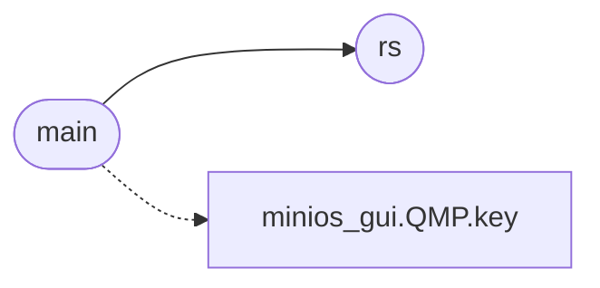

# `tools.gdb_repro`

> Source: [tools/gdb_repro.py:1](../../tools/gdb_repro.py#L1) | language `py` | coverage 33.3% | [API index](../index.md)

gdb_repro.py — drive a graphics-program sequence under the GDB stub.

Boots MiniOS with the gdb server (-s), a QMP socket for keyboard/mouse
injection and a pty serial console, attaches gdb with a conditional
breakpoint on the page-fault handler (isr_dispatch, vector 14), then drives
a sequence of graphics programs. When a page fault fires, gdb dumps the trap
frame (rip/rsp/cr2 = faulting address = FS base + offset) and exits.

## Contents

- **Functions:** [`rs`](#rs), [`main`](#main)

## Call Graph

Solid arrows stay in this module, dashed arrows leave it.



## Functions

<a id="rs"></a>

### `rs`

`function` | [tools/gdb_repro.py:23](../../tools/gdb_repro.py#L23)

```python
def rs(m, t=0.8)
```

**Parameters**

| Name | Type | Default | Description |
|---|---|---|---|
| `m` |  |  |  |
| `t` |  | `0.8` |  |

*Called by:* [`main`](#main)

---

<a id="main"></a>

### `main`

`function` | [tools/gdb_repro.py:27](../../tools/gdb_repro.py#L27)

```python
def main()
```

*Calls:* [`rs`](#rs), [`QMP.key`](tools.minios_gui.py.md#qmp-key)

---
