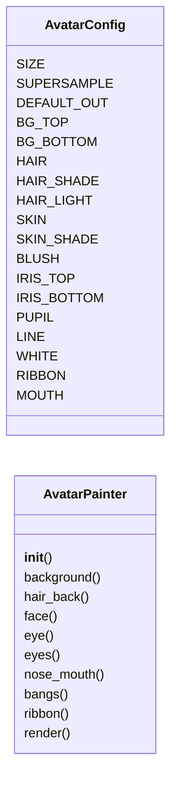
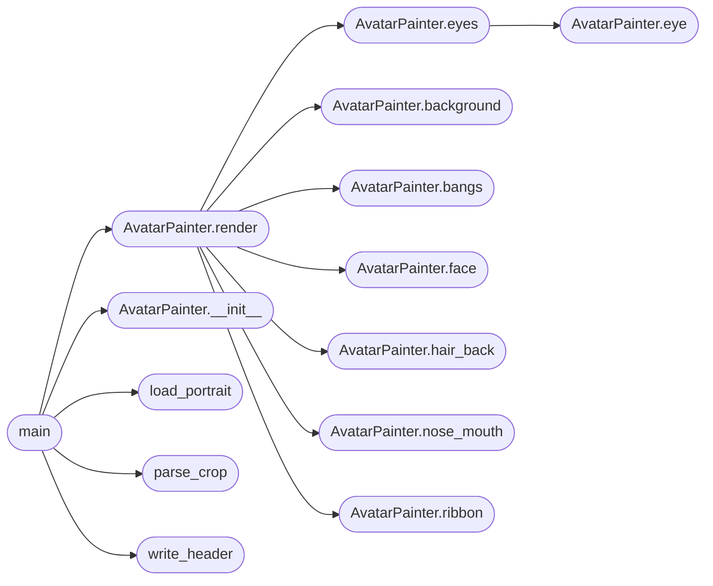

# `tools.gen_avatar`

> Source: [tools/gen_avatar.py:1](../../tools/gen_avatar.py#L1) | language `py` | coverage 41.2% | [API index](../index.md)

Generate the desktop profile avatar as a C header.

Purpose
    Draws a stylized anime-style portrait with vector primitives at a high
    supersampling factor, downsamples it with a Lanczos filter and writes
    the pixels as a packed 0x00RRGGBB array that the kernel blits inside a
    circular mask (headers/avatar_data.h). The artwork is procedural, so the
    repository ships no third-party image and the portrait can be tuned by
    editing AvatarConfig.

Usage
    python3 tools/gen_avatar.py [--out headers/avatar_data.h] [--preview png]

Inputs
    None. All tunables live in AvatarConfig.

Outputs
    A header defining AVATAR_SIZE and the avatar_pixels array, and with
    --preview a PNG of the same pixels for review.

Failure modes
    Missing Pillow aborts with a clear message; an unwritable output path
    aborts with the OS error. The output is written atomically through a
    temporary file in the same directory, never left half written.

## Contents

- **Classes:** [`AvatarConfig`](#avatarconfig), [`AvatarPainter`](#avatarpainter)
- **Functions:** [`load_portrait`](#load_portrait), [`parse_crop`](#parse_crop), [`write_header`](#write_header), [`main`](#main)

## Type Diagram



## Call Graph

Solid arrows stay in this module, dashed arrows leave it.



## Classes

<a id="avatarconfig"></a>

### `AvatarConfig`

`class` | [tools/gen_avatar.py:38](../../tools/gen_avatar.py#L38)

```python
class AvatarConfig
```

Central, immutable tunables for the portrait.

**Attributes**

| Name | Type | Default | Description |
|---|---|---|---|
| [`SIZE`](#avatarconfig-size) |  | `48` |  |
| [`SUPERSAMPLE`](#avatarconfig-supersample) |  | `8` |  |
| [`DEFAULT_OUT`](#avatarconfig-default_out) |  | `os.path.join('headers', 'avatar_data.h')` |  |
| [`BG_TOP`](#avatarconfig-bg_top) |  | `(255, 214, 236)` |  |
| [`BG_BOTTOM`](#avatarconfig-bg_bottom) |  | `(150, 170, 255)` |  |
| [`HAIR`](#avatarconfig-hair) |  | `(146, 108, 222)` |  |
| [`HAIR_SHADE`](#avatarconfig-hair_shade) |  | `(104, 72, 186)` |  |
| [`HAIR_LIGHT`](#avatarconfig-hair_light) |  | `(190, 156, 250)` |  |
| [`SKIN`](#avatarconfig-skin) |  | `(255, 228, 212)` |  |
| [`SKIN_SHADE`](#avatarconfig-skin_shade) |  | `(246, 196, 180)` |  |
| [`BLUSH`](#avatarconfig-blush) |  | `(255, 150, 170)` |  |
| [`IRIS_TOP`](#avatarconfig-iris_top) |  | `(60, 110, 230)` |  |
| [`IRIS_BOTTOM`](#avatarconfig-iris_bottom) |  | `(130, 220, 255)` |  |
| [`PUPIL`](#avatarconfig-pupil) |  | `(28, 32, 80)` |  |
| [`LINE`](#avatarconfig-line) |  | `(70, 40, 90)` |  |
| [`WHITE`](#avatarconfig-white) |  | `(255, 255, 255)` |  |
| [`RIBBON`](#avatarconfig-ribbon) |  | `(255, 90, 130)` |  |
| [`MOUTH`](#avatarconfig-mouth) |  | `(226, 100, 118)` |  |

---

<a id="avatarpainter"></a>

### `AvatarPainter`

`class` | [tools/gen_avatar.py:61](../../tools/gen_avatar.py#L61)

```python
class AvatarPainter
```

Paints the portrait on a square canvas in unit coordinates 0..1.

**Members**

| Member | Kind | Summary |
|---|---|---|
| [`__init__`](#avatarpainter-__init__) | constructor |  |
| [`background`](#avatarpainter-background) | method |  |
| [`hair_back`](#avatarpainter-hair_back) | method |  |
| [`face`](#avatarpainter-face) | method |  |
| [`eye`](#avatarpainter-eye) | method |  |
| [`eyes`](#avatarpainter-eyes) | method |  |
| [`nose_mouth`](#avatarpainter-nose_mouth) | method |  |
| [`bangs`](#avatarpainter-bangs) | method |  |
| [`ribbon`](#avatarpainter-ribbon) | method |  |
| [`render`](#avatarpainter-render) | method |  |

<a id="avatarpainter-__init__"></a>

#### `AvatarPainter.__init__`

`constructor` | [tools/gen_avatar.py:64](../../tools/gen_avatar.py#L64)

```python
def __init__(self, cfg)
```

**Parameters**

| Name | Type | Default | Description |
|---|---|---|---|
| `cfg` |  |  |  |

*Called by:* [`main`](#main)

<a id="avatarpainter-background"></a>

#### `AvatarPainter.background`

`method` | [tools/gen_avatar.py:83](../../tools/gen_avatar.py#L83)

```python
def background(self)
```

*Called by:* [`AvatarPainter.render`](#avatarpainter-render)

<a id="avatarpainter-hair_back"></a>

#### `AvatarPainter.hair_back`

`method` | [tools/gen_avatar.py:86](../../tools/gen_avatar.py#L86)

```python
def hair_back(self)
```

*Called by:* [`AvatarPainter.render`](#avatarpainter-render)

<a id="avatarpainter-face"></a>

#### `AvatarPainter.face`

`method` | [tools/gen_avatar.py:96](../../tools/gen_avatar.py#L96)

```python
def face(self)
```

*Called by:* [`AvatarPainter.render`](#avatarpainter-render)

<a id="avatarpainter-eye"></a>

#### `AvatarPainter.eye`

`method` | [tools/gen_avatar.py:103](../../tools/gen_avatar.py#L103)

```python
def eye(self, cx, cy)
```

**Parameters**

| Name | Type | Default | Description |
|---|---|---|---|
| `cx` |  |  |  |
| `cy` |  |  |  |

*Called by:* [`AvatarPainter.eyes`](#avatarpainter-eyes)

<a id="avatarpainter-eyes"></a>

#### `AvatarPainter.eyes`

`method` | [tools/gen_avatar.py:123](../../tools/gen_avatar.py#L123)

```python
def eyes(self)
```

*Calls:* [`AvatarPainter.eye`](#avatarpainter-eye)

*Called by:* [`AvatarPainter.render`](#avatarpainter-render)

<a id="avatarpainter-nose_mouth"></a>

#### `AvatarPainter.nose_mouth`

`method` | [tools/gen_avatar.py:127](../../tools/gen_avatar.py#L127)

```python
def nose_mouth(self)
```

*Called by:* [`AvatarPainter.render`](#avatarpainter-render)

<a id="avatarpainter-bangs"></a>

#### `AvatarPainter.bangs`

`method` | [tools/gen_avatar.py:134](../../tools/gen_avatar.py#L134)

```python
def bangs(self)
```

*Called by:* [`AvatarPainter.render`](#avatarpainter-render)

<a id="avatarpainter-ribbon"></a>

#### `AvatarPainter.ribbon`

`method` | [tools/gen_avatar.py:149](../../tools/gen_avatar.py#L149)

```python
def ribbon(self)
```

*Called by:* [`AvatarPainter.render`](#avatarpainter-render)

<a id="avatarpainter-render"></a>

#### `AvatarPainter.render`

`method` | [tools/gen_avatar.py:157](../../tools/gen_avatar.py#L157)

```python
def render(self)
```

*Calls:* [`AvatarPainter.background`](#avatarpainter-background), [`AvatarPainter.bangs`](#avatarpainter-bangs), [`AvatarPainter.eyes`](#avatarpainter-eyes), [`AvatarPainter.face`](#avatarpainter-face), [`AvatarPainter.hair_back`](#avatarpainter-hair_back), [`AvatarPainter.nose_mouth`](#avatarpainter-nose_mouth), [`AvatarPainter.ribbon`](#avatarpainter-ribbon)

*Called by:* [`main`](#main)

---

## Functions

<a id="load_portrait"></a>

### `load_portrait`

`function` | [tools/gen_avatar.py:169](../../tools/gen_avatar.py#L169)

```python
def load_portrait(path, crop)
```

Crop the square face region of a picture and downsample it.

**Parameters**

| Name | Type | Default | Description |
|---|---|---|---|
| `path` |  |  |  |
| `crop` |  |  |  |

*Called by:* [`main`](#main)

---

<a id="parse_crop"></a>

### `parse_crop`

`function` | [tools/gen_avatar.py:180](../../tools/gen_avatar.py#L180)

```python
def parse_crop(text)
```

Parse 'X,Y,SIZE' into three integers or abort with a clear message.

**Parameters**

| Name | Type | Default | Description |
|---|---|---|---|
| `text` |  |  |  |

*Called by:* [`main`](#main)

---

<a id="write_header"></a>

### `write_header`

`function` | [tools/gen_avatar.py:191](../../tools/gen_avatar.py#L191)

```python
def write_header(image, path)
```

Write the avatar as a C header, atomically.

**Parameters**

| Name | Type | Default | Description |
|---|---|---|---|
| `image` |  |  |  |
| `path` |  |  |  |

*Called by:* [`main`](#main)

---

<a id="main"></a>

### `main`

`function` | [tools/gen_avatar.py:225](../../tools/gen_avatar.py#L225)

```python
def main(argv=None)
```

Entry point: render, write the header, optionally a preview PNG.

**Parameters**

| Name | Type | Default | Description |
|---|---|---|---|
| `argv` |  | `None` |  |

*Calls:* [`AvatarPainter.__init__`](#avatarpainter-__init__), [`AvatarPainter.render`](#avatarpainter-render), [`load_portrait`](#load_portrait), [`parse_crop`](#parse_crop), [`write_header`](#write_header)

---
