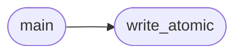

# `tools.gen_desktop_pngs`

> Source: [tools/gen_desktop_pngs.py:1](../../tools/gen_desktop_pngs.py#L1) | language `py` | coverage 33.3% | [API index](../index.md)

gen_desktop_pngs.py -- build MiniOS desktop art from user-supplied PNGs.

Sources (images/ by default, overridable with --src-dir):
  paint.png              paint icon source
  cgoblin.png            wallpaper source (any size, RGB/RGBA)
  doom.png               DOOM icon source
  doomedit.png           doomedit map-editor icon source
  quake2.png             Quake 2 icon source
  piano.png              piano icon source
  nuklear.png            Nuklear icon source
  vedit.png              vedit editor icon source
  pokemon.png            Pokemon icon source (Pikachu art, not pixel art)
  freedom.png            FreeDom browser icon source

Outputs (under the MiniOS repo):
  progs/icons/doom.png, doomedit.png, quake2.png, piano.png, nuklear.png,
  vedit.png, pokemon.png, file.png, shell.png, paint.png, minicraft.png,
  freedom.png, folder.png, files.png, image.png, object.png  32x32 RGBA
  (folder/files/image/object are the file-browser kind icons).
  progs/wall/wallpaper.png                                   800x600 RGB

The kernel runs in an 8-bit palette mode, so it maps icon pixels to the
16-entry icon palette and wallpaper pixels to a fixed 6x6x6 colour cube
at boot; these files only need the right dimensions. Icons keep alpha
(the kernel treats fully transparent pixels as transparent). The
wallpaper is cover-scaled (aspect-preserving fill + centre crop) so a
square source like cgoblin.png never looks stretched.

Fail-closed: a missing source aborts with a diagnostic and nonzero exit
before anything is written; each output is written atomically (tmp +
rename), never a partial file.

Usage:
  python3 tools/gen_desktop_pngs.py [--src-dir DIR] [--repo DIR]

## Contents

- **Functions:** [`write_atomic`](#write_atomic), [`main`](#main)
- **Constants:** [`ICON_SIZE`](#icon_size), [`ICON_JOBS`](#icon_jobs)

## Call Graph

Solid arrows stay in this module, dashed arrows leave it.



## Functions

<a id="write_atomic"></a>

### `write_atomic`

`function` | [tools/gen_desktop_pngs.py:71](../../tools/gen_desktop_pngs.py#L71)

```python
def write_atomic(img, path, **save_kw)
```

**Parameters**

| Name | Type | Default | Description |
|---|---|---|---|
| `img` |  |  |  |
| `path` |  |  |  |
| `**save_kw` |  |  |  |

*Called by:* [`main`](#main)

---

<a id="main"></a>

### `main`

`function` | [tools/gen_desktop_pngs.py:77](../../tools/gen_desktop_pngs.py#L77)

```python
def main()
```

*Calls:* [`write_atomic`](#write_atomic)

---

## Constants

<a id="icon_size"></a>

### `ICON_SIZE`

`constant` | [tools/gen_desktop_pngs.py:48](../../tools/gen_desktop_pngs.py#L48)

```python
ICON_SIZE = 32
```

---

<a id="icon_jobs"></a>

### `ICON_JOBS`

`constant` | [tools/gen_desktop_pngs.py:51](../../tools/gen_desktop_pngs.py#L51)

```python
ICON_JOBS
```

---
